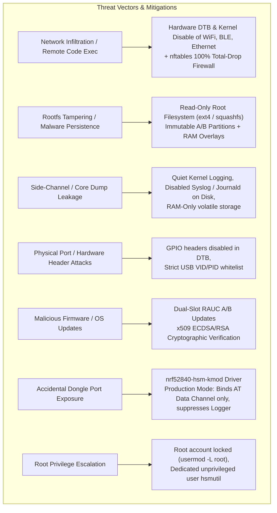
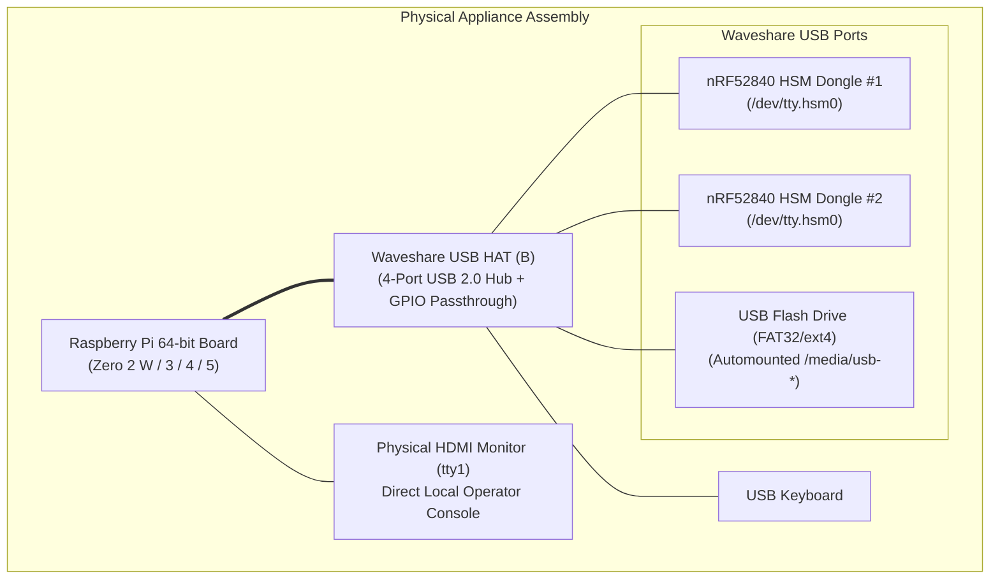
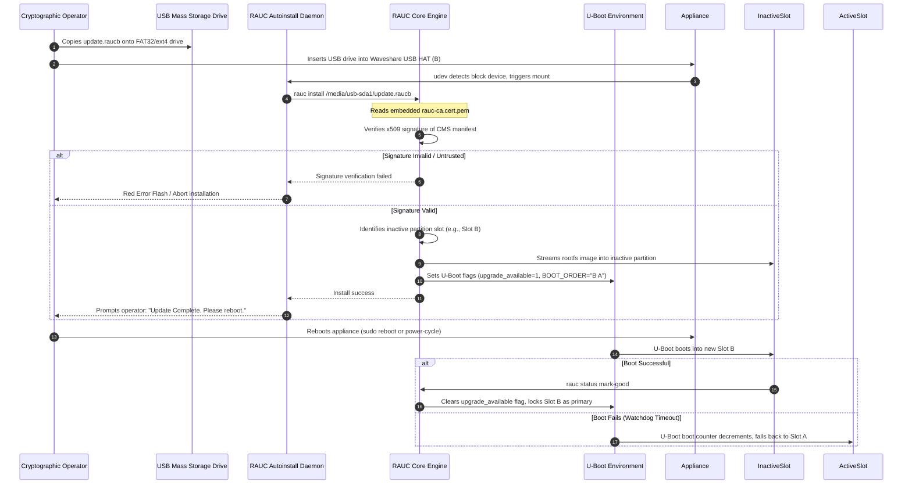

# Air-Gapped RPi HSM OS Architecture

The **`rpi-z2w-yocto-hsm`** sub-repository provides an ultra-hardened, air-gapped, 64-bit embedded Linux operating system built with the **Yocto Project 6.1 (`blacksail`)**, **BitBake 2.20**, and **Linux Kernel 6.12+**. It transforms a Raspberry Pi appliance into a dedicated cryptographic workstation for the nRF52840 HSM Dongle (`PCA10059`), ensuring absolute physical and network isolation during root key generation, key ceremony signing, firmware provisioning, and PKCS#11 operations.

---

## 1. System Purpose & Threat Model

### 1.1 Purpose
Standard host operating systems (macOS, Windows, general Linux distributions) present significant attack surfaces: active network interfaces, background background daemons, persistent log retention, telemetry agents, writable root filesystems, and unconstrained peripheral buses. 

`rpi-z2w-yocto-hsm` delivers a purpose-built, minimal appliance image that enforces the principle of least privilege, strict physical air-gapping, and non-volatile immutability.

### 1.2 Threat Model & Security Invariants



The system establishes seven foundational security invariants:

1. **Total Physical Air-Gap**: WiFi, Bluetooth, and Ethernet controller drivers are stripped from the kernel defconfig and hardware pins are disabled in the device tree overlay. Even if network hardware is physically present, the OS kernel possesses no drivers or peripheral clocks to activate them.
2. **Total Packet Drop (`nftables`)**: An unconditional `nftables` policy drops 100% of inbound, outbound, and forwarded traffic. In the event a rogue USB network adapter is attached, all network traffic is discarded at the netfilter ingress layer.
3. **Immutable Read-Only Filesystem & Volatile Overlays**: The active OS runs from a read-only rootfs (`ext4` or `squashfs`). No persistent modifications to system binaries, configurations, or libraries survive a reboot. Volatile operational state resides strictly in RAM (`tmpfs` mounts for `/media` and `/home/hsmutil`, and `overlayfs` on `/etc` backed by `/run`).
4. **Zero SSH / Remote Access**: SSH daemons (`dropbear`, `openssh-server`), Telnet, and remote terminal services are completely excluded from the package manifest. Console access is restricted exclusively to the physical HDMI display (`tty1`) with forced hotplug support.
5. **Deterministic Cryptographic Channel Binding**: Out-of-tree kernel driver `nrf52840-hsm-kmod` detects nRF52840 dongles (`0x1209:0x0001`), creates deterministic `/dev/tty.hsm<ble_address><num>` nodes, and in production mode strictly binds the AT command channel (`cdc_acm_uart1`) while completely suppressing the debug logging port (`cdc_acm_uart0`). The default `cdc_acm` driver is blacklisted.
6. **Zero Log Retention**: In production mode, systemd journald is configured with `Storage=none` and forwards to syslog/kmsg/console are disabled, preventing forensic data recovery from RAM or flash.
7. **Strict Superuser Lockdown**: In production images, the `root` superuser account is explicitly locked (`usermod -L root`). Operators execute operations through the unprivileged `hsmutil` user account, utilizing setuid root helpers (`hsm-set-date`) only for strictly scoped operations.

---

## 2. Hardware Topology & Platform Support

The operating system targets 64-bit ARM (`aarch64`) Raspberry Pi platforms equipped with the **Waveshare USB HAT (B)** to expand USB host ports for multiple HSM dongles and offline mass storage devices.



### Supported Hardware Targets
- **Primary / Reference Target**: `raspberrypi0-2w-64` (Raspberry Pi Zero 2 W, BCM2710A1, 512 MB LPDDR2). Minimal power draw and ultra-compact form factor.
- **Performance Targets**: `raspberrypi3-64`, `raspberrypi4-64`, `raspberrypi5`. Supported through Kas build overrides for faster cryptographic batch operations and desktop ergonomics.
- **Hardware Integration Details**: See [[Hardware/Waveshare USB HAT (B) Integration|Waveshare USB HAT (B) Integration Specification]].

---

## 3. Yocto Layer Structure (`meta-hsm-os`)

The custom layer [`meta-hsm-os/`](file:///Users/gpfister/Development/Projects/gpfister/nrf52840-hsm/rpi-z2w-yocto-hsm/meta-hsm-os) contains all recipes, configuration fragments, services, and kernel modules required for the air-gapped system.

```text
meta-hsm-os/
├── conf/
│   └── layer.conf                          # Layer configuration (Blacksail 6.1 compatibility)
├── classes/
│   └── rauc-integration.bbclass           # Internalized Raspberry Pi RAUC A/B integration
├── recipes-bsp/
│   ├── bootfiles/
│   │   ├── rpi-cmdline.bbappend            # Boot visibility cmdline (dual console dev vs quiet prod)
│   │   └── rpi-config_%.bbappend          # config.txt: dwc2 host mode, hdmi force hotplug, no wifi/bt
│   ├── rpi-u-boot-scr/
│   │   ├── files/boot.cmd.in               # Dual-slot A/B U-Boot boot script template
│   │   └── rpi-u-boot-scr.bbappend         # Generates boot.scr with RAUC fallback logic & prod silence
│   └── u-boot/
│       ├── files/silent-boot.cfg           # Hardened non-interactive silent boot (CONFIG_BOOTDELAY=-2)
│       ├── files/squashfs.cfg              # SquashFS support Kconfig fragment
│       └── u-boot_%.bbappend               # Injects modular Kconfig fragments conditionally
├── recipes-connectivity/
│   └── nftables/
│       ├── files/nftables.conf             # 100% total-drop ingress/egress/forward firewall rules
│       ├── files/nftables-load.service     # Systemd boot service loading nftables rules
│       └── nftables-rules.bb               # Rules installation recipe
├── recipes-core/
│   ├── base-files/
│   │   ├── files/fstab                     # Persistent /data partition mount (/dev/mmcblk0p4)
│   │   └── base-files_%.bbappend           # Injects custom fstab
│   ├── images/
│   │   ├── hsm-image-base.bb               # Base image definition (read-only-rootfs, libpwquality)
│   │   ├── hsm-image-dev.bb                # Dev image (root login, sudo, allow-root-login, strace)
│   │   └── hsm-image-prod.bb               # Prod image (locked root, quiet kernel, strict lockdown)
│   ├── init-wizard/
│   │   ├── files/first-login-wizard.sh     # Interactive first-login setup (pwd pre-check, loadkeys)
│   │   ├── files/clock-setup.sh            # Interactive every-login UTC timestamp synchronization
│   │   ├── files/hsm-set-date.c            # Setuid root C helper for unprivileged date updates
│   │   ├── files/hsm-profile.sh            # /etc/profile.d/hsm-login.sh shell hook
│   │   └── init-wizard.bb                  # Init wizard packaging recipe
│   ├── systemd-journald-airgap/
│   │   ├── files/journald-dev.conf         # Storage=volatile (64M RAM buffer)
│   │   ├── files/journald-prod.conf        # Storage=none (zero log retention)
│   │   └── systemd-journald-airgap.bb      # Journald drop-in configuration recipe
│   ├── udev/
│   │   ├── files/raspberrypi-rauc.rules    # Custom RAUC rootfs symlink rules
│   │   └── udev-extraconf_%.bbappend       # Injects RAUC udev rules
│   ├── users/
│   │   └── hsmutil-user.bb                 # Creates hsmutil account (default: password), groups, dev sudoers
│   └── volatile-storage/
│       ├── files/hsm-setup-volatile.sh     # Mounts /media tmpfs, /etc overlayfs, /home/hsmutil tmpfs
│       ├── files/hsm-volatile-storage.service # Early boot service running setup script
│       └── volatile-storage.bb             # Volatile storage unit recipe
├── recipes-extended/
│   ├── libpwquality/
│   │   ├── files/common-password           # PAM common-password with pam_pwquality.so enforcement
│   │   ├── files/pwquality.conf            # Complexity rules (minlen=10, credits, maxrepeat, maxsequence)
│   │   └── libpwquality_%.bbappend         # Installs PAM configuration and security parameters
│   ├── pam/
│   │   └── libpam_%.bbappend               # PAM subsystem tuning
│   ├── shadow/
│   │   ├── shadow_%.bbappend               # Enforces PASS_MAX_DAYS 90 in target /etc/login.defs
│   │   └── shadow-sysroot_%.bbappend       # Enforces PASS_MAX_DAYS 90 in sysroot /etc/login.defs
│   └── sudo/
│       └── sudo_%.bbappend                 # Sudoers configuration for dev image
├── recipes-kernel/
│   ├── linux/
│   │   ├── files/hardened.cfg              # Kernel defconfig fragment (no net, security hardening)
│   │   ├── files/rauc.cfg                  # RAUC kernel support (loop, squashfs)
│   │   └── linux-raspberrypi_%.bbappend    # Kernel append injecting hardened.cfg and rauc.cfg
│   └── nrf52840-hsm-kmod/
│       ├── files/nrf52840_hsm.c            # Out-of-tree kernel driver for USB 0x1209:0x0001 (6.12+ llseek)
│       ├── files/blacklist-cdc-acm.conf    # Modprobe blacklist preventing cdc_acm driver binding
│       ├── files/99-nrf52840-hsm.rules     # Udev rules for /dev/tty.hsm* permissions & symlink
│       ├── files/Makefile                  # Kernel module build Makefile
│       └── nrf52840-hsm-kmod.bb            # Kernel module bitbake recipe (${UNPACKDIR} migration)
├── recipes-rauc/
│   └── bundles/
│       └── update-bundle.bb                # RAUC update bundle recipe (.raucb)
├── recipes-support/
│   ├── hsmutil/
│   │   ├── files/hsmutil-arm64             # Pre-compiled Go 1.24+ ARM64 binary
│   │   └── hsmutil.bb                      # Installs binary to /usr/local/bin/hsmutil
│   ├── rauc/
│   │   ├── files/rauc-ca.cert.pem          # Embedded Root CA public certificate
│   │   ├── files/system.conf               # RAUC slot configuration (A/B mmcblk0p2/p3)
│   │   ├── files/rauc-usb-autoinstall.sh   # Background script checking USB for .raucb bundles
│   │   ├── files/rauc-usb-autoinstall.service # Systemd service for USB auto-update
│   │   └── rauc_%.bbappend                 # Injects config, certificate, and services
│   └── usb-mount/
│       ├── files/usb-mount.sh              # Auto-mount script for FAT32/ext4 USB storage
│       ├── files/usb-mount@.service        # Instantiated systemd service for udev mounts
│       ├── files/99-usb-storage-mount.rules# Udev rule triggering usb-mount@.service
│       └── usb-mount.bb                    # Packaging recipe for automount infrastructure
└── wic/
    └── sdimage-dual-raspberrypi.wks.in     # Dual-slot A/B partition layout definition
```

---

## 4. Operating System Runtime Architecture

```mermaid
flowchart TD
    subgraph Bootloader ["Boot & Update Stage"]
        ROM["Broadcom VideoCore Boot ROM"]
        UBOOT["U-Boot Dual-Slot Bootloader (rpi-u-boot-scr)\nDev: Interactive console & RAUC echo\nProd: Silent bootloader (CONFIG_BOOTDELAY=-2, silent=1)"]
        SLOT_A["Slot A: /dev/mmcblk0p2 (RO ext4)"]
        SLOT_B["Slot B: /dev/mmcblk0p3 (RO ext4)"]
        ENV["U-Boot Environment (bootcount, upgrade_available)"]
        
        ROM --> UBOOT
        UBOOT <--> ENV
        UBOOT -. Boots Active Slot .-> SLOT_A
        UBOOT -. Boots Active Slot .-> SLOT_B
    end

    subgraph KernelSpace ["Linux Kernel 6.12+ (Hardened)"]
        KCONFIG["Hardened Defconfig (No Net, No BT, No WiFi)"]
        DTB["Device Tree Overlays (dwc2 host, no-wifi, no-bt)"]
        KMOD["nrf52840-hsm-kmod (Out-of-tree Driver, Linux 6.12+ llseek compat)"]
        NFT["nftables Total Drop Hook"]
        CMDLINE["Kernel Boot Console Multiplexing\nDev: console=serial0,115200 console=tty1 loglevel=7 debug earlyprintk\nProd: quiet loglevel=0 console=tty1 fsck.mode=skip"]
        
        KMOD --> DEV_NODES["/dev/tty.hsm<ble_address><number>"]
        DEV_NODES --> SYMLINK["/dev/tty.hsm (Symlink)"]
    end

    subgraph UserSpace ["User Space (Read-Only Rootfs + RAM Overlays)"]
        VOLATILE["volatile-storage.service\n(/media tmpfs, /etc overlayfs, /home tmpfs)"]
        INIT["System Init & Login Service"]
        WIZARD["Mandatory Login Wizard\nInitial PWD 'password'\nPre-checks 6 complexity rules\nloadkeys layout selection\nUTC timezone standard"]
        PAM["PAM & Security Subsystem\npam_pwquality.so complexity rules\nPASS_MAX_DAYS=90 password aging"]
        DATE_PROMPT["Login Clock Prompt (UTC Date Synchronization via setuid hsm-set-date)"]
        AUTOMOUNT["Automount Manager (usb-mount.sh -> /media/usb-*)"]
        RAUC_SRV["RAUC Update Service (rauc-usb-autoinstall)"]
        HSMUTIL["/usr/local/bin/hsmutil (CLI / TUI)"]
        
        VOLATILE --> INIT
        INIT --> WIZARD
        WIZARD <--> PAM
        WIZARD --> DATE_PROMPT
        DATE_PROMPT --> HSMUTIL
        AUTOMOUNT --> HSMUTIL
        AUTOMOUNT -. Detects .raucb .-> RAUC_SRV
        RAUC_SRV --> UBOOT
        SYMLINK --> HSMUTIL
    end

    SLOT_A --> KernelSpace
    SLOT_B --> KernelSpace
    KernelSpace --> UserSpace
```

### 4.1 Partition Layout (Dual-Slot A/B)
The storage media (MicroSD / eMMC) is partitioned into 5 regions:

| Partition | Device | Filesystem | Mount Point | Description |
| :--- | :--- | :--- | :--- | :--- |
| **P1** | `/dev/mmcblk0p1` | `vfat` | `/boot` | Raspberry Pi firmware files, U-Boot binary, kernel images, and device trees. |
| **P2** | `/dev/mmcblk0p2` | `ext4` | `/` (Slot A) | Read-only System Rootfs Slot A. |
| **P3** | `/dev/mmcblk0p3` | `ext4` | `/` (Slot B) | Read-only System Rootfs Slot B. |
| **P4** | `/dev/mmcblk0p4` | `ext4` | `/data` | Persistent writable state (user home `/home/hsmutil`, machine-id, u-boot env). |
| **RAM** | `tmpfs` | `tmpfs` | `/tmp`, `/run`, `/var/volatile`, `/media` | Volatile working memory discarded on power off. |

---

## 5. Security & Subsystem Implementation Details

### 5.1 Kernel Hardening & Network Elimination
Configured via [`meta-hsm-os/recipes-kernel/linux/files/hardened.cfg`](file:///Users/gpfister/Development/Projects/gpfister/nrf52840-hsm/rpi-z2w-yocto-hsm/meta-hsm-os/recipes-kernel/linux/files/hardened.cfg):
- **Wireless Drivers Stripped**: `CONFIG_WIRELESS`, `CONFIG_CFG80211`, `CONFIG_MAC80211`, `CONFIG_BT`, `CONFIG_WLAN`, `CONFIG_RFKILL` are entirely unset.
- **Wired Network Drivers Stripped**: `CONFIG_NET_ETHERNET`, `CONFIG_USB_NET_DRIVERS`, `CONFIG_USB_USBNET`, `CONFIG_USB_NET_SMSC95XX`, `CONFIG_USB_NET_LAN78XX`, `CONFIG_USB_RTL8152` are disabled.
- **Memory Hardening**: `CONFIG_SECURITY=y`, `CONFIG_HARDENED_USERCOPY=y`, `CONFIG_FORTIFY_SOURCE=y`, `CONFIG_STRICT_KERNEL_RWX=y`, `CONFIG_STRICT_MODULE_RWX=y`, `CONFIG_RANDOMIZE_BASE=y`.
- **GPIO Sysfs Disabled**: `CONFIG_GPIO_SYSFS` is unset to prevent userspace manipulation of raw microcontroller pins.

### 5.2 Packet Filter (`nftables`)
Configured via [`meta-hsm-os/recipes-connectivity/nftables/files/nftables.conf`](file:///Users/gpfister/Development/Projects/gpfister/nrf52840-hsm/rpi-z2w-yocto-hsm/meta-hsm-os/recipes-connectivity/nftables/files/nftables.conf):
- Flushes rulesets on boot and establishes default `policy drop` across input, forward, and output hooks on the `inet` family.
- Even if a malicious USB device attempts to emulate an Ethernet adapter, all frames are immediately discarded at the netfilter ingress hook.

### 5.3 Deterministic Hardware Driver (`nrf52840-hsm-kmod`)
The dedicated kernel module [`meta-hsm-os/recipes-kernel/nrf52840-hsm-kmod/files/nrf52840_hsm.c`](file:///Users/gpfister/Development/Projects/gpfister/nrf52840-hsm/rpi-z2w-yocto-hsm/meta-hsm-os/recipes-kernel/nrf52840-hsm-kmod/files/nrf52840_hsm.c):
1. **CDC-ACM Blacklist**: `blacklist cdc_acm` in [`blacklist-cdc-acm.conf`](file:///Users/gpfister/Development/Projects/gpfister/nrf52840-hsm/rpi-z2w-yocto-hsm/meta-hsm-os/recipes-kernel/nrf52840-hsm-kmod/files/blacklist-cdc-acm.conf) ensures the generic Linux ACM driver does not bind to the dongle.
2. **Deterministic Device Nodes**:
   - Matches USB VID `0x1209` and PID `0x0001`.
   - Reads the hardware BLE MAC address from `udev->serial`.
   - Synthesizes device node `/dev/tty.hsm<ble_address><port_index>`.
   - Udev rule creates convenience symlink `/dev/tty.hsm` pointing to primary device `/dev/tty.hsm*0`.
3. **Production Port Filtering**:
   - In **Production Mode** (`hsm_dev_mode=0`): Interfaces 0 and 1 (Zephyr debug logger console) are deliberately rejected during USB probe (`return -ENODEV`). Only Interfaces 2 and 3 (HSM AT crypto channel) are bound.
   - In **Development Mode** (`hsm_dev_mode=1`): Both debug console and AT channels are registered.
4. **Linux 6.12+ Compatibility & Recipe Modernization**:
   - `file_operations.llseek` assignment is guarded via `#if LINUX_VERSION_CODE < KERNEL_VERSION(6, 12, 0)` because Linux 6.12+ removed `noop_llseek` (defaulting `NULL` to `no_llseek`).
   - Recipe [`nrf52840-hsm-kmod.bb`](file:///Users/gpfister/Development/Projects/gpfister/nrf52840-hsm/rpi-z2w-yocto-hsm/meta-hsm-os/recipes-kernel/nrf52840-hsm-kmod/nrf52840-hsm-kmod.bb) migrated from legacy `${WORKDIR}` to `${UNPACKDIR}` per Yocto Project 6.1 (`blacksail`) standards.

### 5.4 Volatile Storage & RAM Overlays
Implemented via [`meta-hsm-os/recipes-core/volatile-storage/files/hsm-setup-volatile.sh`](file:///Users/gpfister/Development/Projects/gpfister/nrf52840-hsm/rpi-z2w-yocto-hsm/meta-hsm-os/recipes-core/volatile-storage/files/hsm-setup-volatile.sh):
1. **RAM Mount for `/media`**: Mounts `tmpfs` on `/media` to host USB partition mount points without modifying the underlying rootfs.
2. **RAM Overlayfs for `/etc`**: Mounts an `overlayfs` on `/etc` (`lowerdir=/etc,upperdir=/run/overlay/etc-upper,workdir=/run/overlay/etc-work`). This allows the operator to execute `passwd` to modify passwords in `/etc/shadow` in volatile RAM without mutating the immutable disk image.
3. **Ephemeral `/home/hsmutil`**: Mounts `tmpfs` with mode `0750` for user `hsmutil` and copies skeleton files from `/etc/skel`. Cryptographic working files are discarded when powered down.

### 5.5 Silent Journald Logging
Implemented via [`meta-hsm-os/recipes-core/systemd-journald-airgap/`](file:///Users/gpfister/Development/Projects/gpfister/nrf52840-hsm/rpi-z2w-yocto-hsm/meta-hsm-os/recipes-core/systemd-journald-airgap/):
- **Production (`journald-prod.conf`)**:
  ```ini
  [Journal]
  Storage=none
  ForwardToSyslog=no
  ForwardToKMsg=no
  ForwardToConsole=no
  ```
  Prevents memory exhaustion, disk wear, and sensitive cryptographic material leakage into system journals.
- **Development (`journald-dev.conf`)**:
  ```ini
  [Journal]
  Storage=volatile
  ForwardToSyslog=no
  ForwardToKMsg=no
  ForwardToConsole=no
  RuntimeMaxUse=64M
  ```

### 5.6 User Management, Authentication & Password Security Policy
Configured via [`recipes-core/users/hsmutil-user.bb`](file:///Users/gpfister/Development/Projects/gpfister/nrf52840-hsm/rpi-z2w-yocto-hsm/meta-hsm-os/recipes-core/users/hsmutil-user.bb), [`recipes-extended/shadow/`](file:///Users/gpfister/Development/Projects/gpfister/nrf52840-hsm/rpi-z2w-yocto-hsm/meta-hsm-os/recipes-extended/shadow/), [`recipes-extended/libpwquality/`](file:///Users/gpfister/Development/Projects/gpfister/nrf52840-hsm/rpi-z2w-yocto-hsm/meta-hsm-os/recipes-extended/libpwquality/), and [`recipes-core/init-wizard/`](file:///Users/gpfister/Development/Projects/gpfister/nrf52840-hsm/rpi-z2w-yocto-hsm/meta-hsm-os/recipes-core/init-wizard/):
- **User `hsmutil`**: Standard unprivileged operator belonging to `users`, `dialout`, `tty`, and `storage`. Initial default password set to `password` (SHA-512 crypt hash `$6$saltsalt$qFmFH.bQmmtXzyBY0s9v7Oicd2z4XSIecDzlB5KiA2/jctKu9YterLp8wwnSq.qc.eoxqOmSuNp2xS0ktL3nh/`).
- **Superuser Security**: In production (`hsm-image-prod.bb`), `extrausers` executes `usermod -L root;` locking the root password. In development (`hsm-image-dev.bb`), root password is set to `root`.
- **System-Wide PAM `pam_pwquality` Enforcement**:
  - Distro feature `pam` enabled in `kas-project.yml`.
  - `/etc/security/pwquality.conf` and `/etc/pam.d/common-password` enforce:
    - Minimum length 10 (`minlen = 10`)
    - At least 1 digit, 1 uppercase, 1 special char (`dcredit = -1`, `ucredit = -1`, `ocredit = -1`)
    - No adjacent repeated identical characters (`maxrepeat = 1`, rejects `aa`, `11`)
    - No monotonic 3-character sequences (`maxsequence = 2`, rejects `abc`, `123`, `cba`)
    - Strict enforcement for root (`enforce_for_root`)
- **90-Day Password Expiration Policy**:
  - `/etc/login.defs` sets `PASS_MAX_DAYS 90`.
  - `/etc/shadow` configures `hsmutil` with a maximum password age of `90` days (field 5).
- **First-Login Wizard (`first-login-wizard.sh`)**:
  - Triggers on console login via `/etc/profile.d/hsm-login.sh`.
  - Checks for marker file `~/.wizard_completed`.
  - Pre-validates password complexity with detailed rule violation feedback prior to invoking PAM.
  - Enforces mandatory password change for `hsmutil` on initial login.
  - Prompts operator to select physical keyboard layout (US, FR, DE, UK, fr_CH, sg) using `loadkeys` and persists selection to `~/.keymap`.
  - Exports standard UTC timezone (`export TZ=UTC`).
- **Login Clock Calibration (`clock-setup.sh` & `hsm-set-date.c`)**:
  - Raspberry Pi boards lack an onboard battery RTC, and NTP is impossible in an air-gapped environment.
  - On every login, prompts operator for current UTC timestamp (`YYYY-MM-DD HH:MM:SS`).
  - Calls setuid root helper `/usr/local/bin/hsm-set-date` (mode `4755`), which validates timestamp with `strptime`/`timegm` and calls `settimeofday()`.
  - Grants unprivileged `hsmutil` the ability to calibrate system time safely without sudo.

### 5.7 USB Mass Storage Automount & Auto-Update
Implemented in [`meta-hsm-os/recipes-support/usb-mount/`](file:///Users/gpfister/Development/Projects/gpfister/nrf52840-hsm/rpi-z2w-yocto-hsm/meta-hsm-os/recipes-support/usb-mount/):
- Udev detects partition insertions and instantiates `usb-mount@<dev>.service`.
- Mounts FAT32 or ext4 filesystem under `/media/usb-<devname>` with ownership `hsmutil:storage` and mode `0770`.
- **Automatic RAUC Ingestion**: If any `*.raucb` file is present in the root directory of the mounted drive, `usb-mount.sh` automatically launches `rauc-usb-autoinstall.service`.

### 5.8 Kernel Boot Console Multiplexing & U-Boot Bootloader Hardening
Configured via [`recipes-bsp/bootfiles/rpi-cmdline.bbappend`](file:///Users/gpfister/Development/Projects/gpfister/nrf52840-hsm/rpi-z2w-yocto-hsm/meta-hsm-os/recipes-bsp/bootfiles/rpi-cmdline.bbappend), [`recipes-bsp/u-boot/`](file:///Users/gpfister/Development/Projects/gpfister/nrf52840-hsm/rpi-z2w-yocto-hsm/meta-hsm-os/recipes-bsp/u-boot/), and [`recipes-bsp/rpi-u-boot-scr/`](file:///Users/gpfister/Development/Projects/gpfister/nrf52840-hsm/rpi-z2w-yocto-hsm/meta-hsm-os/recipes-bsp/rpi-u-boot-scr/):
1. **Kernel Boot Console Multiplexing**:
   - `meta-raspberrypi` builds `/boot/cmdline.txt` purely from `CMDLINE` variables, ignoring BitBake `APPEND`.
   - `rpi-cmdline.bbappend` specializes `CMDLINE` based on `HSM_DEV_MODE`:
     - **Development (`HSM_DEV_MODE="1"`)**: `CMDLINE_DEV = "console=serial0,115200 console=tty1 loglevel=7 debug earlyprintk"`. Kernel `printk` broadcasts to both the physical HDMI monitor (`tty1`) and UART serial console (`serial0`), attaching `/dev/console` to the foreground monitor (`tty1`).
     - **Production (`HSM_DEV_MODE="0"`)**: `CMDLINE_PROD = "quiet loglevel=0 console=tty1 fsck.mode=skip"`. Suppresses UART output completely and silences HDMI boot logs.
2. **U-Boot Hardening & Non-Interactivity**:
   - Production images include [`silent-boot.cfg`](file:///Users/gpfister/Development/Projects/gpfister/nrf52840-hsm/rpi-z2w-yocto-hsm/meta-hsm-os/recipes-bsp/u-boot/files/silent-boot.cfg) via `u-boot_%.bbappend`: sets `CONFIG_BOOTDELAY=-2` (disabling autoboot abort window), `CONFIG_SILENT_CONSOLE=y`, `CONFIG_SYS_DEVICE_NULLDEV=y`, and `CONFIG_SILENT_U_BOOT_ONLY=y`.
   - In production, `rpi-u-boot-scr.bbappend` injects `setenv silent 1` and replaces verbose `echo` statements in `boot.cmd.in` with `#` comments, ensuring zero diagnostic emission over serial lines.
   - Development images retain `CONFIG_BOOTDELAY=2` and diagnostic RAUC slot echo messages.

### 5.9 Automated Security Configuration & Validator Verification
The repository provides standalone test suites in [`scripts/`](file:///Users/gpfister/Development/Projects/gpfister/nrf52840-hsm/rpi-z2w-yocto-hsm/scripts/):
1. **Password Complexity Validator Suite** ([`scripts/test-password-validator.sh`](file:///Users/gpfister/Development/Projects/gpfister/nrf52840-hsm/rpi-z2w-yocto-hsm/scripts/test-password-validator.sh)):
   - Evaluates 14 test cases covering minimum length, uppercase, digits, symbols, adjacent identical repetitions (`maxrepeat=1`), and monotonic sequential characters (`maxsequence=2`).
2. **Security Configuration Verifier** ([`scripts/verify-security-configs.sh`](file:///Users/gpfister/Development/Projects/gpfister/nrf52840-hsm/rpi-z2w-yocto-hsm/scripts/verify-security-configs.sh)):
   - Runs 19 automated assertions validating `kas-dev.yml`, `kas-prod.yml`, `kas-project.yml`, `rpi-cmdline.bbappend`, `silent-boot.cfg`, `squashfs.cfg`, `rpi-u-boot-scr.bbappend`, `hsmutil-user.bb`, `shadow_%.bbappend`, and `libpwquality_%.bbappend`.

---

## 6. Production vs Development Matrix

| Dimension | Specification | Production (`prod`) | Development (`dev`) |
| :--- | :--- | :--- | :--- |
| **Target Image** | BitBake Recipe | `hsm-image-prod` | `hsm-image-dev` |
| **Kas Overlay** | Configuration File | `kas-prod.yml` | `kas-dev.yml` |
| **Filesystem** | Root Filesystem Type | Strict read-only `ext4` / `squashfs` | Read-only `ext4` with writable `overlayfs` |
| **Volatile State** | RAM Overlays | `/media` tmpfs, `/etc` overlayfs, `/home` tmpfs | Same |
| **Networking** | Physical Drivers | WiFi, BLE, Ethernet stripped from kernel | Same (strict air-gap enforced) |
| **Firewall** | Packet Filter Rules | `nftables` total drop (0 packets allowed) | `nftables` total drop |
| **Superuser Access** | Root Account | Account locked (`usermod -L root`) | Password `root`, login permitted |
| **`hsmutil` User** | Escalation Privilege | Standard unprivileged operator, no `sudo` | Sudoer with `NOPASSWD: ALL` |
| **Clock Setup** | Timestamp Sync Helper | Setuid root `hsm-set-date` helper | Setuid `hsm-set-date` or `sudo date` |
| **Logging** | Syslog / Journald / Dmesg | Disabled (`Storage=none`, silent console) | Active in RAM (`Storage=volatile`, 64M) |
| **Dongle Port Binding** | Serial Node Exposure | Only AT command port `/dev/tty.hsm<ble>0` | Both AT command port and debug console |
| **U-Boot Interactivity** | Autoboot Wait & Abort | Non-interactive (`CONFIG_BOOTDELAY=-2`, abort disabled) | Interactive prompt (`CONFIG_BOOTDELAY=2`, abort enabled) |
| **U-Boot Console Output** | Bootloader Serial Output | Completely silent (`CONFIG_SILENT_CONSOLE=y`, `silent=1`) | Diagnostic banners & RAUC slot `echo` messages |
| **Kernel Log Visibility** | Early Boot Console Sinks | Silent monitor (`console=tty1 quiet loglevel=0 fsck.mode=skip`) | Multiplexed (`console=serial0,115200 console=tty1 loglevel=7 debug earlyprintk`) |
| **Password Policy** | Initial Password & Expiration | Initial `password`, `pam_pwquality` enforced, 90-day max age | Same (`password`, `pam_pwquality`, 90-day max age) |
| **Remote Terminal** | SSH (`sshd` / `dropbear`) | Completely absent | Completely absent |

---

## 7. Offline RAUC A/B Firmware Update Protocol

Updates are distributed exclusively as cryptographically signed `.raucb` bundles delivered via physical USB drives.



---

## 8. Subsystem Integration & Cross-References

- **Hardware Hub Integration**: [[Hardware/Waveshare USB HAT (B) Integration|Waveshare USB HAT (B) Integration Specification]]
- **Dongle Hardware**: [[Hardware/nRF52840 Dongle PCA10059|nRF52840 Dongle PCA10059 Specification]]
- **Dongle USB Interfaces**: [[Architecture/USB Composite Stack|USB Composite Stack Architecture]]
- **Dongle Serial Identification**: [[Architecture/Decisions/ADR-0001 - Hardware BLE Address for Deterministic USB Serial Number|ADR-0001: BLE Address Serial Number]]
- **Host Port Targeting**: [[Architecture/Decisions/ADR-0003 - Host Port Discovery and Serial Targeting Strategy|ADR-0003: Host Port Discovery]]
- **Disk Image `.img` Output Strategy**: [[Architecture/Decisions/ADR-0005 - Custom BitBake img Image Type via WIC Rename|ADR-0005: Custom BitBake img Image Type via WIC Rename]]
- **Yocto 6.1 Layer Decomposition**: [[Architecture/Decisions/ADR-0007 - Decompose Poky into openembedded-core meta-yocto and bitbake|ADR-0007: Decompose Poky into openembedded-core, meta-yocto and bitbake]]
- **Internalized RAUC A/B Integration**: [[Architecture/Decisions/ADR-0008 - Internalize RPi RAUC Integration into meta-hsm-os|ADR-0008: Internalize RPi RAUC Integration into meta-hsm-os]]
- **Kernel Driver llseek Guard & UNPACKDIR Migration**: [[Architecture/Decisions/ADR-0009 - Kernel Driver llseek Version Guard and UNPACKDIR Migration|ADR-0009: Kernel Driver llseek Version Guard and UNPACKDIR Migration]]
- **Kernel Boot Console Multiplexing**: [[Architecture/Decisions/ADR-0010 - Kernel Boot Console Multiplexing and Command Line Specialization|ADR-0010: Kernel Boot Console Multiplexing & Command Line Specialization]]
- **Silent Non-Interactive U-Boot Bootloader**: [[Architecture/Decisions/ADR-0011 - Silent Non-Interactive U-Boot Bootloader Hardening|ADR-0011: Silent Non-Interactive U-Boot Bootloader Hardening]]
- **PAM Password Complexity & Expiration Policy**: [[Architecture/Decisions/ADR-0012 - PAM pwquality Password Complexity and Expiration Policy|ADR-0012: PAM pwquality Password Complexity & Expiration Policy]]
- **Feature Specification**: [[features/yocto-boot-visibility-and-password-policy|Feature: Yocto Boot Visibility & Password Policy]]
- **Technical Specification**: [[Specification/Yocto Dev-Prod Boot Visibility, U-Boot Hardening, and Password Policy|Specification: Yocto Dev-Prod Boot Visibility, U-Boot Hardening, and Password Policy]]
- **Implementation Plan**: [[Plan/Yocto Dev-Prod Boot Visibility, U-Boot Hardening, and Password Policy Implementation Plan|Implementation Plan: Yocto Dev-Prod Boot Visibility, U-Boot Hardening, and Password Policy]]
- **Yocto 6.1 Upgrade Specification**: [[Specification/Yocto 6.1 Blacksail Upgrade|Specification: Yocto 6.1 Blacksail Upgrade]]
- **Yocto 6.1 Upgrade Plan**: [[Plan/Yocto 6.1 Blacksail Upgrade Implementation Plan|Implementation Plan: Yocto 6.1 Blacksail Upgrade]]
- **Operational Guide**: [[Development/Yocto Build and RAUC Update Guide|Yocto Build and RAUC Update Guide]]
- **Source Code**: [`rpi-z2w-yocto-hsm/`](file:///Users/gpfister/Development/Projects/gpfister/nrf52840-hsm/rpi-z2w-yocto-hsm)
