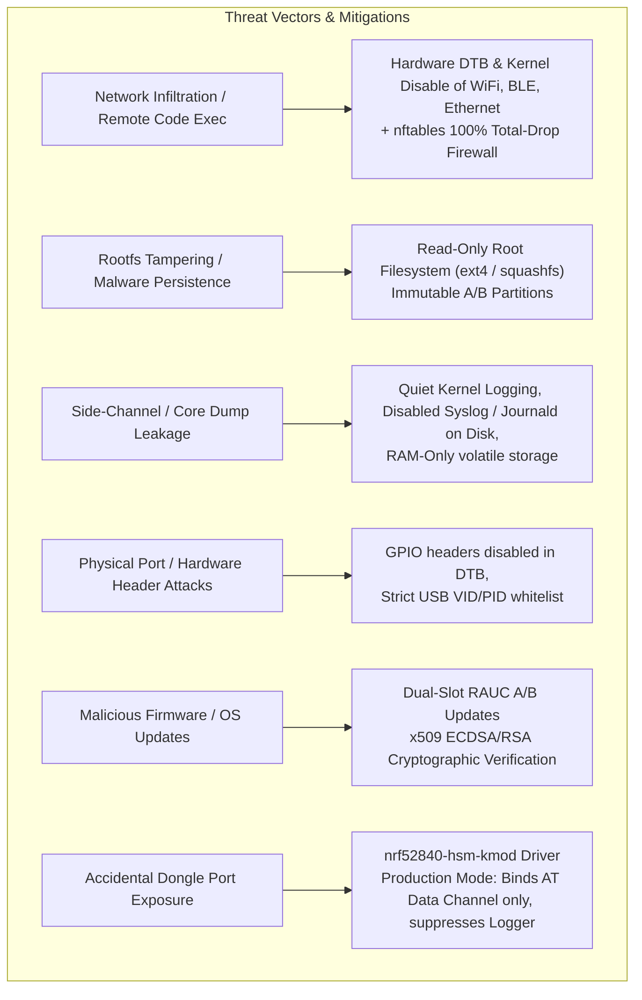
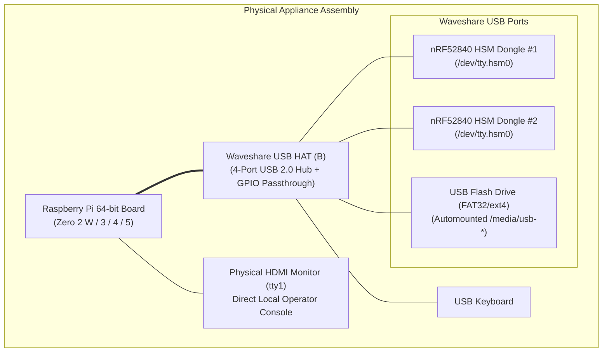
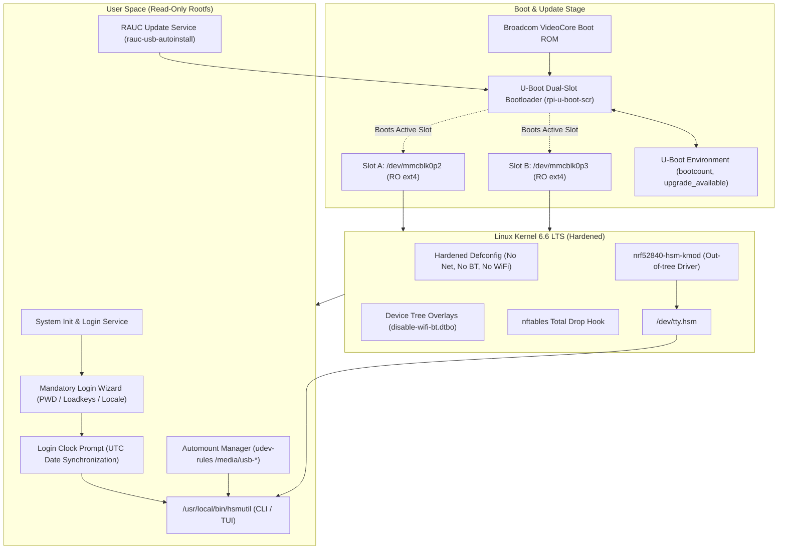
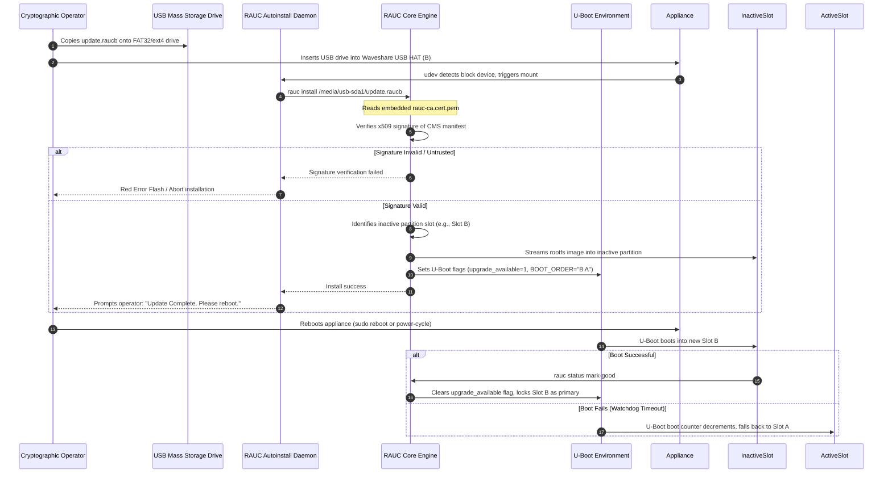

# Air-Gapped RPi HSM OS Architecture

The **`rpi-z2w-yocto-hsm`** sub-repository provides an ultra-hardened, air-gapped, 64-bit embedded Linux operating system built with the **Yocto Project 5.0 LTS (`scarthgap`)** and **Linux Kernel 6.6 LTS**. It transforms a Raspberry Pi appliance into a dedicated cryptographic workstation for the nRF52840 HSM Dongle (`PCA10059`), ensuring absolute physical and network isolation during root key generation, key ceremony signing, firmware provisioning, and PKCS#11 operations.

---

## 1. System Purpose & Threat Model

### 1.1 Purpose
Standard host operating systems (macOS, Windows, general Linux distributions) present significant attack surfaces: active network interfaces, background background daemons, persistent log retention, telemetry agents, writable root filesystems, and unconstrained peripheral buses. 

`rpi-z2w-yocto-hsm` delivers a purpose-built, minimal appliance image that enforces the principle of least privilege, strict physical air-gapping, and non-volatile immutability.

### 1.2 Threat Model & Security Invariants

The system establishes five foundational security invariants:

1. **Total Physical Air-Gap**: WiFi, Bluetooth, and Ethernet controller drivers are stripped from the kernel defconfig and hardware pins are disabled in the device tree overlay. Even if network hardware is physically present, the OS kernel possesses no drivers or peripheral clocks to activate them.
2. **Total Packet Drop (`nftables`)**: An unconditional `nftables` policy drops 100% of inbound, outbound, and forwarded traffic. In the event a rogue USB network adapter is attached, all network traffic is discarded at the netfilter ingress layer.
3. **Immutable Read-Only Filesystem**: The active OS runs from a read-only rootfs (`ext4` or `squashfs`). No persistent modifications to system binaries, configurations, or libraries can survive a reboot. Volatile operational state resides strictly in RAM (`tmpfs`).
4. **Zero SSH / Remote Access**: SSH daemons (`dropbear`, `openssh-server`), Telnet, and remote terminal services are completely excluded from the package manifest. Console access is restricted exclusively to the physical HDMI display (`tty1`) and optional dev UART.
5. **Deterministic Cryptographic Channel Binding**: Out-of-tree kernel driver `nrf52840-hsm-kmod` detects nRF52840 dongles (`0x1209:0x0001`), creates deterministic `/dev/tty.hsm<ble_address><num>` nodes, and in production mode strictly binds the AT command channel (`cdc_acm_uart1`) while completely suppressing the debug logging port (`cdc_acm_uart0`).

---

## 2. Hardware Topology & Platform Support

The operating system targets 64-bit ARM (`aarch64`) Raspberry Pi platforms equipped with the **Waveshare USB HAT (B)** to expand USB host ports for multiple HSM dongles and offline mass storage devices.

### Supported Hardware Targets
- **Primary / Reference Target**: `raspberrypi0-2w-64` (Raspberry Pi Zero 2 W, BCM2710A1, 512 MB LPDDR2). Minimal power draw and ultra-compact form factor.
- **Performance Targets**: `raspberrypi3-64`, `raspberrypi4-64`, `raspberrypi5`. Supported through Kas build overrides for faster cryptographic batch operations and desktop ergonomics.

---

## 3. Operating System Architecture & Stack

### 3.1 Partition Layout (Dual-Slot A/B)
The storage media (MicroSD / eMMC) is partitioned into 5 regions:

| Partition | Device | Filesystem | Mount Point | Description |
| :--- | :--- | :--- | :--- | :--- |
| **P1** | `/dev/mmcblk0p1` | `vfat` | `/boot` | Raspberry Pi firmware files, U-Boot binary, kernel images, and device trees. |
| **P2** | `/dev/mmcblk0p2` | `ext4` | `/` (Slot A) | Read-only System Rootfs Slot A. |
| **P3** | `/dev/mmcblk0p3` | `ext4` | `/` (Slot B) | Read-only System Rootfs Slot B. |
| **P4** | `/dev/mmcblk0p4` | `ext4` | `/data` | Persistent writable state (user home `/home/hsmutil`, machine-id, u-boot env). |
| **RAM** | `tmpfs` | `tmpfs` | `/tmp`, `/run`, `/var/volatile` | Volatile working memory discarded on power off. |

### 3.2 Component Breakdown

#### 1. U-Boot Dual-Slot Boot Counter
U-Boot manages active slot selection and automatic fallback:
- Loads boot script `boot.scr` generated from `meta-hsm-os/recipes-bsp/rpi-u-boot-scr/files/boot.cmd`.
- Maintains variables `BOOT_ORDER`, `BOOT_A_LEFT`, and `BOOT_B_LEFT`.
- If an updated partition fails to boot successfully (watchdog reset or manual reboot before RAUC marks it good), U-Boot decrements the boot counter and reverts to the previously working slot.

#### 2. Out-of-Tree Kernel Driver (`nrf52840-hsm-kmod`)
Custom kernel driver (`meta-hsm-os/recipes-kernel/nrf52840-hsm-kmod/`):
- Intercepts USB enumeration for Vendor ID `0x1209` and Product ID `0x0001`.
- Extracts device serial number (the 12-character hexadecimal BLE MAC address burned into FICR).
- Synthesizes deterministic character device nodes `/dev/tty.hsm<ble_address><interface_index>`.
- In **Production**: Only the AT command channel (`cdc_acm_uart1`) is bound and exposed. The debug logger interface (`cdc_acm_uart0`) is intentionally detached and suppressed to prevent log snooping.
- In **Development**: Both interfaces are registered for development debugging.

#### 3. Network Isolation & Firewall (`nftables`)
- Layer: `recipes-connectivity/nftables/files/nftables.conf`.
- Flushes all chains on boot and applies `type filter hook input priority 0; policy drop;` across input, forward, and output chains.
- Disables loopback networking beyond standard internal IPC.

#### 4. Dedicated Operator User Space & First-Login Wizard
- Standard non-root user `hsmutil` belongs to `dialout`, `tty`, and `storage` groups.
- **First Login Wizard** (`init-wizard`):
  - On first boot, triggers `/usr/sbin/first-login-wizard`.
  - Enforces mandatory password change for user `hsmutil`.
  - Prompts operator to select physical keyboard layout via `loadkeys` (preventing typographical errors in cryptographic PIN entry).
  - Configures terminal locale.
- **Every Login Clock Prompt**:
  - Because air-gapped systems have no NTP network connectivity and the Raspberry Pi lacks an onboard battery-backed Real-Time Clock (RTC), every login shell invokes a prompt asking the operator for current UTC timestamp (`date -s "YYYY-MM-DD HH:MM:SS"`). This ensures valid x509 certificate validity periods during CSR generation.

#### 5. USB Storage Automount
- Handled via `recipes-support/usb-mount/`.
- Dynamically detects inserted USB mass storage drives (FAT32, ext4, NTFS) and mounts them under `/media/usb-<devname>` with ownership `hsmutil:storage` and mode `0770`.
- Allows offline export and import of public keys, CSRs, signed firmware binaries, and RAUC update bundles.

---

## 4. Production vs Development Matrix

| Dimension | Specification | Production (`prod`) | Development (`dev`) |
| :--- | :--- | :--- | :--- |
| **Target Image** | BitBake Recipe | `hsm-image-prod` | `hsm-image-dev` |
| **Kas Overlay** | Configuration File | `kas-prod.yml` | `kas-dev.yml` |
| **Filesystem** | Root Filesystem Type | Strict read-only `ext4` / `squashfs` | Read-only `ext4` with writable `overlayfs` |
| **Networking** | Physical Drivers | WiFi, BLE, Ethernet stripped from kernel | Same (strict air-gap enforced) |
| **Firewall** | Packet Filter Rules | `nftables` total drop (0 packets allowed) | `nftables` total drop |
| **Superuser Access** | Root Account | Password locked/unset, login disabled | Password `root`, login permitted on console |
| **`hsmutil` User** | Escalation Privilege | Standard unprivileged operator, no `sudo` | Sudoer with `NOPASSWD: ALL` |
| **Logging** | Syslog / Journald / Dmesg | Disabled (`quiet`, no disk journal, silent console) | Active in RAM / `journalctl` available |
| **Dongle Port Binding** | Serial Node Exposure | Only AT command port `/dev/tty.hsm<ble>0` | Both AT command port and debug console |
| **Remote Terminal** | SSH (`sshd` / `dropbear`) | Completely absent | Completely absent |

---

## 5. Offline RAUC A/B Firmware Update Protocol

Updates are distributed exclusively as cryptographically signed `.raucb` bundles delivered via physical USB drives.

---

## 6. Subsystem Integration & Cross-References

- **Dongle Hardware**: [[Hardware/nRF52840 Dongle PCA10059|nRF52840 Dongle PCA10059 Specification]]
- **Dongle USB Interfaces**: [[Architecture/USB Composite Stack|USB Composite Stack Architecture]]
- **Dongle Serial Identification**: [[Architecture/Decisions/ADR-0001 - Hardware BLE Address for Deterministic USB Serial Number|ADR-0001: BLE Address Serial Number]]
- **Host Port Targeting**: [[Architecture/Decisions/ADR-0003 - Host Port Discovery and Serial Targeting Strategy|ADR-0003: Host Port Discovery]]
- **Operational Guide**: [[Development/Yocto Build and RAUC Update Guide|Yocto Build and RAUC Update Guide]]
- **Source Code**: [`rpi-z2w-yocto-hsm/`](file:///Users/gpfister/Development/Projects/gpfister/nrf52840-hsm/rpi-z2w-yocto-hsm)
