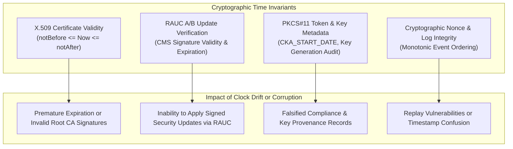
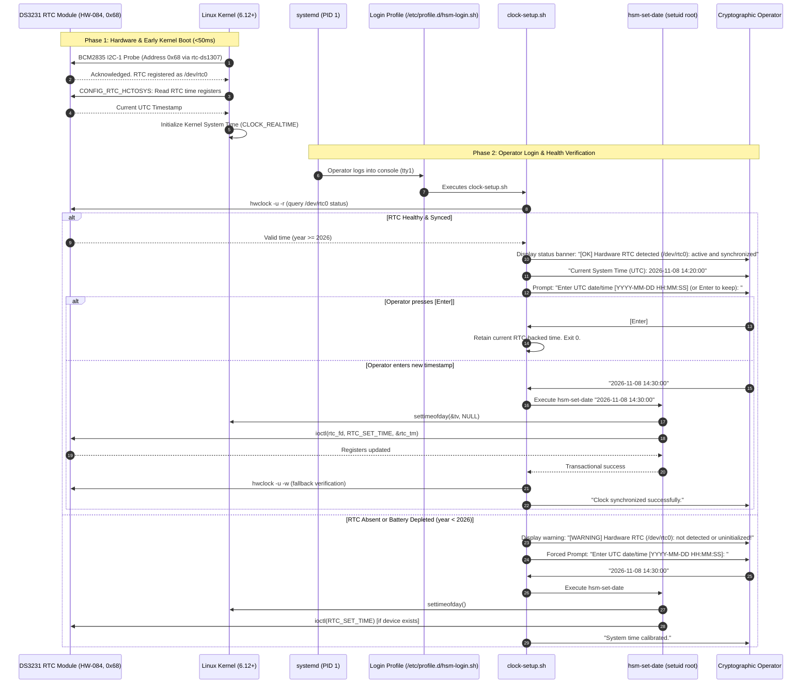

# Air-Gapped Time Synchronization & Hardware RTC Architecture

In the **air-gapped Raspberry Pi HSM OS** ([`hsm-yocto-offgrid-rpi`](file:///Users/gpfister/Development/Projects/gpfister/nrf52840-hsm/hsm-yocto-offgrid-rpi)), absolute network isolation is enforced at all layers: wireless controllers and Ethernet PHYs are disabled in the Device Tree and kernel defconfig, and `nftables` executes an unconditional total-drop policy. As a result, network time synchronization (NTP, PTP, NTS) is physically impossible.

This document describes the multi-layered timekeeping architecture that combines the **HW-084 (Maxim DS3231SN)** hardware Real-Time Clock, Linux kernel early-boot synchronization, and an ergonomic, RTC-aware operator login workflow with transactional clock calibration.

---

## 1. System Threat Model & Time Invariants

Accurate calendar time is not merely a logging convenience; it is a critical security invariant for the HSM ecosystem:



### Core Architecture Rules
1. **Zero Network Dependence**: No background daemons or socket listeners may be spawned for timekeeping.
2. **Early Boot Synchronization**: The Linux kernel must synchronize `CLOCK_REALTIME` from the hardware RTC before user space daemons (systemd, udev, journald) launch.
3. **Atomic Dual-Write**: Whenever an operator calibrates system time, both the kernel software clock and the DS3231 RTC hardware registers must be updated in a single transactional operation.
4. **Minimal Operator Friction**: When the battery-backed RTC is healthy and synchronized, console login must require zero typing to retain the current time.
5. **Fail-Safe Degraded Operation**: If the RTC battery is dead or the module is disconnected, the system must warn the operator and gracefully fall back to interactive manual input.

---

## 2. End-to-End Time Synchronization Sequence



---

## 3. Hardware Interconnect & Pin Mapping

The HW-084 breakout board connects to the Raspberry Pi 40-pin header via the primary hardware I2C bus (**I2C-1**), utilizing the passthrough pins of the [[Hardware/Waveshare USB HAT (B) Integration|Waveshare USB HAT (B)]]:

| HW-084 Pin | RPi Physical Pin | BCM GPIO / Function | Signal Type | Electrical Specification |
| :--- | :--- | :--- | :--- | :--- |
| **VCC** | **Pin 1** | `3V3 Power` | 3.3V DC Supply | Regulated 3.3V DC rail from PMIC |
| **GND** | **Pin 9** (or 6, 14) | `Ground` | 0V Reference | Common signal ground |
| **SDA** | **Pin 3** | `GPIO 2 / I2C1_SDA` | Serial Data | Bidirectional open-drain I2C data (1.8 kΩ pull-up) |
| **SCL** | **Pin 5** | `GPIO 3 / I2C1_SCL` | Serial Clock | Open-drain I2C clock (1.8 kΩ pull-up) |

> [!NOTE]
> Physical pins 1, 3, 5, and 9 form a contiguous quadrant on the upper-left of the 40-pin Raspberry Pi header, allowing compact female-to-female jumper ribbon installation without blocking other peripherals.

---

## 4. Kernel & BSP Implementation

### 4.1 Kernel Defconfig Fragment (`hardened.cfg`)
Configured in [`meta-hsm-os/recipes-kernel/linux/files/hardened.cfg`](file:///Users/gpfister/Development/Projects/gpfister/nrf52840-hsm/hsm-yocto-offgrid-rpi/meta-hsm-os/recipes-kernel/linux/files/hardened.cfg):
```kconfig
# Real-Time Clock (RTC) Subsystem
CONFIG_RTC_CLASS=y
CONFIG_RTC_DRV_DS1307=y
CONFIG_RTC_HCTOSYS=y
CONFIG_RTC_HCTOSYS_DEVICE="rtc0"

# Broadcom BCM2835 Hardware I2C Controller
CONFIG_I2C=y
CONFIG_I2C_CHARDEV=y
CONFIG_I2C_BCM2835=y
```

- `CONFIG_RTC_DRV_DS1307=y`: The unified Maxim/Dallas RTC driver supporting the DS3231SN.
- `CONFIG_RTC_HCTOSYS=y`: Built directly into the kernel image (not a module) to ensure early execution before rootfs mounting.
- `CONFIG_I2C_BCM2835=y`: SoC hardware I2C controller driver, avoiding all CPU bit-banging overhead.

### 4.2 Raspberry Pi Device Tree & Firmware Append (`rpi-config_%.bbappend`)
Configured in [`meta-hsm-os/recipes-bsp/bootfiles/rpi-config_%.bbappend`](file:///Users/gpfister/Development/Projects/gpfister/nrf52840-hsm/hsm-yocto-offgrid-rpi/meta-hsm-os/recipes-bsp/bootfiles/rpi-config_%.bbappend):
```bitbake
ENABLE_I2C = "1"
RPI_EXTRA_CONFIG:append = "\n# HW-084 (DS3231) Hardware RTC on I2C-1\ndtoverlay=i2c-rtc,ds3231\n"
```
During WIC image generation, this appends `dtparam=i2c_arm=on` and `dtoverlay=i2c-rtc,ds3231` into the boot partition's `/boot/config.txt`. The VideoCore firmware loads the overlay and presents the I2C client device tree node at `i2c@7e804000/rtc@68`.

---

## 5. User-Space Tooling & Synchronization Logic

### 5.1 Diagnostic Hardware Verification
The root filesystem includes `i2c-tools` via [`hsm-image-base.bb`](file:///Users/gpfister/Development/Projects/gpfister/nrf52840-hsm/hsm-yocto-offgrid-rpi/meta-hsm-os/recipes-core/images/hsm-image-base.bb). Operators and verification scripts can audit the I2C-1 bus:
```bash
i2cdetect -y 1
```
Output when kernel driver successfully binds:
```text
     0  1  2  3  4  5  6  7  8  9  a  b  c  d  e  f
00:                         -- -- -- -- -- -- -- -- 
10: -- -- -- -- -- -- -- -- -- -- -- -- -- -- -- -- 
...
60: -- -- -- -- -- -- -- -- UU -- -- -- -- -- -- -- 
```
`UU` at address `0x68` confirms the kernel `rtc-ds1307` driver has successfully claimed and locked the DS3231 hardware device.

### 5.2 Transactional SUID Root Helper (`hsm-set-date.c`)
Because production OS images lock the root superuser (`usermod -L root`) and standard operator `hsmutil` possesses no `sudo` privileges, setting system time requires a setuid helper (`/usr/local/bin/hsm-set-date`, mode `4755`):
```c
// Strict format check: YYYY-MM-DD HH:MM:SS
if (strptime(argv[1], "%Y-%m-%d %H:%M:%S", &tm) == NULL) {
    fprintf(stderr, "Error: Invalid date format. Use YYYY-MM-DD HH:MM:SS\n");
    return 1;
}

// 1. Set Kernel CLOCK_REALTIME
time_t t = timegm(&tm);
struct timeval tv = { .tv_sec = t, .tv_usec = 0 };
settimeofday(&tv, NULL);

// 2. Atomically Sync Hardware RTC (/dev/rtc0)
int rtc_fd = open("/dev/rtc0", O_RDWR);
if (rtc_fd >= 0) {
    struct rtc_time rtc_tm;
    rtc_tm.tm_sec  = tm.tm_sec;
    rtc_tm.tm_min  = tm.tm_min;
    rtc_tm.tm_hour = tm.tm_hour;
    rtc_tm.tm_mday = tm.tm_mday;
    rtc_tm.tm_mon  = tm.tm_mon;
    rtc_tm.tm_year = tm.tm_year;
    ioctl(rtc_fd, RTC_SET_TIME, &rtc_tm);
    close(rtc_fd);
}
```

### 5.3 Informative Operator Login Script (`clock-setup.sh`)
When the operator logs in via HDMI console `tty1`, `/etc/profile.d/hsm-login.sh` executes `clock-setup.sh`:
- Queries `hwclock -u -r` to inspect `/dev/rtc0`.
- If healthy: displays `Hardware RTC detected (/dev/rtc0): active and synchronized`.
- Prompts: `Enter current UTC date/time [YYYY-MM-DD HH:MM:SS] (or Enter to keep): `.
- If `[Enter]` is pressed: accepts RTC time and exits with code 0.
- If timestamp provided: runs `hsm-set-date` and secondary `hwclock -u -w`.

---

## 6. Failure Modes & Edge Case Matrix

| Scenario | Symptom / State | System Behavior | Operator Action |
| :--- | :--- | :--- | :--- |
| **Normal Operation** | RTC active, battery > 2.8V, clock valid. | Early boot syncs `CLOCK_REALTIME`. Login banner shows synchronized status. | Press `[Enter]` to confirm and proceed to HSM operations. |
| **Initial Deployment** | RTC uncalibrated (register contents empty / zero). | Kernel reads invalid date (< 2026). `clock-setup.sh` detects year < 2026, flags warning. | Operator enters current UTC time once; system atomically initializes `/dev/rtc0`. |
| **Battery Depleted** | Coin cell voltage < 2.0V; time lost on power-off. | On every boot, year resets to 1970 or 2000. `clock-setup.sh` displays warning. | Replace CR2032 coin cell; enter UTC time at prompt. |
| **Bus Disconnected** | Jumper wire detached; `/dev/rtc0` absent. | Kernel reports I2C probe timeout. `/dev/rtc0` does not exist. `clock-setup.sh` flags missing RTC. | Check wiring (Pins 1, 3, 5, 9); enter UTC time manually for current session. |
| **Small Clock Drift** | TCXO drifted by 2–5 seconds over several months. | Operator notices deviation on login banner. | Operator types current accurate UTC timestamp; helper synchronizes kernel and RTC. |

---

## 7. Subsystem Cross-References

- **Hardware Interconnect ADR**: [[Architecture/Decisions/ADR-0021 - Hardware I2C-1 Bus Mapping for HW-084 DS3231 RTC Module|ADR-0021: Hardware I2C-1 Bus Mapping for HW-084 DS3231 RTC Module]]
- **Login Synchronization ADR**: [[Architecture/Decisions/ADR-0022 - RTC-Aware Informational Login Prompt with Transactional Hardware Clock Sync|ADR-0022: RTC-Aware Informational Login Prompt with Transactional Hardware Clock Sync]]
- **HW-084 Breakout Specification**: [[Hardware/HW-084 DS3231 Real-Time Clock Module|HW-084 DS3231 Real-Time Clock Module]]
- **Appliance Architecture**: [[Architecture/07 - Air-Gapped RPi HSM OS Architecture|07 - Air-Gapped RPi HSM OS Architecture]]
- **Technical Specification**: [[Specification/Yocto 6.1 Blacksail Upgrade, HW-084 DS3231 RTC Integration and Workspace Distclean|Specification: Yocto 6.1 Blacksail Upgrade, HW-084 RTC & Distclean]]
- **Implementation Plan**: [[Plan/Yocto 6.1 Blacksail Upgrade, HW-084 DS3231 RTC Integration and Workspace Distclean Implementation Plan|Implementation Plan: Yocto 6.1 Blacksail Upgrade, HW-084 RTC & Distclean]]
