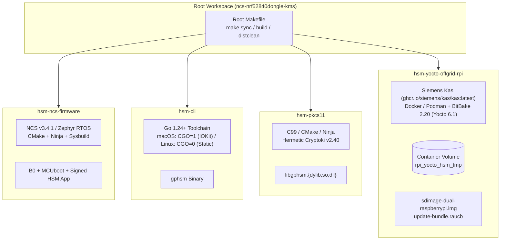
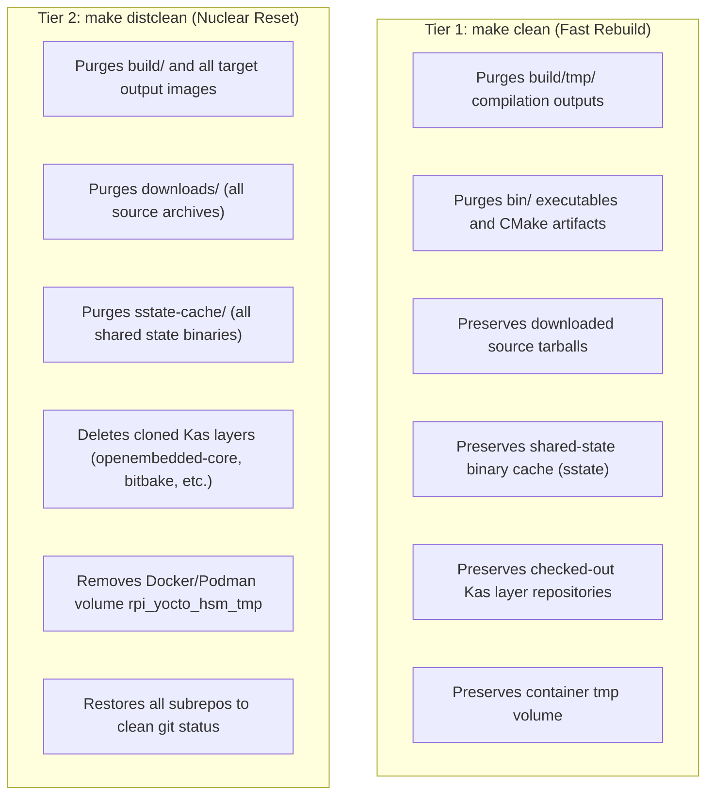

# Build Lifecycle & Workspace Clean Routines

This document details the cross-repository build lifecycle, container orchestration, caching strategies, and hierarchical clean routines across the **Hardware Security Module (HSM)** multi-repository ecosystem.

---

## 1. Multi-Repository Build Topology

The root workspace orchestrates five distinct sub-repositories, each employing specialized toolchains:



---

## 2. Containerized Yocto Build Mechanics (`hsm-yocto-offgrid-rpi`)

BitBake builds within `hsm-yocto-offgrid-rpi` are executed in ephemeral Kas containers (`ghcr.io/siemens/kas/kas:latest`). To balance performance, reproducibility, and host isolation:

1. **Kas Container Mounts**:
   - The sub-repository workspace directory is bind-mounted into `/work` inside the container.
   - Host `downloads/` and `sstate-cache/` are preserved across runs to minimize network usage and re-compilation.
2. **Container Named Volume (`rpi_yocto_hsm_tmp`)**:
   - Compiling kernel modules and generating root filesystems requires tens of thousands of I/O operations per second.
   - A dedicated Docker/Podman named volume `rpi_yocto_hsm_tmp` is created and mounted to `/tmp` inside the Kas container:
     ```bash
     $(CONTAINER_ENGINE) volume create rpi_yocto_hsm_tmp
     ```
   - This prevents tmpfs exhaustion on the host and avoids slow cross-boundary volume synchronization (especially on macOS VirtioFS/gRPC-FUSE).

---

## 3. Tiered Cleanup Architecture (`clean` vs `distclean`)

To avoid confusing developers and corrupting builds, the workspace enforces a strict two-tier cleanup model across all sub-repositories and the root workspace:



### Detailed Cleanup Matrix

| Component | Target | Files & Directories Removed | Preserved Assets |
| :--- | :--- | :--- | :--- |
| **`hsm-ncs-firmware`** | `make clean` | `build/` | Toolchains, west manifests |
| | `make firmware-distclean` | `build/`, sysbuild staging, transient keys | Pristine repository clone |
| **`hsm-cli`** | `make clean` | `bin/gphsm`, coverage reports | Go module cache (`$GOPATH/pkg`) |
| | `make cli-clean` | `bin/` | Pristine repository clone |
| **`hsm-pkcs11`** | `make libpkcs11-clean` | `build/`, `bin/libgphsm.*` | Pristine repository clone |
| **`hsm-yocto-offgrid-rpi`** | `make clean` | `build/tmp/` | `downloads/`, `sstate-cache/`, Kas layers |
| | `make distclean` | `build/`, `downloads/`, `sstate-cache/`, `bitbake/`, `openembedded-core/`, `meta-yocto/`, `meta-openembedded/`, `meta-raspberrypi/`, `meta-rauc/`, and volume `rpi_yocto_hsm_tmp` | Only versioned git files (`meta-hsm-os/`, `kas-*.yml`, `Makefile`, `scripts/`) |
| **Root Workspace** | `make clean` | Calls `clean` across firmware, CLI, and PKCS#11 | Caches and layers |
| | `make distclean` | Chains `firmware-distclean`, `cli-clean`, `libpkcs11-clean`, and `yocto-distclean` | Only versioned root files and clean sub-repos |

---

## 4. Sub-Repository `distclean` Implementation

Configured in [`hsm-yocto-offgrid-rpi/Makefile`](file:///Users/gpfister/Development/Projects/gpfister/nrf52840-hsm/hsm-yocto-offgrid-rpi/Makefile):
```makefile
.PHONY: distclean

distclean: clean
	@echo "==> Purging Yocto workspace, caches, and Kas repositories..."
	@rm -rf $(BUILD_DIR)
	@rm -rf downloads sstate-cache
	@rm -rf bitbake openembedded-core meta-yocto meta-openembedded meta-raspberrypi meta-rauc
	@echo "==> Removing container volume rpi_yocto_hsm_tmp if present..."
	@$(CONTAINER_ENGINE) volume rm -f rpi_yocto_hsm_tmp 2>/dev/null || true
	@echo "Distclean completed."
```

### Safety & Engine Portability
- `$(CONTAINER_ENGINE)` dynamically adapts to either `docker` or `podman`.
- `volume rm -f ... 2>/dev/null || true` ensures non-zero return codes are silenced if the volume does not exist or if the container daemon is currently stopped.
- `rm -rf` targets are explicitly enumerated rather than using wildcard patterns to protect `meta-hsm-os/` and repository root files.

---

## 5. Root Workspace Orchestration

Configured in root [`Makefile`](file:///Users/gpfister/Development/Projects/gpfister/nrf52840-hsm/Makefile):
```makefile
.PHONY: yocto-distclean distclean

yocto-distclean:
	@$(MAKE) -C $(YOCTO_DIR) distclean

distclean: firmware-distclean cli-clean libpkcs11-clean yocto-distclean
```

Executing `make distclean` from the workspace root guarantees complete, cross-repository cleanliness in a single command, ideal for CI/CD runners before executing release builds or after major version upgrades.

---

## 6. Subsystem Cross-References

- **Container Distclean ADR**: [[Architecture/Decisions/ADR-0023 - Container Volume and Workspace Cache Purging during Distclean|ADR-0023: Container Volume and Workspace Cache Purging during Distclean]]
- **Appliance Architecture**: [[Architecture/07 - Air-Gapped RPi HSM OS Architecture|07 - Air-Gapped RPi HSM OS Architecture]]
- **Yocto Build & RAUC Guide**: [[Development/Yocto Build and RAUC Update Guide|Yocto Build and RAUC Update Guide]]
- **Specification**: [[Specification/Yocto 6.1 Blacksail Upgrade, HW-084 DS3231 RTC Integration and Workspace Distclean|Specification: Yocto 6.1 Blacksail Upgrade, HW-084 RTC & Distclean]]
- **Plan**: [[Plan/Yocto 6.1 Blacksail Upgrade, HW-084 DS3231 RTC Integration and Workspace Distclean Implementation Plan|Implementation Plan: Yocto 6.1 Blacksail Upgrade, HW-084 RTC & Distclean]]
