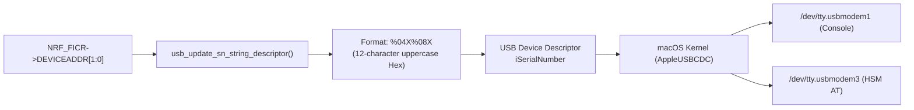

# ADR-0001: Hardware BLE Address for Deterministic USB Serial Number

## Context & Problem Statement

The **nRF52840 Dongle (PCA10059)** acts as a composite USB device providing two CDC-ACM serial channels: Zephyr console logging and HSM AT/Crypto protocol.

Under macOS (`AppleUSBCDCACMData` driver), BSD device nodes are synthesized using the formula:
```text
/dev/tty.usbmodem<iSerialNumber><InterfaceNumber>
```

When `iSerialNumber` is blank, default, or not provided in the USB device descriptor, macOS falls back to the USB physical topology path (e.g. hub location and port indexes like `3142410` or `8310`). This leads to severe operational problems:
1. **Dynamic / Non-Deterministic Paths**: If a dongle is unplugged and moved to another USB-C port or hub port, its device paths change unpredictably.
2. **Device Collisions & Indistinguishability**: When multiple dongles are plugged into adjacent ports or a powered hub, their synthesized paths share similar ephemeral prefixes (e.g., `/dev/tty.usbmodem31424103` vs `/dev/tty.usbmodem31424403`), making automated testing, target binding, and multi-HSM deployment error-prone and brittle.
3. **No Correlation to Physical Hardware**: Host operators cannot match a software device node to a physical PCB without inspecting kernel topology trees or serial snooping.

We need a unique, persistent, immutable hardware identifier programmed into the silicon that survives firmware updates, chip erasures, and USB topology relocations.

---

## Decision Drivers

- **Uniqueness**: Every physical nRF52840 chip must produce a guaranteed unique string.
- **Hardware Correlation**: The serial number should correspond directly to physical markings (e.g., the factory 2D barcode / BLE address printed on Nordic modules).
- **Format Constraints**: macOS and USB 2.0 descriptors favor standard alphanumeric strings without punctuation or colons.
- **Dual-Stage Boot Compatibility**: The serial number generation must be available during application startup without requiring persistent Flash NVS or non-volatile key store reads.

---

## Considered Options

1. **Option 1: Static Hardcoded USB Serial Number (`CONFIG_USB_DEVICE_SN="12345678"`)**
   - *Pros*: Trivial configuration.
   - *Cons*: Total failure in multi-device environments; causes kernel descriptor caching clashes and port collisions.

2. **Option 2: 64-bit Hardware Device ID (`NRF_FICR->DEVICEID[0..1]`)**
   - *Pros*: Guaranteed unique 64-bit hardware ID available in Factory Information Configuration Registers (FICR).
   - *Cons*: Produces a 16-character hexadecimal string that does not match the physical 48-bit BLE MAC address printed on the hardware module labels and packaging.

3. **Option 3: 48-bit Factory BLE Device Address (`NRF_FICR->DEVICEADDR[0..1]`) formatted as 12-char Hex (Chosen)**
   - *Pros*:
     - Unique across all Nordic silicon worldwide (assigned from Nordic IEEE OUI).
     - Directly corresponds to the hardware module label and BLE advertising address.
     - 12 uppercase hexadecimal characters (`%04X%08X` with standard BLE random-static address mask `0xC000`), yielding concise macOS node names: `/dev/tty.usbmodem<12_HEX>1` and `/dev/tty.usbmodem<12_HEX>3`.
     - Zero flash wear; read directly from memory-mapped read-only registers in microseconds.
   - *Cons*: If unprogrammed (erased FICR in engineering prototypes), requires fallback logic.

4. **Option 4: Host-Assigned Alias via Flash NVS / Secure Storage**
   - *Pros*: User can name their dongle (e.g., "HSM-SIGNER-01").
   - *Cons*: Requires custom provisioning tool, flash storage overhead, fails before storage init, and does not solve factory out-of-the-box multi-dongle plugging.

---

## Decision Outcome

**Chosen Option: Option 3 — 48-bit Factory BLE Device Address formatted as 12-character uppercase Hex.**

### Implementation Mechanics

1. **Descriptor Hook Override**:
   Zephyr's USB device stack provides a weak hook function `usb_update_sn_string_descriptor()`. We override this hook in `usb_serial.c`:
   ```c
   uint8_t *usb_update_sn_string_descriptor(void)
   {
       static uint8_t s_ble_sn[13];
       uint32_t addr_hi = NRF_FICR->DEVICEADDR[1];
       uint32_t addr_lo = NRF_FICR->DEVICEADDR[0];

       /* Check for unprogrammed/erased state */
       if ((addr_hi == 0xFFFFFFFF && addr_lo == 0xFFFFFFFF) ||
           (addr_hi == 0x00000000 && addr_lo == 0x00000000)) {
           /* Fallback to DEVICEID */
           addr_hi = NRF_FICR->DEVICEID[1];
           addr_lo = NRF_FICR->DEVICEID[0];
       }

       /* Set the two most significant bits for BLE random static address compliance */
       uint16_t hi16 = (uint16_t)((addr_hi | 0xC000) & 0xFFFF);
       snprintf((char *)s_ble_sn, sizeof(s_ble_sn), "%04X%08X", (unsigned int)hi16, (unsigned int)addr_lo);
       return s_ble_sn;
   }
   ```

2. **Kconfig Enablement**:
   Set `CONFIG_USB_DEVICE_SN="000000000000"` in `prj.conf` to pre-allocate descriptor buffer space for 12 characters.



---

## Consequences & Trade-offs

### Positive Consequences
- **Deterministic Node Paths**: macOS device nodes remain invariant regardless of hub port, cable replugging, or reboot order.
- **Hardware Traceability**: Physical dongles can be identified at a glance by matching the physical module barcode or BLE MAC address with software serial outputs.
- **Robust Multi-Dongle Operations**: Multiple HSM dongles plugged into the same machine enumerate with clean, independent serial numbers with zero collisions.

### Negative Consequences / Risks
- Unprogrammed developer silicon or wiped engineering samples could present identical fallback serials. Mitigated by explicit fallback to `DEVICEID[1:0]`.
