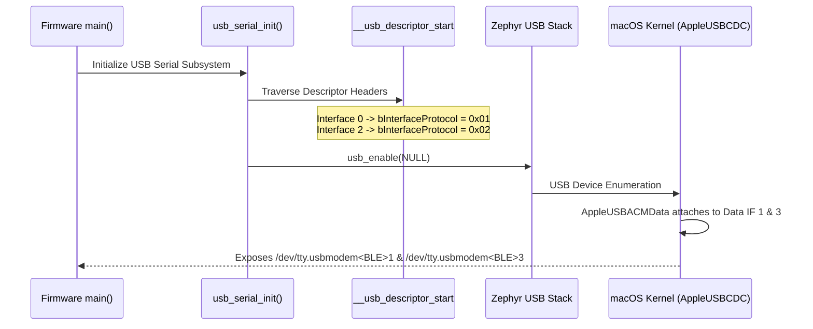

# ADR-0002: In-Tree Protocol Descriptor Patching vs macOS DriverKit Extension

> [!NOTE]
> **Update (2026-11-05)**: The protocol assignment in Option 3 was updated by [[Architecture/Decisions/ADR-0013 - Standard CDC-ACM AT Protocol Descriptors for macOS Dual Enumeration|ADR-0013]]. Interface 2 protocol is standardized to `0x01` (ITU-T V.250) rather than `0x02` because macOS `AppleUSBACMControl` rejects `0x02`, preventing virtual COM port instantiation.

## Context & Problem Statement

The **nRF52840 HSM Dongle** composite USB device exposes two dual CDC-ACM functions:
1. **Console / Log Stream**: Used for Zephyr RTOS runtime diagnostics, boot logging, and PSA crypto telemetry.
2. **HSM AT Protocol / Crypto Channel**: Used for cryptographic operations, key management, and firmware DFU.

Host operating systems (specifically macOS and Linux) need to unambiguously distinguish the Console interface from the HSM AT interface. On macOS:
- Why does the device not enumerate as a dedicated custom device node like `/dev/tty.usbhsm0`?
- Can we alter the standard `bInterfaceProtocol` field in Zephyr's USB descriptors to formally differentiate the roles without breaking standard OS CDC-ACM driver compatibility?

---

## Decision Drivers

- **Zero-Driver / Plug-and-Play Experience**: End-users must be able to plug the dongle into macOS, Linux, or Windows without installing kernel extensions or system software.
- **Portability & CI/CD**: Integration test environments and headless CI runners must operate without requiring manual macOS System Settings approvals or kernel extension entitlements.
- **Standards Compliance**: Must remain compatible with standard CDC-ACM class drivers (`AppleUSBCDCACMData` on macOS, `cdc_acm` on Linux, `usbser.sys` on Windows).
- **Interface Differentiation**: Client software and host scripts must be able to inspect descriptors to programmatically identify which interface is the Console and which is the HSM AT channel.

---

## Considered Options

1. **Option 1: Proprietary macOS Driver Extension (DriverKit DEXT)**
   - *Architecture*: Write a custom DEXT driver using Apple's DriverKit (`com.apple.developer.driverkit.transport.usb`) matching the dongle VID/PID, implementing a custom BSD serial client that creates `/dev/tty.usbhsm<INDEX>`.
   - *Pros*: Custom, beautifully named device nodes (`/dev/tty.usbhsm`).
   - *Cons*:
     - Requires paid Apple Developer Program enterprise account and explicit entitlement approvals from Apple.
     - Requires user to approve System Extension in macOS System Settings and restart/authenticate.
     - Does not work on Linux or Windows; creates an asymmetric development stack.
     - Massive engineering maintenance overhead for zero cryptographic or functional gain.

2. **Option 2: Pure Vendor Class (WinUSB / libusb bulk transfer)**
   - *Architecture*: Replace CDC-ACM for the HSM channel with a custom USB vendor interface using bulk endpoints.
   - *Pros*: Bypasses serial port abstractions entirely; allows raw packet streaming.
   - *Cons*: Requires `libusb` on all host operating systems, custom driver INF on Windows, loses compatibility with standard POSIX serial tools, screen/minicom, and standard terminal/scripting environments.

3. **Option 3: Standard CDC-ACM with In-Tree `bInterfaceProtocol` Patching (Chosen)**
   - *Architecture*: Maintain standard USB CDC-ACM specification classes (`0x02` Comm, `0x0A` Data). Before `usb_enable(NULL)` executes in firmware, traverse the in-memory descriptor table symbol `__usb_descriptor_start` and assign unique protocol IDs:
     - Interface 0 (Console Management): `bInterfaceProtocol = 0x01` (`ZEPHYR_CDC_CONSOLE_PROTO`)
     - Interface 2 (HSM AT Management): `bInterfaceProtocol = 0x02` (`HSM_CDC_AT_PROTO`)
   - *Pros*:
     - Standard operating system CDC-ACM drivers attach natively with zero user prompts or installation requirements.
     - macOS kernel assigns BSD device nodes `/dev/tty.usbmodem<BLE_ADDR>1` (Interface 1, Console) and `/dev/tty.usbmodem<BLE_ADDR>3` (Interface 3, HSM AT).
     - USB enumeration tools (`system_profiler SPUSBDataType`, `ioreg`, `lsusb -v`) display the custom protocol IDs.
     - Cross-platform: works identically on Linux (`/dev/ttyACM0`, `/dev/ttyACM1`) and Windows (`COMx`, `COMy`).
   - *Cons*: BSD paths on macOS retain the `usbmodem` prefix rather than a custom brand name prefix.

---

## Decision Outcome

**Chosen Option: Option 3 — Standard CDC-ACM with In-Tree `bInterfaceProtocol` Patching.**

### Implementation Mechanics

In `nrf52840-hsm-firmware/firmware/app/src/usb_serial.c`:

```c
/* Traverse linker-generated USB descriptor symbols */
extern struct usb_desc_header __usb_descriptor_start[];
extern struct usb_desc_header __usb_descriptor_end[];

void usb_serial_patch_descriptors(void)
{
    struct usb_desc_header *head = __usb_descriptor_start;
    while (head < __usb_descriptor_end) {
        if (head->bDescriptorType == USB_DESC_INTERFACE) {
            struct usb_if_descriptor *if_desc = (struct usb_if_descriptor *)head;
            if (if_desc->bInterfaceNumber == 0) {
                if_desc->bInterfaceProtocol = 0x01; /* Console Protocol */
            } else if (if_desc->bInterfaceNumber == 2) {
                if_desc->bInterfaceProtocol = 0x02; /* HSM AT Protocol */
            }
        }
        head = (struct usb_desc_header *)((uint8_t *)head + head->bLength);
    }
}
```



---

## Consequences & Trade-offs

### Positive Consequences
- **True Zero-Friction Driverless Operation**: The HSM dongle works immediately when inserted into any modern macOS, Linux, or Windows machine.
- **Deterministic Separation**: Console logs cannot be corrupted or intercepted by HSM client software, because client tools strictly open data interface 3 (`...3`).
- **Inspection Clarity**: `lsusb -v` and `system_profiler` display clear protocol distinction (`0x01` vs `0x02`).

### Negative Consequences / Risks
- macOS users cannot customize the `/dev/tty.usbmodem` prefix without a DriverKit DEXT. This is accepted as the standard behavior across all USB CDC-ACM hardware on macOS.
