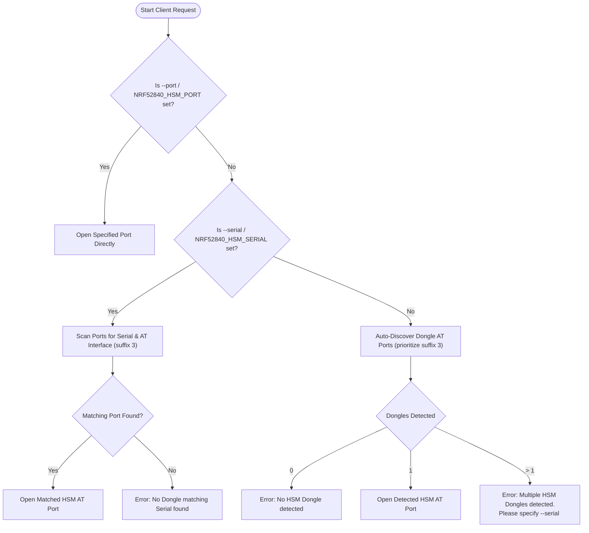

# ADR-0003: Host Port Discovery and Serial Targeting Strategy

## Context & Problem Statement

Both the Go CLI (`hsmutil`) and the PKCS#11 shared library (`libnrf52840_pkcs11.dylib / .so`) must communicate with the dongle over serial CDC-ACM.

In real-world development and production environments:
1. Multiple dongles may be attached simultaneously (e.g. key derivation source vs destination HSM, or automated CI test harness with multiple hardware nodes).
2. Each dongle presents **two** serial ports on the host (Interface 1 for Console logging, Interface 3 for HSM AT/Crypto protocol).
3. If host software blindly opens the first matching port (e.g. `/dev/cu.usbmodem*`), it will attach to Interface 1 (the Console logger), send AT commands, receive no response or garbage boot logs, and fail with timeouts.
4. If multiple dongles are plugged in, auto-discovery without explicit targeting cannot guarantee deterministic binding to the intended device.

---

## Decision Drivers

- **Zero-Configuration Default**: When only one HSM dongle is plugged in, running `hsmutil info` or initializing PKCS#11 must "just work" without requiring any arguments or environment variables.
- **Deterministic Multi-Device Targeting**: When multiple dongles are plugged in, users and automated scripts must be able to target an exact device using its physical 12-digit hex BLE serial number.
- **Fail-Safe Interface Selection**: Client software must never accidentally attempt to talk AT protocol to Interface 1 (Console logger).
- **Consistent Developer Ergonomics**: Both `hsmutil` and `libnrf52840_pkcs11` must obey identical resolution hierarchies and naming conventions.

---

## Considered Options

1. **Option 1: Require Explicit Port Path Everywhere (`-p /dev/tty...`)**
   - *Pros*: Simple, no discovery logic required.
   - *Cons*: Terrible user experience; requires users to inspect `/dev` and copy-paste long device paths every time.

2. **Option 2: Probing Every Serial Port with AT Ping**
   - *Pros*: Discovers which port responds with `OK`.
   - *Cons*: Very slow (serial open/close timeouts); disrupts console logger by sending AT commands to it; dangerous if non-HSM USB-to-serial adapters are connected on the host.

3. **Option 3: Multi-Tiered Target Resolution Hierarchy (Chosen)**
   - Prioritize deterministic parameters over heuristic fallbacks:
     1. **Tier 1 (Explicit Port)**: User-specified `--port <path>` (CLI) or `NRF52840_HSM_PORT=<path>` (PKCS#11).
     2. **Tier 2 (Explicit Serial Filter)**: User-specified `--serial <12_HEX>` (CLI) or `NRF52840_HSM_SERIAL=<12_HEX>` (PKCS#11). Resolves to candidate port matching that serial and ending in suffix `3`.
     3. **Tier 3 (Automated Single-Dongle Auto-Discovery)**:
        - Scan candidate serial ports (`/dev/cu.usbmodem*` on macOS, `/dev/ttyACM*` on Linux, `COM*` on Windows).
        - Filter/prioritize candidates matching the AT interface pattern (ending in `3` on macOS).
        - If exactly one HSM dongle AT port is discovered, select it automatically.
        - If multiple dongles are discovered without explicit flags, output an actionable error listing all detected devices and prompting the user to supply `--serial <ID>`.

---

## Decision Outcome

**Chosen Option: Option 3 — Multi-Tiered Target Resolution Hierarchy.**

### Resolution Flowchart

### Discovery Pattern Specifics

- **macOS Calling Conventions**: Use `/dev/cu.usbmodem*` rather than `/dev/tty.usbmodem*` for client software connections to avoid carrier-detect blocking on opening.
- **Port Matching Regex**:
  - HSM AT Interface: `^/dev/cu\.usbmodem([0-9A-Fa-f]{12})3$`
  - Console Logging Interface: `^/dev/cu\.usbmodem([0-9A-Fa-f]{12})1$`
- **Legacy Fallback**: If non-BLE legacy firmware is present (e.g. `/dev/cu.usbmodem31424103`), match trailing `3` as candidate AT interface.

---

## Consequences & Trade-offs

### Positive Consequences
- **Instant Usability**: Single-device setups require zero flags or configuration.
- **Deterministic Multi-Device Operation**: Automated pipelines can address multiple dongles concurrently without race conditions using `--serial <ID>`.
- **Zero Console Interference**: Client software never attempts AT handshakes on Interface 1, keeping console log streams clean.
- **Consistent Ecosystem**: `hsmutil`, `libnrf52840_pkcs11`, and test runners share the exact same discovery rules.

### Negative Consequences / Risks
- In multi-device setups, commands without `--serial` will halt with an error rather than guessing. This is an intentional safety guard to prevent mutating state on the wrong cryptographic token.
