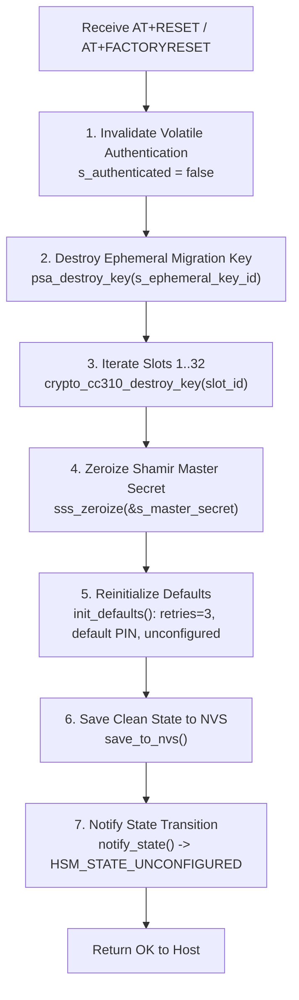

# ADR-0004: Factory Reset Semantics and Safe Erasure Safeguards

## Context & Problem Statement

In Hardware Security Modules (HSMs), distinguishing between **session invalidation** (logging out / clearing volatile symmetric session context) and a **factory reset** (zeroizing master secrets and cryptographic key slots) is critical for operational safety and security assurance.

Prior to this decision, the `hsmutil reset` command and the dongle's `AT+RESET` firmware implementation exhibited an inconsistent and hazardous behavioral mismatch:
1. Running `hsmutil reset` executed immediately without warning or confirmation prompts.
2. The firmware handler in [`firmware/lib/src/keystore.c`](file:///Users/gpfister/Development/Projects/gpfister/nrf52840-hsm/nrf52840-hsm-firmware/firmware/lib/src/keystore.c) only performed transient volatile session teardown (`s_authenticated = false`, stopping autolock timers, wiping an ephemeral ECDH migration key).
3. Persistent cryptographic keys stored in CryptoCell CC310 / PSA slots remained intact, the Shamir Secret Sharing (SSS) master secret remained in Non-Volatile Storage (NVS), and the dongle remained in `HSM_STATE_LOCKED` (solid RED LED).
4. Users expect `reset` on an HSM utility to return the hardware to an unconfigured out-of-the-box state (factory reset), while operators running scripts risk catastrophic unintended key destruction if a true wipe executes without explicit confirmation.

---

## Decision Drivers

- **Cryptographic Sanity & Complete Zeroization**: A factory reset on a Hardware Security Module must guarantee the irreversible destruction of all hardware-backed cryptographic material (CryptoCell CC310 slots and SSS master secret in NVS).
- **Accidental Destruction Prevention**: An irreversible wipe command must never execute without positive human or scripted affirmation.
- **Clear State Machine Transition**: After factory reset, the dongle must transition to `HSM_STATE_UNCONFIGURED` (pulsating/breathing blue LED) and refuse cryptographic operations until reinitialized via `hsmutil init --threshold`.
- **Command Ergonomics & Scriptability**: Interactive terminal users must be prompted with explicit warnings and confirmation (`[y/N]`), while non-interactive CI/CD automation pipelines must be able to bypass prompts using `-y` / `--yes`.
- **Session Reset vs Factory Reset Distinction**: Separate transient session teardown (`AT+LOCK` / `hsmutil lock`) from permanent cryptographic erasure (`AT+RESET` / `AT+FACTORYRESET` / `hsmutil reset`).

---

## Considered Options

### Option 1: Retain Session Reset as `hsmutil reset` and Introduce `hsmutil factory-reset`
- *Pros*: Preserves existing non-destructive behavior for `hsmutil reset`.
- *Cons*: Highly confusing for security operators who expect `reset` on an HSM CLI to reset the hardware to factory defaults (analogous to YubiKey `ykman hsm reset`). Transient session logout is already handled by `hsmutil lock`.

### Option 2: Overload `hsmutil reset` to Perform Full Factory Reset with Mandatory Confirmation (Chosen)
- *Pros*:
  - Aligns `hsmutil reset` with industry standards for dedicated security hardware tokens.
  - Adds mandatory safeguard (`-y` / `--yes` flag or interactive confirmation prompt `Are you sure you want to proceed? (yes/no): `).
  - Implements complete firmware-level zeroization across all CC310 persistent slots, SSS master key, and NVS state.
  - Transitions hardware LED state to `HSM_STATE_UNCONFIGURED`.
- *Cons*:
  - Breaking change for users who mistakenly used `reset` thinking it was a simple session logout (addressed by guiding them to `hsmutil lock`).

---

## Decision Outcome

**Chosen Option: Option 2 — Full Factory Reset with Safe Confirmation Safeguards.**

### 1. Firmware Zeroization Sequence (`keystore_factory_reset`)

When `AT+RESET` (or `AT+FACTORYRESET`) is received on the HSM AT CDC-ACM channel:


1. **Volatile Invalidation**: Clear `s_authenticated = false` and stop the autolock timer.
2. **Ephemeral Destruction**: If an active ephemeral migration key is loaded, destroy it with `psa_destroy_key()`.
3. **CC310 Persistent Slot Purge**: Loop over all slots `1` through `KEYSTORE_MAX_SLOTS` (32 slots) and execute `crypto_cc310_destroy_key(slot_id)` to destroy the persistent key metadata and CC310 hardware keystore references.
4. **Shamir Zeroization**: Explicitly overwrite the in-memory Shamir master secret buffer using `sss_zeroize()`.
5. **Default Initialization**: Invoke `init_defaults()` to restore retry counter to 3, reset PIN to factory default, and set `shamir_initialized = false`.
6. **Flash Persistence**: Commit the cleared state to NVS via `save_to_nvs()`.
7. **Hardware State Transition**: Invoke `notify_state()`, transitioning the device state from `HSM_STATE_LOCKED` to `HSM_STATE_UNCONFIGURED` (LED switches from solid RED to breathing BLUE).

### 2. CLI Confirmation Safeguard

The Go CLI [`internal/ui/cli/auth.go`](file:///Users/gpfister/Development/Projects/gpfister/nrf52840-hsm/nrf52840-hsm-cli/internal/ui/cli/auth.go) enforces:
1. **Interactive Prompt**:
   If `-y` / `--yes` is omitted:
   ```text
   WARNING: This will permanently delete all stored cryptographic keys,
   zeroize the Shamir master secret, and return the HSM to an unconfigured state.
   This action cannot be undone!

   Are you sure you want to proceed? (yes/no):
   ```
2. **Prompt Cancellation**:
   If user enters anything other than `y` or `yes` (case-insensitive), output `Reset cancelled.` and exit with code 0 without sending serial commands.
3. **Automated Bypassing**:
   `-y` / `--yes` allows scripting without prompt blocking.
4. **Post-Reset Guidance**:
   On successful reset, print:
   ```text
   ✓ [OK] HSM Factory Reset Complete!
   All persistent keys and Shamir secrets have been wiped.
   The device is now in an unconfigured state. Run 'hsmutil init --threshold' to reconfigure.
   ```

### 3. Mock Serial PTY Synchronization

The mock serial harness in [`scripts/mock_hsm_pty.py`](file:///Users/gpfister/Development/Projects/gpfister/nrf52840-hsm/scripts/mock_hsm_pty.py) must mirror this zeroization:
- Clear `slots` dictionary (`self.slots.clear()`).
- Zeroize `self.master_secret = None`.
- Set `self.shamir_initialized = False`, `self.authenticated = False`, and `self.retries = 3`.

---

## Consequences

### Positive
- **Security Assurance**: Guaranteed cryptographic sanitization complying with secure hardware disposal and decommissioning workflows.
- **Operational Safety**: Eliminates the risk of accidental key wiping through interactive terminal confirmation.
- **Deterministic Device Lifecycle**: Returns the device cleanly to the initial unconfigured state (`HSM_STATE_UNCONFIGURED`), verifying the complete lifecycle loop: `Init -> Authenticate -> Generate Keys -> Factory Reset -> Re-Init`.

### Negative
- **Destructive Impact**: An operator who bypasses the prompt with `-y` loses all stored keys permanently. Keys cannot be recovered unless backed up via Shamir shares or external key derivation.
