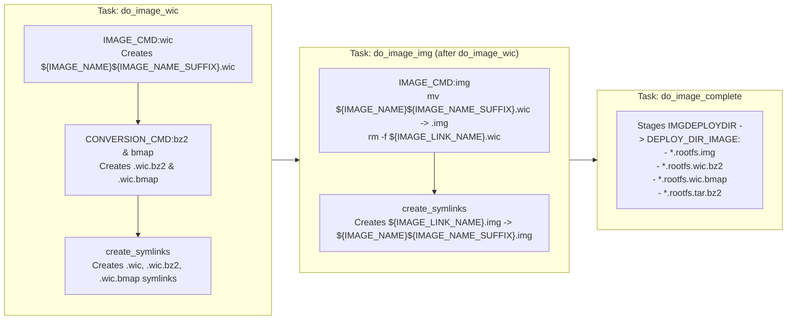

# ADR-0005: Custom BitBake `img` Image Type via WIC Rename

## Context & Problem Statement

The **`rpi-z2w-yocto-hsm`** sub-repository builds an air-gapped Yocto Project 5.0 LTS (`scarthgap`) OS image for Raspberry Pi appliances (`raspberrypi0-2w-64`). Previously, `IMAGE_FSTYPES` in [`kas-project.yml`](file:///Users/gpfister/Development/Projects/gpfister/nrf52840-hsm/rpi-z2w-yocto-hsm/kas-project.yml#L57) was configured as `"tar.bz2 wic wic.bz2 wic.bmap"`, producing an uncompressed partitioned SD card image with the `.wic` extension (`*.rootfs.wic`).

However, standard host disk imaging utilities across macOS, Linux, and Windows — including Raspberry Pi Imager, BalenaEtcher, and macOS `hdiutil` / `Disk Utility` — expect raw uncompressed disk images to carry the `.img` extension rather than `.wic`. At the same time, downstream workflows and fast block-map flashing tools (`bmaptool copy` and compressed streaming) rely on `.wic.bz2` and `.wic.bmap`, while RAUC update bundle generation (`update-bundle.bb`) relies on `.tar.bz2`.

We need a clean, idiomatic BitBake mechanism in `meta-hsm-os` that:
1. Emits the uncompressed raw disk image with the `.img` extension (`*.rootfs.img` and timestamped `*.rootfs-<timestamp>.img`).
2. Preserves `.wic.bz2`, `.wic.bmap`, and `.tar.bz2` outputs without alteration.
3. Ensures no uncompressed `.wic` file or broken `.wic` symlink remains in `DEPLOY_DIR_IMAGE`.
4. Avoids executing `wic create` a second time or duplicating a 1.6 GB disk image during the build.

---

## Decision Drivers

- **Zero Redundant `wic create` Execution**: Running `wic create` twice doubles disk partitioning overhead and slows down incremental image builds.
- **Zero Extra Disk I/O**: Renaming (`mv`) within `${IMGDEPLOYDIR}` is an atomic metadata operation on the same filesystem, whereas copying (`cp`) duplicates 1.6 GB of I/O per build.
- **Race-Free Conversion Ordering**: Compressed and block-map conversions (`wic.bz2`, `wic.bmap`) must finish reading `${IMAGE_NAME}.wic` before it is renamed to `${IMAGE_NAME}.img`.
- **Sstate & Symlink Hygiene**: BitBake's `IMGDEPLOYDIR` sstate staging and automatic `create_symlinks` post-function must produce valid `${IMAGE_LINK_NAME}.img` symlinks and zero dangling `${IMAGE_LINK_NAME}.wic` symlinks.

---

## Considered Options

### Option 1: Define a Standalone `IMAGE_CMD:img` Invoking `wic create` Directly
- *Mechanism*: Duplicate the OpenEmbedded `IMAGE_CMD:wic` implementation inside `IMAGE_CMD:img` to run `wic create` and output `.img`.
- *Pros*: Independent of `do_image_wic`.
- *Cons*: Runs `wic create` twice (once for `wic.bz2` / `wic.bmap` and once for `img`), doubling build time and maintenance burden against upstream Poky Scarthgap `image_types_wic.bbclass`.

### Option 2: Post-Processing Hook (`IMAGE_POSTPROCESS_COMMAND` / `do_image_complete:append`)
- *Mechanism*: Keep `wic` in `IMAGE_FSTYPES` and rename `.wic` to `.img` in a post-processing hook.
- *Pros*: Simple shell script.
- *Cons*: Bypasses BitBake's native `IMAGE_FSTYPES` task graph and automatic `create_symlinks` mechanism, requiring manual timestamp and symlink management.

### Option 3: Custom `img` Image Type with `IMAGE_TYPEDEP:img = "wic"` and Rename in `IMAGE_CMD:img` (Chosen)
- *Mechanism*:
  1. Set `IMAGE_FSTYPES = "tar.bz2 img wic.bz2 wic.bmap"` in [`kas-project.yml`](file:///Users/gpfister/Development/Projects/gpfister/nrf52840-hsm/rpi-z2w-yocto-hsm/kas-project.yml#L57).
  2. Define `IMAGE_TYPEDEP:img = "wic"` and `IMAGE_CMD:img` in [`kas-project.yml`](file:///Users/gpfister/Development/Projects/gpfister/nrf52840-hsm/rpi-z2w-yocto-hsm/kas-project.yml#L58-L59) and [`hsm-image-base.bb`](file:///Users/gpfister/Development/Projects/gpfister/nrf52840-hsm/rpi-z2w-yocto-hsm/meta-hsm-os/recipes-core/images/hsm-image-base.bb#L34-L39):
     ```bitbake
     IMAGE_TYPEDEP:img = "wic"
     IMAGE_CMD:img () {
         mv "${IMGDEPLOYDIR}/${IMAGE_NAME}${IMAGE_NAME_SUFFIX}.wic" "${IMGDEPLOYDIR}/${IMAGE_NAME}${IMAGE_NAME_SUFFIX}.img"
         rm -f "${IMGDEPLOYDIR}/${IMAGE_LINK_NAME}.wic"
     }
     ```
     > [!NOTE]
     > In OE-Core / Yocto Scarthgap (`image_types_wic.bbclass`), `IMAGE_CMD:wic` produces `${IMGDEPLOYDIR}/${IMAGE_NAME}${IMAGE_NAME_SUFFIX}.wic` (where `IMAGE_NAME_SUFFIX = ".rootfs"` by default, or `${IMAGE_NAME}.wic` when `IMAGE_NAME` embeds the suffix). Moving `${IMGDEPLOYDIR}/${IMAGE_NAME}${IMAGE_NAME_SUFFIX}.wic` to `${IMGDEPLOYDIR}/${IMAGE_NAME}${IMAGE_NAME_SUFFIX}.img` ensures exact alignment with OE-Core Scarthgap's `create_symlinks` post-function, which expects `${IMGDEPLOYDIR}/${IMAGE_NAME}${IMAGE_NAME_SUFFIX}.${type}` to create `${IMGDEPLOYDIR}/${IMAGE_LINK_NAME}.img -> ${IMAGE_NAME}${IMAGE_NAME_SUFFIX}.img`.
- *Pros*:
  - Reuses the single `do_image_wic` execution required by `wic.bz2` and `wic.bmap`.
  - Completely race-free: in Yocto Scarthgap (`image.bbclass`), `CONVERSION_CMD:bz2` and `CONVERSION_CMD:bmap` are emitted inline inside the `do_image_wic` task script before `do_image_wic` completes, whereas `do_image_img` is scheduled as a separate BitBake task ordered `after do_image_wic`.
  - BitBake's built-in `create_symlinks` post-function on `do_image_img` automatically creates `${IMGDEPLOYDIR}/${IMAGE_LINK_NAME}.img -> ${IMAGE_NAME}${IMAGE_NAME_SUFFIX}.img`.
  - Removing `${IMGDEPLOYDIR}/${IMAGE_LINK_NAME}.wic` prevents any uncompressed `.wic` symlink from being staged to `DEPLOY_DIR_IMAGE`.
- *Cons*:
  - Requires cleaning any pre-existing stale `.wic` files from `build/deploy/images/<machine>/` generated by earlier builds.

---

## Decision Outcome

**Chosen Option: Option 3 — Custom `img` Image Type with `IMAGE_TYPEDEP:img = "wic"` and in-place rename in `IMAGE_CMD:img`.**

### BitBake Task Execution Flow



---

## Consequences

### Positive
- **Out-of-the-Box Flasher Compatibility**: Host imaging tools (Raspberry Pi Imager, BalenaEtcher, macOS Disk Utility, `scripts/flash-sd.sh`) recognize `*.rootfs.img` directly without manual file renaming.
- **Preserved Ecosystem Compatibility**: `.wic.bz2`, `.wic.bmap`, and `.tar.bz2` remain intact for `bmaptool`, compressed streaming, and RAUC bundle builds.
- **Zero Performance Overhead**: Uses atomic `mv` within `${IMGDEPLOYDIR}` with no second `wic create` invocation.

### Negative
- **Stale Artifact Cleanup on Existing Build Trees**: Existing `build/deploy/images/<machine>/*.wic` files from prior builds must be removed once so the deploy directory only contains `.img` for uncompressed images.
