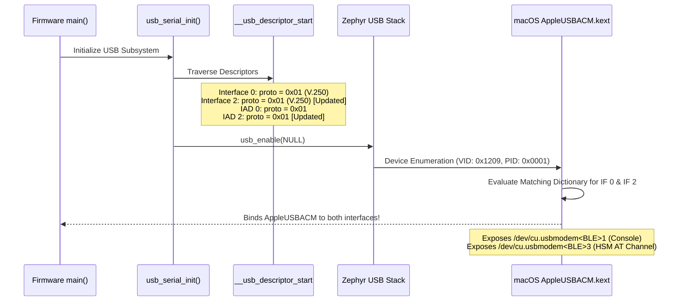

# ADR-0013: Standard CDC-ACM AT Protocol Descriptors for macOS Dual Enumeration

## Context & Problem Statement

The **nRF52840 HSM Dongle** (`PCA10059`) composite USB device exposes two dual CDC-ACM (Abstract Control Model) Virtual COM Ports:
1. **Interface 0 & 1 (`cdc_acm_uart0`)**: Zephyr RTOS kernel logging and console.
2. **Interface 2 & 3 (`cdc_acm_uart1`)**: Dedicated HSM AT Command & DFU channel.

In [[Architecture/Decisions/ADR-0002 - In-Tree Protocol Descriptor Patching vs macOS DriverKit Extension|ADR-0002]], an architectural decision was made to patch Zephyr's in-tree USB descriptors at boot time to uniquely distinguish the two interfaces:
- Interface 0 was assigned `bInterfaceProtocol = 0x01` (ITU-T V.250 AT command protocol).
- Interface 2 was assigned `bInterfaceProtocol = 0x02` under the assumption that assigning an incremental protocol number would provide clean logical differentiation for host software.

However, during production firmware flashing and host telemetry verification on macOS (Darwin ARM64 / Apple Silicon) documented in [[Monitoring/2026-11-05 - Production Flashing and USB CDC-ACM Interface Anomaly|Telemetry Record 2026-11-05]], **macOS failed to instantiate a serial modem device node for Interface 2**. Only Interface 0 registered as `/dev/cu.usbmodem<BLE_ADDR>1`, while the HSM AT channel (`/dev/cu.usbmodem<BLE_ADDR>3`) was absent, completely blocking host communication with `hsmutil` and `libnrf52840_pkcs11`.

### Root Cause Analysis

Under the USB CDC Subclass Specification for PSTN Devices:
- `0x00`: No class-specific protocol.
- `0x01`: AT Commands defined by ITU-T Recommendation V.250.
- `0x02`: AT Commands defined by PCCA-101 (deprecated cellular/telephony standard).

Apple's native CDC-ACM drivers (`AppleUSBACM.kext` and UserSpace DriverKit `com.apple.DriverKit.AppleUSBACMControl`) enforce strict matching criteria for instantiating standard BSD serial client modem nodes (`/dev/cu.usbmodem*`):

$$\text{Matching Rule} = \left(\text{bInterfaceClass} = 0\text{x}02\right) \land \left(\text{bInterfaceSubClass} = 0\text{x}02\right) \land \left(\text{bInterfaceProtocol} \in \{0\text{x}00, 0\text{x}01\}\right)$$

Because Interface 2 descriptor and its Interface Association Descriptor (IAD) specified `0x02`, the Apple USB driver rejected the interface as an unsupported proprietary cellular modem requiring third-party drivers.

---

## Decision Drivers

- **Universal Zero-Driver Host Operation**: End-users must be able to plug the dongle into macOS, Linux, and Windows without installing kernel extensions, DriverKit packages, or custom drivers.
- **Dual-Interface Availability**: Both the Console port and the HSM AT Channel must reliably instantiate their respective character device nodes simultaneously on macOS.
- **Specification Compliance**: Follow standard USB CDC PSTN conventions without violating host operating system matching expectations.
- **Minimal Code Surface**: Solve the issue at the firmware descriptor patch hook without restructuring the Zephyr composite USB stack.

---

## Considered Options

### Option 1: Standardize Both CDC-ACM Interfaces on Protocol `0x01` (ITU-T V.250) — **[ACCEPTED]**
- **Architecture**:
  - In [`firmware/app/src/usb_serial.c`](file:///Users/gpfister/Development/Projects/gpfister/nrf52840-hsm/nrf52840-hsm-firmware/firmware/app/src/usb_serial.c), patch Interface 2 (`bInterfaceNumber == 2`) to `bInterfaceProtocol = 0x01`.
  - In the corresponding Interface Association Descriptor (`bFirstInterface == 2`), set `iad->bFunctionProtocol = 0x01`.
- **Pros**:
  - Conforms directly to Apple's native driver match criteria, immediately creating `/dev/cu.usbmodem<BLE_ADDR>3`.
  - Accurately describes the interface: the HSM channel operates an ASCII AT-command parser (`AT+DFU_*`, `AT+PING`, `AT+ECHO`).
  - Maintains 100% compatibility with Linux `cdc_acm` (`/dev/ttyACM1`) and Windows `usbser.sys`.
  - Requires changing only two numeric constants in [`usb_serial.c`](file:///Users/gpfister/Development/Projects/gpfister/nrf52840-hsm/nrf52840-hsm-firmware/firmware/app/src/usb_serial.c).
- **Cons**:
  - Both CDC-ACM interfaces report protocol `0x01` in descriptor tables. Host tools cannot differentiate the two functions based solely on the `bInterfaceProtocol` field; they must use data interface index (suffix `1` vs `3`), string descriptors (`iInterface`), or AT probing.

### Option 2: Set Interface 2 Protocol to `0x00` (No Class Protocol)
- **Architecture**: Patch Interface 2 to `bInterfaceProtocol = 0x00` and `iad->bFunctionProtocol = 0x00`.
- **Pros**: macOS accepts `0x00` and creates the device node.
- **Cons**: `0x00` signifies vendor-specific / unclassified serial framing. Since the HSM channel strictly implements an AT command protocol conforming to ITU-T V.250 syntax, `0x01` is semantically more accurate.

### Option 3: Author macOS DriverKit DEXT for Custom Protocol `0x02`
- **Architecture**: Keep `bInterfaceProtocol = 0x02` and write an Apple DriverKit extension matching `0x02`.
- **Pros**: Allows maintaining non-standard protocol byte.
- **Cons**: Defeats the zero-driver, plug-and-play philosophy of the project. Requires paid Apple Developer certificates, notarization, and user approval in macOS System Settings. Rejected for reasons detailed in ADR-0002.

---

## Decision Outcome

**Chosen Option**: **Option 1: Standardize Both CDC-ACM Interfaces on Protocol `0x01` (ITU-T V.250)**.

We formally supersede the protocol differentiation choice in [[Architecture/Decisions/ADR-0002 - In-Tree Protocol Descriptor Patching vs macOS DriverKit Extension|ADR-0002]]. Interface 2 descriptor and its IAD will both use `0x01`.

Interface differentiation is achieved through:
1. **Interface Index / macOS Device Suffix**:
   - Console: `/dev/cu.usbmodem<BLE_ADDR>1` (Data IF 1)
   - HSM AT Channel: `/dev/cu.usbmodem<BLE_ADDR>3` (Data IF 3)
2. **String Descriptors**:
   - `iInterface` for IF 0 / IAD 0: `"nRF52840 Dongle Console"`
   - `iInterface` for IF 2 / IAD 2: `"nRF52840 Dongle HSM AT Channel"`
3. **Deterministic Discovery in `hsmutil`**:
   - Host CLI uses the multi-tiered discovery defined in [[Architecture/Decisions/ADR-0003 - Host Port Discovery and Serial Targeting Strategy|ADR-0003]], prioritizing suffix `3` or executing `AT+PING` probing.

---

## Architecture Flow

```mermaid
flowchart TD
    subgraph Host ["macOS Host (AppleUSBACM / DriverKit)"]
        enum["USB Bus Enumeration (VID 0x1209 / PID 0x0001)"]
        match{"AppleUSBACM Match Rule:<br/>bInterfaceClass == 0x02 &<br/>bInterfaceSubClass == 0x02 &<br/>bInterfaceProtocol in {0x00, 0x01}"}
        dev0["Instantiate /dev/cu.usbmodem*1<br/>(Console - IF 0 / Data IF 1)"]
        dev1["Instantiate /dev/cu.usbmodem*3<br/>(HSM AT - IF 2 / Data IF 3)"]
    end

    subgraph Dongle ["nRF52840 Dongle Firmware (usb_serial.c)"]
        patch["usb_serial_patch_descriptors()"]
        desc0["IF 0 & IAD 0:<br/>proto = 0x01 (ITU-T V.250 AT)"]
        desc1["IF 2 & IAD 2:<br/>proto = 0x01 (ITU-T V.250 AT) [FIXED]"]
    end

    enum --> patch
    patch --> desc0
    patch --> desc1
    desc0 --> match
    desc1 --> match
    match -->|IF 0 (0x01)| dev0
    match -->|IF 2 (0x01)| dev1
```

### Descriptor Patch Sequence



---

## Consequences & Trade-offs

### Positive Consequences
- **Full macOS Compatibility**: Both CDC-ACM serial channels instantiate native BSD character devices (`/dev/cu.usbmodem*1` and `/dev/cu.usbmodem*3`) under Darwin with zero drivers.
- **Cross-Platform Uniformity**: Linux (`/dev/ttyACM0`, `/dev/ttyACM1`) and Windows (`COMx`, `COMy`) remain fully supported with no behavioral regressions.
- **Unblocks Automated Tooling**: Host-side test suites, `hsmutil firmware info`, and DFU flashing (`hsmutil firmware update`) can execute directly on macOS developer workstations.

### Negative Consequences & Mitigations
- **Shared Protocol Byte**: Both interfaces advertise protocol `0x01`. Host software cannot use `bInterfaceProtocol` alone to distinguish the interfaces.
  - *Mitigation*: Distinguish via data interface suffix (`1` vs `3`), string descriptors (`iInterface`), or `hsmutil`'s existing discovery hierarchy ([[Architecture/Decisions/ADR-0003 - Host Port Discovery and Serial Targeting Strategy|ADR-0003]]).
