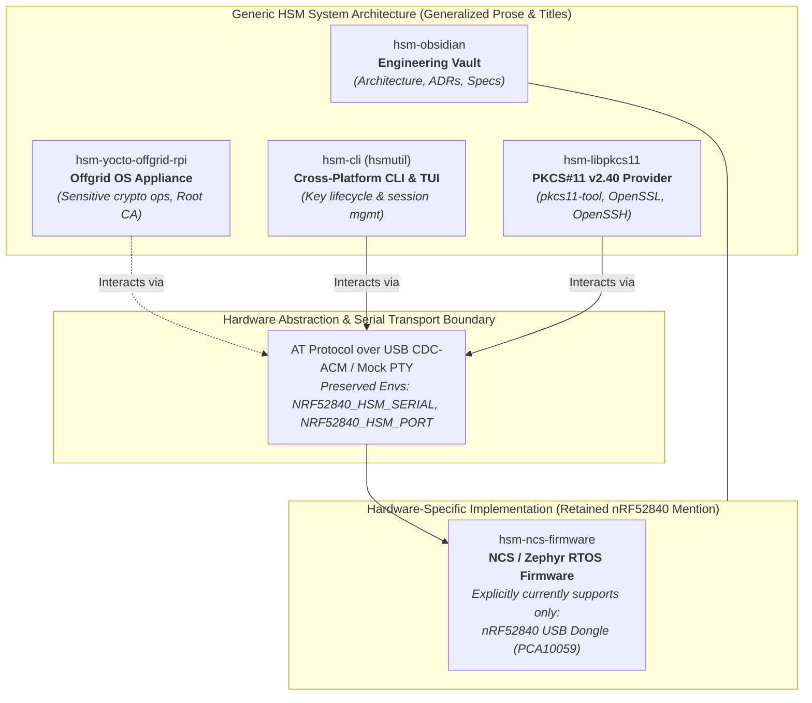

# ADR-0014: Documentation Terminology Generalization to Generic HSM USB Key

## Context & Problem Statement

The multi-repository workspace coordinates multiple distinct subsystems comprising an open-source Hardware Security Module (HSM) ecosystem:
1. An air-gapped embedded Linux operating system for sensitive cryptographic operations (`hsm-yocto-offgrid-rpi`).
2. A cross-platform CLI and TUI utility (`hsm-cli` / `hsmutil`).
3. A Cryptoki PKCS#11 v2.40 shared provider library (`hsm-libpkcs11`).
4. Central engineering knowledge curation and architecture vaults (`hsm-obsidian`).
5. A microcontroller firmware implementation (`hsm-ncs-firmware`).

Historically, documentation across all subsystem `README.md` files, root project instructions (`AGENTS.md`), and Obsidian vault index notes coupled system-level concepts directly to the "nRF52840" microcontroller name in prose, titles, and descriptions.

However, from an architectural standpoint:
- `hsm-yocto-offgrid-rpi` is a generic, hardened, air-gapped Linux operating system designed to host sensitive cryptographic operations (such as offline Root Certificate Authority management and key ceremony orchestration) interfacing with an attached HSM USB key.
- `hsm-cli` (`hsmutil`) is a generic HSM client communicating over an AT-command serial transport or mock PTY.
- `hsm-libpkcs11` is a generic Cryptoki PKCS#11 provider allowing standard utilities (`pkcs11-tool`, OpenSSL 3 `pkcs11-provider`, OpenSSH) to invoke cryptographic operations on an attached HSM key.
- `hsm-obsidian` is the project-wide technical documentation vault.
- `hsm-ncs-firmware` is the **only** subsystem strictly tied to a physical microcontroller target, and it currently exclusively targets the Nordic Semiconductor nRF52840 USB Dongle (`PCA10059`) using ARM CryptoCell CC310.

Tight coupling in documentation misled developers into treating the entire ecosystem as a single-chip peripheral rather than a modular HSM platform with extensible firmware backends.

---

## Decision Drivers

- **Architectural Layering**: High-level host tooling, PKCS#11 middleware, and the offgrid OS appliance should reflect their generic, platform-agnostic roles without leaky hardware abstractions.
- **Accurate Scope Delegation**: The firmware subsystem should be the single source of truth for microcontroller hardware constraints, explicitly documenting that it currently targets the nRF52840 USB Dongle (`PCA10059`).
- **Non-Breaking Preservation**: Machine-level identifiers (build artifacts like `libnrf52840_pkcs11.dylib`, environment variables like `NRF52840_HSM_SERIAL`, Linux kernel module names like `nrf52840-hsm-kmod`, and compilation targets like `PCA10059`) must remain intact to avoid breaking existing toolchains, scripts, and runtime consumers.
- **Consistent Developer Experience**: Ensure all subsystem READMEs, workspace coordination instructions (`AGENTS.md`), and knowledge vault indexes share a clear, coherent taxonomy.

---

## Considered Options

### Option 1: Full Multi-Repository & Code Identifier Renaming
- **Approach**: Rename all sub-repositories, environment variables (`HSM_SERIAL`), kernel modules (`hsm-kmod`), and build artifacts (`libhsm_pkcs11.dylib`).
- **Pros**: 100% uniformity across code and documentation.
- **Cons**: High risk of breaking runtime deployments, existing shell scripts, CI/CD pipelines, udev/DriverKit rules, and third-party PKCS#11 configuration files (`openssl.cnf`, `p11-kit`). High engineering churn with zero functional benefit.
- **Outcome**: **Rejected**.

### Option 2: Status Quo (Retain "nRF52840" Everywhere)
- **Approach**: Maintain existing documentation coupling all tools and operating system layers to nRF52840.
- **Pros**: Zero effort required.
- **Cons**: Violates clean architecture; falsely implies that `hsmutil`, `hsm-libpkcs11`, and `hsm-yocto-offgrid-rpi` cannot interface with other HSM hardware or simulated targets.
- **Outcome**: **Rejected**.

### Option 3: Documentation Terminology Generalization with Targeted Firmware Hardware Scoping — **[ACCEPTED]**
- **Approach**:
  - Standardize documentation prose, titles, and overviews across workspace `README.md` files, `AGENTS.md`, and `hsm-obsidian` to generic HSM and USB key / dongle terminology.
  - Retain "nRF52840" exclusively in `hsm-ncs-firmware`, where it is explicitly documented that the firmware currently only supports the nRF52840 USB Dongle (`PCA10059`).
  - Strictly preserve all code-level symbols, artifact filenames, environment variables, and board build flags.
- **Pros**:
  - Aligns documentation with clean modular architecture.
  - Accurately conveys system responsibilities.
  - Zero risk of regression or breakage for existing tooling and configurations.
- **Outcome**: **Accepted**.

---

## Decision Outcome

**Chosen Option**: **Option 3: Documentation Terminology Generalization with Targeted Firmware Hardware Scoping**.

### Subsystem Documentation Taxonomy

| Subsystem | Generalization Scope | Concrete Terminology in Documentation |
| :--- | :--- | :--- |
| **Workspace Root (`nrf52840-hsm`)** | Multi-repo orchestration overview | Hardware Security Module (HSM) USB Key / Dongle Workspace coordinating firmware, host CLI, PKCS#11 library, offgrid OS, and documentation. |
| **`hsm-yocto-offgrid-rpi`** | Air-gapped OS appliance | Offgrid Yocto-based system to perform sensitive cryptographic operations (e.g. offline Root Certificate Authority management) with an attached HSM USB key. |
| **`hsm-cli`** | Host user-space tooling | Cross-platform CLI (`hsmutil`) and TUI for interacting with the HSM USB key. |
| **`hsm-libpkcs11`** | Cryptoki provider middleware | PKCS#11 v2.40 shared library enabling standard utilities (`pkcs11-tool`, OpenSSL, OpenSSH) to interact with the HSM key. |
| **`hsm-obsidian`** | Knowledge curation vault | Central documentation vault for the HSM USB Key ecosystem, indexing architecture, ADRs, specifications, and workflows. |
| **`hsm-ncs-firmware`** | Microcontroller firmware | HSM firmware built on nRF Connect SDK / Zephyr RTOS, explicitly stating that it **currently only supports the nRF52840 USB Dongle (`PCA10059`)**. |

### Preservation Boundaries (Strictly Unchanged)

To safeguard backward compatibility, the following technical identifiers remain unmodified:
1. **Shared Library Names**: `libnrf52840_pkcs11.dylib`, `libnrf52840_pkcs11.so`, `libnrf52840_pkcs11.dll`.
2. **Environment Variables**: `NRF52840_HSM_SERIAL`, `NRF52840_HSM_PORT`, `NRF52840_HSM_DEBUG`.
3. **Kernel Driver & Device Naming**: `nrf52840-hsm-kmod`, `/dev/tty.hsm<ble_address><number>`.
4. **Hardware Board Targets**: `nrf52840dongle/nrf52840`, `PCA10059`, Segger J-Link probe ID `802007333`, Nordic FICR registers (`NRF_FICR`).
5. **Git Sub-Repository Directory Names**: `hsm-ncs-firmware`, `hsm-cli`, `hsm-libpkcs11`, `hsm-obsidian`, `hsm-yocto-offgrid-rpi`.

---

## Architecture Flow & Terminology Boundaries

---

## Consequences

### Positive Consequences
- **High Architectural Fidelity**: Documentation properly reflects domain boundaries, positioning host tools and the offgrid OS as modular, reusable components.
- **Accurate Expectation Setting**: Users and contributors immediately understand that `hsm-ncs-firmware` currently implements the nRF52840 dongle target, leaving clear paths for future microcontroller ports.
- **Zero Disruption**: Existing compilation scripts, Makefiles, tests, and CI/CD jobs continue running without modifications.

### Negative Consequences / Trade-offs
- Slight divergence between high-level generic documentation prose ("HSM USB key") and legacy low-level symbol names (`NRF52840_HSM_SERIAL`, `libnrf52840_pkcs11`). This is mitigated by explicit notes in the subsystem READMEs clarifying that preserved identifiers ensure backwards compatibility.
