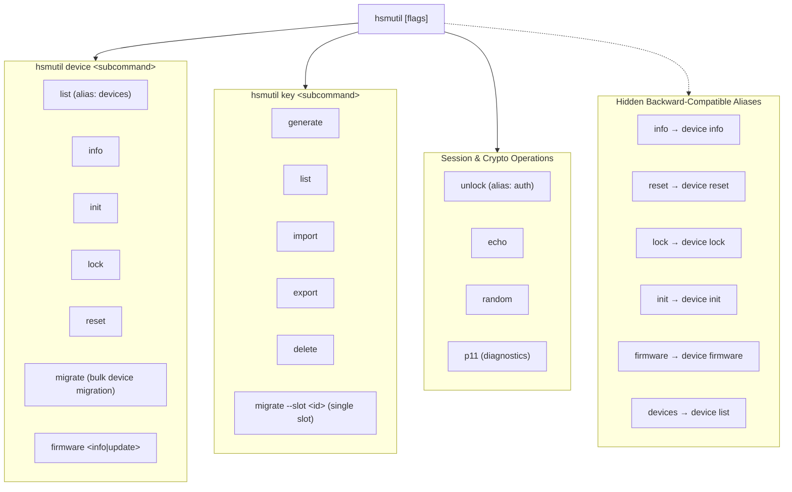
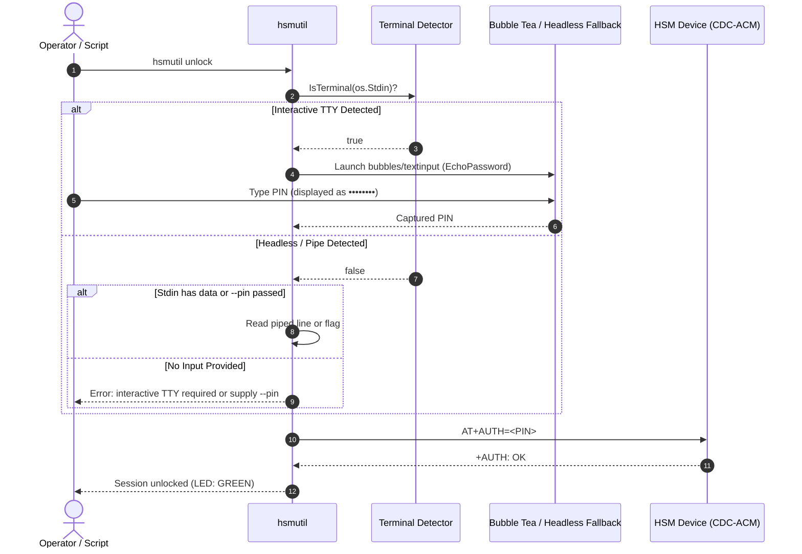

# ADR-0015: HSM CLI Restructuring, Static Compilation, Bubble Tea UX, and PKCS#11 Equivalence

## Context & Problem Statement

The `hsmutil` command-line utility serves as the primary administrative, cryptographic, and firmware lifecycle interface for the Hardware Security Module (HSM) USB key ecosystem across macOS, Linux, and Windows.

Over several development phases, capabilities were added opportunistically directly to the root command (`rootCmd`):
- Device operations: `devices`, `info`, `init`, `lock`, `reset`, `firmware` (with `firmware info` and `firmware update`).
- Cryptographic operations: `key` (with `generate`, `list`, `delete`, `import`, `export`, `migrate`), `echo`, `random`.
- Middleware diagnostics: `p11`.
- Experimental features: a monolithic full-screen Bubble Tea terminal dashboard (`tui`) and embedded integration tests (`test`).

This organic growth introduced several architectural challenges:
1. **Command Namespace Pollution**: Device-level operations (`info`, `reset`, `lock`, `init`, `firmware`) competed with top-level verbs on `rootCmd` without a logical resource hierarchy.
2. **Maintenance Overhead of Dead Features**: The `tui` command was an unmaintained parallel implementation that duplicated CLI commands, while `test` duplicated tests already implemented in Go unit tests and the workspace integration test harness (`scripts/run_integration_tests.sh`).
3. **Dynamic Linking & Portability Hazards**: Default compilation on host environments dynamically linked system C runtime libraries (`libc`/`glibc`), causing distribution and compatibility issues when running on minimal or hardened appliances such as the air-gapped `hsm-yocto-offgrid-rpi` environment.
4. **Suboptimal Interactive UX**: Long-running operations like firmware update (`firmware update`) lacked clear visual feedback, while authentication (`auth`/`unlock`) either required plaintext flags or rudimentary stdin input without masked password entry.
5. **Ambiguous Migration Semantics**: `key migrate` operated ambiguously between migrating a single key slot versus orchestrating an atomic migration of the entire device state to a replacement dongle.
6. **Lack of PKCS#11 Standardization Mapping**: Users and security auditors lacked a formal matrix mapping `hsmutil` commands against standard OpenSC `pkcs11-tool` invocations and clear visibility into feature gaps.
7. **Coupled Hardware Terminology**: Help strings and error messages retained hardware-specific `nRF52840` references, violating the terminology neutrality mandates formalized in [[Architecture/Decisions/ADR-0014 - Documentation Terminology Generalization to Generic HSM USB Key|ADR-0014]].

---

## Decision Drivers

- **Resource-Oriented Command Ergonomics**: Organize commands cleanly around resources (`device`, `key`) while maintaining 100% backward compatibility for existing scripts, CI pipelines, and operator muscle memory.
- **Portability & Hermetic Binaries**: Ensure `hsmutil` is built as a static binary with zero dynamic C library dependencies (`CGO_ENABLED=0`), enabling immediate drop-in execution across diverse Linux distributions, scratch containers, and the Yocto offgrid appliance.
- **Surgical Terminal UX**: Replace monolithic TUI views with targeted, modern micro-interactions using Charm's Bubble Tea ecosystem (`bubbles/progress` for chunked firmware DFU streaming and `bubbles/textinput` for secure masked PIN prompts), featuring graceful headless fallback.
- **Cryptographic Safety in Migration**: Distinguish single key export/import from full device migration, enforcing fail-fast lockdown and source device zeroization during whole-device replacement ceremonies.
- **Standards Alignment**: Formalize the equivalence mapping between `hsmutil` and Cryptoki PKCS#11 v2.40 (`pkcs11-tool`) to document parity and clarify boundaries between device management and Cryptoki operations.
- **Terminology Neutrality**: Align user-facing CLI documentation with ADR-0014 by presenting the tool as a generic HSM USB Key management utility.

---

## Considered Options

### 1. Command Hierarchy Architecture

- **Option A (Flat Root Commands)**: Retain all commands at the root level (`hsmutil info`, `hsmutil reset`, `hsmutil firmware`, etc.).
  - *Pros*: Zero migration effort.
  - *Cons*: Cluttered `--help`, poor scalability as new management subcommands are added.
- **Option B (Strict Breaking Hierarchy)**: Move all device management commands strictly under `hsmutil device <subcommand>` and drop root-level commands immediately.
  - *Pros*: Cleanest possible structure.
  - *Cons*: Breaks existing deployment scripts, Makefile targets, and user workflows.
- **Option C (Resource-Oriented Hierarchy with Hidden Backward-Compatible Aliases) — [ACCEPTED]**:
  - Introduce `hsmutil device <init|reset|lock|migrate|list|info|firmware>`.
  - Maintain legacy root commands (`info`, `reset`, `lock`, `init`, `firmware`) as **hidden** aliases on `rootCmd`.
  - Provide ergonomic convenience aliases (`hsmutil devices`, `bin/hsmutils` symlink).
  - *Pros*: Clean architecture for new users while maintaining complete non-breaking backward compatibility.

### 2. User Interface Strategy

- **Option A (Retain Monolithic Full-Screen TUI Dashboard)**: Maintain `hsmutil tui`.
  - *Pros*: Single command for visual dashboard.
  - *Cons*: High maintenance cost, complex terminal resize handling, fragile serial port sharing between CLI and TUI loops.
- **Option B (Pure Plaintext CLI Only)**: Strip all interactive components.
  - *Pros*: Simple code.
  - *Cons*: Poor user experience during 60-second DFU streaming and plaintext security risks during PIN entry.
- **Option C (Surgical Bubble Tea Component Integration with Headless Fallback) — [ACCEPTED]**:
  - Prune `tui` and `test` dead code.
  - Use `bubbles/progress` for animated, real-time progress bars during firmware update.
  - Use `bubbles/textinput` with masked password bullets (`••••••`) for PIN entry.
  - Implement TTY detection (`term.IsTerminal`): fall back to line logging and non-interactive PIN input in automated scripts and pipes.

### 3. Binary Compilation & Linkage

- **Option A (Standard Dynamic CGO Compilation)**: Default `go build`.
  - *Pros*: Standard Go default.
  - *Cons*: Dynamically links host `libc`. Binaries built on modern Linux distros (glibc 2.38+) fail on minimal Yocto images or older hosts.
- **Option B (Hermetic Static Compilation via `CGO_ENABLED=0`) — [ACCEPTED]**:
  - Enforce `CGO_ENABLED=0` across all host and cross-compilation Makefile targets.
  - *Pros*: Produces self-contained static ELF/Mach-O/PE binaries with zero external shared library dependencies.
  - *Cons*: Pure Go implementation required (already fulfilled by `go-serial` and internal crypto).

---

## Decision Outcome

**Chosen Option**: **Option C for Command Hierarchy, Option C for UI Strategy, and Option B for Binary Compilation**.

### 1. Command Hierarchy & Routing Matrix

The revised CLI structure cleanly decouples device lifecycle management, key management, and cryptographic services:



#### Detailed Command Map

| Revised Command | Description | Legacy / Shortcut Alias | Visibility in `--help` |
| :--- | :--- | :--- | :--- |
| `hsmutil device list` | Enumerate connected HSM keys and serial ports | `hsmutil devices`, `hsmutil list` | Visible |
| `hsmutil device info` | Hardware, firmware, UID, and bootloader metadata | `hsmutil info` | Visible (alias hidden) |
| `hsmutil device init` | Initialize master secret and set administrator PIN | `hsmutil init` | Visible (alias hidden) |
| `hsmutil device lock` | Lock authenticated session and return LED to RED | `hsmutil lock` | Visible (alias hidden) |
| `hsmutil device reset` | Cryptographic factory reset and key zeroization | `hsmutil reset` | Visible (alias hidden) |
| `hsmutil device migrate` | Full device migration with fail-fast lockdown | — | Visible |
| `hsmutil device firmware info` | Query active MCUboot slot, size, and SHA256 digest | `hsmutil firmware info` | Visible (alias hidden) |
| `hsmutil device firmware update` | Stream MCUboot image in 256-byte chunks with DFU progress | `hsmutil firmware update` | Visible (alias hidden) |
| `hsmutil key generate` | Generate SECP256R1 keypair in hardware slot | — | Visible |
| `hsmutil key list` | List occupied key slots and public metadata | — | Visible |
| `hsmutil key import` | Import wrapped private key into target slot | — | Visible |
| `hsmutil key export` | Export wrapped public or private key | — | Visible |
| `hsmutil key delete` | Zeroize specific key slot | — | Visible |
| `hsmutil key migrate --slot <id>` | Migrate a single key slot to another HSM | — | Visible |
| `hsmutil unlock` | Authenticate session with PIN (masked prompt) | `hsmutil auth` | Visible |
| `hsmutil echo` | Serial ping/pong roundtrip latency test | — | Visible |
| `hsmutil random` | Retrieve cryptographically secure random bytes | — | Visible |
| `hsmutil p11` | PKCS#11 shared library diagnostic suite | — | Visible |

### 2. Ergonomic Aliases & Makefile Symlink

To eliminate operator friction:
1. `hsmutil devices` and `hsmutil list` are direct top-level aliases routed to `hsmutil device list`.
2. Common plural typo `hsmutils`: `Makefile` creates an automatic relative symlink in `bin/`:
   ```bash
   ln -sf hsmutil bin/hsmutils
   ```
   Both `bin/hsmutil` and `bin/hsmutils` execute identically.

### 3. Pruning: Removal of `tui` and `test`

- **Pruning `hsmutil tui`**: The standalone full-screen TUI in `internal/ui/tui` is completely removed. Terminal interactivity is redirected to inline, non-blocking Bubble Tea micro-components.
- **Pruning `hsmutil test`**: The embedded test runner is removed from the production binary. Testing is performed through standard testing layers:
  - Unit tests: `go test -v ./...` (or `make test`).
  - Integration harness: `./scripts/run_integration_tests.sh`.
  - Serial protocol validation: `python3 scripts/test_at_client.py`.

### 4. Static Compilation (`CGO_ENABLED=0`)

All build targets in `hsm-cli/Makefile` explicitly enforce `CGO_ENABLED=0`:

```makefile
build:
	@mkdir -p $(BIN_DIR)
	@echo "[INFO] Building $(BINARY_NAME) (pure static binary, CGO_ENABLED=0)..."
	CGO_ENABLED=0 go build -ldflags="-s -w" -o $(BIN_DIR)/$(BINARY_NAME) $(SRC_PKG)
	@ln -sf $(BINARY_NAME) $(BIN_DIR)/$(BINARY_NAME)s
```

Host binaries and cross-compilation artifacts (`darwin-arm64`, `linux-arm64`, `linux-amd64`, `windows-arm64`, `windows-amd64`) are completely static, eliminating runtime libc incompatibilities.

### 5. Surgical Bubble Tea Terminal UX & Headless Fallback

#### A. Firmware Update Progress (`bubbles/progress`)
When streaming chunks over `AT+DFU_CHUNK`:
- **Interactive TTY**: Renders a gradient animated progress bar showing percentage, transferred chunks, total chunks, throughput, and elapsed time:
  ```text
  Updating Firmware [zephyr.signed.bin] (Slot 1 Candidate)
  [████████████████████░░░░░░░░░░░░░░░░░░░░] 52% (67/128 chunks) [ETA: 00:14]
  ```
- **Headless Fallback (`!term.IsTerminal`)**: Emits discrete log lines every 10% or per chunk:
  ```text
  [INFO] DFU Transfer: Chunk 67/128 (52%) acknowledged.
  ```

#### B. Masked PIN Authentication (`bubbles/textinput`)
When executing `hsmutil unlock` without `--pin`:
- **Interactive TTY**: Uses `bubbles/textinput` with `EchoMode = EchoPassword` (masking characters as `•`). Characters are never echoed in plaintext.
- **Headless Fallback**: Checks if stdin has redirected data. If pipe detected, reads single trimmed line. If no data available, returns explicit error requiring `--pin <string>` or environment variable `HSM_PIN`.



### 6. Single Key vs Full Device Migration Architecture

To avoid confusion during key management and disaster recovery, migration is split into two distinct operational scopes:

```mermaid
stateDiagram-v2
    [*] --> DeviceMigrationInitiated: hsmutil device migrate --target <SERIAL>
    
    state "Full Device Migration" as FullMigrate {
        DeviceMigrationInitiated --> ConnectDevices: Resolve source & target ports
        ConnectDevices --> AuthenticateBoth: Unlock source & target devices
        AuthenticateBoth --> EnumerateSourceKeys: Query occupied slots (0..31)
        
        state "Atomic Migration Loop" as KeyLoop {
            ExportWrappedKey: Wrap slot with target ECDH pubkey
            ImportWrappedKey: Import into target slot
            VerifyTargetKey: Verify target slot public key digest
            ExportWrappedKey --> ImportWrappedKey
            ImportWrappedKey --> VerifyTargetKey
        }
        
        EnumerateSourceKeys --> ExportWrappedKey
        
        state "Validation Gate" as CheckGate <<choice>>
        VerifyTargetKey --> CheckGate
        CheckGate --> KeyLoop: More slots remain
        CheckGate --> AllKeysVerified: All slots verified successfully
        CheckGate --> FailFastLockdown: Verification mismatch or transfer error
    }

    state "Fail-Fast Lockdown" as FailFast {
        LockdownSource: Lock source device immediately
        LockdownTarget: Zeroize target partial slots
        HaltExecution: Terminate with non-zero exit code
        LockdownSource --> LockdownTarget --> HaltExecution
    }

    FailFastLockdown --> FailFast
    
    state "Decommissioning Gate" as SourceZeroize {
        ConfirmDestruction: Prompt or --confirm-zeroize
        ZeroizeSource: AT+FACTORYRESET on source device
        ConfirmDestruction --> ZeroizeSource
    }

    AllKeysVerified --> SourceZeroize
    ZeroizeSource --> MigrationCompleted: Complete
    MigrationCompleted --> [*]
```

#### Comparison of Migration Modes

| Dimension | Single Key Migration (`key migrate`) | Full Device Migration (`device migrate`) |
| :--- | :--- | :--- |
| **Command** | `hsmutil key migrate --slot <id> --target <serial>` | `hsmutil device migrate --target <serial>` |
| **Target Scope** | Exactly one designated hardware slot | All occupied slots (0..31), PINs, and metadata |
| **Source Key Action** | Preserved by default (optional `--delete-source`) | **Zeroized** after end-to-end verification |
| **Failure Handling** | Target slot erased; source unmodified | **Fail-fast lockdown**: partial target keys wiped, source locked |
| **Use Case** | Replicating a shared signing key across dongles | Hardware replacement, dongle decommissioning |

### 7. PKCS#11 Equivalence Matrix & GAP Analysis

`hsm-libpkcs11` implements the OASIS Cryptoki PKCS#11 v2.40 specification. The table below maps `hsmutil` commands against standard OpenSC `pkcs11-tool` invocations and identifies device management gaps:

| Functional Area | `hsmutil` Command | `pkcs11-tool` Equivalent (`--module libnrf52840_pkcs11.dylib`) | Parity Status | Gap / Scope Rationale |
| :--- | :--- | :--- | :--- | :--- |
| **Device Enumeration** | `hsmutil device list` | `pkcs11-tool -L` (`--list-slots`) | Equivalent | `hsmutil` displays OS device nodes and hardware BLE serials; PKCS#11 displays Cryptoki slot tokens. |
| **Device Metadata** | `hsmutil device info` | `pkcs11-tool -M` (`--list-mechanisms`) / `-T` | Equivalent | `hsmutil` includes MCUboot slot metadata and PSA digests; PKCS#11 exposes standard token info. |
| **Device Initialization** | `hsmutil device init` | `pkcs11-tool --init-token --init-pin` | Equivalent | Fully supported in both. |
| **Session Unlock** | `hsmutil unlock` (with PIN) | `pkcs11-tool --login --pin <PIN>` | Equivalent | Standard Cryptoki `C_Login`. |
| **Session Lock** | `hsmutil device lock` | `pkcs11-tool --logout` | Equivalent | Standard Cryptoki `C_Logout`. |
| **Factory Reset** | `hsmutil device reset` | *None* | `hsmutil` Exclusive | Out-of-band administrative hardware zeroization not defined in standard Cryptoki. |
| **Firmware Update (DFU)** | `hsmutil device firmware update` | *None* | `hsmutil` Exclusive | Firmware lifecycle and dual-stage MCUboot swapping is a host administration function. |
| **Key Generation** | `hsmutil key generate --slot <N>` | `pkcs11-tool --keypairgen --key-type EC:secp256r1 --id <N>` | Equivalent | Standard Cryptoki `C_GenerateKeyPair`. |
| **Key Enumeration** | `hsmutil key list` | `pkcs11-tool -O` (`--list-objects`) | Equivalent | Standard Cryptoki `C_FindObjects`. |
| **Digital Signature** | `hsmutil key sign` | `pkcs11-tool --sign --id <N> -m ECDSA-SHA256` | Equivalent | Standard Cryptoki `C_Sign`. |
| **Key Deletion** | `hsmutil key delete --slot <N>` | `pkcs11-tool --delete-object --type privkey --id <N>` | Equivalent | Standard Cryptoki `C_DestroyObject`. |
| **Key Migration** | `hsmutil key migrate` | `pkcs11-tool --wrap` / `--unwrap` | Partial Gap | Direct slot-to-slot wrapping supported in `hsmutil`; PKCS#11 requires C_WrapKey mechanism support. |
| **Device Migration** | `hsmutil device migrate` | *None* | `hsmutil` Exclusive | Multi-key atomic device cloning with source zeroization is a specialized HSM platform capability. |
| **Random Data (TRNG)** | `hsmutil random` | `pkcs11-tool --generate-random <bytes>` | Equivalent | Standard Cryptoki `C_GenerateRandom`. |

---

## Consequences & Operational Impacts

### Positive Consequences

1. **Clear Mental Model**: Separating `device` management from `key` operations creates an intuitive, scalable hierarchy.
2. **Zero Regressions**: Hidden aliases guarantee that all existing scripts, documentation examples, and automated tests continue operating without modification.
3. **Flawless Portability**: Static `CGO_ENABLED=0` builds guarantee that `hsmutil` runs out of the box on the air-gapped `hsm-yocto-offgrid-rpi` appliance, minimal containers, and diverse developer workstations.
4. **Enhanced Security UX**: Masked password entry prevents shoulder surfing during key ceremonies, while animated progress bars eliminate ambiguity during lengthy firmware updates.
5. **Robust Disaster Recovery**: Clarified migration semantics ensure cryptographic keys cannot be silently duplicated or left in an incomplete state during device replacement.
6. **Standards Compliance**: The PKCS#11 equivalence matrix provides immediate technical clarity for enterprise PKI and OpenSSL integration teams.

### Mitigations & Transition Strategy

- **Deprecation Timeline**: Legacy top-level commands will remain permanently supported as hidden aliases in `hsmutil` v1.x, with deprecation warnings scheduled only for a hypothetical v2.0 milestone.
- **Typo Tolerance**: The `bin/hsmutils` symlink is generated during build time to handle the frequent plural command execution pattern.
- **Continuous Integration**: The multi-repository integration test harness (`scripts/run_integration_tests.sh`) tests both the canonical `hsmutil device <subcommand>` path and the hidden alias paths.
