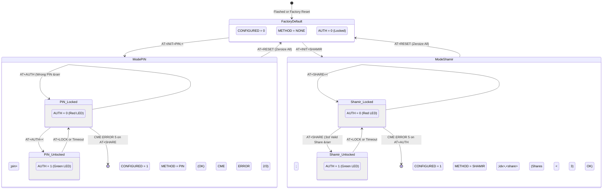

# ADR-0016: Dual-Mode Authentication Architecture (PIN and Shamir's Secret Sharing)

## Context & Problem Statement

The Hardware Security Module (HSM) USB Key must protect cryptographic assets (such as SECP256R1 ECDSA private keys and root authority material) from unauthorized local invocation. In earlier firmware iterations, device initialization and authentication mechanisms evolved opportunistically:
1. **Ambiguous Device Configuration State**: Firmware supported both standard single-user PIN authentication (`AT+AUTH=<pin>`) and 3-of-5 Shamir's Secret Sharing threshold authentication (`AT+INIT=1` and `AT+SHARE=<idx>,<share>`). However, the persistent keystore lacked an explicit authentication method discriminant (`auth_method_t`).
2. **Missing Status Transparency**: The diagnostic command `AT+STATUS?` historically reported only `AUTH=<0|1>,RETRIES=<N>,KEYCOUNT=<K>`. Host utilities, administrative scripts, and PKCS#11 middleware could not programmatically detect whether a connected HSM was unconfigured, initialized with a single-user PIN, or governed by an M-of-N Shamir custodian split.
3. **Absence of Mutual Exclusivity**: Without explicit method enforcement, firmware routines allowed `AT+AUTH` and `AT+SHARE` commands to be dispatched concurrently or interleaved, leading to state machine confusion and undefined security guarantees.
4. **Passphrase Entropy Limitations**: PIN storage was constrained to short numeric or 32-byte ASCII buffers, preventing operators from using high-entropy passphrases (up to 64 bytes) compliant with corporate security policies and appliance password complexity requirements.
5. **PKCS#11 Semantic Gaps**: The Cryptoki PKCS#11 specification mandates clear mechanisms for handling hardware authentication. In Shamir mode, interactive PIN prompts during `C_Login` fail because key unwrapping requires multi-custodian share reconstruction rather than a single ASCII PIN. The middleware failed to signal `CKF_PROTECTED_AUTHENTICATION_PATH` and lacked logic to bypass PIN checks when the device was pre-authenticated via custodian ceremonies.
6. **Cross-Mode Migration Hazards**: Single-key and whole-device migration commands did not validate whether the source and destination devices shared the same authentication paradigm, creating the risk of bricking or locking target devices during backup transfers.

---

## Decision Drivers

- **Cryptographic Rigor & Zero Ambiguity**: The HSM state machine must enforce strict mutual exclusivity between PIN mode and Shamir mode. An HSM initialized with a PIN must never accept Shamir shares; an HSM initialized with Shamir's Secret Sharing must never accept a single PIN.
- **Self-Describing Hardware Status**: Host tools (`gphsm`), PKCS#11 middleware (`libgphsm`), and diagnostic harnesses must discover device status via a single query (`AT+STATUS?`) exposing both `CONFIGURED` and `METHOD`.
- **Passphrase Security**: Support robust alphanumeric passphrases of up to 64 bytes with constant-time comparison and hardware-accelerated SHA-256 / PBKDF2 derivative storage in Non-Volatile Storage (NVS).
- **Standards-Compliant PKCS#11 Integration**: Conform strictly to Cryptoki v2.40 token flags: advertise `CKF_PROTECTED_AUTHENTICATION_PATH` in Shamir mode and streamline `C_Login` to recognize external pre-authentication.
- **Fail-Safe Migration Safeguards**: Device and key migration protocols must enforce homogeneous authentication schemas (`PIN == PIN`, `SHAMIR == SHAMIR`), preventing cross-mode state corruption.

---

## Considered Options

### Option 1: Implicit Method Detection Based on Stored Keys
- **Approach**: Keep the keystore schema unchanged and infer the mode at runtime by checking whether a master Shamir secret or a PIN hash is present in flash.
- **Pros**: Minimal schema changes.
- **Cons**: Prone to race conditions and flash corruption edge cases; leaves initialization state indeterminate if a power loss occurs mid-setup; provides no clean mechanism to report method in `AT+STATUS?`.
- **Outcome**: **Rejected**.

### Option 2: Unified Dual-Mode Architecture with Explicit Enumeration and Status Exposure
- **Approach**: Introduce a formal `auth_method_t` enumeration in firmware keystore (`NONE`, `PIN`, `SHAMIR`), expand PIN storage to 64 bytes, update `AT+STATUS?` to return `CONFIGURED` and `METHOD`, enforce mutual exclusivity on `AT+AUTH` / `AT+SHARE`, update `AT+INIT` to accept `PIN,<pin>` or `SHAMIR`, and align PKCS#11 `CKF_PROTECTED_AUTHENTICATION_PATH` semantics.
- **Pros**: Complete state machine determinism, fully auditable, clean host auto-discovery, seamless PKCS#11 integration, and robust migration validation.
- **Cons**: Requires synchronized updates across firmware, CLI, PKCS#11 provider, mock PTY, and test harnesses.
- **Outcome**: **Accepted**.

---

## Decision Outcome

### 1. Firmware Keystore & State Machine (`hsm-ncs-firmware`)

1. **Authentication Method Enumeration**:
   Define `auth_method_t` stored persistently in Zephyr NVS / Flash:
   ```c
   typedef enum {
       AUTH_METHOD_NONE   = 0,
       AUTH_METHOD_PIN    = 1,
       AUTH_METHOD_SHAMIR = 2,
   } auth_method_t;
   ```
2. **Expanded PIN Buffer**:
   Increase maximum PIN storage to 64 bytes (`char pin[65]` with null-terminator, storing 64-character ASCII/UTF-8 passphrases).
3. **Status Query Protocol (`AT+STATUS?`)**:
   Format:
   ```text
   +STATUS: AUTH=<0|1>,CONFIGURED=<0|1>,METHOD=<NONE|PIN|SHAMIR>,RETRIES=<N>,KEYCOUNT=<K>
   OK
   ```
   - `AUTH`: `1` if unlocked/authenticated, `0` if locked.
   - `CONFIGURED`: `0` if uninitialized (`METHOD == NONE`), `1` if initialized.
   - `METHOD`: `NONE`, `PIN`, or `SHAMIR`.
   - `RETRIES`: Remaining failed attempts before lockdown (applies to PIN mode; in Shamir mode reports remaining attempts or threshold state).
   - `KEYCOUNT`: Number of stored cryptographic key slots.
4. **Initialization Command (`AT+INIT`)**:
   - `AT+INIT=PIN,<pin>`: Initializes device in single-user PIN mode. Validates length (6 to 64 bytes).
   - `AT+INIT=SHAMIR`: Initializes device in 3-of-5 Shamir threshold mode, generating a 32-byte high-entropy master secret and returning 5 custodian shares formatted as `+INIT: <idx>,<64-hex-share>`.
   - If device is already configured (`CONFIGURED == 1`), `AT+INIT` returns `+CME ERROR: 4` (Operation Not Permitted / Already Initialized). Re-initialization requires a verified factory reset (`AT+RESET` / `AT+FACTORYRESET`).
5. **Command Mutual Exclusivity**:
   - If `METHOD == PIN`: `AT+AUTH=<pin>` is accepted. Any invocation of `AT+SHARE` returns `+CME ERROR: 5` (Invalid Method / Unsupported Operation).
   - If `METHOD == SHAMIR`: `AT+SHARE=<idx>,<share>` is accepted. Any invocation of `AT+AUTH` returns `+CME ERROR: 5`.
   - If `METHOD == NONE`: Both `AT+AUTH` and `AT+SHARE` return `+CME ERROR: 6` (Device Not Initialized).

---

### 2. PKCS#11 Middleware Integration (`libgphsm`)

1. **Token Flags (`C_GetTokenInfo`)**:
   - In `PIN` mode: Token advertises standard user PIN flags (`CKF_USER_PIN_INITIALIZED`, `CKF_LOGIN_REQUIRED`).
   - In `SHAMIR` mode: Token advertises `CKF_PROTECTED_AUTHENTICATION_PATH` and sets `CKF_USER_PIN_INITIALIZED` to indicate initialization without requiring an in-band PIN string.
2. **Authentication Flow (`C_Login`)**:
   - Query `AT+STATUS?` upon entry.
   - If device is already authenticated (`AUTH == 1`): Return `CKR_OK` immediately (bypassing redundant PIN evaluation).
   - If device is in `PIN` mode and locked (`AUTH == 0`): Verify supplied PIN via `AT+AUTH=<pin>`. Return `CKR_OK` on success, `CKR_PIN_INCORRECT` on failed retry, or `CKR_PIN_LOCKED` on zero retries.
   - If device is in `SHAMIR` mode and locked (`AUTH == 0`): Return `CKR_PIN_LOCKED` or `CKR_DEVICE_ERROR` with a descriptive log message instructing the user that threshold custodian shares must be provided out-of-band via CLI before invoking PKCS#11 operations.

---

### 3. Host CLI & Administration Tooling (`gphsm`)

1. **Auto-Detecting Unlock (`gphsm unlock`)**:
   - Dispatches `AT+STATUS?`.
   - If `METHOD == PIN`: Prompts for masked PIN input via Bubble Tea `bubbles/textinput` (or `--pin` flag / stdin).
   - If `METHOD == SHAMIR`: Interactively prompts for threshold custodian shares (e.g. 3 of 5 shares) or accepts `--share` flags.
2. **Interactive Initialization Wizard (`gphsm device init`)**:
   - If executed interactively without flags, launches a Bubble Tea selection menu:
     - `1. Single-User PIN (Password-protected)`
     - `2. Shamir Secret Sharing (3-of-5 Custodian Threshold)`
   - Under PIN mode: prompts for PIN and confirms it against Yocto `pam_pwquality` rules.
   - Under Shamir mode: executes `AT+INIT=SHAMIR`, receives the 5 shares, displays them formatted with custodian instructions, and verifies custodian commitment.
3. **Homogeneous Migration Validation**:
   - `gphsm device migrate --target <serial>` and `gphsm key migrate --slot <N> --target <serial>` query `AT+STATUS?` on both source and target devices.
   - Fails immediately if `source.METHOD != target.METHOD` before starting any key migration transfer.

---

## Architecture Flow Diagram



---

## Consequences & Security Impact

### Positive Consequences
- **Unambiguous Operational State**: Eliminates heuristic guessing in host software; devices declare their operational method deterministically.
- **Zero Cross-Authentication Leaks**: Complete mutual exclusivity ensures PIN routines cannot interfere with Shamir polynomial evaluation, and vice versa.
- **Enterprise Passphrase Compatibility**: Expanding PIN length to 64 bytes allows organizations to enforce high-entropy passphrases, sentences, or alphanumeric strings matching Yocto OS hardening standards.
- **Seamless PKCS#11 Interoperability**: Cryptoki applications (`pkcs11-tool`, OpenSC, OpenSSL) handle Shamir-protected hardware gracefully via `CKF_PROTECTED_AUTHENTICATION_PATH`.
- **Safe Migration Guarantees**: Prevents accidental corruption when cloning or migrating keys between devices with mismatched authentication paradigms.

### Negative / Trade-Off Consequences
- **Breaking Protocol Change**: Legacy software expecting unparameterized `AT+INIT=1` must be updated to dispatch `AT+INIT=SHAMIR` or `AT+INIT=PIN,<pin>`.
- **Status Parsing Update**: Host tools and test harnesses must parse the updated `+STATUS:` response tokens (`CONFIGURED` and `METHOD`).
- **NVS Schema Migration**: Existing test devices must undergo a factory reset (`AT+RESET`) to initialize the new `auth_method_t` field in flash.
