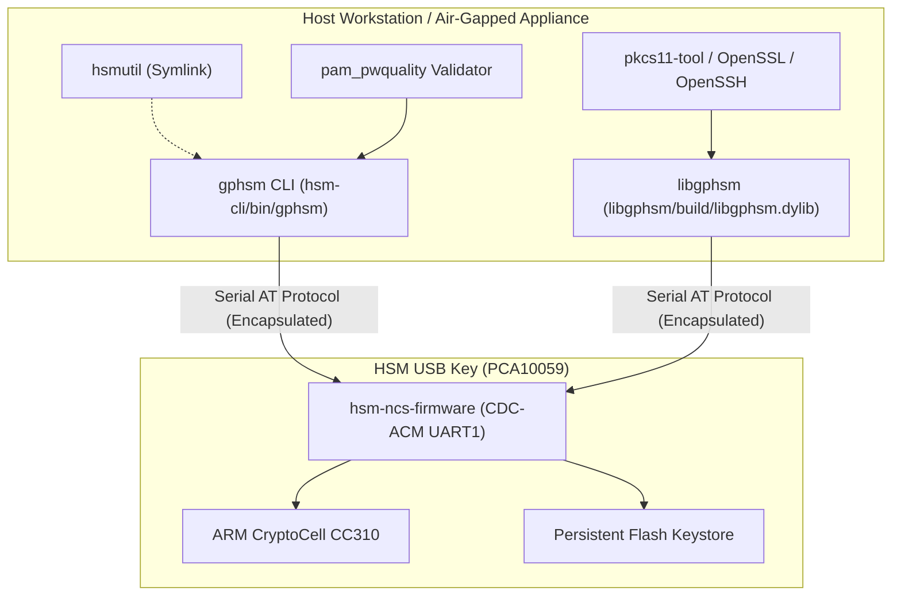

# ADR-0017: Host CLI Rebranding to gphsm and PKCS#11 Refactoring to libgphsm

## Context & Problem Statement

As the open-source Hardware Security Module ecosystem reached maturity across firmware, host management, PKCS#11 middleware, and air-gapped appliance operating systems, several legacy naming and architectural inconsistencies emerged:
1. **Inconsistent Component Naming**:
   - The Go-based administrative utility was historically titled `hsmutil`, built in `hsm-cli/`.
   - The Cryptoki PKCS#11 provider repository was titled `hsm-libpkcs11/`, and generated output binaries named after the underlying development microcontroller (`libnrf52840_pkcs11.dylib`/`.so`/`.dll`).
   - This coupling violated the ecosystem vision of a unified, production-grade HSM suite under canonical identifiers: the host command-line utility should be named **`gphsm`**, and the shared Cryptoki provider library should be named **`libgphsm`**.
2. **Repository Directory Mismatch**:
   - The provider repository directory `hsm-libpkcs11/` did not reflect the library artifact name `libgphsm`.
   - Root `Makefile` orchestration targets referenced `cli-*` and `libpkcs11-*` rather than canonical component names.
3. **Internal Abstraction Leakage in CLI Help Strings**:
   - `hsmutil` help descriptions frequently referred to internal modem and AT-command transport mechanics (e.g., mentioning `AT+AUTH`, `AT+KEYGEN`, `AT+RESET`, serial framing), leaking low-level hardware transport details to end users.
4. **Redundant Diagnostic Commands (`p11`)**:
   - `hsmutil` retained an embedded `p11` command group attempting to emulate basic PKCS#11 testing. In practice, this duplicated standard OpenSC tooling (`pkcs11-tool`) and created confusion regarding whether `hsmutil` was a PKCS#11 provider or consumer.
5. **Divergent Password Complexity Enforcement**:
   - [[Architecture/Decisions/ADR-0012 - PAM pwquality Password Complexity and Expiration Policy|ADR-0012]] formalized enterprise-grade password complexity rules on the air-gapped Yocto appliance (`pam_pwquality`: minimum 10 characters, upper, lower, digit, and special character requirements).
   - However, the CLI utility allowed operators to set arbitrary PINs during initialization or credential changes without validating against the Yocto appliance password quality rules, leading to security disparity across the ecosystem.

---

## Decision Drivers

- **Canonical Product Identity**: Standardize on `gphsm` for the host management CLI and `libgphsm` for the Cryptoki PKCS#11 shared library.
- **Microcontroller-Agnostic Middleware**: Build artifacts must be strictly named `libgphsm.dylib` (Darwin), `libgphsm.so` (Linux), and `libgphsm.dll` (Windows), decoupling the PKCS#11 library from specific microcontroller product names.
- **Directory & Orchestration Uniformity**: Rename `hsm-libpkcs11/` to `libgphsm/`, aligning repository directory names, CMake targets, root `Makefile` variables (`SUBREPOS`), and CI scripts.
- **Clean CLI Ergonomics & Transport Encapsulation**: Purge redundant `p11` subcommands from the CLI. Replace raw AT command references in help strings with user-oriented, protocol-agnostic descriptions.
- **Cross-Ecosystem Password Quality Alignment**: Implement a pure Go `pam_pwquality` validator within `gphsm` that enforces the identical complexity constraints established on the Yocto appliance OS.
- **Backward Compatibility**: Preserve existing operational scripts and muscle memory by generating backward-compatible symlinks (`bin/hsmutil -> gphsm`).

---

## Considered Options

### Option 1: Incremental Renaming Leaving Directory Structure Intact
- **Approach**: Change the Go output binary to `gphsm` and CMake output to `libgphsm`, but leave directories named `hsm-cli/` and `hsm-libpkcs11/`.
- **Pros**: Avoids git directory rename operations.
- **Cons**: Retains confusing discrepancies between directory paths and library names; perpetuates technical debt in root Makefile and workspace scripts.
- **Outcome**: **Rejected**.

### Option 2: Comprehensive Rebranding, Directory Refactoring, and Policy Alignment
- **Approach**:
  - Rename `hsm-libpkcs11` directory to `libgphsm` and update CMake project to `libgphsm`.
  - Re-brand CLI Go module and binary to `gphsm` while retaining `hsmutil` symlink.
  - Purge `p11` commands and sanitize AT strings from CLI help.
  - Implement Yocto-compliant `pam_pwquality` PIN validation in `gphsm`.
  - Align root Makefile (`SUBREPOS`, build targets, test recipes) and integration harnesses.
- **Pros**: Delivers complete ecosystem alignment, clean architecture boundaries, robust security policy uniformity, and professional naming.
- **Cons**: Requires coordinated git worktree/submodule alignment across the root workspace and test scripts.
- **Outcome**: **Accepted**.

---

## Decision Outcome

### 1. Host CLI Rebranding (`gphsm`)

1. **Binary & Go Module**:
   - Target binary: `gphsm`.
   - Go module: `github.com/gpfister/gphsm` (or internal package equivalent `gphsm`).
   - Root command renamed from `hsmutil` to `gphsm` with usage string `gphsm [command] [flags]`.
2. **Backward-Compatible Symlinks (Transitional)**:
   - Makefile originally built `bin/gphsm` and automatically created relative symlinks:
     - `bin/hsmutil -> gphsm`
     - `bin/hsmutils -> gphsm`
   > [!NOTE]
   > **Update (2026-11-06)**: As formalized in [[Architecture/Decisions/ADR-0020 - Retirement of Backward-Compatible Binary Symlinks and Native macOS USB Discovery|ADR-0020]], these transitional symlinks (`bin/hsmutil`, `bin/hsmutils`, `bin/gphsms`) have been retired. `gphsm` is now the single canonical binary executable in `bin/`. Muscle memory is preserved via in-process hidden root aliases and visible shortcuts (`gphsm devices`).
3. **Purge of `p11` Command Group**:
   - Completely remove `internal/cmd/p11.go` and all subcommands (`p11 list-slots`, `p11 test-sign`).
   - Guide users to standard Cryptoki utilities:
     ```bash
     pkcs11-tool --module /usr/local/lib/libgphsm.dylib -L
     pkcs11-tool --module /usr/local/lib/libgphsm.dylib --login --test
     ```
4. **Transport Decoupling in Help Strings**:
   - Audit and sanitize all Cobra command `Short` and `Long` help texts.
   - Replace strings like `"Sends AT+AUTH to authenticate session"` with `"Authenticates the session using device PIN or custodian shares"`.
   - Replace `"Sends AT+RESET to zeroize NVS"` with `"Initiates irreversible factory reset and hardware key zeroization"`.
5. **Yocto-Compliant `pam_pwquality` Validation**:
   - Implement pure-Go password policy validator in `internal/security/pwquality.go`:
     - Minimum length: 10 characters (`minlen = 10`).
     - Minimum character classes: At least 3 of 4 categories (uppercase, lowercase, digits, special characters) or all 4 for high-security modes.
     - Maximum repeating characters: 3 (`maxrepeat = 3`).
     - Rejects sequential patterns (e.g. `123456`, `abcdef`).
   - Hooked directly into interactive initialization (`gphsm device init`), PIN updates, and migration workflows.

---

### 2. PKCS#11 Library Refactoring (`libgphsm`)

1. **Repository & Directory Renaming**:
   - Directory renamed: `hsm-libpkcs11/` $\rightarrow$ `libgphsm/`.
2. **CMake Project Alignment**:
   - `CMakeLists.txt` updated:
     ```cmake
     project(libgphsm VERSION 1.0.0 LANGUAGES C)
     add_library(gphsm SHARED ...)
     set_target_properties(gphsm PROPERTIES OUTPUT_NAME "gphsm" PREFIX "lib")
     ```
   - Generated shared library outputs:
     - macOS: `build/libgphsm.dylib`
     - Linux: `build/libgphsm.so`
     - Windows: `build/libgphsm.dll`
3. **Symbol & Header Neutrality**:
   - Provider implementation files in `src/` generalized to generic HSM Cryptoki driver.
   - Preserves Cryptoki v2.40 standard export symbols (`C_GetFunctionList`, `C_Initialize`, `C_Finalize`, etc.).

---

### 3. Root Workspace & Makefile Alignment

1. **Sub-Repository Definition**:
   Update `SUBREPOS` in root `Makefile`:
   ```makefile
   SUBREPOS = hsm-ncs-firmware hsm-cli libgphsm hsm-obsidian hsm-yocto-offgrid-rpi
   ```
2. **Target Renaming & Aliases**:
   - `cli-build` $\rightarrow$ `gphsm-build` (with `cli-build` preserved as alias).
   - `cli-build-all` $\rightarrow$ `gphsm-build-all` (with `cli-build-all` preserved as alias).
   - `libpkcs11-build` $\rightarrow$ `libgphsm-build` (with `libpkcs11-build` preserved as alias).
   - `libpkcs11-test` $\rightarrow$ `libgphsm-test` (with `libpkcs11-test` preserved as alias).
3. **Harness Updates**:
   - `scripts/mock_hsm_pty.py`: updated banner, command handling, and log tags.
   - `scripts/test_at_client.py`: test client updated to target `libgphsm` and `gphsm`.
   - `scripts/run_integration_tests.sh`: updated binary paths to `hsm-cli/bin/gphsm` and shared library to `libgphsm/build/libgphsm.dylib`.

---

## Ecosystem Component Topology



---

## Consequences & Impact

### Positive Consequences
- **Professional Product Cohesion**: A clear, unified brand across the Go CLI (`gphsm`) and PKCS#11 library (`libgphsm`).
- **Clean Separation of Concerns**: Strips raw transport leakage from help text and defers PKCS#11 verification to standard utilities.
- **Enterprise Security Policy Alignment**: Users cannot configure trivial or insecure PINs on the HSM USB key, enforcing parity with the air-gapped Yocto appliance password policies.
- **Hardware Abstraction Decoupling**: Eliminates `nrf52840` from host library filenames, making the PKCS#11 middleware ready for future multi-hardware backends.
- **Smooth Transition**: Backward-compatible symlinks and Makefile aliases prevent disruption to developer workflows.

### Negative / Trade-Off Consequences
- **Directory Rename Coordination**: Renaming `hsm-libpkcs11` to `libgphsm` requires updating git tracking and worktree paths across developer checkouts.
- **Configuration Path Updates**: Existing PKCS#11 configuration files (e.g. `openssl.cnf`, `p11-kit` module configs) referencing `libnrf52840_pkcs11.dylib` must update their library paths to `libgphsm.dylib`.
