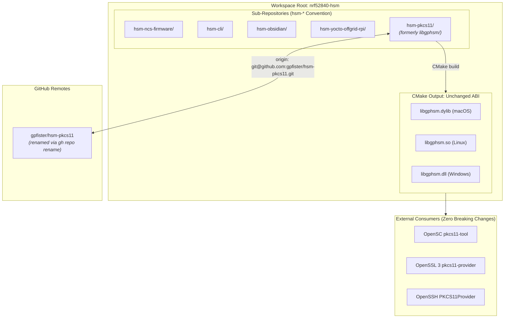

# ADR-0018: Sub-Repository Renaming to hsm-pkcs11 with libgphsm ABI Invariance

## Context & Problem Statement

The open-source Hardware Security Module (HSM) ecosystem operates as an orchestrated multi-repository workspace. Across the workspace, sub-repositories adhere to a uniform prefix naming scheme:
- `hsm-ncs-firmware`: Zephyr / NCS firmware workspace
- `hsm-cli`: Cross-platform Go CLI (`gphsm` / `hsmutil`)
- `hsm-obsidian`: Centralized Obsidian engineering documentation vault
- `hsm-yocto-offgrid-rpi`: Yocto 6.1 (Blacksail) air-gapped embedded Linux OS

However, following the refactoring documented in [[Architecture/Decisions/ADR-0017 - Host CLI Rebranding to gphsm and PKCS11 Refactoring to libgphsm|ADR-0017]], the Cryptoki PKCS#11 shared library provider repository developed structural naming inconsistencies across workspace layers:
1. **Local Directory vs Remote Repository Mismatch**:
   - The local workspace directory was named [`libgphsm/`](file:///Users/gpfister/Development/Projects/gpfister/nrf52840-hsm/libgphsm).
   - The remote GitHub repository remained [`gpfister/hsm-libpkcs11`](https://github.com/gpfister/hsm-libpkcs11).
   - In [`scripts/worktree.sh`](file:///Users/gpfister/Development/Projects/gpfister/nrf52840-hsm/scripts/worktree.sh), the sub-repo array referenced `hsm-libpkcs11`.
   - In the root [`Makefile`](file:///Users/gpfister/Development/Projects/gpfister/nrf52840-hsm/Makefile), `SUBREPOS` referenced `libgphsm`.
2. **Violation of Sub-Repository Nomenclature**:
   - Every other sub-repository is prefixed with `hsm-<component>` (e.g., `hsm-ncs-firmware`, `hsm-cli`, `hsm-obsidian`, `hsm-yocto-offgrid-rpi`).
   - Naming the local directory `libgphsm` conflated the **source code repository / directory name** with the **compiled binary artifact name**.
3. **Need for Strict ABI Invariance**:
   - External consumers—including OpenSC `pkcs11-tool`, OpenSSL 3 `pkcs11-provider`, OpenSSH (`PKCS11Provider`), and integration test harnesses—load the compiled shared dynamic library by its standard name: `libgphsm.dylib` (macOS), `libgphsm.so` (Linux), and `libgphsm.dll` (Windows).
   - Renaming the sub-repository must not disrupt the compiled binary filename, CMake output targets, or C exported symbol ABI.

---

## Decision Drivers

- **Workspace Uniformity**: Standardize all sub-repository directory names and GitHub remote repositories on the canonical `hsm-<component>` taxonomy (`hsm-pkcs11`).
- **Separation of Repository and Artifact Semantics**: Decouple the repository container name (`hsm-pkcs11`) from the compiled binary artifact name (`libgphsm`).
- **Strict ABI & Binary Invariance**: Guarantee zero breaking changes for existing external consumers, dynamic linkers, and test runners that reference `libgphsm.{dylib,so,dll}`.
- **Idempotent Multi-Repo Orchestration**: Ensure root `Makefile`, `.gitignore`, `scripts/worktree.sh`, and `scripts/run_integration_tests.sh` operate seamlessly with the unified directory name.
- **Clean Migration Path**: Provide automated, safe renaming via GitHub CLI (`gh repo rename`) and git origin remote reconfiguration with instant rollback capability.

---

## Considered Options

### Option 1: Retain `libgphsm/` Directory and Remote `hsm-libpkcs11`
- **Pros**: Zero modifications to workspace configuration or filesystem.
- **Cons**: Perpetuates naming drift and confusion between `libgphsm` (local) and `hsm-libpkcs11` (remote/worktree); breaks the `hsm-<role>` naming convention across sub-repositories.
- **Outcome**: **Rejected**.

### Option 2: Rename Everything (Repository, CMake Project, and Output Binaries) to `hsm-pkcs11` / `libhsmpkcs11`
- **Pros**: Complete theoretical naming alignment across repositories and binaries.
- **Cons**: **Severe breaking change**. Breaks OpenSC configs, OpenSSH configs, OpenSSL 3 provider configs, and existing user automation expecting `libgphsm.dylib`/`libgphsm.so`. Requires re-verifying external tool chains.
- **Outcome**: **Rejected**.

### Option 3: Rename Remote & Directory to `hsm-pkcs11` while Strictly Preserving `libgphsm` ABI & Binary Artifact Names
- **Pros**:
  - Restores flawless naming harmony across all sub-repos (`hsm-ncs-firmware`, `hsm-cli`, `hsm-obsidian`, `hsm-yocto-offgrid-rpi`, `hsm-pkcs11`).
  - Aligns GitHub remote URL to `git@github.com:gpfister/hsm-pkcs11.git`.
  - Zero disruption to runtime consumers: compiled binaries remain `libgphsm.dylib` / `libgphsm.so` / `libgphsm.dll`.
  - CMake target configuration remains intact (`OUTPUT_NAME "gphsm"`, `PREFIX "lib"`).
- **Cons**: Requires coordinated git directory move, remote rename, and root Makefile/script path updates.
- **Outcome**: **Accepted**.

---

## Architectural Specification & Invariance Model



---

## Decision Outcome & Directives

### 1. Sub-Repository Directory & Remote Standardization
- The local sub-repository directory [`libgphsm`](file:///Users/gpfister/Development/Projects/gpfister/nrf52840-hsm/libgphsm) is moved to [`hsm-pkcs11`](file:///Users/gpfister/Development/Projects/gpfister/nrf52840-hsm/hsm-pkcs11).
- The GitHub remote repository `gpfister/hsm-libpkcs11` is renamed to `gpfister/hsm-pkcs11` using the GitHub CLI:
  ```bash
  gh repo rename hsm-pkcs11 --repo gpfister/hsm-libpkcs11 --yes
  ```
- The local git origin URL is updated:
  ```bash
  git -C hsm-pkcs11 remote set-url origin git@github.com:gpfister/hsm-pkcs11.git
  ```

### 2. ABI & Binary Target Invariance
- The compiled shared library provider must continue to output as `libgphsm.dylib` (macOS), `libgphsm.so` (Linux), and `libgphsm.dll` (Windows).
- In [`hsm-pkcs11/CMakeLists.txt`](file:///Users/gpfister/Development/Projects/gpfister/nrf52840-hsm/hsm-pkcs11/CMakeLists.txt), the project name `project(libgphsm C)` and library target properties:
  ```cmake
  set_target_properties(gphsm PROPERTIES
      OUTPUT_NAME "gphsm"
      PREFIX "lib"
  )
  ```
  remain strictly preserved.
- Unit and interface tests continue to link against `libgphsm`.

### 3. Root Workspace Orchestration Harmonization
- [`Makefile`](file:///Users/gpfister/Development/Projects/gpfister/nrf52840-hsm/Makefile):
  - `SUBREPOS` is updated to include `hsm-pkcs11`:
    ```makefile
    SUBREPOS := hsm-ncs-firmware hsm-cli hsm-obsidian hsm-pkcs11 hsm-yocto-offgrid-rpi
    ```
  - `LIBPKCS11_DIR` variable is updated from `libgphsm` to `hsm-pkcs11`:
    ```makefile
    LIBPKCS11_DIR := hsm-pkcs11
    ```
- [`.gitignore`](file:///Users/gpfister/Development/Projects/gpfister/nrf52840-hsm/.gitignore):
  - `/hsm-pkcs11/` is added under `# Sub-repositories`.
  - Existing `/libgphsm/` and `/hsm-libpkcs11/` entries are retained for backward compatibility with previous worktrees and historical checkouts.
- [`scripts/worktree.sh`](file:///Users/gpfister/Development/Projects/gpfister/nrf52840-hsm/scripts/worktree.sh):
  - `SUBREPOS` array replaces `hsm-libpkcs11` with `hsm-pkcs11`.
- [`scripts/run_integration_tests.sh`](file:///Users/gpfister/Development/Projects/gpfister/nrf52840-hsm/scripts/run_integration_tests.sh):
  - `P11_DIR` path is updated to `${WORKSPACE_ROOT}/hsm-pkcs11`.

### 4. Workspace Documentation Synchronization
- Root [`README.md`](file:///Users/gpfister/Development/Projects/gpfister/nrf52840-hsm/README.md) and [`AGENTS.md`](file:///Users/gpfister/Development/Projects/gpfister/nrf52840-hsm/AGENTS.md) are updated to reference `hsm-pkcs11/` as the sub-repository directory while explicitly noting that it produces the `libgphsm` provider library.

---

## Consequences

### Positive
- **Predictable Repository Topology**: All sub-repositories consistently begin with `hsm-`, eliminating cognitive overhead for developers and automation scripts.
- **Remote Parity**: GitHub remote names and local directory paths are 100% synchronized (`hsm-pkcs11` $\leftrightarrow$ `gpfister/hsm-pkcs11`).
- **Zero Ecosystem Regressions**: Zero disruption to external PKCS#11 tooling or host applications because the output binary names and exported symbols are completely unaffected.
- **Harmonized Worktree Tooling**: `make worktree-add`, `make worktree-list`, and `make worktree-rm` function uniformly across all 5 sub-repositories without custom exception branches.

### Negative / Neutral
- Requires updating existing developer clones: existing clones will need to run `git remote set-url origin git@github.com:gpfister/hsm-pkcs11.git` and rename their local `libgphsm` directory to `hsm-pkcs11`. (GitHub automatically handles HTTP/SSH redirects for renamed repositories, providing seamless fallback).
- Prior CMake build caches in `libgphsm/build` must be cleared (`rm -rf build`) upon renaming to avoid stale absolute path references.

---

## Validation & Implementation Status

- **Status**: Merged & Verified (Phase 6 Post-Merge Complete)
- **Pull Request**: [#1 (https://github.com/gpfister/hsm/pull/1)](https://github.com/gpfister/hsm/pull/1)
- **Base Branch**: `main`
- **Merged Source Branch**: `task/rename-subrepo-hsm-pkcs11` (squashed commit: [`81d2cb9`](file:///Users/gpfister/Development/Projects/gpfister/nrf52840-hsm))
- **Branch Cleanup**: `task/rename-subrepo-hsm-pkcs11` deleted locally and remotely.
- **Root Commit on main**: [`81d2cb9`](file:///Users/gpfister/Development/Projects/gpfister/nrf52840-hsm) (`81d2cb9`) — *chore(workspace): standardize PKCS#11 sub-repo to hsm-pkcs11 (#1)*
- **GitHub Remote**: Successfully renamed to `gpfister/hsm-pkcs11`
- **Verification**: `make status`, `make libpkcs11-build`, `make libpkcs11-test`, and `make integration-test` passing 100% on `main`. Clean working trees.
