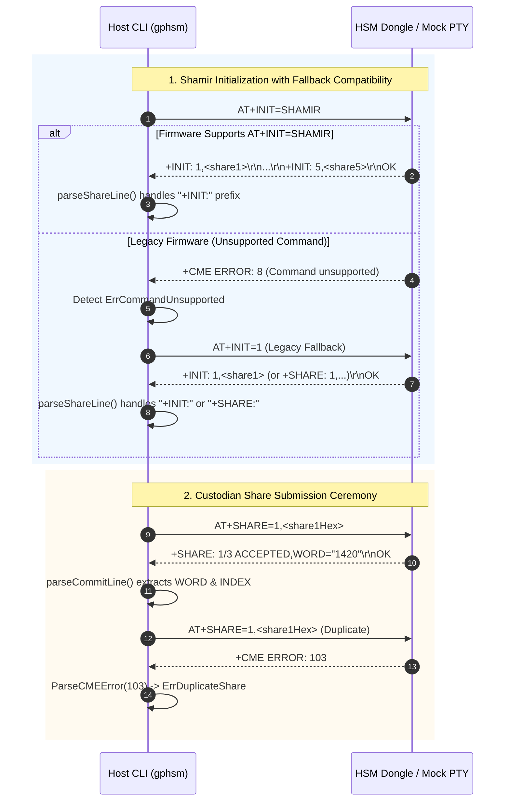

# ADR-0019: HSM Device Initialization and Dual-Mode Protocol Compatibility

## Context & Problem Statement

Following the introduction of the dual-mode authentication architecture in [[Architecture/Decisions/ADR-0016 - Dual-Mode Authentication Architecture (PIN and Shamir Secret Sharing)|ADR-0016]]—which established explicit keystore method tracking (`auth_method_t`), `AT+STATUS?` transparency (`CONFIGURED` and `METHOD`), `AT+INIT=PIN,<pin>`, and `AT+INIT=SHAMIR`—physical dongle testing and diagnostic analysis (detailed in [[investigations/2026-11-06 - HSM Device Initialization Failure|Issue Assessment: 2026-11-06 - HSM Device Initialization Failure]]) uncovered several critical interoperability gaps and latent protocol incompatibilities between the host CLI (`gphsm` / `hsmutil`), the physical hardware dongles (`PCA10059`), and virtual test harnesses:

1. **Unsupported Command Fallback Discrepancy**:
   - When encountering un-upgraded physical hardware running earlier firmware builds, dispatching `AT+INIT=SHAMIR` returns `+CME ERROR: 8` (`CME_ERR_COMMAND_UNSUPPORTED`).
   - In [`at_client.go`](file:///Users/gpfister/Development/Projects/gpfister/nrf52840-hsm/hsm-cli/internal/domain/at_client.go), the fallback branch attempted to call `ThresholdInit(3, 5)`, which dispatched `AT+INIT=THRESHOLD,3,5`. This command syntax does not exist in any firmware release or mock implementation.
   - The legacy firmware syntax for initializing Shamir's Secret Sharing is `AT+INIT=1`. The host client lacked fallback to this canonical legacy command.

2. **Protocol Response Line Prefix Mismatch on Shamir Initialization**:
   - The embedded firmware ([`at_commands.c#L272`](file:///Users/gpfister/Development/Projects/gpfister/nrf52840-hsm/hsm-ncs-firmware/firmware/lib/src/at_commands.c#L272)) and mock test harness ([`mock_hsm_pty.py#L244`](file:///Users/gpfister/Development/Projects/gpfister/nrf52840-hsm/scripts/mock_hsm_pty.py#L244)) emit generated custodian shares prefixed with `+INIT: <index>,<share_hex>`.
   - The client-side parser in [`at_client.go#L581`](file:///Users/gpfister/Development/Projects/gpfister/nrf52840-hsm/hsm-cli/internal/domain/at_client.go#L581) only checked for lines prefixed with `+SHARE:`, and [`parseShareLine()`](file:///Users/gpfister/Development/Projects/gpfister/nrf52840-hsm/hsm-cli/internal/domain/at_client.go#L723) strictly trimmed `+SHARE:`.
   - Consequently, when running against compliant firmware or mock PTYs, `InitShamir()` discarded all emitted shares, wrongly concluded `no custodian shares returned by HSM`, and fell back to the invalid `AT+INIT=THRESHOLD,3,5` command. Because the device was already initialized by the first command, the second command was rejected with `+CME ERROR: 41` (`CME_ERR_ALREADY_CONFIGURED`).

3. **Protocol Response Prefix Mismatch on Custodian Share Submission**:
   - During threshold authentication via `AT+SHARE=<index>,<share_hex>`, the firmware emits intermediate acceptance lines formatted as `+SHARE: <count>/3 ACCEPTED,WORD="<word>"` ([`at_commands.c#L362`](file:///Users/gpfister/Development/Projects/gpfister/nrf52840-hsm/hsm-ncs-firmware/firmware/lib/src/at_commands.c#L362)).
   - In [`at_client.go#L651`](file:///Users/gpfister/Development/Projects/gpfister/nrf52840-hsm/hsm-cli/internal/domain/at_client.go#L651), `SubmitShare()` scanned exclusively for prefixes `+COMMIT:` and `+WORD:`, causing intermediate share submissions to fail with `missing +COMMIT: line in device response`.

4. **Incomplete CME Error Code Mapping**:
   - In [`at_errors.go#L64-L85`](file:///Users/gpfister/Development/Projects/gpfister/nrf52840-hsm/hsm-cli/internal/domain/at_errors.go#L64-L85), `ParseCMEError()` only mapped legacy error codes 1 through 8.
   - Dual-mode and threshold ceremony error codes defined in firmware ([`at_commands.h`](file:///Users/gpfister/Development/Projects/gpfister/nrf52840-hsm/hsm-ncs-firmware/firmware/lib/include/hsm/at_commands.h))—specifically code 41 (`CME_ERR_ALREADY_CONFIGURED`), code 42 (`CME_ERR_INVALID_AUTH_MODE`), and code 103 (`CME_ERR_DUPLICATE_SHARE`)—fell through to `Unknown hardware error`, obscuring failure root causes.

5. **Integration Test Automation Blindspot**:
   - In [`scripts/run_integration_tests.sh`](file:///Users/gpfister/Development/Projects/gpfister/nrf52840-hsm/scripts/run_integration_tests.sh), test setup bypassed the CLI initialization commands, directly injecting raw AT command bytes into mock serial sockets (`b'AT+INIT=PIN,123456\r\n'` and `b'AT+INIT=SHAMIR\r\n'`). This masked the parser prefix incompatibilities from continuous integration runs.

6. **Physical Hardware Firmware Deployment**:
   - Physical USB dongles retained in-field factory or pre-dual-mode firmware builds, requiring an in-place DFU upgrade over CDC-ACM UART1 to activate dual-mode capabilities.

---

## Decision Drivers

- **Zero Breaking Regressions & Backward Compatibility**: The host CLI must seamlessly operate across both modern dual-mode firmware (`AT+INIT=SHAMIR`, `+INIT:` prefix) and legacy firmware builds (`AT+INIT=1`, `+SHARE:` prefix).
- **Protocol Symmetry & Parser Tolerance**: Line parsers in `hsm-cli` must flexibly accept valid response prefixes (`+INIT:` and `+SHARE:`) and response formats emitted by firmware and mock devices.
- **Explicit Domain Error Handling**: Hardware CME error codes must translate deterministically into typed Go error sentinels (`ErrAlreadyConfigured`, `ErrInvalidAuthMode`, `ErrDuplicateShare`).
- **Comprehensive End-to-End Verification**: CI test suites must exercise the public CLI interfaces (`gphsm device init --mode pin` and `gphsm device init --mode shamir`) against mock hardware.
- **Physical Device Alignment**: Physical development dongles must be updated to the latest signed dual-mode firmware via DFU.

---

## Considered Options

### Option 1: Firmware-Only Protocol Change (Force Firmware to Match CLI Expectations)
- **Approach**: Change the firmware to emit `+SHARE:` on initialization and `+COMMIT:` on share submission, and remove legacy `AT+INIT=1`.
- **Pros**: Leaves client parser logic unchanged.
- **Cons**: Breaks backward compatibility with existing legacy firmware dongles in the field; requires all physical hardware to be reflashed before CLI can function; breaks existing firmware unit tests; rejects standard AT conventions.
- **Outcome**: **Rejected**.

### Option 2: Full Dual-Mode Protocol Compatibility, Parser Flexibility & DFU Upgrade
- **Approach**: Update `hsm-cli` to support both modern and legacy command fallbacks (`AT+INIT=SHAMIR` $\rightarrow$ `AT+INIT=1`), accept dual line prefixes (`+INIT:` and `+SHARE:`), parse `+SHARE: ... ACCEPTED,WORD=...`, map CME error codes 41, 42, and 103, expand integration test coverage, and reflash physical dongles via DFU.
- **Pros**: Complete cross-version compatibility; resilient to legacy hardware; eliminates subtle ceremony failures; enforces typed error diagnostics; provides 100% CI automated regression protection.
- **Cons**: Slightly expands parser branching in `at_client.go`.
- **Outcome**: **Accepted**.

---

## Decision Outcome

### 1. Fallback Compatibility in `InitShamir()`
In [`internal/domain/at_client.go`](file:///Users/gpfister/Development/Projects/gpfister/nrf52840-hsm/hsm-cli/internal/domain/at_client.go):
- When `c.transport.SendCommand("AT+INIT=SHAMIR", ...)` returns `ErrCommandUnsupported` (CME code 8) or indicates an unsupported command error, `InitShamir()` immediately falls back to `c.transport.SendCommand("AT+INIT=1", ...)`.
- The erroneous fallback to `ThresholdInit(3, 5)` / `AT+INIT=THRESHOLD,3,5` is eliminated.

### 2. Multi-Prefix Line Parsing in `parseShareLine()` and `SubmitShare()`
- **Initialization Shares**:
  - `parseShareLine(line)` is updated to trim either `+SHARE:` or `+INIT:` prefixes before tokenizing key-value pairs or comma-delimited parameters.
  - `InitShamir()` and `ThresholdInit()` iterate over response lines and accept any line starting with either `+SHARE:` or `+INIT:`.
- **Custodian Share Submissions**:
  - `SubmitShare(index, shareHex)` is updated to evaluate response lines starting with `+COMMIT:`, `+WORD:`, or `+SHARE:`.
  - `parseCommitLine(line, fallbackIndex)` is updated to parse status lines formatted as:
    `+SHARE: <count>/3 ACCEPTED,WORD="<word>"` or `+SHARE: <count>/3 ACCEPTED,WORD=<idx>`
    extracting the commitment word and custodian index.

### 3. CME Error Code Mapping in `at_errors.go`
In [`internal/domain/at_errors.go`](file:///Users/gpfister/Development/Projects/gpfister/nrf52840-hsm/hsm-cli/internal/domain/at_errors.go):
- Add error definition:
  ```go
  var ErrDuplicateShare = errors.New("duplicate custodian share index submitted")
  ```
- Update `ParseCMEError(code)` to map:
  - `case 41`: return `ErrAlreadyConfigured` (or wrapped `&CMEError{Code: 41, Message: "Device already configured"}`)
  - `case 42`: return `ErrInvalidAuthMode` (or wrapped `&CMEError{Code: 42, Message: "Invalid authentication mode for command"}`)
  - `case 103`: return `&CMEError{Code: 103, Message: "Duplicate custodian share index"}` matching `ErrDuplicateShare`

### 4. Integration Test Suite CLI Coverage
In [`scripts/run_integration_tests.sh`](file:///Users/gpfister/Development/Projects/gpfister/nrf52840-hsm/scripts/run_integration_tests.sh):
- Replace manual Python socket injection for initialization with real CLI executions:
  - Test PIN initialization: `gphsm device init --mode pin --pin ValidP@ssw0rd!`
  - Test Shamir initialization: `gphsm device init --mode shamir`
- Verify that custodian shares are parsed and non-empty.

### 5. Production Firmware Rebuild & Hardware DFU Upgrade
- Recompile signed production firmware: `make firmware-build`
- Upgrade connected physical dongles using:
  `gphsm device firmware update --file hsm-ncs-firmware/build-prod/app/zephyr/zephyr.signed.bin`
- Verify device status reports `CONFIGURED=0` (or `1`), `METHOD=PIN|SHAMIR`, and active DFU image hash.

---

## Architectural Interaction Diagram



---

## Consequences

### Positive Consequences
- **Robust Multi-Firmware Support**: The host CLI operates seamlessly against legacy devices and newly flashed devices without requiring manual mode flags.
- **No Cascade Device Lockouts**: Eliminates spurious `+CME ERROR: 41 (Already configured)` failures caused by re-sending non-standard `AT+INIT=THRESHOLD,3,5` commands.
- **Accurate Error Visibility**: Operators and diagnostic scripts receive clear, actionable error messages for duplicate shares, mode mismatches, and pre-configured hardware.
- **Automated Regression Prevention**: Automated end-to-end integration tests prevent parser prefix regressions in CI.

### Negative Consequences & Trade-offs
- **Parser Permissiveness**: Accepting multiple response prefixes (`+INIT:` and `+SHARE:`) requires slightly more permissive parsing logic in `at_client.go`, but this trade-off is essential for backward and forward compatibility.
