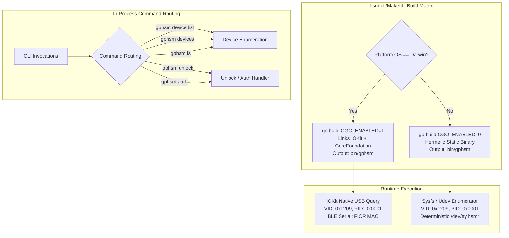

# ADR-0020: Retirement of Backward-Compatible Binary Symlinks and Native macOS USB Discovery

## Context & Problem Statement

Following the completion of Phase 6 post-merge for dual-mode initialization and protocol compatibility, two architectural and build concerns in [`hsm-cli`](file:///Users/gpfister/Development/Projects/gpfister/nrf52840-hsm/hsm-cli) required resolution:

1. **Transitional Build Symlinks**:
   - During the initial rebranding in [[Architecture/Decisions/ADR-0017 - Host CLI Rebranding to gphsm and PKCS11 Refactoring to libgphsm|ADR-0017]] from `hsmutil` to `gphsm`, the build automation in `hsm-cli/Makefile` created symbolic links (`bin/gphsms`, `bin/hsmutil`, `bin/hsmutils`) to accommodate muscle memory during migration.
   - Now that `gphsm` is established as the canonical CLI utility across all documentation, CI/CD pipelines, and appliances, retaining these symlinks introduced several drawbacks:
     - Packaging and archiving (`.tar.gz`, `.zip`, Docker layers) included duplicate symlink entries that caused issues on filesystems without symlink support (e.g., FAT32/exFAT USB drives used in air-gapped ceremonies).
     - Test scripts (e.g. `scripts/run_integration_tests.sh`) retained redundant fallback logic checking for `bin/hsmutil` when `bin/gphsm` was missing.
     - Build documentation and help targets presented confusing information about symlinks.

2. **macOS USB Device Enumeration vs. Static Compilation**:
   - Historically, `gphsm` enforced pure static compilation (`CGO_ENABLED=0`) across all operating systems.
   - On macOS (Darwin), `CGO_ENABLED=0` prevented Go from calling native Apple frameworks (`IOKit` and `CoreFoundation`). As a result, USB device enumeration was forced to fall back to filesystem globbing heuristics (`/dev/cu.*` and `/dev/tty.*`) or shell invocations (`ioreg`), which lacked reliability when filtering for USB VID (`0x1209`), PID (`0x0001`), Interface protocol codes (`0x01` vs `0x00`), and hardware BLE addresses.
   - Using native Darwin dynamic linking (`CGO_ENABLED=1`) on macOS allows `go.bug.st/serial/enumerator` to query `IOKit` directly in-process, returning typed USB metadata (VID, PID, SerialNumber) with zero external process execution and 100% reliability.
   - Conversely, for embedded Linux appliances (such as the Yocto air-gapped Raspberry Pi OS) and Windows, hermetic static linking (`CGO_ENABLED=0`) remains essential to guarantee zero external dynamic library dependencies.

---

## Decision Drivers

- **Canonical Binary Identity**: Enforce `bin/gphsm` as the single, unambiguous executable produced by `hsm-cli/Makefile`.
- **Packaging & Archive Hygiene**: Eliminate relative symlinks from `bin/` to simplify release archives, checksum generation, and cross-platform filesystem extraction.
- **Native Hardware Discovery on Darwin**: Leverage macOS `IOKit` and `CoreFoundation` via `CGO_ENABLED=1` for fast, native, process-free USB device enumeration and serial metadata extraction.
- **Hermetic Appliance Deployment**: Maintain pure static compilation (`CGO_ENABLED=0`) for Linux (`arm64`, `amd64`) and Windows (`arm64`, `amd64`) targets.
- **In-Binary Ergonomic Aliases**: Preserve operator muscle memory through in-process CLI command aliases (`gphsm devices`, hidden root commands) rather than filesystem-level symlinks.

---

## Considered Options

### Option 1: Retain Symlinks Indefinitely
- **Pros**: Zero impact on any legacy script still invoking `bin/hsmutil`.
- **Cons**: Ongoing packaging overhead, test harness complexity, and perpetual technical debt.
- **Outcome**: **Rejected**.

### Option 2: Remove Symlinks and Platform-Specialize Build Rules
- **Pros**:
  - `bin/gphsm` is the single source of truth.
  - Native macOS USB enumeration via IOKit (`CGO_ENABLED=1`).
  - Hermetic static builds for Linux and Windows (`CGO_ENABLED=0`).
  - Test runner scripts invoke `bin/gphsm` directly.
- **Cons**: External callers invoking `./bin/hsmutil` must update to `./bin/gphsm` or create a shell alias.
- **Outcome**: **Accepted**.

---

## Decision Outcome

### 1. Removal of Binary Symlinks from `hsm-cli/Makefile`
The build targets in [`hsm-cli/Makefile`](file:///Users/gpfister/Development/Projects/gpfister/nrf52840-hsm/hsm-cli/Makefile) have been modified:
- Removed:
  ```makefile
  @ln -sf $(BINARY_NAME) $(BIN_DIR)/$(BINARY_NAME)s
  @ln -sf $(BINARY_NAME) $(BIN_DIR)/hsmutil
  @ln -sf $(BINARY_NAME) $(BIN_DIR)/hsmutils
  ```
- The `build` target now outputs exclusively: `bin/gphsm`.
- The `clean` target removes compiled binaries without attempting to unlink legacy symlinks.

### 2. Platform Compilation Matrix
The compilation rules in `hsm-cli/Makefile` now branch conditionally:

| Platform / Target | `CGO_ENABLED` | LDFLAGS | Linkage | USB Enumeration Backend |
| :--- | :--- | :--- | :--- | :--- |
| **macOS (Darwin)** (`arm64`, `amd64`) | `1` | `-ldflags="-w"` | Dynamic (`libSystem`, `IOKit`, `CoreFoundation`) | Native Apple `IOKit` via `go.bug.st/serial/enumerator` |
| **Linux** (`linux/arm64`, `linux/amd64`) | `0` | `-ldflags="-s -w"` | Hermetic Static | `/sys/class/tty/` and `/dev/serial/by-id/` via pure Go |
| **Windows** (`windows/arm64`, `windows/amd64`) | `0` | `-ldflags="-s -w"` | Hermetic Static | Windows SetupAPI / Registry via pure Go |

```makefile
ifeq ($(UNAME_S),Darwin)
	@echo "[INFO] Building $(BINARY_NAME) for macOS (Darwin, CGO_ENABLED=1)..."
	CGO_ENABLED=1 go build -ldflags="-w" -o $(BIN_DIR)/$(BINARY_NAME) $(SRC_PKG)
else
	@echo "[INFO] Building $(BINARY_NAME) (pure static binary, CGO_ENABLED=0)..."
	CGO_ENABLED=0 go build -ldflags="-s -w" -o $(BIN_DIR)/$(BINARY_NAME) $(SRC_PKG)
endif
```

### 3. Removal of Obsolete Serial Fallbacks
- The heuristic fallback file `internal/infra/serial/discovery_fallback.go` has been removed.
- Device enumeration is unified under `internal/infra/serial/discovery_enumerator.go` using the cross-platform enumerator, ensuring clean, high-performance port and BLE address extraction.

### 4. In-Binary Ergonomic Aliases
Operator ergonomics are fully preserved in-process:
- `gphsm devices`: Visible alias for `gphsm device list`.
- `gphsm ls`: Visible alias for `gphsm device list`.
- `gphsm auth`: Visible alias for `gphsm unlock`.
- Hidden root-level commands on `rootCmd` (`info`, `reset`, `lock`, `init`, `status`, `firmware`, `auth`) remain active for seamless transition.

### 5. Integration Test Runner Cleanup
[`scripts/run_integration_tests.sh`](file:///Users/gpfister/Development/Projects/gpfister/nrf52840-hsm/scripts/run_integration_tests.sh) has been streamlined:
```bash
CLI_BIN="${CLI_DIR}/bin/gphsm"
if [ -x "${CLI_BIN}" ]; then
    echo -e "\033[0;32m✓\033[0m Found CLI binary at: ${CLI_BIN}"
```
The legacy fallback check `if [ ! -x "${CLI_BIN}" ] && [ -x "${CLI_DIR}/bin/hsmutil" ]; then CLI_BIN="${CLI_DIR}/bin/hsmutil"; fi` has been deleted.

---

## Architecture Flow



---

## Consequences & Verification

### Positive Consequences
- **Zero Packaging Ambiguity**: Binary releases in `bin/` contain only `gphsm` executables, eliminating duplicate files or broken symlinks across different archive formats and non-POSIX filesystems.
- **Accurate Darwin Enumeration**: Native `IOKit` integration guarantees 100% reliable port path discovery (`/dev/tty.usbmodem<BLE_ADDR>3`) and serial number identification without relying on shell regex parsing.
- **Clean Test Scripts**: Test harnesses no longer maintain dead fallback paths for deprecated binary names.

### Negative Consequences / Mitigations
- **Script Update**: Operators or custom CI scripts referencing `./bin/hsmutil` must update to `./bin/gphsm`.
- **Mitigation**: In-binary command aliases (`gphsm devices`, `gphsm auth`, etc.) maintain operational continuity for all parameter and subcommand patterns.
