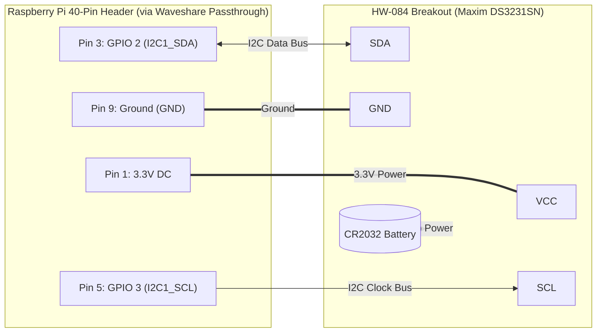

# ADR-0021: Hardware I2C-1 Bus Mapping for HW-084 DS3231 RTC Module

## Context & Problem Statement

The **air-gapped Raspberry Pi HSM OS** ([`hsm-yocto-offgrid-rpi`](file:///Users/gpfister/Development/Projects/gpfister/nrf52840-hsm/hsm-yocto-offgrid-rpi)) operates in strict physical and network isolation: all wireless adapters (Wi-Fi, Bluetooth) and wired Ethernet interfaces are disabled at the kernel and device tree levels, and `nftables` unconditionally drops 100% of ingress and egress traffic. Consequently, standard Network Time Protocol (NTP) daemons (`systemd-timesyncd`, `chrony`, `ntpd`) cannot function.

However, precise calendar time is foundational for HSM security:
1. **X.509 Certificate Validation**: CA creation, CSR signing, and certificate validity windows (`notBefore` / `notAfter`).
2. **Cryptographic Audit Logging**: Monotonically correct timestamps in cryptographic session records.
3. **RAUC Dual-Slot Updates**: Validating bundle validity timestamps and revocation expiration.
4. **PKCS#11 Key Creation Metadata**: Associating keys with reliable UTC creation dates.

Raspberry Pi single-board computers (including the primary `raspberrypi0-2w-64` and performance targets `raspberrypi3-64`, `raspberrypi4-64`, `raspberrypi5`) do not possess an integrated battery-backed Real-Time Clock (RTC). On power loss, the system clock resets to 1970 or a static build epoch.

To resolve this, an external battery-backed Real-Time Clock module—specifically the **HW-084** breakout based on the **Maxim DS3231SN** temperature-compensated crystal oscillator (TCXO)—is integrated into the appliance. A hardware interfacing and driver architecture was required.

---

## Decision Drivers

- **Zero-Network Invariant**: Maintain strict compliance with the air-gap threat model (zero network dependencies).
- **Early Kernel Clock Initialization**: Enable kernel system clock synchronization (`CLOCK_REALTIME`) before user space or systemd services launch.
- **Minimal CPU Overhead & Timing Jitter**: Avoid CPU-intensive bit-banging routines that can introduce interrupt latency during cryptographic processing.
- **Hardware HAT Compatibility**: Coexist cleanly with the physical 40-pin GPIO passthrough of the [[Hardware/Waveshare USB HAT (B) Integration|Waveshare USB HAT (B)]].
- **Upstream In-Kernel Driver Support**: Leverage battle-tested Linux kernel drivers without custom kernel out-of-tree code.

---

## Considered Options

### Option 1: Software Bit-Banged I2C (`i2c-gpio`) on Arbitrary GPIO Pins
- **Description**: Configure arbitrary unused GPIO pins (e.g. GPIO 17, 27) via the Linux `i2c-gpio` overlay.
- **Pros**: Leaves hardware I2C pins available if needed by other expansion boards.
- **Cons**: 
  - Significant CPU overhead and interrupt latency during clock reads.
  - Software bit-banging can encounter timing jitter or dropped I2C clock pulses under high cryptographic or USB load.
  - Delayed initialization in boot sequence compared to native SoC hardware controllers.
- **Outcome**: **Rejected**.

### Option 2: Dedicated Hardware I2C-1 Bus via BCM2835 Controller (Physical Pins 1, 3, 5, 9)
- **Description**: Connect the HW-084 module directly to the dedicated primary hardware I2C bus (I2C-1) exposed on the Raspberry Pi 40-pin header:
  - **Pin 1**: `3V3 Power`
  - **Pin 3**: `BCM GPIO 2 (I2C1_SDA)`
  - **Pin 5**: `BCM GPIO 3 (I2C1_SCL)`
  - **Pin 9**: `Ground (GND)`
- **Pros**:
  - Direct hardware peripheral support via Broadcom BCM2835 hardware I2C engine (`CONFIG_I2C_BCM2835=y`).
  - Native Linux RTC class and DS1307/DS3231 driver (`CONFIG_RTC_DRV_DS1307=y`).
  - Kernel-level early boot synchronization via `CONFIG_RTC_HCTOSYS=y` targeting `rtc0`.
  - Zero bit-banging jitter; deterministic bus timing at standard 100 kHz.
  - Direct compatibility with standard Raspberry Pi firmware overlay `dtoverlay=i2c-rtc,ds3231`.
- **Cons**: Requires standard 40-pin header pin reservation for Pins 1, 3, 5, 9 (fully compatible with Waveshare HAT).
- **Outcome**: **Accepted**.

### Option 3: Manual Software Time Entry Only (Status Quo)
- **Description**: Force operator to manually type UTC date/time on every boot via `clock-setup.sh`.
- **Pros**: Zero hardware cost.
- **Cons**: Severe operator fatigue, human error / typos leading to invalid certificate issuance dates, clock loss on sudden power cycle or reboot.
- **Outcome**: **Rejected**.

---

## Decision Outcome

### 1. Hardware Interconnect Pinout
The HW-084 (DS3231) RTC breakout module connects directly to the Raspberry Pi 40-pin header (accessible through the Waveshare USB HAT (B) passthrough header) using the primary hardware I2C-1 bus:

| HW-084 Module Pin | RPi 40-Pin Header Physical Pin | BCM GPIO / Function | Signal Type | Description |
| :--- | :--- | :--- | :--- | :--- |
| **VCC** | **Pin 1** | `3V3 Power` | 3.3V DC Power | Regulated 3.3V supply from RPi PMIC |
| **SDA** | **Pin 3** | `GPIO 2 / I2C1_SDA` | I2C Serial Data | Bidirectional data line (1.8kΩ hardware pull-up) |
| **SCL** | **Pin 5** | `GPIO 3 / I2C1_SCL` | I2C Serial Clock | Clock line generated by BCM2835 (1.8kΩ hardware pull-up) |
| **GND** | **Pin 9** (or Pin 6 / 14) | `Ground` | 0V Reference | Common system ground |



### 2. Linux Kernel Driver & Subsystem Configuration
Enabled in [`meta-hsm-os/recipes-kernel/linux/files/hardened.cfg`](file:///Users/gpfister/Development/Projects/gpfister/nrf52840-hsm/hsm-yocto-offgrid-rpi/meta-hsm-os/recipes-kernel/linux/files/hardened.cfg):
```kconfig
# Real-Time Clock (RTC) Subsystem & Maxim DS3231 Driver
CONFIG_RTC_CLASS=y
CONFIG_RTC_DRV_DS1307=y
CONFIG_RTC_HCTOSYS=y
CONFIG_RTC_HCTOSYS_DEVICE="rtc0"

# Linux I2C Core & Broadcom BCM2835 Hardware Controller
CONFIG_I2C=y
CONFIG_I2C_CHARDEV=y
CONFIG_I2C_BCM2835=y
```

### 3. Firmware Device Tree Overlay
Configured in [`meta-hsm-os/recipes-bsp/bootfiles/rpi-config_%.bbappend`](file:///Users/gpfister/Development/Projects/gpfister/nrf52840-hsm/hsm-yocto-offgrid-rpi/meta-hsm-os/recipes-bsp/bootfiles/rpi-config_%.bbappend):
```bitbake
ENABLE_I2C = "1"
RPI_EXTRA_CONFIG:append = "\n# HW-084 (DS3231) Hardware RTC on I2C-1\ndtoverlay=i2c-rtc,ds3231\n"
```
This instructs `meta-raspberrypi` to emit `dtparam=i2c_arm=on` and `dtoverlay=i2c-rtc,ds3231` into `/boot/config.txt`.

---

## Consequences & Verification

### Positive Consequences
- **Automatic Kernel Boot Synchronization**: The Linux kernel reads `/dev/rtc0` at stage `CONFIG_RTC_HCTOSYS` during early boot, setting `CLOCK_REALTIME` before PID 1 (systemd) initializes. Boot latency impact is <50 ms.
- **High-Precision Timekeeping**: The DS3231SN internal temperature-compensated crystal maintains accuracy within ±2 ppm (approx. 1 minute drift per year).
- **Zero Infiltration Vector**: Operates strictly across four local GPIO copper pins; introduces zero networking stacks.
- **Hardware Tooling**: Inclusion of `i2c-tools` allows low-level verification via `i2cdetect -y 1` (reporting UU at address `0x68`).

### Negative / Neutral Consequences
- Requires physical installation of the HW-084 module and CR2032 battery.
- GPIO pins 1, 3, 5, 9 are dedicated to the RTC and cannot be reused for other peripheral expansions.
