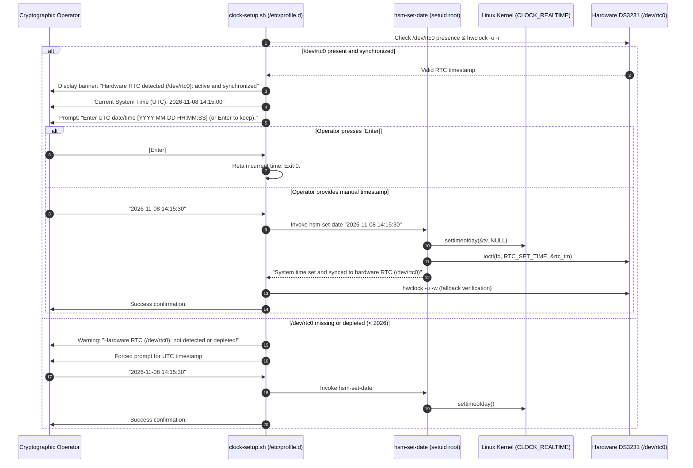

# ADR-0022: RTC-Aware Informational Login Prompt with Transactional Hardware Clock Sync

## Context & Problem Statement

In the air-gapped Raspberry Pi HSM OS ([`hsm-yocto-offgrid-rpi`](file:///Users/gpfister/Development/Projects/gpfister/nrf52840-hsm/hsm-yocto-offgrid-rpi)), operator console logins trigger initialization logic via `/etc/profile.d/hsm-login.sh`. Prior to the introduction of the [[Architecture/Decisions/ADR-0021 - Hardware I2C-1 Bus Mapping for HW-084 DS3231 RTC Module|HW-084 DS3231 hardware RTC]], the system possessed no non-volatile calendar clock. As a consequence:
1. Every console login invoked [`clock-setup.sh`](file:///Users/gpfister/Development/Projects/gpfister/nrf52840-hsm/hsm-yocto-offgrid-rpi/meta-hsm-os/recipes-core/init-wizard/files/clock-setup.sh), which unconditionally prompted the operator to type out a full UTC timestamp (`YYYY-MM-DD HH:MM:SS`).
2. If the operator was performing frequent routine ceremonies, repetitively typing 19 characters was tedious and error-prone.
3. Once the DS3231 hardware RTC was integrated, forcing manual time entry on every login became redundant and counterproductive, as manual typos would overwrite accurate RTC battery-backed time.
4. However, completely removing the login prompt would leave operators blind to hardware failures (e.g. dead CR2032 battery, disconnected jumper wires, or severe clock drift) and prevent necessary manual clock calibrations during initial provisioning or leap adjustments.

A balanced interaction model was required: one that confirms RTC health, preserves valid hardware time with zero friction, and atomically updates both kernel and RTC hardware registers when an operator intentionally overrides the clock.

---

## Decision Drivers

- **Ergonomics & Operator Velocity**: Eliminate forced manual timestamp typing when the hardware RTC is operating accurately.
- **Hardware Health Transparency**: Visually communicate the operational state of `/dev/rtc0` (active and synchronized vs. uninitialized/absent) immediately upon login.
- **Transactional Consistency**: When a new timestamp is provided, ensure atomic update of both the kernel software clock (`CLOCK_REALTIME`) and the hardware DS3231 registers (`/dev/rtc0`) in a single execution.
- **Least Privilege Execution**: Allow the unprivileged `hsmutil` user to calibrate system and hardware time safely without granting general `sudo` root escalation.
- **Defensive Input Validation**: Reject malformed or dangerous date/time strings before system modification.

---

## Considered Options

### Option 1: Completely Suppress Clock Prompt When `/dev/rtc0` Exists
- **Description**: If `/dev/rtc0` is detected, bypass `clock-setup.sh` entirely during login.
- **Pros**: Fastest login experience.
- **Cons**: 
  - Operator has no visibility into whether the RTC battery has depleted or whether the clock is drifting.
  - No prompt or convenience tool for the operator to set the initial time on a brand-new, uncalibrated DS3231 module.
- **Outcome**: **Rejected**.

### Option 2: Retain Forced Input Always
- **Description**: Require manual date entry on every login, writing the result to both system time and RTC.
- **Pros**: Guarantees operator explicitly verifies time.
- **Cons**: Severe operator friction; high risk of operator typographical errors corrupting a perfectly good RTC clock.
- **Outcome**: **Rejected**.

### Option 3: RTC-Aware Informational Banner with "Enter-to-Keep" and Dual-Sync SUID Helper
- **Description**:
  1. `clock-setup.sh` probes `/dev/rtc0` and reads current hardware time via `hwclock -u -r`.
  2. Displays an informational banner showing current system UTC time and RTC hardware time status.
  3. Prompts: `Enter current UTC date/time [YYYY-MM-DD HH:MM:SS] (or Enter to keep): `.
  4. If operator presses `[Enter]`: The script retains the current RTC-backed system time and completes instantly.
  5. If operator enters a timestamp: The script validates the format and invokes the setuid root binary `hsm-set-date`, which executes `settimeofday()` and `ioctl(fd, RTC_SET_TIME, &rtc_tm)` atomically, followed by `hwclock -u -w` fallback.
- **Pros**:
  - Zero-friction confirmation for routine logins: operator simply hits `[Enter]`.
  - Immediate visual audit of RTC synchronization state and drift.
  - Transparent fallback warning if `/dev/rtc0` is missing or battery died.
  - Atomic dual-synchronization of kernel and RTC registers.
  - Preserves strict principle of least privilege.
- **Outcome**: **Accepted**.

---

## Decision Outcome

### 1. Interaction Workflow Sequence



### 2. Dual-Sync Architecture in `hsm-set-date.c`
The setuid root helper [`meta-hsm-os/recipes-core/init-wizard/files/hsm-set-date.c`](file:///Users/gpfister/Development/Projects/gpfister/nrf52840-hsm/hsm-yocto-offgrid-rpi/meta-hsm-os/recipes-core/init-wizard/files/hsm-set-date.c):
1. Validates strict syntax: `YYYY-MM-DD HH:MM:SS` using `strptime(..., "%Y-%m-%d %H:%M:%S", &tm)`.
2. Converts to `time_t` via `timegm(&tm)`.
3. Issues `settimeofday(&tv, NULL)` to calibrate the kernel system clock (`CLOCK_REALTIME`).
4. Opens `/dev/rtc0` in `O_RDWR` mode.
5. Populates `struct rtc_time` and issues `ioctl(rtc_fd, RTC_SET_TIME, &rtc_tm)` from `<linux/rtc.h>`.
6. Emits structured status confirmation to stdout and closes descriptors.

### 3. SUID Security & Permissions
In [`init-wizard.bb`](file:///Users/gpfister/Development/Projects/gpfister/nrf52840-hsm/hsm-yocto-offgrid-rpi/meta-hsm-os/recipes-core/init-wizard/init-wizard.bb):
```bitbake
install -d ${D}${bindir}
install -m 4755 ${UNPACKDIR}/hsm-set-date ${D}${bindir}/hsm-set-date
```
File permissions `4755` (`rwsr-xr-x`, owner `root:root`) grant unprivileged operator `hsmutil` the exact capability required to execute `settimeofday` and `RTC_SET_TIME` while strict input validation prevents shell escape or arbitrary memory modification.

---

## Consequences & Verification

### Positive Consequences
- **Fast Login Ergonomics**: For normal operations where the DS3231 module keeps accurate time, operator login overhead drops to hitting `[Enter]`.
- **Fault Awareness**: An operator is immediately alerted if the DS3231 coin cell battery has died or the module is unplugged.
- **Transactional Synchrony**: Prevents time divergence where kernel clock is adjusted but RTC hardware remains at the old timestamp (or vice-versa).
- **Hardened Privilege Model**: Standard operator does not require generic `sudo` privileges.

### Negative / Neutral Consequences
- Requires operator to understand that pressing `[Enter]` confirms and retains the current clock.
