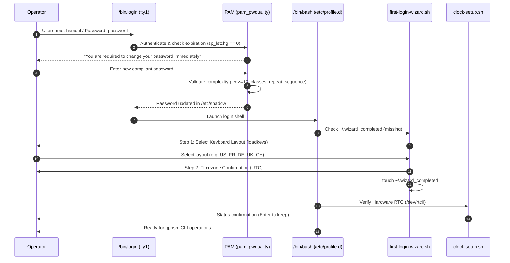

# ADR-0024: Native Shadow/PAM Password Expiration vs First-Login Wizard Deduplication

## Context & Problem Statement

In the air-gapped cryptographic appliance ([`hsm-yocto-offgrid-rpi`](file:///Users/gpfister/Development/Projects/gpfister/nrf52840-hsm/hsm-yocto-offgrid-rpi)), initial operator credentials default to username `hsmutil` and password `password`. To prevent appliances from operating with default credentials, mandatory password rotation on first login has always been an explicit requirement.

However, the historical implementation contained a redundant dual-layer password reset flow:
1. **Linux PAM / Shadow Expiration**: The system configured 90-day password aging (`PASS_MAX_DAYS 90`), and target initialization or `chage -d 0` flagged the default account as expired in `/etc/shadow` (`sp_lstchg = 0`). When the operator entered `password` at the console login prompt, Linux PAM immediately intercepted the login with:
   ```text
   You are required to change your password immediately (administrator enforced).
   Current password: 
   New password: 
   Retype new password: 
   ```
   PAM validated the new password against `pam_pwquality.so` rules (`minlen=10`, uppercase, digits, symbols, repetition, sequence constraints).
2. **First-Login Wizard Script Loop**: Once the PAM password update succeeded and the user shell spawned, `/etc/profile.d/hsm-login.sh` launched `first-login-wizard.sh`. This script immediately asked the operator to change their password *again* via a 130-line bash script loop implementing duplicate regex checks (`validate_password`), custom prompts, and invocations of `chpasswd`/`passwd`.

This duplicated prompt created significant operator confusion: users believed their first password entry had failed or that the system was malfunctioning, forcing them to devise or re-type complex passwords twice in a row during initial commissioning.

---

## Decision Drivers

- **Operator Experience & Ergonomics**: Eliminate confusing double-password prompts during first-time appliance setup.
- **Architectural Single Source of Truth**: Enforce password complexity and aging through standard Linux PAM (`pam_pwquality.so`) and shadow password facilities rather than custom shell parsing.
- **Least Privilege & Immutability**: Avoid running custom bash routines that pipe raw passwords into `chpasswd` or spawn subshells with sensitive plaintext in process tables.
- **Strict Hardening Compliance**: Preserve the mandatory 10-character, 4-class complexity policy (`minlen=10`, `dcredit=-1`, `ucredit=-1`, `ocredit=-1`, `maxrepeat=1`, `maxsequence=2`) and 90-day aging.

---

## Considered Options

### Option 1: Keep Bash Script Loop and Disable PAM First-Login Expiration
- **Description**: Set `sp_lstchg` to a valid timestamp during image creation and rely exclusively on `first-login-wizard.sh` to prompt and execute `chpasswd`.
- **Pros**: Retains custom visual ASCII banners in the wizard script.
- **Cons**: 
  - Circumvents native Linux PAM infrastructure.
  - Bypasses standard `/bin/login` security controls: if an operator aborts the script (e.g. `Ctrl+C` or terminal disconnect), they could drop to a shell without having changed the default password.
  - Re-implements complex validation logic in bash, which is prone to edge-case parsing bugs.
- **Outcome**: **Rejected**.

### Option 2: Retain Both Prompts (Status Quo)
- **Description**: Leave PAM expiration active and retain the wizard password loop.
- **Pros**: Zero development effort.
- **Cons**: Severe operator friction, perceived system instability, redundant cognitive load.
- **Outcome**: **Rejected**.

### Option 3: Delegate Password Rotation Exclusively to Native PAM / Shadow and Deduplicate Wizard
- **Description**:
  1. Configure shadow password expiration natively during target provisioning in `recipes-core/users/hsmutil-user.bb` by setting field 3 (`sp_lstchg`) of `/etc/shadow` to `0` (`sed -i 's/^hsmutil:\([^:]*\):[^:]*:/hsmutil:\1:0:/'`).
  2. Linux PAM (`/etc/pam.d/common-password` + `/etc/security/pwquality.conf`) natively forces and validates password rotation before the user session is granted.
  3. Strip all password validation loops, prompts, and `chpasswd` calls from `first-login-wizard.sh`.
  4. The wizard starts immediately at **Step 1: Keyboard Layout Selection** and proceeds to **Step 2: Locale & Timezone Selection**, writing `${HOME}/.wizard_completed` upon conclusion.
- **Pros**:
  - Exactly one password change prompt on initial login.
  - Native PAM enforcement is non-bypassable: if the operator disconnects or aborts during the PAM prompt, the account remains expired and no shell access is granted.
  - Reuses robust, enterprise-grade `pam_pwquality` C libraries.
  - Clean separation of concerns: PAM handles authentication; the wizard handles hardware ergonomics (keyboard layout and timezone).
- **Outcome**: **Accepted**.

---

## Decision Outcome

### 1. Shadow Expiration Configuration (`hsmutil-user.bb`)
In [`meta-hsm-os/recipes-core/users/hsmutil-user.bb`](file:///Users/gpfister/Development/Projects/gpfister/nrf52840-hsm/hsm-yocto-offgrid-rpi/meta-hsm-os/recipes-core/users/hsmutil-user.bb):
```bitbake
pkg_postinst:${PN}() {
    if [ -n "$D" ]; then
        if [ -f "$D/etc/shadow" ]; then
            # Force password expiration on first login (sp_lstchg = 0)
            sed -i 's/^hsmutil:\([^:]*\):[^:]*:/hsmutil:\1:0:/' "$D/etc/shadow"
        fi
    else
        chage -d 0 hsmutil 2>/dev/null || true
    fi
}
```

### 2. Refactored Wizard Sequence (`first-login-wizard.sh`)
In [`meta-hsm-os/recipes-core/init-wizard/files/first-login-wizard.sh`](file:///Users/gpfister/Development/Projects/gpfister/nrf52840-hsm/hsm-yocto-offgrid-rpi/meta-hsm-os/recipes-core/init-wizard/files/first-login-wizard.sh):
- Completely removed `validate_password()`, interactive password read prompts, confirmation comparisons, and `chpasswd`/`passwd` invocations.
- Streamlined operator setup workflow:



---

## Consequences & Verification

### Positive Consequences
- **Zero Redundancy**: Operators change their password exactly once on first boot.
- **Fail-Safe Security**: Unauthenticated or incomplete password changes cannot reach a shell or bypass policy.
- **Reduced Attack Surface**: Eliminates ~130 lines of bash code manipulating passwords in plaintext subshells.
- **Maintenance Simplicity**: Password complexity policy is managed in a single central configuration file (`/etc/security/pwquality.conf`).

### Negative / Neutral Consequences
- The initial password prompt uses standard Linux PAM console formatting rather than custom ASCII art banner formatting.
