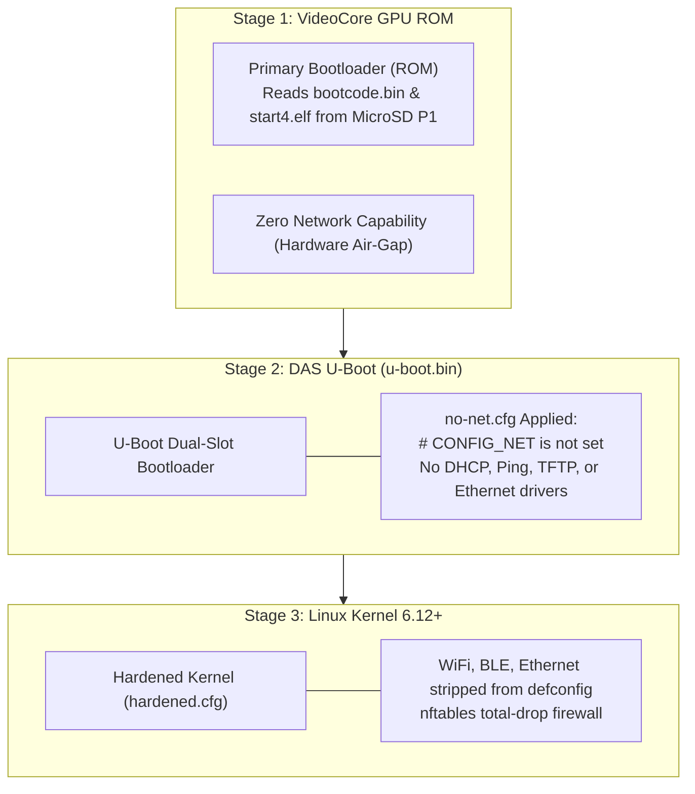

# ADR-0025: Complete U-Boot Network Subsystem Deactivation in Air-Gapped Appliance

## Context & Problem Statement

The **air-gapped Raspberry Pi HSM OS** ([`hsm-yocto-offgrid-rpi`](file:///Users/gpfister/Development/Projects/gpfister/nrf52840-hsm/hsm-yocto-offgrid-rpi)) enforces strict physical network isolation:
1. At the hardware and Device Tree level, on-board Wi-Fi and Bluetooth peripherals are disabled.
2. In the Linux kernel configuration (`hardened.cfg`), all wired Ethernet and wireless networking drivers are compiled out.
3. At the network filter layer, `nftables` establishes an unconditional drop-all policy.

However, security analysis of the secondary bootloader stage (**DAS U-Boot**) revealed that the default Raspberry Pi BSP configuration inherited complete networking subsystems from upstream `rpi_arm64_defconfig`:
- Network core engine: `CONFIG_NET=y`
- Network diagnostic and transfer commands: `CONFIG_CMD_DHCP=y`, `CONFIG_CMD_PING=y`, `CONFIG_CMD_TFTPBOOT=y`, `CONFIG_CMD_NFS=y`, `CONFIG_CMD_NET=y`
- Network device drivers: `CONFIG_NETDEVICES=y` and USB network adapter drivers.

In an ultra-secure cryptographic workstation designed for offline root key generation and key ceremonies, dormant bootloader network stacks present latent security vulnerabilities:
- **Physical Insertion Attack**: An unauthorized USB Ethernet or Wi-Fi adapter attached to the Waveshare USB HAT could be probed or initialized if U-Boot drops to a command prompt during hardware faults or development builds.
- **Bootloader Vulnerabilities**: Historical CVEs in U-Boot network parsing (DHCP packet parsing overflows, TFTP buffer handling flaws, DNS lookups) represent unnecessary exposure.
- **Boot Speed & Memory Footprint**: Compiling, allocating, and initializing network data structures adds unnecessary milliseconds to early boot latency and wastes RAM.

---

## Decision Drivers

- **Zero-Network Invariant Enforcement**: Align the bootloader stage with the kernel and OS air-gap security models (100% elimination of network stacks).
- **Attack Surface Minimization**: Remove network commands, socket buffers, and packet parsers from the bootloader binary image.
- **Deterministic Boot Pipeline**: Ensure the boot sequence is strictly confined to local storage (eMMC / MicroSD partition slots A and B).
- **Broadcom BSP Compatibility**: Strip networking cleanly without breaking core Raspberry Pi board bring-up, clocks, or device tree relocation.

---

## Considered Options

### Option 1: Leave Network Drivers Enabled but Rely on Silent Mode
- **Description**: Rely on `CONFIG_BOOTDELAY=-2` and silent console flags ([[Architecture/Decisions/ADR-0011 - Silent Non-Interactive U-Boot Bootloader Hardening|ADR-0011]]) to prevent operator access to network commands.
- **Pros**: Zero modification to U-Boot configuration fragments.
- **Cons**: 
  - Dormant code remains compiled into the binary.
  - Development builds (`HSM_DEV_MODE=1`) provide an interactive U-Boot prompt where network commands could still be invoked.
  - Violates defense-in-depth principles.
- **Outcome**: **Rejected**.

### Option 2: Full Network Subsystem Deactivation via Modular Kconfig Fragment
- **Description**:
  Create a dedicated configuration fragment `recipes-bsp/u-boot/files/no-net.cfg` that explicitly unsets all network subsystems:
  ```config
  # CONFIG_NET is not set
  # CONFIG_CMD_NET is not set
  # CONFIG_CMD_DHCP is not set
  # CONFIG_CMD_PING is not set
  # CONFIG_CMD_NFS is not set
  # CONFIG_CMD_TFTPBOOT is not set
  # CONFIG_NETDEVICES is not set
  ```
  Inject this fragment into all U-Boot builds for Raspberry Pi platforms via `recipes-bsp/u-boot/u-boot_%.bbappend`.
- **Pros**:
  - Compiles out 100% of network code, drivers, and commands from the resulting `u-boot.bin`.
  - Guarantees zero network capabilities across both development and production images.
  - Board bring-up and device tree passing remain completely intact.
  - Reduces binary footprint and improves boot time.
- **Outcome**: **Accepted**.

---

## Decision Outcome

### 1. Configuration Fragment (`no-net.cfg`)
Created in [`meta-hsm-os/recipes-bsp/u-boot/files/no-net.cfg`](file:///Users/gpfister/Development/Projects/gpfister/nrf52840-hsm/hsm-yocto-offgrid-rpi/meta-hsm-os/recipes-bsp/u-boot/files/no-net.cfg):
```config
# Deactivate U-Boot Network Subsystem & Commands
# CONFIG_NET is not set
# CONFIG_CMD_NET is not set
# CONFIG_CMD_DHCP is not set
# CONFIG_CMD_PING is not set
# CONFIG_CMD_NFS is not set
# CONFIG_CMD_TFTPBOOT is not set
# CONFIG_NETDEVICES is not set
```

### 2. Integration in `u-boot_%.bbappend`
In [`meta-hsm-os/recipes-bsp/u-boot/u-boot_%.bbappend`](file:///Users/gpfister/Development/Projects/gpfister/nrf52840-hsm/hsm-yocto-offgrid-rpi/meta-hsm-os/recipes-bsp/u-boot/u-boot_%.bbappend):
```bitbake
FILESEXTRAPATHS:prepend := "${THISDIR}/files:"

SRC_URI:append:rpi = " \
    file://squashfs.cfg \
    file://no-net.cfg \
    ${@oe.utils.conditional('HSM_DEV_MODE', '1', '', 'file://silent-boot.cfg', d)} \
"
```

### 3. Threat Model & Boot Stages Defense Matrix



---

## Consequences & Verification

### Positive Consequences
- **Complete Air-Gap Parity**: Network deactivation is now enforced continuously across all three boot stages (VideoCore ROM $\rightarrow$ U-Boot $\rightarrow$ Linux Kernel).
- **Physical Header Hardening**: Attaching a malicious USB-to-Ethernet adapter has zero effect in the bootloader, as no drivers exist to bind to the USB device.
- **Binary Footprint Reduction**: Stripping network routines trims the U-Boot binary size and eliminates dead code.
- **Diagnostic Safety in Dev Mode**: Even when development images permit an interactive U-Boot console (`HSM_DEV_MODE=1`), network commands do not exist (`Unknown command 'dhcp'`).

### Negative / Neutral Consequences
- Network booting (TFTP/NFS boot) is permanently impossible. All firmware images and kernels must boot from local storage (MicroSD or eMMC).
