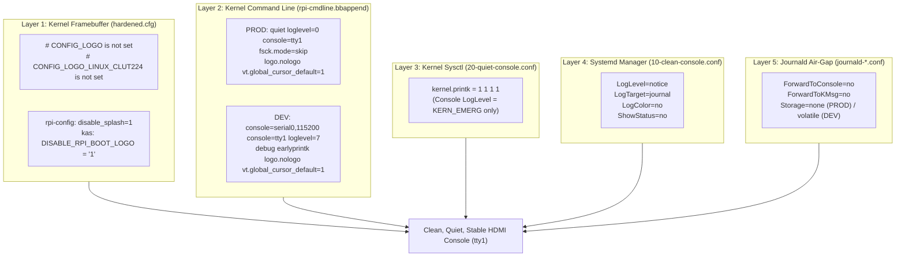

# ADR-0026: HDMI Console Noise Suppression and Log Level Hardening

## Context & Problem Statement

The **air-gapped Raspberry Pi HSM OS** ([`hsm-yocto-offgrid-rpi`](file:///Users/gpfister/Development/Projects/gpfister/nrf52840-hsm/hsm-yocto-offgrid-rpi)) is designed as a dedicated physical cryptographic appliance. Operators interact directly with the system through a connected HDMI monitor (`tty1`) and USB keyboard attached to the Waveshare USB HAT (B).

During field testing and operational validation, multiple asynchronous sources of visual noise and text clutter were observed on `tty1`:
1. **GPU & Framebuffer Boot Logos**: The Raspberry Pi VideoCore GPU firmware and Linux kernel framebuffer rendered four multi-color Raspberry Pi logos across the top of the screen during early boot. This compromised the professional stealth branding required for an enterprise cryptographic security appliance.
2. **Systemd Service Startup Chatter**: During system boot and background task execution, systemd repeatedly printed service status lines (`[  OK  ] Started ...`, `[  OK  ] Reached target ...`) to the foreground console.
3. **Software Watchdog Interruptions**: Periodic watchdog notifications and timer updates intermittently interrupted interactive TUI screens, clock setup prompts, and operator passphrase input.
4. **Kernel Printk Console Bleed**: Background kernel drivers (USB enumeration, power subsystem, MMC activity) flushed diagnostic log messages directly to `/dev/console` (`tty1`), corrupting Bubble Tea TUI rendering in `gphsm`.
5. **Console Cursor Inconsistencies**: The framebuffer console cursor could be hidden or placed in indeterminate states by framebuffer driver initialization.

A comprehensive, multi-layer noise suppression architecture was required to deliver a clean, silent, and deterministic console experience on `tty1`.

---

## Decision Drivers

- **Zero-Distraction Operator Workflow**: Maintain `tty1` as an unpolluted canvas dedicated exclusively to interactive operator tasks (login, PAM password update, keyboard selection, RTC synchronization, and `gphsm` CLI/TUI).
- **Stealth Appliance Aesthetics**: Eliminate all non-essential consumer hardware logos, splash images, and banners during boot.
- **TUI & Cursor Stability**: Prevent asynchronous kernel or service text from corrupting Charm Bubble Tea terminal interfaces.
- **Diagnostic Safety (Dev vs Prod)**: Ensure production images are completely quiet while development builds retain verbose serial console diagnostics on `serial0,115200` for debugging.
- **Fail-Safe Emergency Visibility**: Guarantee that catastrophic hardware failures, kernel panics, or emergency oops messages bypass silencing rules and render visibly on screen.

---

## Considered Options

### Option 1: Apply Only `quiet` to Kernel Bootargs
- **Description**: Add `quiet` to `CMDLINE_PROD` without modifying systemd, kernel configs, or sysctl.
- **Pros**: Minimal code modification.
- **Cons**: 
  - Fails to stop systemd service status lines (`ShowStatus=yes` by default).
  - Leaves software watchdog notifications active.
  - Does not suppress the four Raspberry Pi framebuffer logos.
  - Kernel printk loglevel defaults (`7 4 1 7`) still allow warnings and notice messages to spill to `tty1`.
- **Outcome**: **Rejected**.

### Option 2: Multi-Layered Console Hardening Stack
- **Description**: Implement coordinated hardening across four system layers:
  1. **Kernel Framebuffer Config**: Disable framebuffer logos via `# CONFIG_LOGO is not set` in `hardened.cfg`.
  2. **Kernel Bootargs**: Append `logo.nologo` and `vt.global_cursor_default=1` to both `CMDLINE_PROD` and `CMDLINE_DEV`. In `CMDLINE_PROD`, set `quiet loglevel=0 console=tty1 fsck.mode=skip`.
  3. **Systemd Manager Drop-In (`10-clean-console.conf`)**: Configure `LogLevel=notice`, `LogTarget=journal`, `LogColor=no`, `ShowStatus=no`.
  4. **Kernel Printk Sysctl (`20-quiet-console.conf`)**: Set `kernel.printk = 1 1 1 1` (allowing only emergency kernel alerts to reach the console).
  5. **Journald Configuration**: Enforce `ForwardToConsole=no` and `ForwardToKMsg=no`.
- **Pros**:
  - 100% elimination of boot logos, startup service lines, watchdog pops, and kernel chatter on `tty1`.
  - Bubble Tea TUI rendering remains pristine without asynchronous line wraps.
  - Emergency panics remain visible.
  - Development images retain full serial debugging on `serial0,115200`.
- **Outcome**: **Accepted**.

---

## Decision Outcome

### 1. Multi-Layer Noise Suppression Architecture



### 2. Configuration Artifacts

#### A. Kernel Framebuffer Hardening (`hardened.cfg`)
In [`meta-hsm-os/recipes-kernel/linux/files/hardened.cfg`](file:///Users/gpfister/Development/Projects/gpfister/nrf52840-hsm/hsm-yocto-offgrid-rpi/meta-hsm-os/recipes-kernel/linux/files/hardened.cfg):
```config
# Disable Boot Logo on Framebuffer Console
# CONFIG_LOGO is not set
# CONFIG_LOGO_LINUX_MONO is not set
# CONFIG_LOGO_LINUX_VGA16 is not set
# CONFIG_LOGO_LINUX_CLUT224 is not set
```

#### B. Clean Console Recipe (`clean-console.bb`)
A dedicated recipe [`meta-hsm-os/recipes-core/clean-console/clean-console.bb`](file:///Users/gpfister/Development/Projects/gpfister/nrf52840-hsm/hsm-yocto-offgrid-rpi/meta-hsm-os/recipes-core/clean-console/clean-console.bb) installs:
- `/etc/systemd/system.conf.d/10-clean-console.conf`:
  ```ini
  [Manager]
  LogLevel=notice
  LogTarget=journal
  LogColor=no
  ShowStatus=no
  ```
- `/etc/sysctl.d/20-quiet-console.conf`:
  ```ini
  kernel.printk = 1 1 1 1
  ```

#### C. Kernel Command Line Specialization (`rpi-cmdline.bbappend`)
In [`meta-hsm-os/recipes-bsp/bootfiles/rpi-cmdline.bbappend`](file:///Users/gpfister/Development/Projects/gpfister/nrf52840-hsm/hsm-yocto-offgrid-rpi/meta-hsm-os/recipes-bsp/bootfiles/rpi-cmdline.bbappend):
```bitbake
CMDLINE_PROD = "quiet loglevel=0 console=tty1 fsck.mode=skip vt.global_cursor_default=1 logo.nologo"
CMDLINE_DEV  = "console=serial0,115200 console=tty1 loglevel=7 debug earlyprintk logo.nologo vt.global_cursor_default=1"
```

---

## Consequences & Verification

### Positive Consequences
- **Pure Stealth Boot**: The HDMI display remains completely black until the login prompt appears. Zero berry logos or splash images are rendered.
- **Undisrupted TUI Dashboards**: `gphsm` TUI elements and Bubble Tea micro-components operate without text tearing or background message contamination.
- **Fail-Safe Panic Handling**: Because `kernel.printk = 1 1 1 1` permits `KERN_EMERG` (level 0), fatal kernel panics and hardware machine check exceptions still print directly to the screen.
- **Complete Development Visibility**: In `HSM_DEV_MODE=1`, developers maintain 100% visibility over `serial0,115200` (`loglevel=7`, `debug`, `earlyprintk`).

### Negative / Neutral Consequences
- Standard non-fatal startup errors (e.g. non-critical systemd service restart notices) will not be displayed on the HDMI screen; they must be inspected via `journalctl` (in dev mode) or through the interactive shell.
