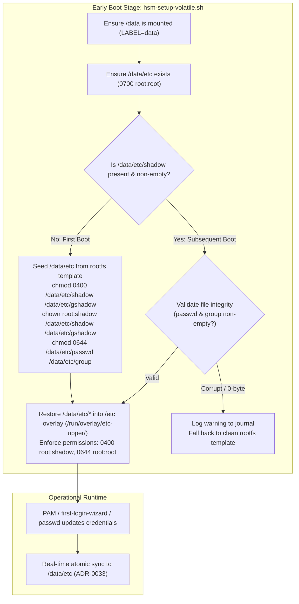

# ADR-0032: Targeted Authentication State Persistence to /data/etc with Ephemeral /etc OverlayFS

## Context & Problem Statement

The **air-gapped Raspberry Pi HSM OS** ([`hsm-yocto-offgrid-rpi`](file:///Users/gpfister/Development/Projects/gpfister/nrf52840-hsm/hsm-yocto-offgrid-rpi)) runs from an immutable, read-only root filesystem (`read-only-rootfs`) with an ephemeral RAM-only tmpfs overlay mounted over `/etc` (`lowerdir=/etc,upperdir=/run/overlay/etc-upper,workdir=/run/overlay/etc-work`). This architecture ensures runtime isolation, prevents tampering, and guarantees clean A/B partition updates via RAUC.

However, because `/run` is backed entirely by volatile RAM, all writes to `/etc`—most critically user credential and account databases (`/etc/shadow`, `/etc/passwd`, `/etc/group`, `/etc/gshadow`)—disappear upon system reboot:
1. When an operator updates their initial password via Linux PAM on first login, the change is written only to `/run/overlay/etc-upper/shadow`.
2. Upon power-cycling or rebooting the appliance, the RAM tmpfs overlay is discarded.
3. `/etc/shadow` reverts to the default template on the read-only rootfs, where the `hsmutil` account password has expired (`sp_lstchg=0`).
4. The operator is repeatedly forced to change their password on every boot, preventing persistent unattended operation and disrupting automated workflows.

A mechanism is required to persist operator credentials and account states across reboots while strictly preserving the read-only rootfs and RAUC update isolation.

---

## Decision Drivers

- **Credential & Account Continuity**: Operator password updates, password age (`sp_lstchg`), account attributes, and group memberships must survive power cycles and reboots.
- **Rootfs Immutability & RAUC Upgrade Safety**: The underlying root filesystem partition (`/dev/mmcblk0p2` or `/dev/mmcblk0p3`) must remain 100% read-only. Upgrades to Slot A or Slot B must not cause configuration drift or conflict with stale system configuration files.
- **Least Privilege & Confidentiality**: Persisted password hashes must be stored on the persistent ext4 data partition (`/data`) under a dedicated directory with strict POSIX permissions (`0700 root:root` directory, `0400 root:shadow` shadow files).
- **Fault Tolerance & Lockout Prevention**: If the persistent storage partition is unformatted, missing, or corrupted, the system must detect corruption, log a warning, and safely fall back to the base rootfs template, ensuring console accessibility rather than locking out the operator.

---

## Considered Options

### Option 1: Full `/etc` Persistent OverlayFS Backed by `/data/overlay-etc`
- **Description**: Mount an OverlayFS over `/etc` where the `upperdir` and `workdir` reside on the persistent ext4 partition (`/data/overlay-etc-upper`, `/data/overlay-etc-work`).
- **Pros**: Any modification made anywhere in `/etc` is automatically persistent without scripts or sync services.
- **Cons**: 
  - **Severe Configuration Drift**: Over time, system-level configurations (PAM profiles, systemd configs, udev rules, network configs) diverge from the versioned OS image.
  - **RAUC Upgrade Incompatibility**: When RAUC updates the rootfs (Slot A &rarr; Slot B), newly updated system configuration files in the new rootfs layer are masked by stale files preserved in the persistent upper overlay layer.
  - **High Blast Radius**: A corrupted file in `/data/overlay-etc` can break system boot across both A and B slots.

### Option 2: Direct Symlinks from `/etc` to `/data/etc`
- **Description**: Replace `/etc/{shadow,passwd,group,gshadow}` on the rootfs or in the overlay with symbolic links pointing to `/data/etc/{shadow,passwd,group,gshadow}`.
- **Pros**: Simple conceptual mapping; zero synchronization daemon required.
- **Cons**:
  - **POSIX & PAM Incompatibility**: Core Linux shadow suite utilities (`passwd`, `chage`, `useradd`, `vipw`) explicitly reject symbolic links for `/etc/shadow` for security reasons, or break them by writing to a temporary file and atomically renaming (`rename()`) over the destination, replacing the symlink with a regular file in the RAM overlay.
  - **Boot Dependency Deadlocks**: If `/data` fails to mount before early login services initialize, broken symlinks cause immediate authentication panics.

### Option 3: Targeted Authentication State Persistence with Boot Seeding & Restoration (Selected)
- **Description**:
  - Retain `/etc` as an ephemeral RAM-only tmpfs overlay (`/run/overlay/etc-upper`), preserving 100% rootfs immutability and preventing RAUC configuration drift.
  - Designate `/data/etc` (mode `0700`, owner `root:root`) on the persistent ext4 partition as the dedicated credential vault.
  - Restrict persistence strictly to the 4 canonical authentication databases: `shadow`, `passwd`, `group`, `gshadow`.
  - Implement early boot seeding (first boot) and restoration (subsequent boots) in `hsm-setup-volatile.sh`:
    - **First Boot**: If `/data/etc/shadow` is missing or empty, seed `/data/etc` from the read-only rootfs template, applying strict modes (`0400 root:shadow` for shadow/gshadow, `0644 root:root` for passwd/group).
    - **Subsequent Boots**: Copy `/data/etc/{shadow,passwd,group,gshadow}` into active `/etc` overlay and enforce proper permissions.
    - **Corruption Fallback**: If persistent files are zero-byte or corrupt, log a kernel warning and fall back to rootfs defaults.
- **Pros**:
  - Complete RAUC upgrade safety: system configuration files in `/etc` are never masked across OS updates.
  - Full compatibility with Linux PAM, shadow suite, and setuid binaries.
  - Minimal blast radius: only user accounts and credentials persist.
  - Robust corruption recovery prevents operator lockout.
- **Cons**: Requires an event-driven synchronization mechanism to capture runtime credential changes back to `/data/etc` (addressed in [[Architecture/Decisions/ADR-0033 - Real-Time Atomic Credential Synchronization and Reboot-Shutdown Flushes|ADR-0033]]).

---

## Decision Outcome

**Accepted Option 3**. The appliance implements **Targeted Authentication State Persistence** to `/data/etc` while retaining an ephemeral RAM-only tmpfs overlay over `/etc`.

### Architecture Workflow



### Filesystem Mount Standardization (`/etc/fstab`)

In [`recipes-core/base-files/files/fstab`](file:///Users/gpfister/Development/Projects/gpfister/nrf52840-hsm/hsm-yocto-offgrid-rpi/meta-hsm-os/recipes-core/base-files/files/fstab), filesystem mounts are standardized on volume labels rather than fragile static partition device nodes:
```text
LABEL=data    /data    ext4    defaults                   0    2
LABEL=homefs  /home    ext4    defaults,x-systemd.growfs  0    2
```

### Persistent Home Directory Alignment

In [`hsm-setup-volatile.sh`](file:///Users/gpfister/Development/Projects/gpfister/nrf52840-hsm/hsm-yocto-offgrid-rpi/meta-hsm-os/recipes-core/volatile-storage/files/hsm-setup-volatile.sh), the script checks whether `/home` is already mounted from `LABEL=homefs`. If persistent `/home` is mounted, `hsm-setup-volatile.sh` bypasses the ephemeral `tmpfs` mount on `/home/hsmutil`, preserving operator shell environment (`.bashrc`), keyboard layout (`.keymap`), and first-login wizard completion marker (`.wizard_completed`).

---

## Consequences

### Positive
- **Seamless Operator Experience**: Once changed during the initial login, passwords persist indefinitely across reboots; operators are never re-prompted to change expired passwords unless `PASS_MAX_DAYS` (90 days) elapses.
- **RAUC Upgrade Invariance**: Upgrading slot A or slot B replaces the system software without altering user passwords or inheriting stale `/etc` system configuration drift.
- **Fail-Safe Operation**: If storage corruption occurs on `/data`, the appliance logs an anomaly and boots safely using default credentials, permitting emergency recovery.

### Negative / Trade-Offs
- Requires an active synchronization mechanism to mirror runtime password changes from volatile RAM back to non-volatile flash (formalized in ADR-0033).
- User and group IDs must remain consistent with the base rootfs schema (standardized to UID 1000 `hsmutil`).
