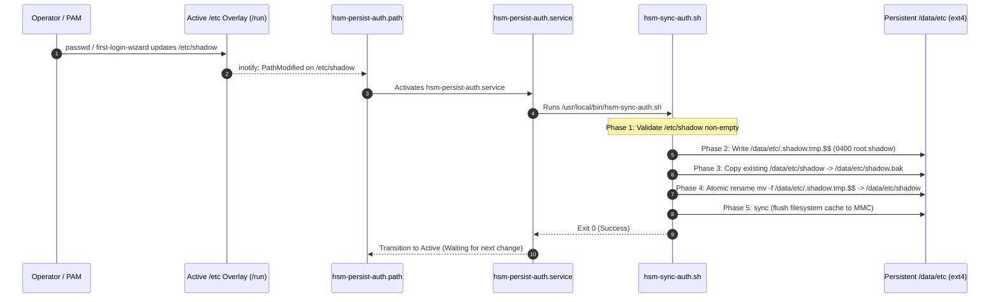
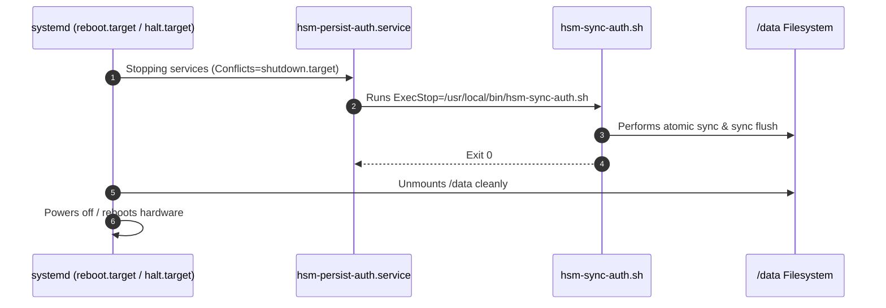

# ADR-0033: Real-Time Atomic Credential Synchronization and Reboot/Shutdown Flushes

## Context & Problem Statement

Per [[Architecture/Decisions/ADR-0032 - Targeted Authentication State Persistence to data-etc with Ephemeral etc OverlayFS|ADR-0032]], the air-gapped operating system persists operator authentication and user account state to `/data/etc/` while running an ephemeral RAM-only OverlayFS on `/etc`.

When an operator updates their password via Linux PAM (`passwd`), rotates credentials, or executes user management commands (`chage`, `useradd`, `usermod`), the changes take effect immediately in the active `/etc` overlay layer (`/run/overlay/etc-upper/`). However:
1. If the appliance experiences an abrupt power loss or immediate reboot before changes are copied to `/data/etc`, in-memory credential changes are lost.
2. If a synchronization process writes directly to `/data/etc/shadow` and power is abruptly cut mid-write, the target file can be truncated to 0 bytes or left in a corrupt partial state, causing authentication lockouts on subsequent boots.
3. Periodic polling (e.g. cron daemon) introduces an unacceptable window of vulnerability and induces continuous flash storage wear on MicroSD/eMMC media.

An automated, event-driven, power-fail safe synchronization mechanism is required that captures credential updates immediately, executes atomic writes with backup rotation, and guarantees that any pending writes are committed to disk before `/data` unmounts on shutdown or reboot.

---

## Decision Drivers

- **Zero-Latency Event Detection**: Capture file modification events on `/etc/{shadow,passwd,group,gshadow}` in real time without introducing polling overhead or flash wear.
- **Power-Fail Safety & POSIX Atomicity**: Guarantee that abrupt power cuts cannot corrupt, truncate, or zero out persistent credential files in `/data/etc`.
- **Pre-Unmount Shutdown Guarantee**: Ensure that during system halt, poweroff, or reboot, all pending credential updates are flushed to physical storage before unmounting filesystems.
- **Systemd Native Integration**: Leverage standard Linux `systemd.path` and oneshot `systemd.service` primitives without introducing custom long-running background daemons.

---

## Considered Options

### Option 1: Periodic Polling / Cron Synchronization
- **Description**: Run a cron job or systemd timer every 60 seconds to copy `/etc/{shadow,passwd,group,gshadow}` to `/data/etc/`.
- **Pros**: Simple to set up.
- **Cons**: 
  - Up to 60-second window where a power pull loses updated passwords.
  - Continuous flash writes degrade MicroSD / eMMC endurance.
  - Unnecessary CPU wakeups on battery-constrained or low-power embedded appliances.

### Option 2: Binary Wrappers or Shell Aliases for `passwd` / `chage`
- **Description**: Replace `/usr/bin/passwd` with a wrapper script that calls the real binary and then copies the output to `/data/etc/`.
- **Pros**: Direct synchronous execution upon command completion.
- **Cons**:
  - Breaks Linux PAM architecture: `passwd` is a setuid root binary (`4755`); wrapping it introduces severe security and permission escalation risks.
  - Misses first-login password expiration changes triggered internally by PAM during login (`/bin/login` / `login.defs`).
  - Fragile and easily bypassed by system management tools or non-interactive scripts.

### Option 3: Event-Driven `systemd.path` with Atomic PID-Staging, Backup Rotation, and Shutdown Hooks (Selected)
- **Description**:
  1. Deploy a systemd path unit `hsm-persist-auth.path` monitoring `PathModified` on `/etc/shadow`, `/etc/passwd`, `/etc/group`, and `/etc/gshadow`.
  2. The path unit triggers a oneshot service `hsm-persist-auth.service` executing `/usr/local/bin/hsm-sync-auth.sh`.
  3. `hsm-sync-auth.sh` executes the 4-phase atomic update pipeline:
     - **Staging**: Copies active `/etc/<file>` to temporary file `/data/etc/.<file>.tmp.<PID>`.
     - **Mode Enforcement**: Sets permissions (`0400 root:shadow` for shadow/gshadow, `0644 root:root` for passwd/group) on the temporary file before replacement.
     - **Backup Rotation**: If destination file `/data/etc/<file>` exists, copies it to `/data/etc/<file>.bak`.
     - **Atomic Rename**: Atomically moves the temporary file over the destination file using POSIX `mv -f` (which calls `rename(2)`).
     - **Hardware Flush**: Executes `sync` to immediately flush dirty kernel filesystem buffers to non-volatile MMC storage blocks.
  4. The service declares `RemainAfterExit=yes`, `Conflicts=shutdown.target`, and `ExecStop=/usr/local/bin/hsm-sync-auth.sh`. On shutdown or reboot, systemd automatically executes `ExecStop` before unmounting `/data`.
- **Pros**:
  - Real-time reaction: triggers within milliseconds of PAM writing to `/etc/shadow`.
  - Zero idle overhead: zero CPU wakeups or flash writes when credentials are not changing.
  - True atomicity: POSIX `rename` guarantees the destination file is never half-written; power failure leaves either the old version or new version intact.
  - Resilience: `.bak` files preserved as emergency secondary fallbacks.
  - Clean shutdown integration: `ExecStop` guarantees all writes hit physical storage before `/data` unmounts.
- **Cons**: Minor delay while `sync` commits dirty blocks to flash.

---

## Decision Outcome

**Accepted Option 3**. Credential persistence is orchestrated via `hsm-persist-auth.path`, `hsm-persist-auth.service`, and `/usr/local/bin/hsm-sync-auth.sh`.

### Synchronization Sequence Diagram



### Shutdown / Reboot Sequence



---

## Unit Implementation Specifications

### 1. Systemd Path Unit (`hsm-persist-auth.path`)
```ini
[Unit]
Description=Monitor Authentication and Account Database Changes
DefaultDependencies=no
After=data.mount

[Path]
PathModified=/etc/shadow
PathModified=/etc/passwd
PathModified=/etc/group
PathModified=/etc/gshadow
Unit=hsm-persist-auth.service

[Install]
WantedBy=multi-user.target
```

### 2. Systemd Service Unit (`hsm-persist-auth.service`)
```ini
[Unit]
Description=Synchronize Authentication Database to Persistent Storage
DefaultDependencies=no
After=data.mount
Conflicts=shutdown.target

[Service]
Type=oneshot
ExecStart=/usr/local/bin/hsm-sync-auth.sh
ExecStop=/usr/local/bin/hsm-sync-auth.sh
RemainAfterExit=yes

[Install]
WantedBy=multi-user.target
```

### 3. Atomic Synchronization Script (`hsm-sync-auth.sh`)
```bash
#!/bin/bash
set -eu

TARGET_DIR="/data/etc"

if ! mountpoint -q /data; then
    exit 0
fi

mkdir -p "${TARGET_DIR}"
chmod 0700 "${TARGET_DIR}"
chown root:root "${TARGET_DIR}"

PID=$$
AUTH_FILES=("shadow" "passwd" "group" "gshadow")

for file in "${AUTH_FILES[@]}"; do
    src="/etc/${file}"
    dst="${TARGET_DIR}/${file}"
    tmp="${TARGET_DIR}/.${file}.tmp.${PID}"
    bak="${TARGET_DIR}/${file}.bak"

    if [ -f "${src}" ] && [ -s "${src}" ]; then
        cp -p "${src}" "${tmp}"

        if [ "${file}" = "shadow" ] || [ "${file}" = "gshadow" ]; then
            chmod 0400 "${tmp}"
            chown root:shadow "${tmp}" 2>/dev/null || chown root:root "${tmp}"
        else
            chmod 0644 "${tmp}"
            chown root:root "${tmp}"
        fi

        if [ -f "${dst}" ]; then
            cp -p "${dst}" "${bak}" 2>/dev/null || true
        fi

        mv -f "${tmp}" "${dst}"
    fi
done

sync
```

---

## Consequences

### Positive
- **Instantaneous Persistence**: Credential changes are mirrored to physical storage within milliseconds of execution.
- **Guaranteed Power-Fail Safety**: POSIX atomic file replacement prevents incomplete, corrupt, or truncated shadow files during unexpected power loss.
- **Fail-Safe Shutdown Hook**: Immediate reboot or shutdown triggers `ExecStop`, committing all dirty buffers before partition teardown.
- **Minimal Wear on Storage**: Writes occur only when credential databases change; zero constant polling or unnecessary disk cycles.

### Negative / Trade-Offs
- The `sync` command forces a flush of all kernel dirty filesystem blocks, briefly blocking until writes are committed to flash. This is desirable for cryptographic integrity and takes <50ms.
