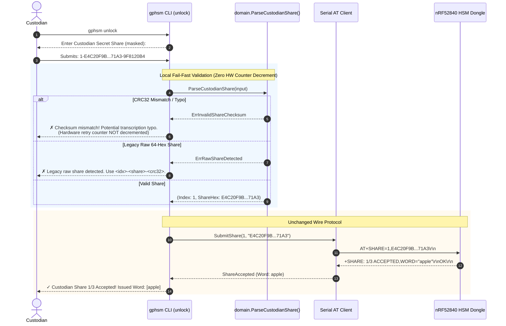

# ADR-0034: Shamir Key Format with Embedded Index and CRC32 Checksum

## Context & Problem Statement

Under [[Architecture/Decisions/ADR-0016 - Dual-Mode Authentication Architecture (PIN and Shamir Secret Sharing)|ADR-0016]], the HSM ecosystem supports Shamir Secret Sharing (3-of-5 threshold scheme) for multi-custodian device unlock and administration. In the initial implementation:
1. `gphsm device init --mode shamir` output five raw 32-byte secret shares formatted as 64-character hexadecimal strings alongside a separate integer index ($1 \dots 5$).
2. `gphsm unlock` prompted custodians across two distinct steps:
   - Entering their custodian index ($1 \dots 5$) in cleartext.
   - Entering their raw 64-hexadecimal share under terminal password masking.

This workflow exhibited three critical vulnerabilities and operational liabilities:

1. **Index Disassociation & Swapping**: Custodians frequently transcribed or engraved only the 64-hex share string without associating the corresponding index, or entered an index that mismatched the cryptographic share.
2. **Accidental Hardware Retry Counter Exhaustion**: The physical microcontroller maintains an immutable non-volatile retry counter initialized to 3. If a custodian made a single transcription typo in their 64-hex share, the unverified share was transmitted over the serial link (`AT+SHARE=<idx>,<shareHex>`), causing the dongle to reject the share and decrement its non-volatile counter. Three incorrect submissions trigger a permanent security lockout, requiring a factory reset and catastrophic loss of all non-backed private keys.
3. **Multi-Prompt Friction**: Prompting for an index followed by a separate masked string added friction and confusion during high-stakes threshold recovery operations.

A unified, self-verifying, and tamper-evident custodian share format is required at the host CLI layer that catches transcription errors before hardware transmission while keeping the underlying firmware wire protocol unchanged.

---

## Decision Drivers

- **Zero-Tolerance Hardware Counter Exhaustion**: Prevent any transcription typo or malformed share from reaching the physical HSM over the serial AT link.
- **Cryptographic Identity Binding**: Conclusively bind the custodian index ($1 \dots 5$) to the share entropy so index swapping or omitting the index is impossible.
- **Firmware Wire Protocol Invariance**: Keep the nRF52840 firmware (`hsm-ncs-firmware`) and its CDC-ACM AT command framing (`AT+SHARE=<idx>,<shareHex>`) 100% untouched to avoid requiring firmware reflashes across already deployed dongles.
- **Streamlined Ceremony UX**: Reduce the custodian interaction to a single masked prompt (`"Enter Custodian Secret Share (masked): "`).
- **High Performance & Zero CGO**: Validation must execute in $< 100\,\mu\text{s}$ using pure Go standard library components across macOS, Linux, and Windows.

---

## Considered Options

### Option 1: Status Quo (Raw 64-Hex Shares with Separate Cleartext Index)
- **Description**: Retain two-step entry (`idx` followed by raw 64-hex share) without checksum.
- **Pros**: No changes to existing CLI logic.
- **Cons**: High operational risk; single typos exhaust non-volatile hardware retry counters, leading to unrecoverable HSM bricking; poor user experience.

### Option 2: Bech32 / Bech32m Encoding (e.g. `hsm1share...`)
- **Description**: Encode index and share into a Bech32/Bech32m string with BCH error detection.
- **Pros**: Human-friendly character set (excludes `1`, `b`, `i`, `o`), built-in error detection.
- **Cons**:
  - Hides the custodian index from immediate visual inspection by operators.
  - Requires third-party encoding libraries or complex BCH polynomial implementations.
  - Unfamiliar format compared to the hexadecimal representation standard in the HSM ecosystem.

### Option 3: Base64 / Base64URL Encoding with Trailing Checksum
- **Description**: Base64-encode `[index || share || checksum]`.
- **Pros**: Shorter character length (~48 characters).
- **Cons**:
  - Contains mixed-case and punctuation characters (`+`, `/`, `=`) that cause transcription errors on handwritten paper or metal punch plates.
  - Does not allow quick visual confirmation of the custodian index.

### Option 4: Delimited Hex Format `<index>-<64_hex_share>-<8_hex_crc32>` with CRC-32 IEEE (Selected)
- **Description**: Package the share as a 75-character delimited uppercase hexadecimal string:
  $$\mathbf{\langle index \rangle \textbf{--} \langle 64\_hex\_share \rangle \textbf{--} \langle 8\_hex\_crc32 \rangle}$$
  where CRC-32 is computed using IEEE 802.3 (`crc32.ChecksumIEEE`) over the 33-byte binary slice:
  $$\text{Payload} = \left[ \text{uint8}(index) \;\parallel\; \text{hex\_decode}(shareHex) \right]$$
- **Pros**:
  - Clear visual demarcation of custodian index, cryptographic entropy, and error-check suffix.
  - The index is embedded directly into the CRC-32 calculation: modifying the index invalidates the checksum.
  - Standard IEEE 802.3 polynomial (`0xEDB88320`) available in Go standard library (`hash/crc32`).
  - Zero CGO dependencies and instantaneous computation ($< 1\,\mu\text{s}$).
  - Firmware wire protocol remains 100% invariant (`AT+SHARE=<idx>,<shareHex>`).
  - Enables single masked prompt during `gphsm unlock`.

---

## Decision Outcome

**Adopt Option 4: Delimited Hex Format with CRC-32 IEEE.**

The host administration utility [`gphsm`](file:///Users/gpfister/Development/Projects/gpfister/nrf52840-hsm/hsm-cli) will:
1. Emits shares in the canonical 75-character format during `gphsm device init --mode shamir`.
2. Interrogate custodians with a single masked prompt during `gphsm unlock`.
3. Validate syntax, index bounds ($1 \dots 5$), hex length (64 characters / 32 bytes), and CRC-32 checksum locally before executing any serial I/O.
4. Detect and reject legacy raw 64-hex shares with explicit diagnostic instructions.
5. Transmit validated shares to the dongle via existing `AT+SHARE=<idx>,<shareHex>`.

---

## Architecture & Data Flow

---

## Consequences & Trade-offs

### Positive
- **Hardware Lockout Elimination**: Transcription errors are trapped locally in software. Microcontroller non-volatile retry counters remain completely untouched by user typos.
- **Index-Entropy Binding**: Prevents index confusion, index swapping, and orphan shares.
- **Zero Firmware Risk**: Deployed firmware does not need to be reflashed, preserving existing MCUboot slots and hardware integrity.
- **Frictionless UX**: Replaces multi-step interrogation with a single prompt in `gphsm unlock`.
- **Informative Diagnostics**: Detects pre-upgrade raw 64-hex shares and gives actionable guidance.

### Negative & Mitigations
- **Increased Share Length**: String length increases from 64 to 75 characters ($+11$ characters).
  - *Mitigation*: Hyphen delimiters partition the string into readable segments, facilitating manual double-checking and metal-plate stamping.
- **Deprecation of Raw Share Entry**: Custodians holding legacy raw shares from earlier testing cannot paste them directly into `gphsm unlock`.
  - *Mitigation*: `ParseCustodianShare` explicitly identifies 64-character raw hex strings and displays an instructive diagnostic error explaining the required `<index>-<share>-<crc32>` format. Operators can compute the CRC-32 suffix using standard tooling if necessary.

---

## Implementation Reference

- Specification: [[Specification/Shamir Key Format with Embedded Index and CRC32 Checksum|Technical Specification: Shamir Key Format with Embedded Index and CRC32 Checksum]]
- Plan: [[Plan/Shamir Key Format with Embedded Index and CRC32 Checksum Implementation Plan|Implementation Plan: Shamir Key Format with Embedded Index and CRC32 Checksum]]
- Feature Guide: [[features/shamir-share-format-crc32|Feature Specification: Shamir Custodian Share Format with CRC32 Checksum]]
- Domain Implementation: [`hsm-cli/internal/domain/share_format.go`](file:///Users/gpfister/Development/Projects/gpfister/nrf52840-hsm/hsm-cli/internal/domain/share_format.go)
- Usecase Ceremony Implementation: [`hsm-cli/internal/usecases/ceremony_service.go`](file:///Users/gpfister/Development/Projects/gpfister/nrf52840-hsm/hsm-cli/internal/usecases/ceremony_service.go)
