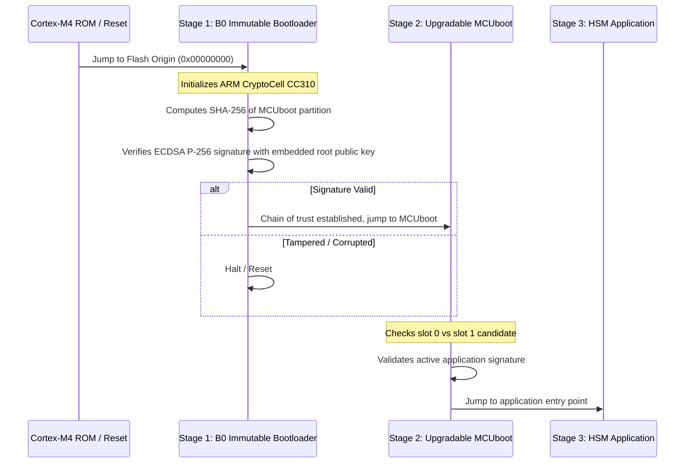

# Dual-Stage Secure Boot

The dongle enforces an unbroken cryptographic chain of trust from initial hardware power-on through application execution.

---

## Flash Layout & Signing

- **Stage 1 (B0)**: Immutable first stage bootloader placed at address `0x00000000`. Uses hardware acceleration (Nordic CryptoCell CC310) for SHA-256 hashing and ECDSA P-256 signature verification.
- **Stage 2 (MCUboot)**: Upgradable bootloader located immediately following B0. Handles partition swap, image verification, and rollback protection.
- **Keys**: All signing keys are kept at root level in `keys/root-ec-p256.pem`. The public key `keys/root-ec-p256-pub.c` is compiled into the bootloaders.
