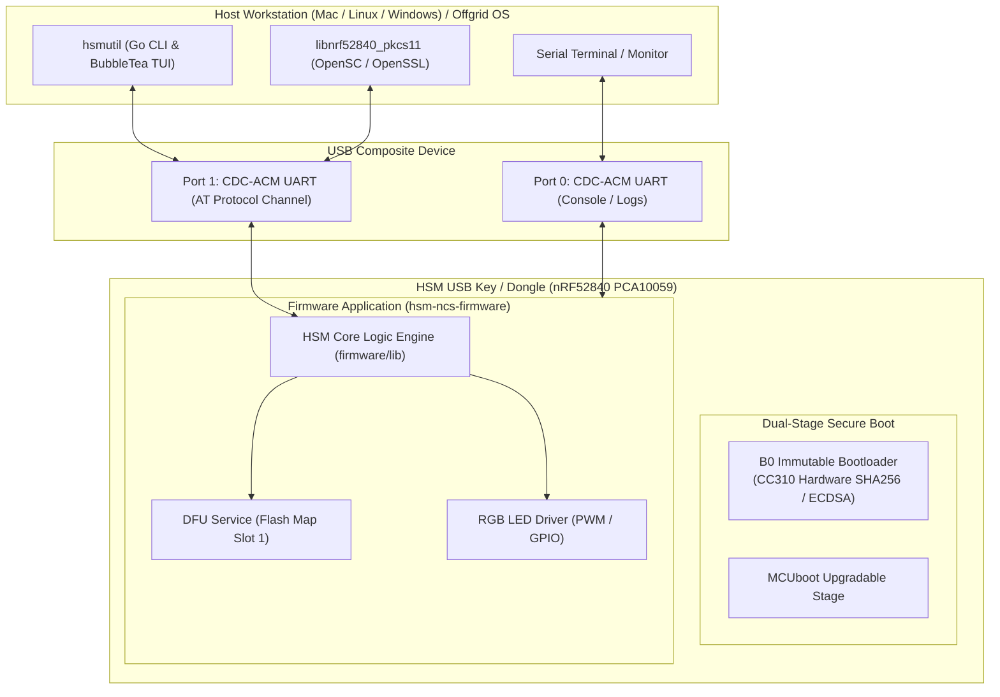

# System Architecture

The **ncs-nrf52840dongle-kms** workspace implements a Hardware Security Module (HSM) ecosystem with firmware currently targeting an **nRF52840 Dongle** (`PCA10059`), communicating via a dual CDC-ACM USB interface and controlled by the cross-platform CLI `hsmutil` or standard PKCS#11 tooling (see [[Architecture/Decisions/ADR-0014 - Documentation Terminology Generalization to Generic HSM USB Key|ADR-0014]]).

---

## Workspace Multi-Repo Structure

The workspace coordinates five orchestrated sub-repositories:

1. **[`hsm-ncs-firmware`](file:///Users/gpfister/Development/Projects/gpfister/nrf52840-hsm/hsm-ncs-firmware)**: NCS v3.4.1 / Zephyr RTOS workspace repository for the dongle firmware (currently exclusively supporting the nRF52840 USB Dongle `PCA10059`), including dual-stage secure boot configurations and pure HSM logic.
2. **[`hsm-cli`](file:///Users/gpfister/Development/Projects/gpfister/nrf52840-hsm/hsm-cli)**: Cross-platform Go repository delivering the `hsmutil` CLI and BubbleTea TUI for interacting with the HSM USB key on macOS, Linux, and Windows.
3. **[`hsm-libpkcs11`](file:///Users/gpfister/Development/Projects/gpfister/nrf52840-hsm/hsm-libpkcs11)**: Cryptoki PKCS#11 v2.40 shared library provider (`libnrf52840_pkcs11.dylib` / `.so` / `.dll`) allowing utilities like `pkcs11-tool` to interact with the HSM key.
4. **[`hsm-obsidian`](file:///Users/gpfister/Development/Projects/gpfister/nrf52840-hsm/hsm-obsidian)**: Centralized Obsidian documentation vault tracking specifications, architecture, and sessions.
5. **[`hsm-yocto-offgrid-rpi`](file:///Users/gpfister/Development/Projects/gpfister/nrf52840-hsm/hsm-yocto-offgrid-rpi)**: Ultra-hardened, air-gapped 64-bit embedded Linux operating system built with Yocto Project 6.1 (`blacksail`) for performing sensitive cryptographic operations (e.g. offline Root CA management) with the HSM key.
