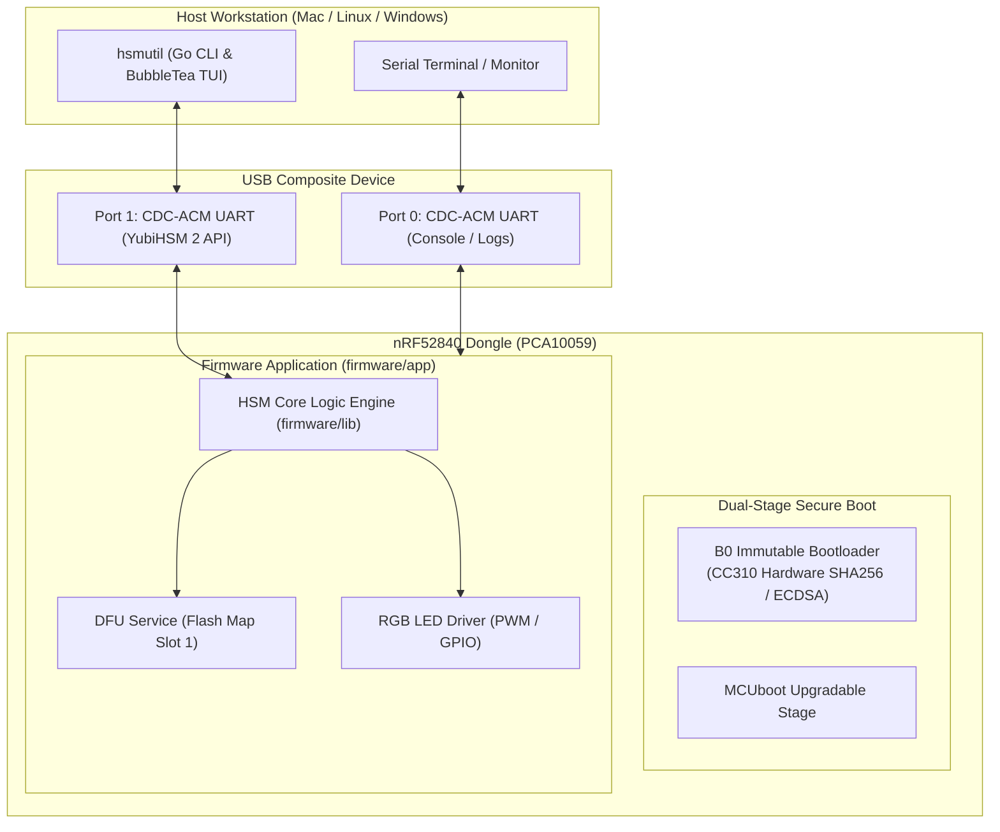

# System Architecture

The **ncs-nrf52840dongle-kms** workspace implements a Hardware Security Module (HSM) on an **nRF52840 Dongle** (`PCA10059`), communicating via a dual CDC-ACM USB interface and controlled by the cross-platform CLI `hsmutil`.

---

## Workspace Multi-Repo Structure

The workspace coordinates five orchestrated sub-repositories:

1. **`nrf52840-hsm-firmware`**: NCS/Zephyr workspace repository for the dongle firmware, including dual-stage secure boot configurations and pure HSM logic.
2. **`nrf52840-hsm-cli`**: Cross-platform Go repository delivering the `hsmutil` CLI and BubbleTea TUI for macOS, Linux, and Windows.
3. **`nrf52840-hsm-libpkcs11`**: Cryptoki PKCS#11 v2.40 shared library provider (`libnrf52840_pkcs11.dylib` / `.so` / `.dll`).
4. **`nrf52840-hsm-obsidian`**: Centralized Obsidian documentation vault tracking specifications, architecture, and sessions.
5. **`rpi-z2w-yocto-hsm`**: Ultra-hardened, air-gapped 64-bit embedded Linux operating system built with Yocto Project 5.0 LTS (`scarthgap`) for Raspberry Pi hardware appliances and dual-slot RAUC A/B updates.
