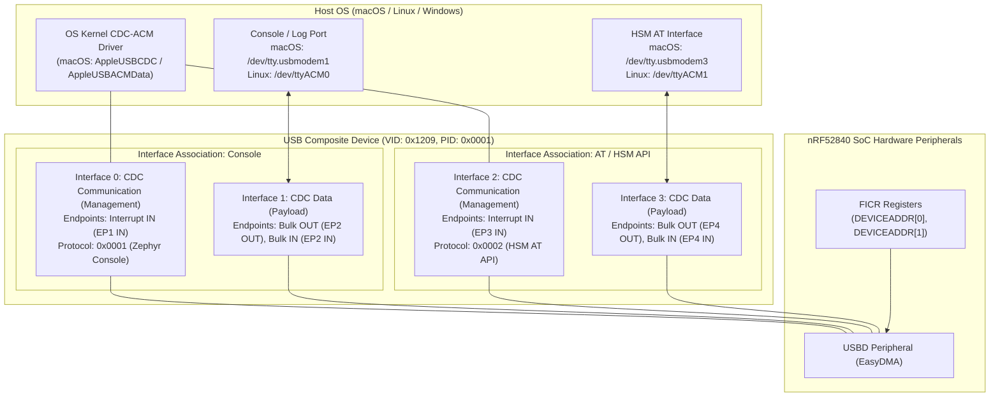
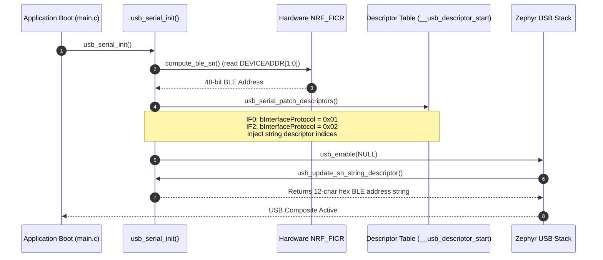

# USB Composite Stack Architecture

The **nRF52840 HSM Dongle** operates as a high-speed compliant full-speed USB 2.0 composite device exposing two distinct CDC-ACM (Communications Device Class - Abstract Control Model) Virtual COM Ports.

---

## 1. High-Level USB Topology



---

## 2. Interface Numbering & macOS BSD Device Mapping

In Zephyr's USB CDC-ACM implementation, each CDC-ACM function requires a pair of interfaces:
1. **Communication (Management) Interface** (`bInterfaceClass = 0x02`, `bInterfaceSubClass = 0x02`): Handles line coding, control lines (DTR/RTS), and serial state notifications via an interrupt endpoint.
2. **Data Interface** (`bInterfaceClass = 0x0A`, `bInterfaceSubClass = 0x00`): Carries raw bidirectional payload bytes via bulk endpoints.

### Interface Allocation Table

| Port Function | Zephyr Device Node | Interface # | Role | Endpoints | Protocol ID (`bInterfaceProtocol`) | macOS TTY Mapping |
| :--- | :--- | :--- | :--- | :--- | :--- | :--- |
| **Console / Logs** | `cdc_acm_uart0` | `0` | CDC Management | EP1 IN (Interrupt) | `0x0001` (Zephyr Console) | *Control Plane* |
| **Console / Logs** | `cdc_acm_uart0` | `1` | CDC Data | EP2 OUT / EP2 IN (Bulk) | `0x0000` | `/dev/tty.usbmodem<BLE_ADDR>1` |
| **HSM AT Protocol** | `cdc_acm_uart1` | `2` | CDC Management | EP3 IN (Interrupt) | `0x0002` (HSM AT API) | *Control Plane* |
| **HSM AT Protocol** | `cdc_acm_uart1` | `3` | CDC Data | EP4 OUT / EP4 IN (Bulk) | `0x0000` | `/dev/tty.usbmodem<BLE_ADDR>3` |

> [!NOTE]
> macOS's `AppleUSBCDCACMData` driver attaches BSD device nodes (`/dev/tty.*` and `/dev/cu.*`) strictly to **data** interfaces. Consequently, the assigned suffix digits are `1` (Console) and `3` (AT API), rather than `0` and `1`.

---

## 3. macOS Kernel & DriverKit Boundary Analysis

A critical architectural consideration is why the macOS device path remains `/dev/tty.usbmodem<SERIAL><SUFFIX>` rather than a custom device node like `/dev/tty.usbhsm`:

1. **Kernel Driver Hierarchy**:
   macOS matches CDC-ACM devices using `AppleUSBCDCCompositeDevice` -> `AppleUSBACMControl` -> `AppleUSBACMData` -> `IOSerialBSDClient`.
2. **Hardcoded Device Node Prefix**:
   `AppleUSBACMData` sets `IOTTYBaseName` hardcoded to `"usbmodem"`. The BSD subsystem synthesizes device paths in `/dev` according to:
   ```text
   /dev/tty.<IOTTYBaseName><IOTTYSuffix>
   ```
3. **DriverKit DEXT Entitlements**:
   Creating custom `/dev/tty.usbhsm*` device nodes requires authoring and distributing a macOS DriverKit Driver Extension (DEXT). This introduces significant deployment friction:
   - Requires Apple Developer Program entitlements (`com.apple.developer.driverkit.transport.usb`).
   - Requires manual user security approvals in macOS System Settings.
   - Breaks plug-and-play portability across unprivileged user environments and CI runners.
4. **Architectural Decision**:
   Retain native standard CDC-ACM class compliance. Cross-platform user applications, `hsmutil`, and `libnrf52840_pkcs11` locate the device via USB VID (`0x1209`), PID (`0x0001`), and data interface suffix `3`.

---

## 4. Hardware BLE Address & Dynamic Serial Numbering

The USB Device Descriptor exposes a dynamic Serial Number string descriptor derived directly from the nRF52840's factory-burned Bluetooth Device Address in FICR:

### 4.1 FICR Register Extraction
The 48-bit BLE Device Address is stored in Nordic FICR:
- `NRF_FICR->DEVICEADDR[1]`: Upper 16 bits of the address.
- `NRF_FICR->DEVICEADDR[0]`: Lower 32 bits of the address.
- `NRF_FICR->DEVICEADDRTYPE`: Address type bit (Random Static vs Public). If set to random static, the two most significant bits are asserted (`0xC000`).

### 4.2 Formatting & Override Hook
The address is formatted into a 12-character uppercase hexadecimal string:
```c
snprintf(s_ble_sn, sizeof(s_ble_sn), "%04X%08X",
         (unsigned int)(addr1 & 0xFFFFUL), (unsigned int)addr0);
```
Zephyr's weak symbol hook `usb_update_sn_string_descriptor()` is overridden in `firmware/app/src/usb_serial.c` to return `(uint8_t *)s_ble_sn`. When the host requests string descriptor index `iSerialNumber`, Zephyr serves this hardware address.

---

## 5. Runtime Dynamic Descriptor Patching

Zephyr generates USB descriptor tables statically via linker sets (`__usb_descriptor_start` to `__usb_descriptor_end`). To configure interface protocol identifiers without maintaining out-of-tree Zephyr fork patches:

1. **User String Descriptors**:
   String descriptors for the interfaces are registered via:
   ```c
   USBD_STRING_DESCR_USER_DEFINE(primary) struct usb_console_if_string_desc s_console_str_desc = ...;
   USBD_STRING_DESCR_USER_DEFINE(primary) struct usb_hsm_if_string_desc s_hsm_str_desc = ...;
   ```
2. **Descriptor Table Walk**:
   In `usb_serial_patch_descriptors()`, before calling `usb_enable(NULL)`:
   - Traverses descriptor headers starting at `__usb_descriptor_start`.
   - When encountering `USB_DESC_INTERFACE`:
     - Interface 0 (Console): sets `bInterfaceProtocol = 0x01` and assigns the console string descriptor index to `iInterface`.
     - Interface 2 (HSM AT): sets `bInterfaceProtocol = 0x02` and assigns the HSM string descriptor index to `iInterface`.
   - When encountering `USB_DESC_INTERFACE_ASSOC`:
     - Patches `bFunctionProtocol` and `iFunction` accordingly.



---

## 6. Host Discovery & Port Scoring Matrix

To avoid conflicting with the Zephyr console logger or hanging during serial communications, host client software implements candidate port priority scoring:

### Scoring Rules

| Platform | Port Pattern | Last Digit | Suitability | Score |
| :--- | :--- | :---: | :--- | :---: |
| **macOS** | `/dev/tty.usbmodem*` | `3` | **Primary AT Data Channel** | **1000** |
| **macOS** | `/dev/cu.usbmodem*` | `3` | Secondary AT Data Channel | 900 |
| **macOS** | `/dev/tty.usbmodem*` | *other* | Non-console serial channel | 600 |
| **macOS** | `/dev/cu.usbmodem*` | *other* | Non-console serial channel | 500 |
| **macOS** | `/dev/tty.usbmodem*` | `1` | Firmware Console / Logger | 200 (Demoted) |
| **macOS** | `/dev/cu.usbmodem*` | `1` | Firmware Console / Logger | 100 (Demoted) |
| **Linux** | `/dev/ttyACM*` | `1` or `3`| Primary AT Data Channel | 1000 |
| **Linux** | `/dev/ttyACM0` | `0` | Firmware Console / Logger | 200 (Demoted) |

This hierarchy ensures `hsmutil` and `libnrf52840_pkcs11` immediately connect to the AT protocol channel without probing or disturbing the console stream.

---

## 7. Architecture Decision Records (ADRs)

- [[Architecture/Decisions/ADR-0001 - Hardware BLE Address for Deterministic USB Serial Number|ADR-0001: Hardware BLE Address for Deterministic USB Serial Number]]
- [[Architecture/Decisions/ADR-0002 - In-Tree Protocol Descriptor Patching vs macOS DriverKit Extension|ADR-0002: In-Tree Protocol Descriptor Patching vs macOS DriverKit Extension]]
- [[Architecture/Decisions/ADR-0003 - Host Port Discovery and Serial Targeting Strategy|ADR-0003: Host Port Discovery and Serial Targeting Strategy]]

---

## 8. Related Notes

- [[features/usb-descriptors-ble-address|USB Descriptors & Device Identification Feature Spec & Implementation]]
- [[Plan/USB Descriptors and BLE Identification Implementation Plan|Implementation Plan: USB Descriptors & BLE Device Identification]]
- [[Specification/USB Descriptors and Device Identification|USB Descriptors & Device Identification Specification]]
- [[Development/CLI Reference|hsmutil CLI Reference]]
- [[git-status|Workspace Git Status]]
- [[Architecture/System Architecture|System Architecture]]
- [[Hardware/nRF52840 Dongle PCA10059|nRF52840 Dongle PCA10059 Hardware]]
