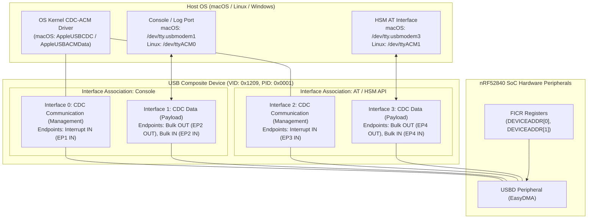

# USB Composite Stack Architecture

The **nRF52840 HSM Dongle** operates as a high-speed compliant full-speed USB 2.0 composite device exposing two distinct CDC-ACM (Communications Device Class - Abstract Control Model) Virtual COM Ports.

---

## 1. High-Level USB Topology



---

## 2. Interface Numbering & macOS BSD Device Mapping

In Zephyr's USB CDC-ACM implementation, each CDC-ACM function requires a pair of interfaces:
1. **Communication (Management) Interface** (`bInterfaceClass = 0x02`, `bInterfaceSubClass = 0x02`): Handles line coding, control lines (DTR/RTS), and serial state notifications via an interrupt endpoint.
2. **Data Interface** (`bInterfaceClass = 0x0A`, `bInterfaceSubClass = 0x00`): Carries raw bidirectional payload bytes via bulk endpoints.

### Interface Allocation Table

| Port Function | Zephyr Device Node | Interface # | Role | Endpoints | Protocol ID (`bInterfaceProtocol`) | macOS TTY Mapping |
| :--- | :--- | :--- | :--- | :--- | :--- | :--- |
| **Console / Logs** | `cdc_acm_uart0` | `0` | CDC Management | EP1 IN (Interrupt) | `0x0001` (Zephyr Console) | *Control Plane* |
| **Console / Logs** | `cdc_acm_uart0` | `1` | CDC Data | EP2 OUT / EP2 IN (Bulk) | `0x0000` | `/dev/tty.usbmodem<SERIAL>1` |
| **HSM AT Protocol** | `cdc_acm_uart1` | `2` | CDC Management | EP3 IN (Interrupt) | `0x0002` (HSM AT API) | *Control Plane* |
| **HSM AT Protocol** | `cdc_acm_uart1` | `3` | CDC Data | EP4 OUT / EP4 IN (Bulk) | `0x0000` | `/dev/tty.usbmodem<SERIAL>3` |

> [!NOTE]
> macOS's `AppleUSBCDCACMData` driver attaches BSD device nodes (`/dev/tty.*` and `/dev/cu.*`) strictly to **data** interfaces. Consequently, the assigned suffix digits are `1` (Console) and `3` (AT API), rather than `0` and `1`.

---

## 3. macOS Kernel & DriverKit Boundary Analysis

A critical architectural consideration is why the macOS device path remains `/dev/tty.usbmodem<SERIAL><SUFFIX>` rather than a custom device node like `/dev/tty.usbhsm`:

1. **Kernel Driver Hierarchy**:
   macOS matches CDC-ACM devices using `AppleUSBCDCCompositeDevice` -> `AppleUSBACMControl` -> `AppleUSBACMData` -> `IOSerialBSDClient`.
2. **Hardcoded Device Node Prefix**:
   `AppleUSBACMData` sets `IOTTYBaseName` hardcoded to `"usbmodem"`. The BSD subsystem synthesizes device paths in `/dev` according to:
   ```text
   /dev/tty.<IOTTYBaseName><IOTTYSuffix>
   ```
3. **DriverKit DEXT Entitlements**:
   Creating custom `/dev/tty.usbhsm*` device nodes requires authoring and distributing a macOS DriverKit Driver Extension (DEXT). This introduces significant deployment friction:
   - Requires Apple Developer Program entitlements (`com.apple.developer.driverkit.transport.usb`).
   - Requires manual user security approvals in macOS System Settings.
   - Breaks plug-and-play portability across unprivileged user environments and CI runners.
4. **Architectural Decision**:
   Retain native standard CDC-ACM class compliance. Cross-platform user applications and `hsmutil` auto-discovery locate the device via USB VID (`0x1209`), PID (`0x0001`), and data interface suffix `3`.

---

## 4. USB Descriptors & Identification

The composite device exposes:
- **Vendor ID (VID)**: `0x1209` (pid.codes community VID)
- **Product ID (PID)**: `0x0001` (nRF52840 HSM Dongle)
- **Manufacturer String**: `"pid.codes"`
- **Product String**: `"nRF52840 HSM Dongle"`
- **Serial Number String**: 12-digit uppercase hexadecimal string extracted directly from hardware Factory Information Configuration Registers (FICR) representing the factory BLE Device Address.

---

## 5. Related Notes

- [[Specification/USB Descriptors and Device Identification|USB Descriptors & Device Identification Specification]]
- [[Architecture/System Architecture|System Architecture]]
- [[Hardware/nRF52840 Dongle PCA10059|nRF52840 Dongle PCA10059 Hardware]]
- [[Development/CLI Reference|hsmutil CLI Reference]]
