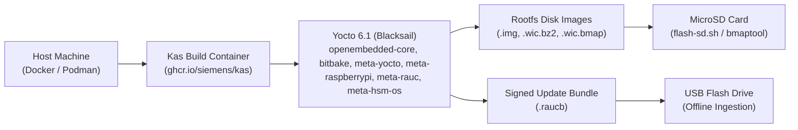
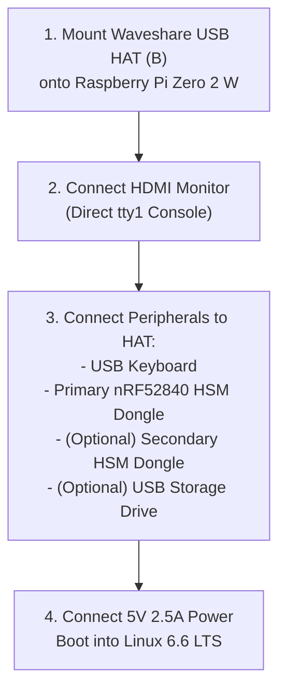
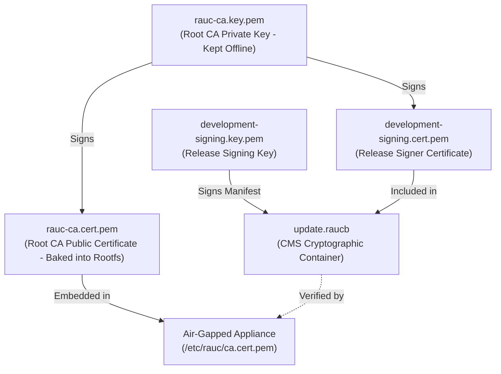

# Yocto Build and RAUC Update Guide

This operational guide provides end-to-end procedures for compiling, flashing, configuring, and updating the **`rpi-z2w-yocto-hsm`** air-gapped embedded Linux operating system for the Raspberry Pi appliance and nRF52840 HSM Dongle (`PCA10059`).

---

## 1. Build System Architecture & Tooling

The build pipeline leverages **Kas** (`ghcr.io/siemens/kas/kas:latest`) running inside Docker or Podman. Kas provides declarative layer aggregation, reproducible BitBake environments, and complete isolation from host dependencies.



### Host Prerequisites
- **Container Engine**: Docker or Podman installed and running.
- **Disk Space**: At least 50 GB free disk space (downloads and sstate cache are shared across builds).
- **Architecture**: Supports macOS (Apple Silicon / Intel) and Linux (`x86_64` / `aarch64`).
- **Host Tools for Flashing**: `bzip2` or `pbzip2`, `dd`, `sudo`.

---

## 2. Building OS Images with Kas

Build targets can be triggered either from the **workspace root** or directly within the **`rpi-z2w-yocto-hsm`** sub-repository.

### 2.1 Workspace Root Makefile Targets

```bash
# Build development image (hsm-image-dev) for default machine (raspberrypi0-2w-64)
make yocto-build-dev

# Build production air-gapped image (hsm-image-prod)
make yocto-build-prod

# Target specific Raspberry Pi model (Pi 3, Pi 4, Pi 5)
make -C rpi-z2w-yocto-hsm build-prod MACHINE=raspberrypi4-64

# Build signed RAUC A/B update bundle (.raucb)
make yocto-bundle

# Launch interactive Kas shell inside build container
make yocto-shell

# Clean build artifacts while preserving downloads/sstate cache
make yocto-clean
```

### 2.2 Sub-Repository Makefile Targets

Navigate to [`rpi-z2w-yocto-hsm/`](file:///Users/gpfister/Development/Projects/gpfister/nrf52840-hsm/rpi-z2w-yocto-hsm):

```bash
cd rpi-z2w-yocto-hsm

# 1. Build development image (features sudo, debug console port, RAM logging)
make build-dev

# 2. Build production hardened image (quiet kernel, locked root, AT port only, silent journald)
make build-prod

# 3. Build signed RAUC update bundle (.raucb)
make bundle

# 4. Open interactive Bitbake shell
make shell
```

### 2.3 Kas Configuration Hierarchy

Kas configurations are organized hierarchically:
- [`kas-project.yml`](file:///Users/gpfister/Development/Projects/gpfister/nrf52840-hsm/rpi-z2w-yocto-hsm/kas-project.yml): Declares upstream Blacksail 6.1 repositories (`openembedded-core`, `bitbake`, `meta-yocto`, `meta-raspberrypi`, `meta-openembedded`, `meta-rauc`), machine defaults (`raspberrypi0-2w-64`), and base distro configurations with PAM enabled.
- [`kas-dev.yml`](file:///Users/gpfister/Development/Projects/gpfister/nrf52840-hsm/rpi-z2w-yocto-hsm/kas-dev.yml): Inherits `kas-project.yml`, builds target `hsm-image-dev`, sets `HSM_DEV_MODE=1`, enables `allow-root-login post-install-logging`, root password `root`, sudo escalation for user `hsmutil`, and RAM-only logging (`Storage=volatile`).
- [`kas-prod.yml`](file:///Users/gpfister/Development/Projects/gpfister/nrf52840-hsm/rpi-z2w-yocto-hsm/kas-prod.yml): Inherits `kas-project.yml`, builds target `hsm-image-prod`, sets `HSM_DEV_MODE=0`, enforces quiet kernel, locks root account (`usermod -L root`), and enables silent journald (`Storage=none`).

### 2.4 Verified Build Execution & Benchmark

The development image build pipeline has been executed and verified in the containerized Kas environment:
- **Build Target**: `hsm-image-dev`
- **Machine Target**: `raspberrypi0-2w-64` (Raspberry Pi Zero 2 W 64-bit ARMv8 Cortex-A53)
- **BitBake Tasks**: **5,844 tasks attempted and succeeded** (0 failed tasks, 0 build errors)
- **Deployment Directory**: [`rpi-z2w-yocto-hsm/build/deploy/images/raspberrypi0-2w-64/`](file:///Users/gpfister/Development/Projects/gpfister/nrf52840-hsm/rpi-z2w-yocto-hsm/build/deploy/images/raspberrypi0-2w-64)

#### Verified Deployed Artifacts

| Artifact | Size | Description |
| :--- | :--- | :--- |
| `hsm-image-dev-raspberrypi0-2w-64.rootfs.img` | **1.6 GB** | Uncompressed raw bootable SD card disk image formatted with dual-slot A/B partition topology, U-Boot environment, and hardened Linux rootfs (`IMAGE_FSTYPES += "img"`, `IMAGE_TYPEDEP:img = "wic"`, symlink to `hsm-image-dev-raspberrypi0-2w-64.rootfs-20261105103859.img`). |
| `hsm-image-dev-raspberrypi0-2w-64.rootfs.wic.bz2` | **168 MB** | Bzip2-compressed raw bootable SD card disk image. |
| `hsm-image-dev-raspberrypi0-2w-64.rootfs.wic.bmap` | **8.0 KB** | Fast block map file enabling high-speed SD card flashing via `bmaptool copy` by writing only populated sectors. |
| `hsm-image-dev-raspberrypi0-2w-64.rootfs.tar.bz2` | **73 MB** | Compressed root filesystem archive containing base packages, systemd configurations, and `hsmutil` user space (used by RAUC bundles). |
| `disable-bt.dtbo` | **1.0 KB** | Kernel device tree overlay disabling onboard Broadcom Bluetooth controller at boot. |
| `disable-wifi.dtbo` | **387 B** | Kernel device tree overlay disabling onboard Broadcom SDIO WiFi interface at boot. |
| `dwc2.dtbo` | **801 B** | Kernel device tree overlay forcing DWC2 USB controller host mode for Waveshare USB HAT (B). |
| `bcm2710-rpi-zero-2.dtb` | **33.7 KB** | Compiled Device Tree Blob for Raspberry Pi Zero 2 W SoC. |
| `boot.scr` | **1.3 KB** | Compiled U-Boot boot script handling dual-slot A/B slot selection, boot counters, and kernel handoff. |

---

## 3. Flashing to MicroSD Card

Once the build finishes, the raw partitioned image and fast block map are available under:
[`rpi-z2w-yocto-hsm/build/deploy/images/raspberrypi0-2w-64/`](file:///Users/gpfister/Development/Projects/gpfister/nrf52840-hsm/rpi-z2w-yocto-hsm/build/deploy/images/raspberrypi0-2w-64)

### 3.1 Device Identification Safety

> [!CAUTION]
> Flashing raw disk images completely overwrites the target device. Always identify your physical MicroSD card device path with absolute certainty before proceeding.

- **macOS Identification**:
  ```bash
  diskutil list
  # Identify external disk (e.g., /dev/disk4)
  # Use the raw character device /dev/rdisk4 for 10x faster flashing speed
  ```
- **Linux Identification**:
  ```bash
  lsblk -p
  # Identify target SD card (e.g., /dev/sdb or /dev/mmcblk0)
  ```

### 3.2 Method A: Built-in Raw / Streaming Flasher (`scripts/flash-sd.sh`)

Use the workspace flasher script [`scripts/flash-sd.sh`](file:///Users/gpfister/Development/Projects/gpfister/nrf52840-hsm/rpi-z2w-yocto-hsm/scripts/flash-sd.sh), which supports both uncompressed `.img` images and compressed `.wic.bz2` archives on macOS (`Darwin`) and Linux:

```bash
# Syntax: ./scripts/flash-sd.sh <image.img | image.wic.bz2> <target_device>

# Example 1: Flash uncompressed .img image directly (macOS):
./scripts/flash-sd.sh \
  build/deploy/images/raspberrypi0-2w-64/hsm-image-dev-raspberrypi0-2w-64.rootfs.img \
  /dev/rdisk4

# Example 2: Stream compressed .wic.bz2 image on the fly (macOS):
./scripts/flash-sd.sh \
  build/deploy/images/raspberrypi0-2w-64/hsm-image-dev-raspberrypi0-2w-64.rootfs.wic.bz2 \
  /dev/rdisk4

# Example 3: Flash on Linux:
./scripts/flash-sd.sh \
  build/deploy/images/raspberrypi0-2w-64/hsm-image-dev-raspberrypi0-2w-64.rootfs.img \
  /dev/sdb
```

The script performs safety and platform compatibility checks:
1. Confirms the source `.img` or `.wic.bz2` image exists.
2. Displays source and target device path.
3. Requires explicit interactive typing of `"yes"` before invoking `dd`.
4. Automatically selects platform-appropriate `dd` flags via `uname -s` (`bs=4m status=progress` on macOS BSD `dd`; `bs=4M status=progress conv=fsync` on Linux GNU `dd`).
5. Writes the raw `.img` directly or streams decompression via `bzip2 -dc` / `pbzip2 -dc`, followed by `sync` to flush buffered blocks to physical flash.

### 3.3 Method B: High-Speed Flashing via Block Map (`bmaptool copy`)

Using `bmaptool` is up to 5 times faster than standard `dd` because it skips unallocated image sectors. Because BitBake emits both the uncompressed `.img` and `.wic.bmap` directly in `build/deploy/images/raspberrypi0-2w-64/`, no manual decompression step is required:

```bash
# Flash uncompressed .img directly with bmaptool:
sudo bmaptool copy \
  --bmap build/deploy/images/raspberrypi0-2w-64/hsm-image-dev-raspberrypi0-2w-64.rootfs.wic.bmap \
  build/deploy/images/raspberrypi0-2w-64/hsm-image-dev-raspberrypi0-2w-64.rootfs.img \
  /dev/rdisk4  # or /dev/sdb on Linux
```

> [!TIP]
> On macOS, `bmaptool` can be installed via `brew install bmap-tools`. On Ubuntu/Debian, install with `sudo apt install bmap-tools`.

---

## 4. Appliance Assembly & Cold Boot Procedure



1. **Physical Assembly**:
   - Mount the [[Hardware/Waveshare USB HAT (B) Integration|Waveshare USB HAT (B)]] onto the Raspberry Pi Zero 2 W (or Pi 3/4/5) using brass standoffs.
   - Verify firm contact of pogo pins with test points (or attach the Micro-USB bridge).
2. **Connect Peripherals**:
   - Local HDMI display to HDMI port (console will appear on `tty1` via `hdmi_force_hotplug=1`).
   - USB Keyboard into Waveshare USB HAT Port 1.
   - nRF52840 HSM Dongle into Waveshare USB HAT Port 2.
3. **Power On**:
   - Apply power via 5V 2.5A Micro-USB adapter.
   - U-Boot initializes hardware, verifies partition slot (Slot A), and boots the hardened kernel.
   - The appliance issue banner displays on the local HDMI monitor.

---

## 5. Operator Initialization & Workflows

### 5.1 First-Login Setup Wizard
1. At the login prompt, enter default operator credentials:
   - **Login**: `hsmutil`
   - **Password**: `password`
2. [`first-login-wizard.sh`](file:///Users/gpfister/Development/Projects/gpfister/nrf52840-hsm/rpi-z2w-yocto-hsm/meta-hsm-os/recipes-core/init-wizard/files/first-login-wizard.sh) executes automatically:
   - **Step 1: Forced Password Change with Complexity Enforcement**:
     ```text
     You must now change the default password for account 'hsmutil'.
     Password requirements:
       - At least 10 characters
       - At least 1 digit, 1 uppercase letter, 1 special character
       - No adjacent repeated identical characters (e.g. 'aa', '11')
       - No monotonic sequences of 3+ characters (e.g. 'abc', '123')
     Current password:
     New password:
     Retype new password:
     ```
     Candidate passwords are pre-validated by `first-login-wizard.sh` and enforced system-wide by `pam_pwquality.so` in `/etc/pam.d/common-password`.
     Password update applies to `/etc/shadow` residing in volatile RAM overlay (`/run/overlay/etc-upper`), preserving the underlying immutable root filesystem while enforcing a 90-day password aging limit (`PASS_MAX_DAYS 90`).
   - **Step 2: Keyboard Layout Selection**:
     ```text
     Select your physical keyboard layout:
       1) US English (us)
       2) French (fr)
       3) German (de)
       4) UK English (uk)
       5) Swiss French (fr_CH)
       6) Swiss German (sg)
     Enter choice [1-6] (default: 1):
     ```
     Applies `loadkeys` and persists choice to `~/.keymap`.
   - **Step 3: Timezone / Locale**:
     Applies `export TZ=UTC` ensuring standard timestamp logging.
   - Creates marker `~/.wizard_completed` so the wizard does not re-fire on subsequent logins.

### 5.2 Every-Login UTC Timestamp Calibration
Because the appliance is air-gapped without NTP network synchronization, and Raspberry Pi boards lack an onboard battery RTC:
1. On every login shell, [`clock-setup.sh`](file:///Users/gpfister/Development/Projects/gpfister/nrf52840-hsm/rpi-z2w-yocto-hsm/meta-hsm-os/recipes-core/init-wizard/files/clock-setup.sh) prompts:
   ```text
   ------------------------------------------------------------------
   Air-Gapped Clock Notice:
   Current System Time: 2026-11-01 12:00:00 UTC
   ------------------------------------------------------------------
   Because this machine is strictly air-gapped without NTP network sync
   or battery-backed RTC, verify and update the system clock for
   accurate cryptographic certificate timestamps and audit logs.

   Enter current UTC date/time [YYYY-MM-DD HH:MM:SS] (or Enter to keep):
   ```
2. Operator inputs current UTC time (e.g. `2026-11-01 19:30:00`).
3. The script calls the setuid root C helper [`hsm-set-date`](file:///Users/gpfister/Development/Projects/gpfister/nrf52840-hsm/rpi-z2w-yocto-hsm/meta-hsm-os/recipes-core/init-wizard/files/hsm-set-date.c) (`/usr/local/bin/hsm-set-date`), which validates the format using `strptime`/`timegm` and calls `settimeofday()`.
4. The system clock is updated without requiring superuser credentials, ensuring valid x509 certificate timestamps.

### 5.3 USB Mass Storage Automounting
When a USB flash drive (FAT32 or ext4) is inserted into an available Waveshare HAT port:
- `udev` invokes [`usb-mount.sh`](file:///Users/gpfister/Development/Projects/gpfister/nrf52840-hsm/rpi-z2w-yocto-hsm/meta-hsm-os/recipes-support/usb-mount/files/usb-mount.sh) via `usb-mount@<dev>.service`.
- Mounts the partition under `/media/usb-<devname>` with ownership `hsmutil:storage` and permissions `0770`.
- Operator can read and write keys, certificates, and backups:
  ```bash
  # Generate CSR or export public key to USB drive:
  hsmutil key list
  hsmutil key export --slot 1 --out /media/usb-sda1/root-ca.pub.pem
  ```

---

## 6. Offline RAUC A/B Firmware Update Protocol

System updates are cryptographically signed using an x509 PKI infrastructure and delivered offline via USB mass storage.

### 6.1 RAUC PKI Architecture



To initialize or rotate RAUC keys:
```bash
./scripts/generate-rauc-keys.sh
```
- Generates an ECDSA P-256 (`prime256v1`) Root CA certificate valid for 10 years.
- Embeds `keys/rauc-ca.cert.pem` directly into `/etc/rauc/ca.cert.pem` during Yocto image compilation.
- Generates a developer signing certificate (`development-signing.cert.pem`) signed by the Root CA.

### 6.2 Creating Signed Update Bundles
Run the bundle generator:
```bash
# From workspace root:
make yocto-bundle

# Or from sub-repo:
cd rpi-z2w-yocto-hsm
make bundle
```
The resulting `.raucb` bundle encapsulates the new kernel, device tree, and rootfs image, cryptographically signed with CMS/PKCS#7.

### 6.3 Offline Automated USB Installation
1. **Copy Bundle to USB Storage**:
   ```bash
   cp build/deploy/images/raspberrypi0-2w-64/update-bundle-raspberrypi0-2w-64.raucb /Volumes/SECURE_USB/update.raucb
   ```
2. **Insert USB Drive into Appliance**:
   - Plug the drive into an available Waveshare USB HAT port.
3. **Automated Detection & Installation**:
   - `udev` mounts the drive under `/media/usb-sda1`.
   - `usb-mount.sh` detects `update.raucb` and automatically starts `rauc-usb-autoinstall.service`.
   - RAUC verifies the CMS signature against `/etc/rauc/ca.cert.pem`.
   - If valid, RAUC streams the image into the inactive partition slot (e.g. Slot B).
   - U-Boot environment variables are updated: `upgrade_available=1`, `BOOT_ORDER="B A"`.
4. **Reboot & Mark Good**:
   - Power-cycle or reboot the appliance.
   - U-Boot boots into the updated slot.
   - Confirm active slot and health:
     ```bash
     rauc status
     rauc status mark-good
     ```
   - If the update fails to boot, U-Boot's boot counter automatically falls back to Slot A.

---

## 7. Verification & Troubleshooting Commands

Inside the appliance terminal, verify system state with:

```bash
# 1. Inspect RAUC dual-slot status and active slot:
rauc status

# 2. Inspect attached nRF52840 HSM character device nodes:
ls -la /dev/tty.hsm*
# Output: crw-rw---- 1 root dialout ... /dev/tty.hsmF4CE3682910A0
# Symlink: lrwxrwxrwx 1 root root ... /dev/tty.hsm -> tty.hsmF4CE3682910A0

# 3. Test communication with HSM via hsmutil:
hsmutil info
hsmutil echo --message "Air-gap verification"

# 4. Verify total-drop firewall rules:
nft list ruleset
# Output confirms: table inet filter { chain input { type filter hook input priority filter; policy drop; } ... }

# 5. Check volatile RAM mounts:
df -h | grep -E "media|overlay|hsmutil"
# Confirms tmpfs mounts on /media, /home/hsmutil, and overlay on /etc

# 6. Check silent journald configuration:
cat /etc/systemd/journald.conf.d/airgap-logging.conf
# Output (prod): Storage=none, ForwardToSyslog=no, ForwardToKMsg=no, ForwardToConsole=no

# 7. Test unprivileged clock calibration:
hsm-set-date "2026-11-01 20:00:00"
date -u

# 8. Verify host-side configuration and password validator test suites:
./scripts/test-password-validator.sh
./scripts/verify-security-configs.sh
```

---

## 8. Cross-References

- **Appliance Architecture**: [[Architecture/07 - Air-Gapped RPi HSM OS Architecture|07 - Air-Gapped RPi HSM OS Architecture]]
- **Hardware Integration**: [[Hardware/Waveshare USB HAT (B) Integration|Waveshare USB HAT (B) Integration]]
- **Dongle Specifications**: [[Hardware/nRF52840 Dongle PCA10059|nRF52840 Dongle PCA10059]]
- **CLI Reference**: [[Development/CLI Reference|CLI Reference]]
- **Feature Specification**: [[features/yocto-boot-visibility-and-password-policy|Feature: Yocto Boot Visibility & Password Policy]]
- **Technical Specification**: [[Specification/Yocto Dev-Prod Boot Visibility, U-Boot Hardening, and Password Policy|Specification: Yocto Dev-Prod Boot Visibility, U-Boot Hardening, and Password Policy]]
- **Implementation Plan**: [[Plan/Yocto Dev-Prod Boot Visibility, U-Boot Hardening, and Password Policy Implementation Plan|Implementation Plan: Yocto Dev-Prod Boot Visibility, U-Boot Hardening, and Password Policy]]
- **ADR-0010: Boot Console Multiplexing**: [[Architecture/Decisions/ADR-0010 - Kernel Boot Console Multiplexing and Command Line Specialization|ADR-0010]]
- **ADR-0011: Silent U-Boot Hardening**: [[Architecture/Decisions/ADR-0011 - Silent Non-Interactive U-Boot Bootloader Hardening|ADR-0011]]
- **ADR-0012: PAM Password Policy**: [[Architecture/Decisions/ADR-0012 - PAM pwquality Password Complexity and Expiration Policy|ADR-0012]]
- **Root Orchestration**: [`Makefile`](file:///Users/gpfister/Development/Projects/gpfister/nrf52840-hsm/Makefile)
