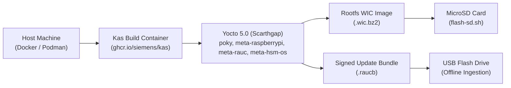
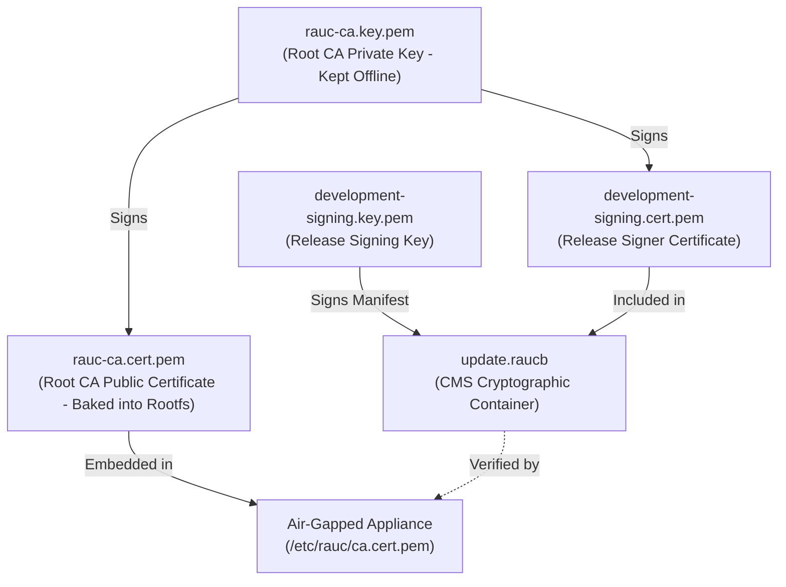

# Yocto Build and RAUC Update Guide

This operational guide provides step-by-step procedures for compiling, flashing, and maintaining the **`rpi-z2w-yocto-hsm`** air-gapped embedded Linux operating system for the Raspberry Pi appliance and nRF52840 HSM Dongle (`PCA10059`).

---

## 1. Build System Overview

The build pipeline leverages **Kas** (`ghcr.io/siemens/kas/kas:latest`) running inside Docker or Podman. Kas provides declarative layer aggregation, reproducible BitBake environments, and complete isolation from host dependencies.



### Host Prerequisites
- **Container Engine**: Docker or Podman installed and running.
- **Disk Space**: At least 50 GB free disk space (persisted downloads and sstate cache are shared across builds).
- **Architecture**: Supports macOS (Apple Silicon / Intel) and Linux (`x86_64` / `aarch64`).
- **Dependencies for Flashing**: `bzip2` or `pbzip2` and `dd` / `sudo`.

---

## 2. Building OS Images with Kas

Build targets can be triggered either from the **workspace root** or directly within the **`rpi-z2w-yocto-hsm`** sub-repository.

### 2.1 Workspace Root Makefile Targets

```bash
# Build development image (hsm-image-dev) for default machine (raspberrypi0-2w-64)
make yocto-build-dev

# Build production air-gapped image (hsm-image-prod)
make yocto-build-prod

# Target specific Raspberry Pi model (Pi 3, Pi 4, Pi 5)
make -C rpi-z2w-yocto-hsm build-prod MACHINE=raspberrypi4-64

# Build signed RAUC A/B update bundle
make yocto-bundle

# Launch interactive Kas shell inside build container
make yocto-shell

# Clean build artifacts while preserving downloads/sstate cache
make yocto-clean
```

### 2.2 Sub-Repository Makefile Targets

Navigate to [`rpi-z2w-yocto-hsm/`](file:///Users/gpfister/Development/Projects/gpfister/nrf52840-hsm/rpi-z2w-yocto-hsm):

```bash
cd rpi-z2w-yocto-hsm

# 1. Build development image (features sudo, debug console port, RAM logging)
make build-dev

# 2. Build production hardened image (quiet kernel, no root login, AT port only)
make build-prod

# 3. Build signed RAUC update bundle (.raucb)
make bundle

# 4. Open interactive Bitbake shell
make shell
```

### 2.3 Build Configuration Matrix

Kas configurations are organized hierarchically:
- [`kas-project.yml`](file:///Users/gpfister/Development/Projects/gpfister/nrf52840-hsm/rpi-z2w-yocto-hsm/kas-project.yml): Declares upstream Scarthgap repositories (`poky`, `meta-raspberrypi`, `meta-openembedded`, `meta-rauc`) and base distro configurations.
- [`kas-dev.yml`](file:///Users/gpfister/Development/Projects/gpfister/nrf52840-hsm/rpi-z2w-yocto-hsm/kas-dev.yml): Inherits `kas-project.yml`, builds target `hsm-image-dev`, enables `debug-tweaks`, root login, and development port exposure.
- [`kas-prod.yml`](file:///Users/gpfister/Development/Projects/gpfister/nrf52840-hsm/rpi-z2w-yocto-hsm/kas-prod.yml): Inherits `kas-project.yml`, builds target `hsm-image-prod`, enforces quiet kernel, disables root login, and applies strict production lockdown.

---

## 3. Flashing to MicroSD Card

Once the build finishes, the raw partitioned image is available under:
`rpi-z2w-yocto-hsm/build/tmp/deploy/images/<machine>/hsm-image-<variant>.rootfs.wic.bz2`

### 3.1 Device Identification Safety

> [!CAUTION]
> Flashing raw disk images completely overwrites the target device. Always identify your physical MicroSD card device path with absolute certainty before proceeding.

- **macOS Identification**:
  ```bash
  diskutil list
  # Identify external disk (e.g., /dev/disk4)
  # Use the raw character device /dev/rdisk4 for 10x faster flashing speed
  ```
- **Linux Identification**:
  ```bash
  lsblk -p
  # Identify target SD card (e.g., /dev/sdb or /dev/mmcblk0)
  ```

### 3.2 Executing Flashing Script

Use the built-in flasher [`scripts/flash-sd.sh`](file:///Users/gpfister/Development/Projects/gpfister/nrf52840-hsm/rpi-z2w-yocto-hsm/scripts/flash-sd.sh):

```bash
# Syntax: ./scripts/flash-sd.sh <image_path> <target_device>

./scripts/flash-sd.sh \
  build/tmp/deploy/images/raspberrypi0-2w-64/hsm-image-prod.rootfs.wic.bz2 \
  /dev/rdisk4
```

The script performs safety checks:
1. Confirms the source file exists.
2. Displays source and target device path.
3. Requires explicit interactive typing of `"yes"` before invoking `dd`.
4. Streams decompression via `bzip2 -dc` directly to the raw block device with `bs=4M status=progress conv=fsync`.
5. Executes `sync` to ensure buffered blocks are flushed to physical flash.

---

## 4. Cold Boot & Operator Setup Procedure

1. **Insert MicroSD Card** into Raspberry Pi (Zero 2 W / 3 / 4 / 5).
2. **Mount Waveshare USB HAT (B)** to GPIO header and USB OTG/Host port.
3. **Connect Peripherals**:
   - Local HDMI display to HDMI port (console will appear on `tty1`).
   - USB Keyboard into Waveshare USB HAT port.
   - One or more nRF52840 HSM Dongles into Waveshare USB HAT ports.
4. **Power On**:
   - U-Boot initializes hardware, verifies partition slot, and boots Linux 6.6 LTS.
   - Screen displays the `rpi-z2w-yocto-hsm` issue banner.

### 4.1 First-Login Setup Wizard
On initial login:
1. Log in with initial credentials (`hsmutil` / temporary factory PIN).
2. The wizard intercepts the session:
   - **Forced Password Reset**: Prompts operator to enter and confirm a new strong passphrase for user `hsmutil`.
   - **Keyboard Selection**: Runs `loadkeys` selection menu to match physical keyboard layout (preventing mistyped PINs/passphrases).
   - **Locale Initialization**: Applies system locale variables.

### 4.2 Every-Login UTC Timestamp Prompt
Air-gapped appliances possess no NTP connectivity, and Raspberry Pi boards lack an onboard battery RTC:
- At every terminal login, the shell prompts:
  ```text
  [TIME SYNC REQUIRED] Please enter current UTC timestamp (YYYY-MM-DD HH:MM:SS):
  ```
- Operator inputs current time (e.g. `2026-11-01 19:30:00`).
- Script executes `date -u -s "$INPUT"` to initialize kernel time. This ensures proper `notBefore` and `notAfter` validity periods for x509 CSRs and certificate generation.

---

## 5. RAUC Offline A/B Firmware Update Protocol

System updates are cryptographically signed using an x509 PKI infrastructure and delivered offline via USB mass storage.

### 5.1 RAUC PKI Architecture



To initialize or rotate RAUC keys:
```bash
./scripts/generate-rauc-keys.sh
```
- Generates an ECDSA P-256 (`prime256v1`) Root CA certificate valid for 10 years.
- Embeds `keys/rauc-ca.cert.pem` directly into `/etc/rauc/ca.cert.pem` during Yocto image compilation.
- Generates a developer signing certificate (`development-signing.cert.pem`) signed by the Root CA.

### 5.2 Creating Signed Update Bundles
Run the bundle generator:
```bash
# From workspace root:
make yocto-bundle

# Or from sub-repo:
cd rpi-z2w-yocto-hsm
make bundle
```
The resulting `.raucb` bundle encapsulates the new kernel, device tree, and rootfs image, cryptographically signed with CMS/PKCS#7.

### 5.3 Offline Installation Procedure

1. **Copy Bundle to USB Storage**:
   ```bash
   cp build/deploy/bundles/hsm-update-bundle.raucb /Volumes/SECURE_USB/update.raucb
   ```
2. **Insert USB Drive into Appliance**:
   - Plug the drive into an available Waveshare USB HAT port.
3. **Automated Verification & Installation**:
   - `udev` detects the partition and mounts it under `/media/usb-<devname>`.
   - `rauc-usb-autoinstall.service` detects `update.raucb`.
   - RAUC verifies the CMS signature against `/etc/rauc/ca.cert.pem`.
   - If valid, RAUC streams the new image to the inactive slot (Slot A or Slot B).
   - U-Boot environment variables are updated: `upgrade_available=1`, `BOOT_ORDER="<new_slot> <old_slot>"`.
4. **Reboot**:
   - Type `reboot` at the terminal or power-cycle.
   - U-Boot boots into the updated slot.
   - Upon successful user login and health checks, RAUC marks the slot active:
     ```bash
     rauc status mark-good
     ```
   - If boot fails or kernel panics, U-Boot's boot counter decrements and automatically reboots back into the previous known-good slot.

---

## 6. Verification & Troubleshooting Commands

Inside the appliance terminal, verify system state with:

```bash
# 1. Inspect RAUC dual-slot status and active slot:
rauc status

# 2. Inspect attached nRF52840 HSM character device nodes:
ls -la /dev/tty.hsm*
# Output: crw-rw---- 1 root dialout ... /dev/tty.hsmF4CE3682910A0

# 3. Test communication with HSM via hsmutil:
hsmutil info
hsmutil echo --message "Air-gap verification"

# 4. Verify total-drop firewall rules:
nft list ruleset

# 5. Check USB mass storage mount:
df -h | grep /media/usb
```

---

## 7. Cross-References

- **Architecture Details**: [[Architecture/07 - Air-Gapped RPi HSM OS Architecture|07 - Air-Gapped RPi HSM OS Architecture]]
- **Dongle Specifications**: [[Hardware/nRF52840 Dongle PCA10059|nRF52840 Dongle PCA10059]]
- **CLI Reference**: [[Development/CLI Reference|CLI Reference]]
- **Root Orchestration**: [`Makefile`](file:///Users/gpfister/Development/Projects/gpfister/nrf52840-hsm/Makefile)
