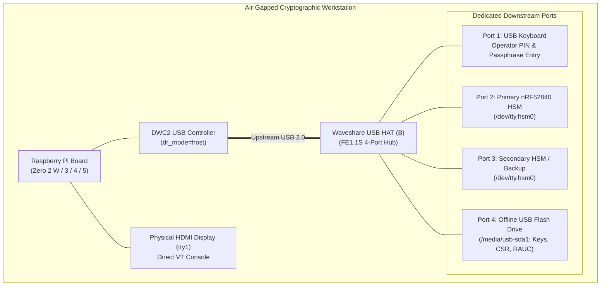

# Waveshare USB HAT (B) Integration

The **Waveshare USB HAT (B)** is a dedicated 4-port USB 2.0 expansion hub and GPIO passthrough board designed for Raspberry Pi systems (specifically form-factor optimized for Raspberry Pi Zero / Zero W / Zero 2 W, and compatible with Raspberry Pi 3, 4, and 5). In the air-gapped HSM appliance architecture ([`rpi-z2w-yocto-hsm`](file:///Users/gpfister/Development/Projects/gpfister/nrf52840-hsm/rpi-z2w-yocto-hsm)), it provides the physical USB expansion required to operate multiple [[Hardware/nRF52840 Dongle PCA10059|nRF52840 HSM Dongles]], an operator keyboard, and offline USB mass storage drives.

---

## 1. Hardware Specifications & Board Overview

| Feature | Specification |
| :--- | :--- |
| **Manufacturer** | Waveshare |
| **Model** | USB HAT (B) |
| **USB Hub Controller** | FE1.1S USB 2.0 High-Speed 4-Port Hub Controller |
| **Upstream Interface** | Micro-USB connector (or spring pogo pins connecting to Pi Zero test points `PP1`, `PP6`, `PP22`, `PP23`) |
| **Downstream Ports** | 4x USB 2.0 Type-A downstream ports (USB 1.1 / 2.0 compatible, up to 480 Mbps) |
| **Operating Voltage** | 5V DC supplied via Raspberry Pi GPIO header or external Micro-USB power port |
| **GPIO Header** | 40-pin 2.54mm pitch GPIO passthrough header |
| **Dimensions** | 65.0 mm × 30.0 mm (identical footprint to Raspberry Pi Zero form factor) |
| **Status Indicators** | Power LED (red), USB port activity/power status LEDs |

---

## 2. Appliance Topology & Port Allocation

In the air-gapped appliance, the Raspberry Pi Zero 2 W (or Pi 3/4/5) operates in strict USB host mode, routing the upstream DWC2 controller directly into the FE1.1S hub chip.



### Port Allocation Policy

1. **Port 1 (Operator Input)**: Dedicated to a physical USB keyboard. Handled by kernel HID driver; keyboard map configured via [[Architecture/07 - Air-Gapped RPi HSM OS Architecture#4-dedicated-operator-user-space--first-login-wizard|First-Login Setup Wizard]] (`loadkeys`).
2. **Port 2 (Primary Cryptographic HSM)**: Connected to the primary [[Hardware/nRF52840 Dongle PCA10059|nRF52840 Dongle (`PCA10059`)]]. Driven by `nrf52840-hsm-kmod` producing `/dev/tty.hsm<ble_address>0` and symlink `/dev/tty.hsm`.
3. **Port 3 (Secondary Dongle / Migration)**: Accommodates a second HSM dongle for offline Shamir secret split recovery, key migration ceremonies (`hsmutil key migrate`), or cross-signing.
4. **Port 4 (Air-Gapped Mass Storage)**: Connected to an unencrypted offline USB flash drive (FAT32/ext4). Automatically mounted under `/media/usb-<devname>` by `usb-mount.sh` for certificate export, public key extraction, and RAUC update ingestion.

---

## 3. Firmware & Kernel Configuration

To enable the Waveshare USB HAT (B) in host mode and disable OTG peripheral emulation on the Raspberry Pi Zero 2 W, the Yocto Board Support Package recipe [`meta-hsm-os/recipes-bsp/bootfiles/rpi-config_%.bbappend`](file:///Users/gpfister/Development/Projects/gpfister/nrf52840-hsm/rpi-z2w-yocto-hsm/meta-hsm-os/recipes-bsp/bootfiles/rpi-config_%.bbappend) configures `/boot/config.txt`:

```text
# Waveshare USB HAT (B) Host Mode Support
dtoverlay=dwc2,dr_mode=host

# Video Console on HDMI (tty1)
hdmi_force_hotplug=1
hdmi_drive=2

# Air-Gap Hardware Lockdown
dtoverlay=disable-bt
dtoverlay=disable-wifi
boot_delay=0
disable_splash=1
```

### Configuration Rationale
- `dtoverlay=dwc2,dr_mode=host`: Forces the Broadcom USB OTG controller into host mode exclusively. By locking the port to host mode at boot, peripheral gadget emulation is disabled, eliminating USB ethernet or CDC gadget attack vectors.
- `hdmi_force_hotplug=1` & `hdmi_drive=2`: Ensures video signals are continuously transmitted over HDMI even if a monitor is connected after boot, ensuring operator console (`tty1`) availability.
- `dtoverlay=disable-bt` & `dtoverlay=disable-wifi`: Electrically shuts down onboard wireless modems, maintaining the physical air-gap invariant.

---

## 4. Kernel Driver & USB Subsystem Interactions

When the Waveshare USB HAT (B) is energized, the Linux USB core recognizes the upstream FE1.1S controller:

```text
usb 1-1: new high-speed USB device number 2 using dwc2
usb 1-1: New USB device found, idVendor=05e3, idProduct=0608, bcdDevice= 9.01
usb 1-1: New USB device strings: Mfr=0, Product=1, SerialNumber=0
usb 1-1: Product: USB2.0 Hub
hub 1-1:1.0: USB hub found
hub 1-1:1.0: 4 ports detected
```

### Subsystem Handshakes
1. **Dongle Attachment**:
   - Dongle insertion into Port 2/3 triggers `nrf52840-hsm-kmod` ([`recipes-kernel/nrf52840-hsm-kmod/`](file:///Users/gpfister/Development/Projects/gpfister/nrf52840-hsm/rpi-z2w-yocto-hsm/meta-hsm-os/recipes-kernel/nrf52840-hsm-kmod)).
   - Default `cdc_acm` driver is blacklisted via [`blacklist-cdc-acm.conf`](file:///Users/gpfister/Development/Projects/gpfister/nrf52840-hsm/rpi-z2w-yocto-hsm/meta-hsm-os/recipes-kernel/nrf52840-hsm-kmod/files/blacklist-cdc-acm.conf) to guarantee exclusive driver binding.
   - The driver creates `/dev/tty.hsm<ble_address>0` with `0660` permissions owned by `root:dialout` ([`99-nrf52840-hsm.rules`](file:///Users/gpfister/Development/Projects/gpfister/nrf52840-hsm/rpi-z2w-yocto-hsm/meta-hsm-os/recipes-kernel/nrf52840-hsm-kmod/files/99-nrf52840-hsm.rules)).
2. **Storage Attachment**:
   - Drive insertion triggers `udev` rule [`99-usb-storage-mount.rules`](file:///Users/gpfister/Development/Projects/gpfister/nrf52840-hsm/rpi-z2w-yocto-hsm/meta-hsm-os/recipes-support/usb-mount/files/99-usb-storage-mount.rules).
   - Launches [`usb-mount@.service`](file:///Users/gpfister/Development/Projects/gpfister/nrf52840-hsm/rpi-z2w-yocto-hsm/meta-hsm-os/recipes-support/usb-mount/files/usb-mount@.service) which runs [`usb-mount.sh`](file:///Users/gpfister/Development/Projects/gpfister/nrf52840-hsm/rpi-z2w-yocto-hsm/meta-hsm-os/recipes-support/usb-mount/files/usb-mount.sh).
   - Mounts filesystem read-write under volatile RAM mount `/media/usb-<devname>` with ownership `hsmutil:storage`.
   - If an update bundle `*.raucb` is detected, automatically triggers `rauc-usb-autoinstall.service`.

---

## 5. Physical Assembly & Electrical Considerations

1. **Standoffs & Alignment**: Fasten the Waveshare HAT to the Raspberry Pi Zero 2 W using four brass M2.5 standoffs to prevent physical flex when inserting or removing USB dongles.
2. **Pogo Pins vs Micro-USB Bridge**:
   - When using pogo pins with the Pi Zero, verify firm contact with test pads `PP1` (5V), `PP6` (GND), `PP22` (USB D+), and `PP23` (USB D-).
   - Alternatively, utilize the supplied Micro-USB to Micro-USB bridge connector for guaranteed galvanic contact.
3. **Power Budget**:
   - The FE1.1S hub and each connected nRF52840 dongle draw minimal power (~30 mA idle, ~60 mA active crypto per dongle).
   - Total appliance draw under full load (Pi Zero 2 W + Waveshare HAT + 2x HSM Dongles + Keyboard + USB Flash Drive) remains below **1.2A at 5V DC**, well within the capacity of a standard 2.5A power adapter.
4. **USB Isolation**: No network dongles (Ethernet/WiFi) can function over the HAT ports because kernel network drivers (`CONFIG_NET_ETHERNET=n`, `CONFIG_USB_NET_DRIVERS=n`, `CONFIG_WLAN=n`) and wireless subsystems are disabled.

---

## 6. Cross-References

- **Air-Gapped OS Architecture**: [[Architecture/07 - Air-Gapped RPi HSM OS Architecture|07 - Air-Gapped RPi HSM OS Architecture]]
- **Dongle Hardware Specs**: [[Hardware/nRF52840 Dongle PCA10059|nRF52840 Dongle PCA10059]]
- **Build & RAUC Guide**: [[Development/Yocto Build and RAUC Update Guide|Yocto Build and RAUC Update Guide]]
- **OS Sub-Repository**: [`rpi-z2w-yocto-hsm/`](file:///Users/gpfister/Development/Projects/gpfister/nrf52840-hsm/rpi-z2w-yocto-hsm)
