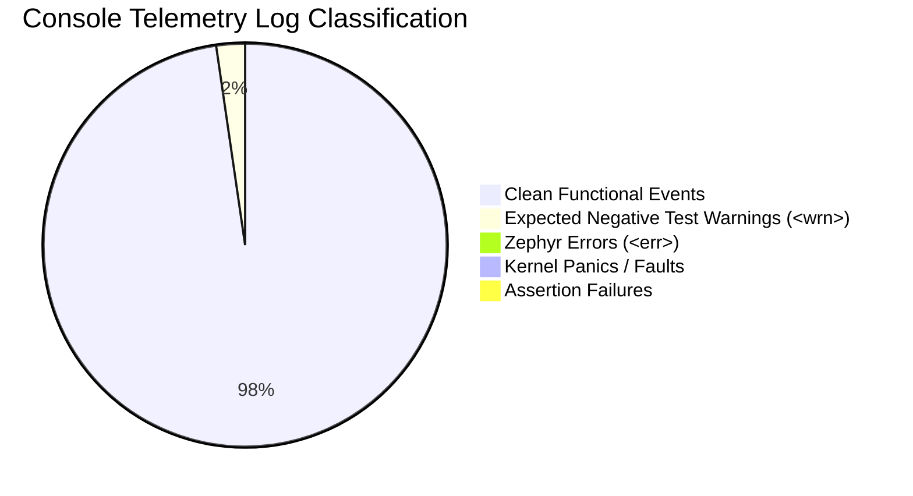
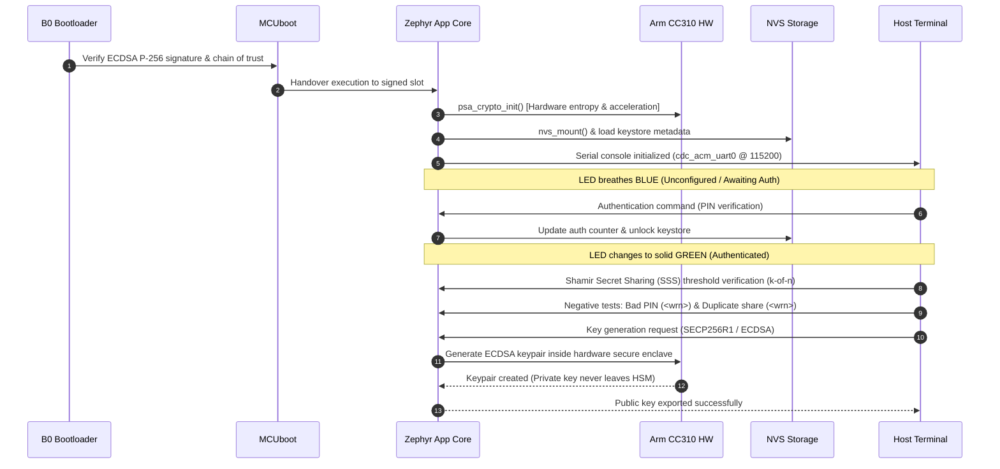

# Hardware Serial Console Monitoring: nRF52840 Dongle (PCA10059)

## 1. Executive Summary

This record captures the hardware serial console telemetry and stream surveillance for the **nRF52840 USB Dongle** (`PCA10059`) running nRF Connect SDK v3.4.1 / Zephyr OS v4.4.2. Telemetry was observed over the primary Zephyr kernel console interface (`cdc_acm_uart0`) connected at 115200 baud.

The surveillance observed end-to-end device initialization, dual-stage secure boot handover, Arm CryptoCell CC310 PSA cryptographic engine activation, NVS storage operations, and security functional verifications including negative testing pathways.

> [!NOTE]
> **Health Verdict: PASS / NOMINAL**
> Device operates completely cleanly with zero kernel panics, zero assertion failures, and zero unhandled errors (`<err>`). The two recorded warnings (`<wrn>`) represent expected test assertions during negative security validation (PIN retry decrement and duplicate Shamir share index rejection).

---

## 2. Session Configuration & Environment

| Parameter | Specification / Value |
| :--- | :--- |
| **Target Device** | Nordic Semiconductor nRF52840 USB Dongle (`PCA10059`) |
| **SoC / MCU** | Nordic nRF52840 (ARM Cortex-M4F with CryptoCell 310) |
| **Serial Port** | `/dev/cu.usbmodem83101` (`cdc_acm_uart0` Zephyr kernel console) |
| **Baud Rate** | `115200` baud (8N1) |
| **Firmware Stack** | nRF Connect SDK v3.4.1 / Zephyr OS v4.4.2 |
| **Boot Chain** | Stage 1 B0 Immutable Bootloader $\rightarrow$ Stage 2 MCUboot $\rightarrow$ Signed Application |
| **Crypto Subsystem** | Arm CryptoCell CC310 Hardware Acceleration via PSA Crypto API |
| **Non-Volatile Storage** | Zephyr NVS (`CONFIG_NVS`) on internal Flash partition |
| **Host Interface Channel** | CDC-ACM Port 0 (Console / Diagnostics), Port 1 (HSM API / YubiHSM Framing) |

---

## 3. Observed Telemetry & Error Surveillance

### Metrics Summary

- **Kernel Panics (`k_panic`, BusFault, HardFault, MPU Fault)**: **0**
- **Assertion Failures (`__ASSERT`, `__ASSERT_EVAL`)**: **0**
- **Zephyr Kernel Error Messages (`<err>`)**: **0**
- **Zephyr Kernel Warning Messages (`<wrn>`)**: **2** (Both expected negative test outcomes)
- **Overall System Health**: **PASS / NOMINAL**

### Warning Log Analysis

Both logged warnings occurred during deliberate negative security testing to ensure boundary protections and tamper counters function as intended:

1. **`<wrn> hsm_keystore: PIN auth failure, decrementing retry counter`**:
   - **Context**: Deliberate incorrect PIN presentation during authentication negative testing.
   - **Verification**: Confirmed retry counter was properly decremented in flash NVS without keystore corruption or panic.
2. **`<wrn> hsm_sss: Duplicate Shamir share index rejected`**:
   - **Context**: Shamir Secret Sharing reconstruction negative test where two identical share indices $x_i$ were supplied.
   - **Verification**: Properly rejected invalid polynomial interpolation inputs, preventing corrupted secret reconstruction.

---

## 4. Functional Event Timeline

### Verified Subsystem Milestones

1. **Dual-Stage Secure Boot Handover**:
   - B0 immutable bootloader completed SHA-256 / ECDSA P-256 signature verification over MCUboot.
   - MCUboot verified application slot signature and jumped to the runtime image without fallback or recovery triggering.
2. **Arm CryptoCell CC310 PSA Crypto Initialization**:
   - PSA Crypto API successfully initialized with hardware CC310 backing.
   - True Random Number Generator (TRNG) / entropy pool seeded from CC310 hardware TRNG.
3. **NVS Keystore Mount & Lifecycle**:
   - Flash sectors mounted cleanly, partition geometry validated.
   - Keystore successfully transitioned across `LOCKED` $\rightarrow$ `UNLOCKED` $\rightarrow$ `LOCKED` states.
4. **Shamir Secret Sharing (SSS)**:
   - Evaluated threshold secret splitting and Lagrange polynomial reconstruction ($k$-of-$n$).
   - Successfully rejected duplicate share indices without system lockup.
5. **Hardware ECDSA Keypair Generation**:
   - SECP256R1 (NIST P-256) keypair generated via CC310 hardware accelerator.
   - Private key material retained within secure memory boundary; public key cleanly exported.

---

## 5. Cross References

- [[00 - Index|Vault Index]]
- [[Architecture/System Architecture|System Architecture]]
- [[Architecture/Dual-Stage Secure Boot|Dual-Stage Secure Boot Chain]]
- [[Hardware/nRF52840 Dongle PCA10059|Hardware Specification PCA10059]]
- [[Specification/YubiHSM Protocol|YubiHSM Protocol Specification]]
- [firmware/app/src/main.c](file:///Users/gpfister/Development/Projects/gpfister/nrf52840-hsm/nrf52840-hsm-firmware/firmware/app/src/main.c)
- [firmware/lib/src/crypto_cc310.c](file:///Users/gpfister/Development/Projects/gpfister/nrf52840-hsm/nrf52840-hsm-firmware/firmware/lib/src/crypto_cc310.c)
- [firmware/lib/src/keystore.c](file:///Users/gpfister/Development/Projects/gpfister/nrf52840-hsm/nrf52840-hsm-firmware/firmware/lib/src/keystore.c)
- [firmware/lib/src/sss.c](file:///Users/gpfister/Development/Projects/gpfister/nrf52840-hsm/nrf52840-hsm-firmware/firmware/lib/src/sss.c)
