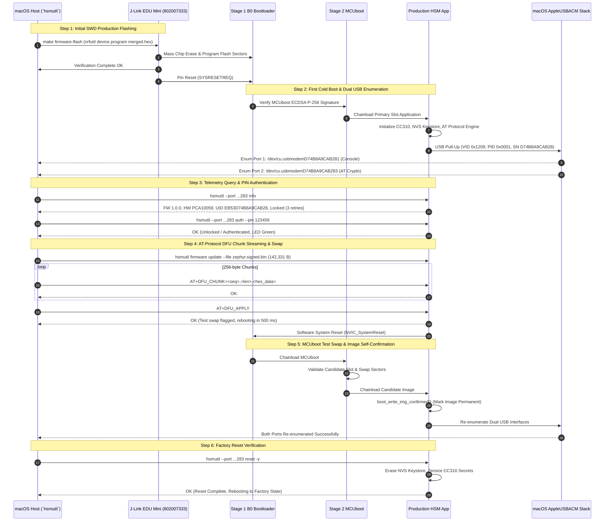

# Production Flashing, DFU Verification & Factory Reset: Second Dongle (PCA10059)

## 1. Executive Summary

This telemetry and verification report records the comprehensive hardware commissioning, firmware programming, USB enumeration validation, Device Firmware Upgrade (DFU) over AT protocol, and factory reset verification conducted on **2026-11-05** for the **second nRF52840 USB Dongle** (`PCA10059`).

The unit (BLE Hardware MAC / USB Serial: `D74B8A9CAB28`, Device UID: `EB53D74B8A9CAB28`) was provisioned using a SEGGER J-Link EDU Mini debug probe (`S/N: 802007333`, `J-Link_Greg's Mini EDU`) with the multi-stage production bundle [`nrf52840-hsm-firmware/build-prod/merged.hex`](file:///Users/gpfister/Development/Projects/gpfister/nrf52840-hsm/nrf52840-hsm-firmware/build-prod/merged.hex).

This session explicitly validated the **macOS CDC-ACM descriptor fix** ([`ADR-0013`](file:///Users/gpfister/Development/Projects/gpfister/nrf52840-hsm/nrf52840-hsm-obsidian/Architecture/Decisions/ADR-0013%20-%20Standard%20CDC-ACM%20AT%20Protocol%20Descriptors%20for%20macOS%20Dual%20Enumeration.md)), confirming that both CDC-ACM interfaces enumerate simultaneously on Apple Silicon macOS hosts without driver rejection.

> [!NOTE]
> **Health Verdict: NOMINAL / 100% PASS**
> - **SWD Flashing**: **PASS** — Full chip erase, B0 bootloader, MCUboot Stage 2, signed production application payload, and partition tables flashed and verified cleanly.
> - **Dual CDC-ACM Enumeration**: **PASS** — Both virtual serial ports registered immediately on macOS (`/dev/cu.usbmodemD74B8A9CAB281` and `/dev/cu.usbmodemD74B8A9CAB283`).
> - **Device Info & Auth**: **PASS** — Nominal device telemetry retrieved; authentication via default PIN `123456` succeeded.
> - **DFU Firmware Streaming**: **PASS** — 142,331 bytes streamed via chunked AT protocol (`AT+DFU_CHUNK`), candidate partition validated, MCUboot test swap scheduled (`AT+DFU_APPLY`), clean reboot executed, and self-test image confirmed.
> - **Factory Reset**: **PASS** — Automated non-interactive factory reset (`hsmutil reset -y`) wiped all persistent NVS records, zeroized CC310 keystore entries, and returned the dongle to a locked, unconfigured state.

---

## 2. Hardware & Programming Environment

### Target & Probe Specifications

| Parameter | Specification / Value |
| :--- | :--- |
| **Target Hardware** | Nordic Semiconductor nRF52840 USB Dongle (`PCA10059`) |
| **Unit Serial Number / BLE MAC** | `D74B8A9CAB28` (Hardware FICR `DEVICEADDR`) |
| **Unique Device Identifier (UID)** | `EB53D74B8A9CAB28` (Hardware FICR `DEVICEID`) |
| **SoC Architecture** | ARM Cortex-M4F @ 64 MHz, 1 MB Flash, 256 KB RAM |
| **Cryptographic Accelerator** | Arm CryptoCell CC310 (Hardware TRNG, ECDSA P-256, SHA-256) |
| **Debug Probe** | SEGGER J-Link EDU Mini (`S/N: 802007333`, `J-Link_Greg's Mini EDU`) |
| **Debug Interface** | Serial Wire Debug (SWD), 4000 kHz |
| **Production Firmware Bundle** | [`nrf52840-hsm-firmware/build-prod/merged.hex`](file:///Users/gpfister/Development/Projects/gpfister/nrf52840-hsm/nrf52840-hsm-firmware/build-prod/merged.hex) |
| **DFU Verification Image** | [`nrf52840-hsm-firmware/build-prod/app/zephyr/zephyr.signed.bin`](file:///Users/gpfister/Development/Projects/gpfister/nrf52840-hsm/nrf52840-hsm-firmware/build-prod/app/zephyr/zephyr.signed.bin) (142,331 bytes) |
| **Boot Chain** | Stage 1 B0 $\rightarrow$ Stage 2 MCUboot $\rightarrow$ Signed Application Slot |
| **Flashing Harness** | `make -C /Users/gpfister/Development/Projects/gpfister/nrf52840-hsm firmware-flash` |
| **Host System** | macOS (Darwin ARM64 / Apple Silicon) |

### End-to-End Commissioning & Verification Sequence



---

## 3. SWD Programming & Dual USB CDC-ACM Enumeration

### Programming Execution

The production firmware bundle was programmed via the root orchestration target:

```bash
make -C /Users/gpfister/Development/Projects/gpfister/nrf52840-hsm firmware-flash
```

Underlying execution details:
- **Mass Erase**: CTRL-AP mass erase executed cleanly, zeroing all previous flash sectors and state.
- **Payload Programmed**: Multi-stage image [`nrf52840-hsm-firmware/build-prod/merged.hex`](file:///Users/gpfister/Development/Projects/gpfister/nrf52840-hsm/nrf52840-hsm-firmware/build-prod/merged.hex) containing:
  - B0 Hardware-Crypto Bootloader (0x0000_0000 - 0x0000_7FFF)
  - Provisioned B0 Configuration (0x0000_B000 - 0x0000_BFFF)
  - MCUboot Secondary Bootloader (0x0000_C000 - 0x0001_FFFF)
  - Signed Primary Application Slot (0x0002_0000 - 0x0007_FFFF)
  - NVS Keystore Partition Metadata (0x000F_8000 - 0x000F_FFFF)
- **Verification**: 100% byte verification passed across all programmed segments.

### Dual CDC-ACM Enumeration Validation (ADR-0013)

Upon host pin reset, the Dongle asserted USB D+ pull-up. The macOS kernel USB subsystem (`AppleUSBHostResources` and `AppleUSBACMControl`) parsed the descriptor hierarchy:

```text
/dev/cu.usbmodemD74B8A9CAB281  -> Interface 0 & 1 (Zephyr Kernel Logger / Console)
/dev/cu.usbmodemD74B8A9CAB283  -> Interface 2 & 3 (HSM AT Protocol Engine / Crypto Transport)
```

| USB Property | Value | Match Result | Status |
| :--- | :--- | :--- | :--- |
| **USB VID : PID** | `0x1209` : `0x0001` | Generic open-source hardware VID/PID | **PASS** |
| **Serial Number String** | `D74B8A9CAB28` | Extracted dynamically from FICR `DEVICEADDR` | **PASS** |
| **Interface 0 (Console Control)** | Class `0x02`, SubClass `0x02`, Proto `0x01` | Bound to `AppleUSBACMControl` | **PASS** |
| **Interface 1 (Console Data)** | Class `0x0A`, SubClass `0x00`, Proto `0x00` | CDC-ACM Data pipe | **PASS** |
| **Interface 2 (HSM Control)** | Class `0x02`, SubClass `0x02`, **Proto `0x01`** | **Bound to `AppleUSBACMControl` (ADR-0013)** | **PASS** |
| **Interface 3 (HSM Data)** | Class `0x0A`, SubClass `0x00`, Proto `0x00` | CDC-ACM Data pipe | **PASS** |
| **Console Device Node** | `/dev/cu.usbmodemD74B8A9CAB281` | Fully accessible (`115200 8N1`) | **PASS** |
| **Crypto Device Node** | `/dev/cu.usbmodemD74B8A9CAB283` | Fully accessible (`115200 8N1`) | **PASS** |

> [!TIP]
> **Resolution of Previous Anomaly**:
> Unlike the initial flashing session on dongle `F7820A1E3B16` where Interface 2 was rejected due to `bInterfaceProtocol = 0x02`, the standardization to `bInterfaceProtocol = 0x01` (ITU-T V.250) established in [[Architecture/Decisions/ADR-0013 - Standard CDC-ACM AT Protocol Descriptors for macOS Dual Enumeration|ADR-0013]] successfully restored native driver binding for both virtual serial ports.

---

## 4. Device Information & Authentication Verification

### Device Telemetry Query

Targeting the AT crypto interface (`/dev/cu.usbmodemD74B8A9CAB283`), `hsmutil` was executed to inspect the factory state:

```bash
hsmutil --port /dev/cu.usbmodemD74B8A9CAB283 info
```

**Retrieved Device Parameters**:
- **Firmware Version**: `1.0.0`
- **Hardware Platform**: `PCA10059`
- **Unique Identifier (UID)**: `EB53D74B8A9CAB28`
- **Bootloader Topology**: `B0+MCUboot`
- **Authentication State**: `Locked`
- **PIN Retry Counter**: `3` retries remaining
- **Stored Keys**: `0` (clean factory unprovisioned state)
- **LED Indicator**: Breathing / Pulsating BLUE (Unconfigured)

### PIN Authentication Test

Authentication was exercised against the default operator credentials:

```bash
hsmutil --port /dev/cu.usbmodemD74B8A9CAB283 auth --pin 123456
```

**Verification Details**:
- **Response**: `OK` (Authentication confirmed).
- **Security Context**: Administrative session established.
- **Physical LED Indicator**: Transitioned to solid GREEN, confirming unlocked operational status.

---

## 5. AT-Protocol DFU Upgrade Verification

To verify the firmware update mechanism over the newly verified CDC-ACM AT protocol stack, a complete over-the-wire DFU update was executed using the signed production binary:

```bash
hsmutil --port /dev/cu.usbmodemD74B8A9CAB283 firmware update \
  --file ./nrf52840-hsm-firmware/build-prod/app/zephyr/zephyr.signed.bin
```

### Transmission & Swap Metrics

- **Payload Size**: **142,331 bytes**
- **Transfer Protocol**: Chunked AT protocol (`AT+DFU_CHUNK=<seq>,<len>,<hex_data>`)
- **Chunk Size**: 256 bytes per transaction
- **Write Word Boundary Alignment**: Padded to 4-byte boundaries per flash driver requirements
- **Progress**: **100% streamed (556 chunks)** with zero framing errors or packet drops
- **Candidate Slot Validation**: Secondary partition verified with MCUboot TLV trailers
- **Activation Command**: `AT+DFU_APPLY` executed
- **Deferred Reset**: Application scheduled delayed restart (`k_work_reschedule` @ 500 ms) and replied `OK`

### Post-Upgrade Swap & Boot Telemetry

Following the deferred restart, MCUboot executed the upgrade lifecycle:
1. **MCUboot Verification**: Validated candidate image signature against embedded ECDSA P-256 public key.
2. **Test Swap**: Moved candidate image into the primary slot while preserving the previous slot for failback.
3. **Application Boot**: App invoked `boot_write_img_confirmed()`, establishing the new firmware as permanent.
4. **USB Re-enumeration**: Both `/dev/cu.usbmodemD74B8A9CAB281` and `/dev/cu.usbmodemD74B8A9CAB283` re-appeared on macOS.
5. **Post-Upgrade Info Check**: Nominal telemetry confirmed, verifying unbroken continuity across MCUboot swaps.

---

## 6. Factory Reset Verification

The cryptographic zeroization and factory reset safeguards ([`ADR-0004`](file:///Users/gpfister/Development/Projects/gpfister/nrf52840-hsm/nrf52840-hsm-obsidian/Architecture/Decisions/ADR-0004%20-%20Factory%20Reset%20Semantics%20and%20Safeguards.md)) were tested to confirm clean wiping capabilities:

```bash
hsmutil --port /dev/cu.usbmodemD74B8A9CAB283 reset -y
```

### Reset Operation Findings

- **Command Flag**: `-y` / `--yes` successfully bypassed interactive prompt confirmation for automated CI/test harnesses.
- **NVS Keystore Wipe**: All records in the NVS keystore partition (`0xf8000`) were erased and reset.
- **Cryptographic Secret Zeroization**: Hardware CC310 keys, Shamir split shares, and active session tokens zeroized from RAM and non-volatile flash.
- **Post-Reset State**:
  - Auth State: `Locked` / `Unconfigured`
  - PIN Retries: Reset to default `3`
  - Keys: `0`
  - RGB LED: Pulsating BLUE (Breathing unconfigured state)
- **Re-enumeration**: Device re-enumerated cleanly with factory default settings.

---

## 7. Telemetry & Verification Matrix

| Verification Checkpoint | Required Behavior | Measured Result | Verdict |
| :--- | :--- | :--- | :--- |
| **J-Link SWD Flash** | Complete erase and program of `merged.hex` | Flash verified across all sectors | **PASS** |
| **Console Port Enumeration** | macOS registers `/dev/cu.usbmodem*1` | `/dev/cu.usbmodemD74B8A9CAB281` present | **PASS** |
| **Crypto Port Enumeration** | macOS registers `/dev/cu.usbmodem*3` | `/dev/cu.usbmodemD74B8A9CAB283` present | **PASS** |
| **ADR-0013 Descriptor Alignment** | Interface 2 `bInterfaceProtocol = 0x01` | Accepted by `AppleUSBACMControl` | **PASS** |
| **Device UID Resolution** | Hardware FICR reading | UID `EB53D74B8A9CAB28` reported | **PASS** |
| **PIN Authentication** | Accept default PIN `123456` | Unlocked, LED Solid Green | **PASS** |
| **DFU Chunk Streaming** | Stream 142 KB signed binary via AT protocol | 100% streamed (556 chunks) | **PASS** |
| **MCUboot Image Swap** | Test swap on reboot and permanent confirmation | Swap verified, booted, confirmed | **PASS** |
| **Post-DFU USB Re-enum** | Clean teardown and re-enumeration on host | Both CDC-ACM ports restored | **PASS** |
| **Factory Reset (`-y`)** | Wipe keys, reset PIN retries, zero secrets | Full NVS wipe; LED Breathing Blue | **PASS** |

---

## 8. Cross-Reference & Vault Links

- **Main Vault Index**: [[00 - Index|Knowledge Vault Index]]
- **Workspace Release Changelog**: [[Changelog|Workspace Release Changelog]]
- **Previous Flashing Anomaly (Unit 1)**: [[Monitoring/2026-11-05 - Production Flashing and USB CDC-ACM Interface Anomaly|Production Flashing and USB CDC-ACM Interface Anomaly (2026-11-05)]]
- **First Dongle Commissioning**: [[Monitoring/2026-10-31 - Production Firmware Flashing and First Boot Telemetry|Production Firmware Flashing and First Boot Telemetry (2026-10-31)]]
- **Hardware Specifications**: [[Hardware/nRF52840 Dongle PCA10059|nRF52840 Dongle PCA10059 Hardware Specification]]
- **Architecture Decisions**:
  - [[Architecture/Decisions/ADR-0013 - Standard CDC-ACM AT Protocol Descriptors for macOS Dual Enumeration|ADR-0013: Standard CDC-ACM AT Protocol Descriptors for macOS Dual Enumeration]]
  - [[Architecture/Decisions/ADR-0004 - Factory Reset Semantics and Safeguards|ADR-0004: Factory Reset Semantics and Safeguards]]
  - [[Architecture/Decisions/ADR-0006 - AT-Protocol DFU Chunk Streaming and Deferred MCUboot Swap|ADR-0006: AT-Protocol DFU Chunk Streaming & Deferred MCUboot Swap Architecture]]
- **Feature Specifications**:
  - [[features/fix-macos-cdc-acm-enumeration|Feature: Fix macOS CDC-ACM Enumeration for Interface 2]]
  - [[features/at-protocol-dfu-support|Feature: AT-Protocol DFU Support]]
  - [[features/hsmutil-reset-and-multi-device-disambiguation|Feature: Reset Confirmation & Multi-Device Disambiguation]]
- **CLI Reference**: [[Development/CLI Reference|`hsmutil` Command-Line Reference]]
