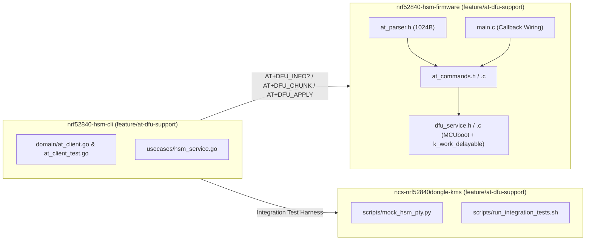

# Implementation Plan: AT-Protocol DFU Support (`AT+DFU_INFO?`, `AT+DFU_CHUNK`, `AT+DFU_APPLY`)

> [!IMPORTANT]
> **Source Specification**: [[Specification/AT-Protocol DFU Support|AT-Protocol DFU Support Specification]]  
> **Feature Note**: [[features/at-protocol-dfu-support|AT-Protocol DFU Support Feature]]  
> **Architecture Decision Record**: [[Architecture/Decisions/ADR-0006 - AT-Protocol DFU Chunk Streaming and Deferred MCUboot Swap|ADR-0006: AT-Protocol DFU Chunk Streaming & Deferred MCUboot Swap Architecture]]  
> **Source Plan Artifact**: [`plan.md`](file:///Users/gpfister/.gemini/antigravity/brain/9de1e053-7881-466a-91a4-92de7e28e63c/plan.md)  
> **Status**: Implemented & Verified (`7aa1d2b`, `7613d43`, `2a2a9ce` — Ready for Phase 6 Merge).

---

## 1. Overview & Architecture Flow

This plan implements end-to-end Device Firmware Upgrade (DFU) support over the ASCII AT command protocol (`AT+DFU_INFO?`, `AT+DFU_CHUNK=<offset>,<hex_data>`, `AT+DFU_APPLY`) across the firmware ([`nrf52840-hsm-firmware`](file:///Users/gpfister/Development/Projects/gpfister/nrf52840-hsm/nrf52840-hsm-firmware)), CLI ([`nrf52840-hsm-cli`](file:///Users/gpfister/Development/Projects/gpfister/nrf52840-hsm/nrf52840-hsm-cli)), and virtual mock PTY simulator ([`ncs-nrf52840dongle-kms`](file:///Users/gpfister/Development/Projects/gpfister/nrf52840-hsm)).



---

## 2. Repository Work Breakdown

### 2.1 Repository 1: `nrf52840-hsm-firmware`
- **Repository Path**: [`/Users/gpfister/Development/Projects/gpfister/nrf52840-hsm/nrf52840-hsm-firmware`](file:///Users/gpfister/Development/Projects/gpfister/nrf52840-hsm/nrf52840-hsm-firmware)
- **Target Git Branch**: `feature/at-dfu-support`
- **Local Deployment (`coding-deploy`)**: **Required** (Firmware build `make firmware-build` and optional hardware J-Link bootstrap `make firmware-flash` if J-Link `802007333` is connected; triggered immediately after `coding-develop`).

#### Atomic Implementation Steps
1. **Branch Setup**:
   - Checkout branch `feature/at-dfu-support` from `main` in `nrf52840-hsm-firmware`.
2. **Increase AT Line Parser Capacity**:
   - **Modify**: [at_parser.h](file:///Users/gpfister/Development/Projects/gpfister/nrf52840-hsm/nrf52840-hsm-firmware/firmware/lib/include/hsm/at_parser.h#L12)
   - Update `#define AT_PARSER_MAX_LINE_LEN` from `512` to `1024` so a 256-byte binary chunk (`512` hex chars) plus `AT+DFU_CHUNK=<offset>,` prefix and `\r\n` terminator is accepted without triggering `CME_ERR_BUFFER_OVERFLOW` (`+CME ERROR: 7`).
3. **Define DFU Callbacks & Register API in AT Command Engine**:
   - **Modify**: [at_commands.h](file:///Users/gpfister/Development/Projects/gpfister/nrf52840-hsm/nrf52840-hsm-firmware/firmware/lib/include/hsm/at_commands.h)
   - Define `at_dfu_callbacks_t`:
     ```c
     typedef struct {
         int (*write_chunk)(uint32_t offset, const uint8_t *data, size_t len);
         int (*apply)(void);
         int (*get_info)(uint8_t *major, uint8_t *minor, uint8_t *patch,
                         uint32_t *active_slot, uint32_t *image_size, uint8_t sha256[32]);
     } at_dfu_callbacks_t;

     void at_commands_register_dfu_callbacks(const at_dfu_callbacks_t *cbs);
     ```
4. **Implement `AT+DFU_INFO?`, `AT+DFU_CHUNK`, and `AT+DFU_APPLY` in AT Command Processor**:
   - **Modify**: [at_commands.c](file:///Users/gpfister/Development/Projects/gpfister/nrf52840-hsm/nrf52840-hsm-firmware/firmware/lib/src/at_commands.c)
   - Store static `at_dfu_callbacks_t s_dfu_cbs` and implement `at_commands_register_dfu_callbacks()`.
   - Handle `AT+DFU_INFO?`:
     - Query `s_dfu_cbs.get_info` if registered; otherwise populate default version from `FIRMWARE_VERSION` (`1.0.0`), `SLOT=0`, `SIZE=0`, and zeroed `SHA256`.
     - Format `+DFU_INFO: VER="%u.%u.%u",SLOT=%u,SIZE=%u,SHA256="%s"\r\nOK\r\n`.
   - Handle `AT+DFU_CHUNK=<offset>,<hex_data>`:
     - Enforce `keystore_is_authenticated()`; return `+CME ERROR: 1` (`CME_ERR_DEVICE_LOCKED`) if locked.
     - Parse `<offset>` as unsigned 32-bit decimal integer and validate `<hex_data>` (`hex_len >= 2`, `hex_len % 2 == 0`, decoded `bin_len <= 256`). Return `+CME ERROR: 5` (`CME_ERR_INVALID_PARAMETER`) on malformed input.
     - Decode hex via `hsm_hex2bin()` into a 256-byte buffer and invoke `s_dfu_cbs.write_chunk(offset, chunk_buf, bin_len)` if registered. Return `+CME ERROR: 6` (`CME_ERR_CRYPTO_FAILURE`) if callback returns non-zero.
     - Format `OK\r\n` on success.
   - Handle `AT+DFU_APPLY`:
     - Enforce `keystore_is_authenticated()`; return `+CME ERROR: 1` if locked.
     - Invoke `s_dfu_cbs.apply()` if registered; return `+CME ERROR: 6` on non-zero return.
     - Format `OK\r\n` on success.
5. **Enhance MCUboot DFU Service & Delayed Reboot**:
   - **Modify**: [dfu_service.h](file:///Users/gpfister/Development/Projects/gpfister/nrf52840-hsm/nrf52840-hsm-firmware/firmware/app/src/dfu_service.h) and [dfu_service.c](file:///Users/gpfister/Development/Projects/gpfister/nrf52840-hsm/nrf52840-hsm-firmware/firmware/app/src/dfu_service.c)
   - In `dfu_service_init()`: check `!boot_is_img_confirmed()` and call `boot_write_img_confirmed()` so newly swapped MCUboot test images are marked permanent upon boot. Initialize a `struct k_work_delayable s_reboot_work` for deferred cold reboot.
   - Implement `dfu_service_get_info(uint8_t *major, uint8_t *minor, uint8_t *patch, uint32_t *active_slot, uint32_t *image_size, uint8_t sha256[32])` reading `FLASH_AREA_ID(image_0)` size and computing SHA-256 or reading image header metadata.
   - In `dfu_service_apply()`: call `boot_request_upgrade(BOOT_UPGRADE_TEST)` and schedule `s_reboot_work` with a `200 ms` delay (`k_work_schedule(&s_reboot_work, K_MSEC(200))`) instead of blocking/rebooting synchronously, allowing `usb_serial_poll()` to flush `OK\r\n` over USB CDC-ACM first.
6. **Wire DFU Callbacks in Firmware Application Entrypoint**:
   - **Modify**: [main.c](file:///Users/gpfister/Development/Projects/gpfister/nrf52840-hsm/nrf52840-hsm-firmware/firmware/app/src/main.c#L48-L55)
   - Register `dfu_service_write_chunk`, `dfu_service_apply`, and `dfu_service_get_info` via `at_commands_register_dfu_callbacks()` during startup.

#### Verification Commands
```bash
make -C /Users/gpfister/Development/Projects/gpfister/nrf52840-hsm/nrf52840-hsm-firmware build-prod
```

---

### 2.2 Repository 2: `nrf52840-hsm-cli`
- **Repository Path**: [`/Users/gpfister/Development/Projects/gpfister/nrf52840-hsm/nrf52840-hsm-cli`](file:///Users/gpfister/Development/Projects/gpfister/nrf52840-hsm/nrf52840-hsm-cli)
- **Target Git Branch**: `feature/at-dfu-support`
- **Local Deployment (`coding-deploy`)**: **Required** (Host binary build via `make cli-build` and unit test execution `make cli-test`; triggered immediately after `coding-develop`).

#### Atomic Implementation Steps
1. **Branch Setup**:
   - Checkout branch `feature/at-dfu-support` from `main` in `nrf52840-hsm-cli`.
2. **Add `DFUInfo`, `DFUChunk`, and `DFUApply` to `ATClient`**:
   - **Modify**: [at_client.go](file:///Users/gpfister/Development/Projects/gpfister/nrf52840-hsm/nrf52840-hsm-cli/internal/domain/at_client.go)
   - Implement `DFUInfo() (*FirmwareInfo, error)`:
     - Send `AT+DFU_INFO?` with `3*time.Second` timeout.
     - If the device returns `+CME ERROR: 8` (`CME_ERR_COMMAND_UNSUPPORTED`), gracefully fall back to `c.Info()` (`AT+INFO?`) and parse semantic version numbers (`Major`, `Minor`, `Patch`) from `DeviceInfo.Firmware`.
     - Parse `+DFU_INFO: VER="<major>.<minor>.<patch>",SLOT=<slot>,SIZE=<size>,SHA256="<hex>"` into [`FirmwareInfo`](file:///Users/gpfister/Development/Projects/gpfister/nrf52840-hsm/nrf52840-hsm-cli/internal/domain/firmware.go#L5-L12).
   - Implement `DFUChunk(offset uint32, data []byte) error`:
     - Validate `1 <= len(data) <= 256`.
     - Encode `data` as uppercase hexadecimal (`strings.ToUpper(hex.EncodeToString(data))`).
     - Send `fmt.Sprintf("AT+DFU_CHUNK=%d,%s", offset, hexData)` with a `10*time.Second` timeout to accommodate secondary slot flash erase on `offset == 0`.
   - Implement `DFUApply() error`:
     - Send `AT+DFU_APPLY` with a `10*time.Second` timeout.
3. **Wire `HSMService` DFU Usecases to `ATClient`**:
   - **Modify**: [hsm_service.go](file:///Users/gpfister/Development/Projects/gpfister/nrf52840-hsm/nrf52840-hsm-cli/internal/usecases/hsm_service.go#L93-L230)
   - In [`HSMService.GetFirmwareInfo`](file:///Users/gpfister/Development/Projects/gpfister/nrf52840-hsm/nrf52840-hsm-cli/internal/usecases/hsm_service.go#L93-L131):
     - When `s.atClient != nil`, call and return `s.atClient.DFUInfo()`.
   - In [`HSMService.UpdateFirmware`](file:///Users/gpfister/Development/Projects/gpfister/nrf52840-hsm/nrf52840-hsm-cli/internal/usecases/hsm_service.go#L178-L230):
     - Read and validate `filePath` (`total > 0`) first.
     - When `s.atClient != nil`, iterate over `data` in 256-byte chunks, call `s.atClient.DFUChunk(uint32(offset), chunk)`, invoke `onProgress(offset, total, pct)` after each chunk, and finish by calling `s.atClient.DFUApply()`.
4. **Add Unit Tests for AT DFU Methods**:
   - **Modify**: [at_client_test.go](file:///Users/gpfister/Development/Projects/gpfister/nrf52840-hsm/nrf52840-hsm-cli/internal/domain/at_client_test.go)
   - Add unit tests covering:
     - `DFUInfo()` parsing (`+DFU_INFO: VER="1.0.0",SLOT=0,SIZE=262144,SHA256="..."`) and fallback to `AT+INFO?` on `+CME ERROR: 8`.
     - `DFUChunk()` valid chunk encoding, empty/oversized (>256B) chunk rejection, and locked error handling (`+CME ERROR: 1`).
     - `DFUApply()` command dispatch and error propagation.

#### Verification Commands
```bash
cd /Users/gpfister/Development/Projects/gpfister/nrf52840-hsm/nrf52840-hsm-cli && go test -v ./...
make -C /Users/gpfister/Development/Projects/gpfister/nrf52840-hsm cli-build
```

---

### 2.3 Repository 3: Root Workspace (`ncs-nrf52840dongle-kms`)
- **Repository Path**: [`/Users/gpfister/Development/Projects/gpfister/nrf52840-hsm`](file:///Users/gpfister/Development/Projects/gpfister/nrf52840-hsm)
- **Target Git Branch**: `feature/at-dfu-support`
- **Local Deployment (`coding-deploy`)**: **Required** (Virtual Mock HSM PTY daemon startup and end-to-end integration test execution via `make integration-test`; triggered immediately after `coding-develop`).

#### Atomic Implementation Steps
1. **Branch Setup**:
   - Checkout branch `feature/at-dfu-support` from `main` in the root repository (`ncs-nrf52840dongle-kms`).
2. **Add AT DFU Support & 1024-Byte Line Buffer in Mock HSM PTY**:
   - **Modify**: [mock_hsm_pty.py](file:///Users/gpfister/Development/Projects/gpfister/nrf52840-hsm/scripts/mock_hsm_pty.py)
   - In [`MockHSMEngine.__init__`](file:///Users/gpfister/Development/Projects/gpfister/nrf52840-hsm/scripts/mock_hsm_pty.py#L92-L107) and [`handle_reset`](file:///Users/gpfister/Development/Projects/gpfister/nrf52840-hsm/scripts/mock_hsm_pty.py#L108-L120): initialize `self.dfu_buffer = bytearray()` and `self.dfu_applied = False`.
   - In [`MockHSMEngine.handle_command`](file:///Users/gpfister/Development/Projects/gpfister/nrf52840-hsm/scripts/mock_hsm_pty.py#L142-L526):
     - Handle `AT+DFU_INFO?`: compute SHA-256 of `self.dfu_buffer` (or default image if empty) and return `\r\n+DFU_INFO: VER="1.0.0",SLOT=0,SIZE=<size>,SHA256="<sha256_hex>"\r\nOK\r\n`.
     - Handle `AT+DFU_CHUNK=<offset>,<hex_data>`:
       - Check `self.authenticated` (`+CME ERROR: 1` if locked).
       - Validate `<offset>` (`>= 0`) and `<hex_data>` (`1..256` bytes decoded, valid hex; `+CME ERROR: 5` on error).
       - If `offset == 0`, clear `self.dfu_buffer` and `self.dfu_applied = False`. Write decoded chunk at `offset` into `self.dfu_buffer` and return `\r\nOK\r\n`.
     - Handle `AT+DFU_APPLY`:
       - Check `self.authenticated` (`+CME ERROR: 1` if locked).
       - Require `len(self.dfu_buffer) > 0` (`+CME ERROR: 6` if empty).
       - Set `self.dfu_applied = True` and return `\r\nOK\r\n`.
   - In [`main()`](file:///Users/gpfister/Development/Projects/gpfister/nrf52840-hsm/scripts/mock_hsm_pty.py#L616-L629):
     - Increase `os.read(master_fd, 1024)` and the line overflow threshold from `256` to `1024` bytes so 256-byte chunks (`512` hex chars + prefix) do not trigger `+CME ERROR: 7`.
3. **Extend End-to-End Integration Test Suite with DFU Verification**:
   - **Modify**: [run_integration_tests.sh](file:///Users/gpfister/Development/Projects/gpfister/nrf52840-hsm/scripts/run_integration_tests.sh)
   - In Phase C (`hsmutil` CLI tests), add automated verification for:
     - `hsmutil --port "${NRF52840_HSM_PORT}" firmware info`
     - `hsmutil --port "${NRF52840_HSM_PORT}" auth` followed by `hsmutil --port "${NRF52840_HSM_PORT}" firmware update --file <temp_firmware.bin>` (only on mock PTY unless explicitly requested on hardware).

#### Verification Commands
```bash
make -C /Users/gpfister/Development/Projects/gpfister/nrf52840-hsm integration-test
```

---

## 3. Local Deployment & Hardware Verification Assessment (`coding-deploy`)

> [!IMPORTANT]
> For each repository above, `coding-deploy` will trigger immediately after that repository's `coding-develop` phase concludes to build, deploy locally, and verify health probes.

| Repository | Deployment Target | Commands Executed by `coding-deploy` | Health & Verification Check |
| :--- | :--- | :--- | :--- |
| `nrf52840-hsm-firmware` | Zephyr/NCS Sysbuild & Optional J-Link Hardware Bootstrap | 1. `make firmware-build`<br>2. Check J-Link probe (`nrfutil device list` / `JLinkExe`); if J-Link `802007333` is attached, run `make firmware-flash` | Verify `nrf52840-hsm-firmware/build-prod/merged.hex` and `dfu_application.zip` artifacts are generated; if flashed over J-Link, verify USB CDC-ACM enumeration (`/dev/cu.usbmodem*`) and `AT+DFU_INFO?` response. |
| `nrf52840-hsm-cli` | Local Host Binary (`bin/hsmutil`) | 1. `make cli-build`<br>2. `make cli-test` | Verify `nrf52840-hsm-cli/bin/hsmutil` binary exists, passes all unit tests, and responds to `hsmutil firmware --help`. |
| `ncs-nrf52840dongle-kms` (Root) | Virtual Mock HSM PTY Daemon (`/tmp/mock-hsm-pty`) | 1. `make integration-test` | Verify `scripts/mock_hsm_pty.py` starts on `/tmp/mock-hsm-pty`, passes Phase A (`test_at_client.py`), Phase B (`libnrf52840_pkcs11`), and Phase C (`hsmutil firmware info` & `hsmutil firmware update`). |

> [!NOTE]
> **Physical Dongle Bootstrap Note**: Physical dongles (`3302311888499AC7` and `FD54E793A75540C9`) currently running older firmware `53f764b` require a one-time J-Link flash (`make firmware-flash`) to install the new `AT+DFU_*` handlers and `boot_write_img_confirmed()` logic. Once bootstrapped via J-Link, all subsequent firmware upgrades can be performed directly over USB CDC-ACM using `hsmutil firmware update --file <app_update.bin>`.
