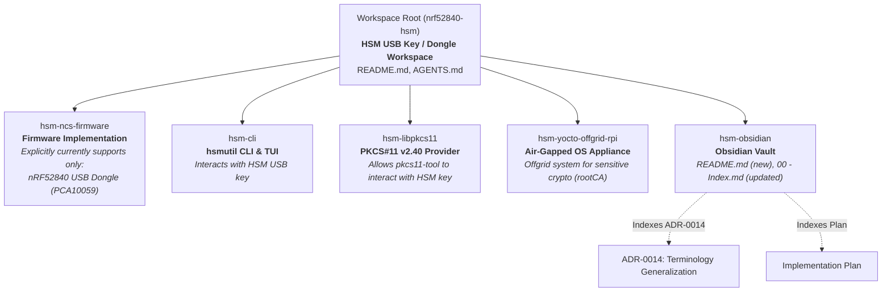

# Implementation Plan: Workspace Documentation Terminology Generalization

## Executive Summary

This implementation plan defines the work breakdown and execution strategy to standardize and generalize documentation across all workspace subsystem READMEs, root project instructions (`AGENTS.md`), and the Obsidian vault index to generic Hardware Security Module (HSM) and USB key / dongle terminology. 

Mentions of "nRF52840" in prose and titles are removed or generalized across the workspace, except in [`hsm-ncs-firmware/`](file:///Users/gpfister/Development/Projects/gpfister/nrf52840-hsm/hsm-ncs-firmware), which explicitly states that it currently only supports the nRF52840 USB Dongle (`PCA10059`).

All machine-readable identifiers (such as build artifact filenames, environment variables, Linux kernel module names, and hardware board targets in compilation examples) are preserved intact to guarantee zero regression across automated tools, build pipelines, and runtime deployments.

---

## 1. Local Deployment Assessment

| Repository | Assessment | Detail |
| :--- | :--- | :--- |
| Workspace Root (`nrf52840-hsm`) | **Local Deployment: Not Required** | Pure documentation and markdown refactoring. No running services or runtime containers. |
| Sub-Repositories | **Local Deployment: Not Required** | Changes are strictly confined to markdown documentation files (`README.md`, `AGENTS.md`, and Obsidian notes). |

> [!NOTE]
> Because this is a cross-repository documentation update, no container deployments or hardware flashing procedures are required during execution. Verification relies on markdown linting, link validation, and text audit checks.

---

## 2. Multi-Repository Work Breakdown

### Subsystem 1: Workspace Root ([`nrf52840-hsm`](file:///Users/gpfister/Development/Projects/gpfister/nrf52840-hsm))
- **Files to Modify**:
  - [`README.md`](file:///Users/gpfister/Development/Projects/gpfister/nrf52840-hsm/README.md)
  - [`AGENTS.md`](file:///Users/gpfister/Development/Projects/gpfister/nrf52840-hsm/AGENTS.md)
- **Modifications**:
  - Generalize root titles and overviews to "Hardware Security Module (HSM) USB Key / Dongle Workspace".
  - Update descriptions of orchestrated repositories to emphasize generic HSM roles.
  - In key capabilities, refer to "HSM USB key / dongle" rather than tying features globally to the nRF52840 SoC.
  - Preserve exact references to hardware board targets (`PCA10059`), J-Link debugger ID (`802007333`), and environment variables (`NRF52840_HSM_SERIAL`).

### Subsystem 2: Air-Gapped OS Appliance ([`hsm-yocto-offgrid-rpi`](file:///Users/gpfister/Development/Projects/gpfister/nrf52840-hsm/hsm-yocto-offgrid-rpi))
- **Files to Modify**:
  - [`README.md`](file:///Users/gpfister/Development/Projects/gpfister/nrf52840-hsm/hsm-yocto-offgrid-rpi/README.md)
- **Modifications**:
  - Update title and overview to: "Offgrid Yocto-based system to perform sensitive cryptographic operations (typically on offline Root Certificate Authority / rootCA) interfacing with an HSM USB key".
  - Replace "Air-Gapped Embedded Linux OS for nRF52840 HSM" with generic HSM USB key terminology in headings and prose.
  - Retain driver name `nrf52840-hsm-kmod` and `/dev/tty.hsm*` references as the concrete kernel module implementation.

### Subsystem 3: Host CLI Tooling ([`hsm-cli`](file:///Users/gpfister/Development/Projects/gpfister/nrf52840-hsm/hsm-cli))
- **Files to Modify**:
  - [`README.md`](file:///Users/gpfister/Development/Projects/gpfister/nrf52840-hsm/hsm-cli/README.md)
- **Modifications**:
  - Update title to `hsm-cli (hsmutil)` and describe as a cross-platform CLI and TUI utility to interact with the HSM USB key.
  - Generalize command descriptions (e.g. `hsmutil devices`: "List connected HSM USB keys / dongles...").
  - Preserve CLI command syntax, flags (`-s`, `-p`), and environment variable compatibility (`NRF52840_HSM_SERIAL`).

### Subsystem 4: PKCS#11 Shared Library Provider ([`hsm-libpkcs11`](file:///Users/gpfister/Development/Projects/gpfister/nrf52840-hsm/hsm-libpkcs11))
- **Files to Modify**:
  - [`README.md`](file:///Users/gpfister/Development/Projects/gpfister/nrf52840-hsm/hsm-libpkcs11/README.md)
- **Modifications**:
  - Update title and overview to describe it as a Cryptoki PKCS#11 v2.40 shared library provider allowing standard tools (e.g. `pkcs11-tool`, OpenSSL `pkcs11-provider`, OpenSSH) to interact with the HSM USB key.
  - Generalize device references from "nRF52840 HSM Dongle" to "HSM USB key / dongle".
  - Retain binary artifact names (`libnrf52840_pkcs11.dylib`, `.so`, `.dll`), environment variables (`NRF52840_HSM_SERIAL`, `NRF52840_HSM_PORT`, `NRF52840_HSM_DEBUG`), and USB VID/PID (`0x1209:0x0001`).

### Subsystem 5: Central Knowledge Vault ([`hsm-obsidian`](file:///Users/gpfister/Development/Projects/gpfister/nrf52840-hsm/hsm-obsidian))
- **Files to Modify / Create**:
  - Create new [`hsm-obsidian/README.md`](file:///Users/gpfister/Development/Projects/gpfister/nrf52840-hsm/hsm-obsidian/README.md) describing the Obsidian documentation vault role, directory layout, and conventions for the HSM project.
  - Update [`hsm-obsidian/00 - Index.md`](file:///Users/gpfister/Development/Projects/gpfister/nrf52840-hsm/hsm-obsidian/00 - Index.md) to generalize vault title and overview to "Hardware Security Module (HSM) USB Key Documentation Vault".
  - Index new architecture decision record `[[Architecture/Decisions/ADR-0014 - Documentation Terminology Generalization to Generic HSM USB Key|ADR-0014]]` and this implementation plan.

### Subsystem 6: Firmware Subsystem ([`hsm-ncs-firmware`](file:///Users/gpfister/Development/Projects/gpfister/nrf52840-hsm/hsm-ncs-firmware))
- **Files to Modify**:
  - [`README.md`](file:///Users/gpfister/Development/Projects/gpfister/nrf52840-hsm/hsm-ncs-firmware/README.md)
- **Modifications**:
  - Keep nRF52840 mention prominently in the title and overview.
  - Explicitly include a scope statement: **Note that this firmware currently only supports the Nordic Semiconductor nRF52840 USB Dongle (`PCA10059`)**.
  - Document the secure boot stages (B0 + MCUboot) and CryptoCell CC310 cryptographic engine as the specific hardware implementation of the generic HSM interface.

---

## 3. Preservation Invariants

To eliminate any chance of regressions, the implementation must strictly preserve:
1. **Build Artifacts**:
   - `libnrf52840_pkcs11.dylib`
   - `libnrf52840_pkcs11.so`
   - `libnrf52840_pkcs11.dll`
2. **Environment Variables**:
   - `NRF52840_HSM_SERIAL`
   - `NRF52840_HSM_PORT`
   - `NRF52840_HSM_DEBUG`
3. **Linux Kernel Module & Device Node Patterns**:
   - `nrf52840-hsm-kmod`
   - `/dev/tty.hsm<ble_address><number>`
4. **Hardware Board Targets & Debugger IDs**:
   - `nrf52840dongle/nrf52840`
   - `PCA10059`
   - Segger J-Link `802007333`
5. **Git Sub-Repository Folder Names**:
   - Directory paths (`hsm-ncs-firmware`, `hsm-cli`, `hsm-libpkcs11`, `hsm-obsidian`, `hsm-yocto-offgrid-rpi`) remain identical.

---

## 4. Architecture Plan & Documentation Topology

---

## 5. Verification & Quality Gates

1. **Terminology Audit**:
   - Run grep sweeps across the workspace to confirm that generic terms ("HSM USB key", "HSM dongle") replace "nRF52840" in prose and titles in root, Yocto, CLI, PKCS#11, and Obsidian documentation.
   - Confirm that `hsm-ncs-firmware/README.md` clearly contains the explicit notice regarding exclusive current support for the nRF52840 USB Dongle (`PCA10059`).
2. **Preservation Audit**:
   - Confirm that `libnrf52840_pkcs11`, `NRF52840_HSM_SERIAL`, `nrf52840-hsm-kmod`, and `PCA10059` remain intact across all examples, tables, and command snippets.
3. **Markdown & Link Validation**:
   - Verify that all relative links, file links (`file://`), and Obsidian wikilinks (`[[Note]]`) resolve properly.
