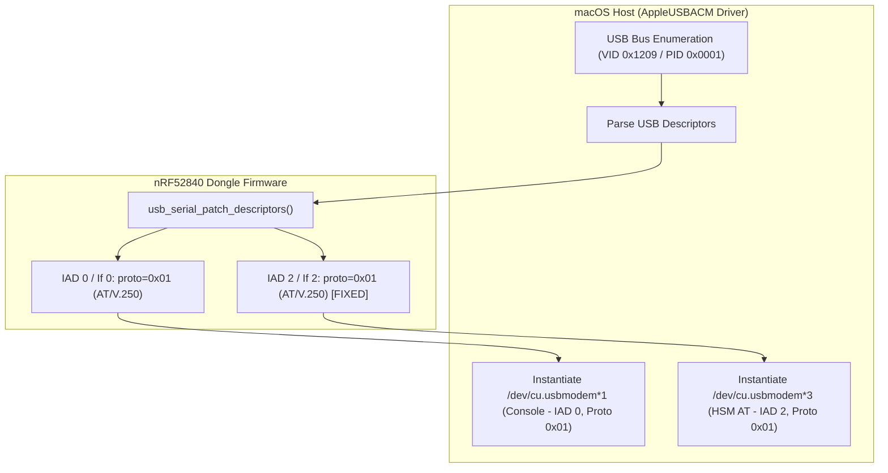

# Implementation Plan: Fix macOS CDC-ACM Enumeration for Interface 2 (HSM AT Channel)

## Executive Summary
This implementation plan outlines the steps required to resolve an issue where macOS fails to instantiate a CDC-ACM character device (`/dev/cu.usbmodem*`) for USB Interface 2 (HSM AT Channel) on the nRF52840 Dongle (`PCA10059`). The root cause is a non-standard `bInterfaceProtocol` and `bFunctionProtocol` descriptor value (`0x02`), which macOS's `AppleUSBACMControl` driver rejects. Updating these descriptors to standard AT command protocol `0x01` restores dual CDC-ACM device enumeration.

---

## 1. Local Deployment Assessment

| Repository | Assessment | Detail |
| :--- | :--- | :--- |
| [nrf52840-hsm-firmware](file:///Users/gpfister/Development/Projects/gpfister/nrf52840-hsm/nrf52840-hsm-firmware) | **Local Deployment: Not Required** | Embedded RTOS firmware repository. Does not use containerized local infrastructure (Docker/Compose/k8s). Deployment target is physical microcontroller hardware programmed directly via Segger J-Link probe `802007333`. |
| [nrf52840-hsm-cli](file:///Users/gpfister/Development/Projects/gpfister/nrf52840-hsm/nrf52840-hsm-cli) | **Local Deployment: Not Required** | Host-side Go CLI tool used for verification. |

> [!NOTE]
> Hardware programming via `make firmware-flash` is integrated as an explicit verification step within the development phase rather than a containerized deployment stage.

---

## 2. Multi-Repository Work Breakdown & Git Branching

### Repositories Involved
1. **[nrf52840-hsm-firmware](file:///Users/gpfister/Development/Projects/gpfister/nrf52840-hsm/nrf52840-hsm-firmware)**
   - **Target Branch**: `bugfix/macos-cdc-acm-enumeration` (branched from current `feature/at-dfu-support`)
   - **Role**: Firmware descriptor fix and signed image compilation.
2. **[nrf52840-hsm-cli](file:///Users/gpfister/Development/Projects/gpfister/nrf52840-hsm/nrf52840-hsm-cli)**
   - **Target Branch**: `main` / `feature/at-dfu-support` (Read-only consumer / verification tool)
3. **[nrf52840-hsm-obsidian](file:///Users/gpfister/Development/Projects/gpfister/nrf52840-hsm/nrf52840-hsm-obsidian)**
   - **Role**: Architecture notes, hardware testing logs, and changelog documentation.

---

## 3. Architecture & Descriptor Patch Flow



---

## 4. Implementation Steps

### Phase 1: Repository Branching & Source Modification
- **Target Repository**: [nrf52840-hsm-firmware](file:///Users/gpfister/Development/Projects/gpfister/nrf52840-hsm/nrf52840-hsm-firmware)
- **Git Branch**:
  ```bash
  cd /Users/gpfister/Development/Projects/gpfister/nrf52840-hsm/nrf52840-hsm-firmware
  git checkout -b bugfix/macos-cdc-acm-enumeration
  ```
- **Files to Modify**:
  - [usb_serial.c](file:///Users/gpfister/Development/Projects/gpfister/nrf52840-hsm/nrf52840-hsm-firmware/firmware/app/src/usb_serial.c#L149-L170):
    1. Update Interface 2 descriptor `if_desc->bInterfaceProtocol` from `0x02` to `0x01`:
       ```c
       } else if (if_desc->bInterfaceNumber == 2) {
           if_desc->bInterfaceProtocol = 0x01;
           if (hsm_idx > 0) {
               if_desc->iInterface = (uint8_t)hsm_idx;
           }
           LOG_INF("Patched Interface 2 (HSM AT): proto=0x%02x, iInterface=%u",
               if_desc->bInterfaceProtocol, if_desc->iInterface);
       }
       ```
    2. Update Interface Association Descriptor (IAD) for Interface 2 (`iad->bFunctionProtocol`) from `0x02` to `0x01`:
       ```c
       } else if (iad->bFirstInterface == 2) {
           iad->bFunctionProtocol = 0x01;
           if (hsm_idx > 0) {
               iad->iFunction = (uint8_t)hsm_idx;
           }
       }
       ```

---

### Phase 2: Production Firmware Build
- **Command**:
  ```bash
  make -C /Users/gpfister/Development/Projects/gpfister/nrf52840-hsm firmware-build
  ```
- **Validation**:
  - Verify zero compilation errors or warnings.
  - Confirm generation of signed application binary at:
    `nrf52840-hsm-firmware/build-prod/app/zephyr/zephyr.signed.bin`
    and combined hex files for the PCA10059 board.

---

### Phase 3: Hardware Programming & Flashing
- **Command**:
  ```bash
  make -C /Users/gpfister/Development/Projects/gpfister/nrf52840-hsm firmware-flash
  ```
- **Parameters**:
  - Target Board: `nrf52840dongle/nrf52840` (`PCA10059`)
  - J-Link Probe Serial Number: `802007333`
- **Validation**:
  - J-Link connects, verifies B0 bootloader, MCUboot, and programs application slot 0 without verification errors.

---

### Phase 4: Device Enumeration & Functional Verification
1. **Enumeration Check**:
   - Inspect macOS character devices:
     ```bash
     ls -la /dev/cu.usbmodem*
     ```
   - **Pass Criteria**: Exactly two `/dev/cu.usbmodem*` nodes appear (e.g., `/dev/cu.usbmodem14101` and `/dev/cu.usbmodem14103`).

2. **AT Interface Query via `hsmutil`**:
   - Identify the AT port (the second port or query both):
     ```bash
     hsmutil --port /dev/cu.usbmodem<ID> firmware info
     ```
   - **Pass Criteria**: Valid firmware version, slot partition info, and MCUboot boot status reported over AT channel.

3. **In-Field DFU Upgrade Test**:
   - Stream firmware update over the AT port:
     ```bash
     hsmutil firmware update --file /Users/gpfister/Development/Projects/gpfister/nrf52840-hsm/nrf52840-hsm-firmware/build-prod/app/zephyr/zephyr.signed.bin
     ```
   - **Pass Criteria**: All chunks upload successfully, device reboots, swaps slots via MCUboot, confirms image, and re-enumerates both ports reliably.

---

### Phase 5: Documentation Synchronization
- Update the Obsidian vault documentation:
  - Formalize [[Architecture/Decisions/ADR-0013 - Standard CDC-ACM AT Protocol Descriptors for macOS Dual Enumeration|ADR-0013]].
  - Update [[Architecture/USB Composite Stack|USB Composite Stack Architecture]] with protocol 0x01 notes.
  - Record the macOS CDC-ACM descriptor protocol fix in [[Changelog|Release Changelog]].
  - Update `git-status.md` with active branches.

---

## 5. Verification Checklist

| Item | Target | Expected Result | Status |
| :--- | :--- | :--- | :--- |
| 1 | `firmware/app/src/usb_serial.c` | `bInterfaceProtocol` & `bFunctionProtocol` set to `0x01` | Pending |
| 2 | `make firmware-build` | Clean compilation of signed binary | Pending |
| 3 | `make firmware-flash` | Successfully programmed via J-Link `802007333` | Pending |
| 4 | `ls -la /dev/cu.usbmodem*` | Two distinct modem nodes enumerated on macOS | Pending |
| 5 | `hsmutil firmware info` | Correct response from AT interface | Pending |
| 6 | `hsmutil firmware update` | Flawless OTA/serial DFU upgrade cycle | Pending |
| 7 | Documentation | Obsidian vault updated via `@coding-document` | Complete |
