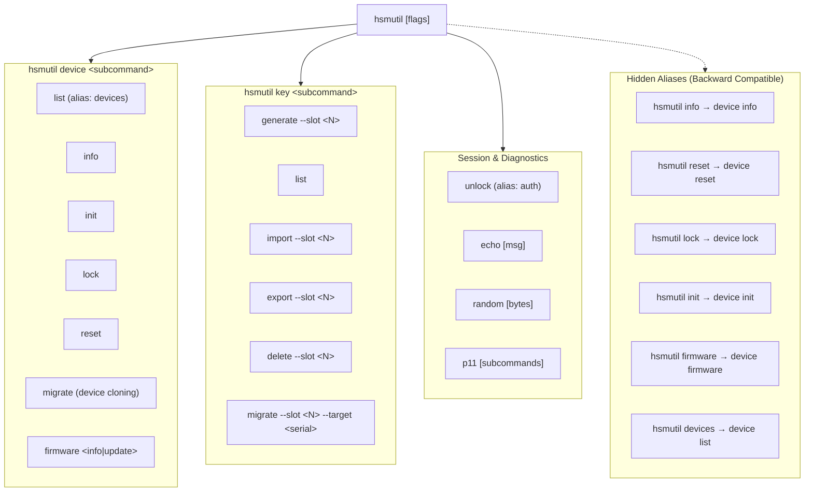
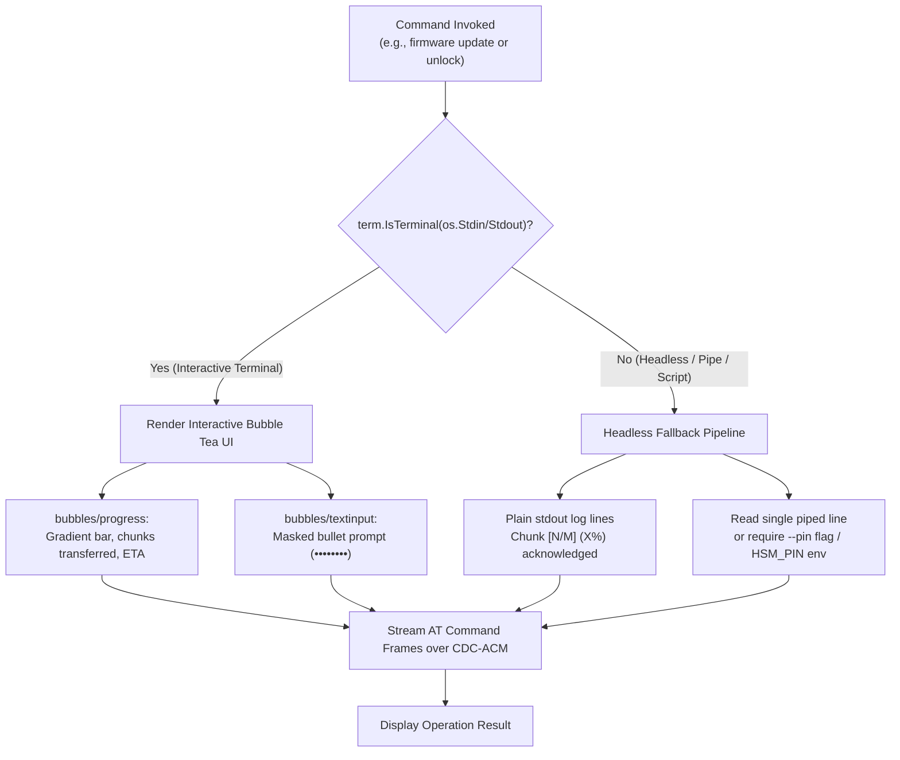
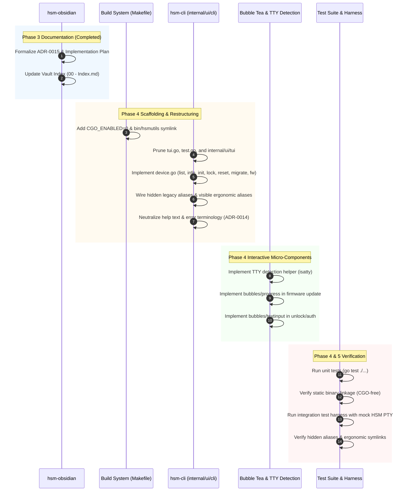

# Multi-Repository Implementation Plan: HSM CLI Restructuring, Static Binary Compilation, Bubble Tea UX & PKCS#11 Equivalence

> [!NOTE]
> **Source Plan**: Implementation Plan: HSM CLI Restructuring, Static Binary Compilation, Bubble Tea UX & PKCS#11 Equivalence  
> **Related Architecture Decisions**:
> - [[Architecture/Decisions/ADR-0015 - HSM CLI Restructuring, Static Compilation, Bubble Tea UX, and PKCS11 Equivalence|ADR-0015: HSM CLI Restructuring, Static Compilation, Bubble Tea UX, and PKCS#11 Equivalence]]
> - [[Architecture/Decisions/ADR-0014 - Documentation Terminology Generalization to Generic HSM USB Key|ADR-0014: Documentation Terminology Generalization to Generic HSM USB Key]]  
> **Target Repositories**:
> - [`hsm-cli`](file:///Users/gpfister/Development/Projects/gpfister/nrf52840-hsm/hsm-cli) (`hsmutil`)
> - [`hsm-obsidian`](file:///Users/gpfister/Development/Projects/gpfister/nrf52840-hsm/hsm-obsidian)  
> **Execution Status**: Completed & Merged into `main` (Phase 6 Post-Merge Complete). Fast-forward merged `189c7fd..6c8781c` in `hsm-cli`, working tree clean, verification suite `go test ./...` 100% passed.

---

## 1. Executive Summary & Architectural Overview

This implementation plan coordinates the architectural overhaul of `hsmutil`—the cross-platform host management utility for the HSM ecosystem—and the technical documentation in the Obsidian vault.

The overhaul achieves four core architectural goals:
1. **Clean Resource Hierarchy**: Restructures commands logically under `hsmutil device <subcommand>` while preserving 100% backward compatibility for existing scripts, CI pipelines, and operator muscle memory via hidden root-level aliases.
2. **Zero-Dependency Hermetic Compilation**: Enforces `CGO_ENABLED=0` across all Makefile targets to produce 100% static binaries capable of running seamlessly on the air-gapped `hsm-yocto-offgrid-rpi` appliance, minimal containers, or desktop developer workstations without C runtime mismatches.
3. **Surgical Terminal UX**: Prunes unmaintained monolithic TUI code and replaces it with focused Bubble Tea micro-components (`bubbles/progress` for animated firmware DFU streaming and `bubbles/textinput` for masked PIN prompts), featuring automatic TTY detection and deterministic headless fallback.
4. **Cryptographic Rigor & Standards Mapping**: Clarifies single key migration (`key migrate --slot`) vs whole-device migration (`device migrate` with fail-fast lockdown and source zeroization), and formalizes the equivalence matrix between `hsmutil` and standard Cryptoki PKCS#11 (`pkcs11-tool`).

---

## 2. Architecture & Workflow Diagrams

### 2.1 Refactored Command Tree



### 2.2 Interactive TTY vs Headless Execution Flow



---

## 3. Detailed Work Breakdown Structure (WBS)

### Component 1: Command Hierarchy Restructuring (`hsmutil device <subcommand>`)
- **Objective**: Create `device` parent command with subcommands: `list`, `info`, `init`, `lock`, `reset`, `migrate`, `firmware`.
- **Implementation Tasks**:
  1. Create or refactor [`internal/ui/cli/device.go`](file:///Users/gpfister/Development/Projects/gpfister/nrf52840-hsm/hsm-cli/internal/ui/cli/device.go) to define `newDeviceCmd()`.
  2. Attach child commands:
     - `newDeviceListCmd()` (enumerates devices; displays BLE serial, AT data port, console port, USB VID/PID).
     - `newDeviceInfoCmd()` (queries hardware model, firmware version, UID, MCUboot status).
     - `newDeviceInitCmd()` (master secret initialization).
     - `newDeviceLockCmd()` (locks session, resets LED to solid RED).
     - `newDeviceResetCmd()` (safeguarded factory reset zeroization).
     - `newDeviceMigrateCmd()` (full-device migration orchestrator).
     - `newFirmwareCmd()` attached under `deviceCmd` (with `info` and `update` subcommands).
  3. Register `newDeviceCmd()` on `rootCmd` in [`internal/ui/cli/root.go`](file:///Users/gpfister/Development/Projects/gpfister/nrf52840-hsm/hsm-cli/internal/ui/cli/root.go).

### Component 2: Backward Compatibility via Hidden Aliases
- **Objective**: Ensure that existing scripts invoking legacy top-level commands continue working identically without errors.
- **Implementation Tasks**:
  1. Keep legacy commands registered directly on `rootCmd`:
     - `newInfoCmd()` with `Hidden: true`.
     - `newResetCmd()` with `Hidden: true`.
     - `newLockCmd()` with `Hidden: true`.
     - `newInitCmd()` with `Hidden: true`.
     - `newFirmwareCmd()` with `Hidden: true`.
  2. Ensure their execution functions delegate directly to the underlying shared use case handlers in [`internal/usecases/`](file:///Users/gpfister/Development/Projects/gpfister/nrf52840-hsm/hsm-cli/internal/usecases).
  3. Verify that running `hsmutil --help` does not display hidden commands, maintaining a clean help output.

### Component 3: Ergonomic Aliases (`devices`, `bin/hsmutils` symlink)
- **Objective**: Eliminate operator frustration caused by common command typos or pluralizations.
- **Implementation Tasks**:
  1. In [`internal/ui/cli/root.go`](file:///Users/gpfister/Development/Projects/gpfister/nrf52840-hsm/hsm-cli/internal/ui/cli/root.go), register `newDevicesCmd()` as a visible top-level convenience alias pointing directly to `newDeviceListCmd()`.
  2. Also add `devices` and `list` as aliases to `newDeviceListCmd()` (`Aliases: []string{"devices", "ls"}`).
  3. In [`hsm-cli/Makefile`](file:///Users/gpfister/Development/Projects/gpfister/nrf52840-hsm/hsm-cli/Makefile):
     - Update the `build` and `build-all` rules to generate a relative symlink `bin/hsmutils -> hsmutil`.
     - Update `clean` to remove both `bin/hsmutil` and `bin/hsmutils`.

### Component 4: Pruning of `tui` and `test`
- **Objective**: Eliminate dead and duplicated code paths to keep the production CLI lightweight and maintainable.
- **Implementation Tasks**:
  1. Remove `hsmutil tui` command registration from [`internal/ui/cli/root.go`](file:///Users/gpfister/Development/Projects/gpfister/nrf52840-hsm/hsm-cli/internal/ui/cli/root.go).
  2. Delete [`internal/ui/cli/tui.go`](file:///Users/gpfister/Development/Projects/gpfister/nrf52840-hsm/hsm-cli/internal/ui/cli/tui.go) and the directory [`internal/ui/tui/`](file:///Users/gpfister/Development/Projects/gpfister/nrf52840-hsm/hsm-cli/internal/ui/tui).
  3. Remove `hsmutil test` command registration from `root.go` and delete [`internal/ui/cli/test.go`](file:///Users/gpfister/Development/Projects/gpfister/nrf52840-hsm/hsm-cli/internal/ui/cli/test.go).
  4. Ensure all integration testing is covered by the workspace test harness (`scripts/run_integration_tests.sh` and `go test ./...`).

### Component 5: Terminology Neutrality per ADR-0014
- **Objective**: Purge hardware-specific "nRF52840" strings from user-facing CLI help text, error messages, and descriptions.
- **Implementation Tasks**:
  1. In `root.go`, update `Short` and `Long` descriptions:
     - Old: `"hsmutil — CLI & TUI tool for nRF52840 Hardware Security Module Dongle"`
     - New: `"hsmutil — Command-line interface for the Hardware Security Module (HSM) USB Key"`
  2. Audit all command help strings across `device.go`, `key.go`, `auth.go`, `firmware.go`, `p11.go`.
  3. Update connection error strings from `"no nRF52840 HSM Dongle detected"` to `"no HSM USB Key detected"`.
  4. Preserve backward-compatible environment variable lookups (`NRF52840_HSM_PORT`, `NRF52840_HSM_SERIAL`), while introducing standard fallbacks `HSM_PORT` and `HSM_SERIAL`.

### Component 6: Static Binary Compilation (`CGO_ENABLED=0`)
- **Objective**: Ensure `hsmutil` compiles to a self-contained, static binary with zero external dynamic library dependencies.
- **Implementation Tasks**:
  1. In [`hsm-cli/Makefile`](file:///Users/gpfister/Development/Projects/gpfister/nrf52840-hsm/hsm-cli/Makefile):
     - Update `build` target:
       ```makefile
       build:
       	@mkdir -p $(BIN_DIR)
       	@echo "[INFO] Building $(BINARY_NAME) (static binary, CGO_ENABLED=0)..."
       	CGO_ENABLED=0 go build -ldflags="-s -w" -o $(BIN_DIR)/$(BINARY_NAME) $(SRC_PKG)
       	@ln -sf $(BINARY_NAME) $(BIN_DIR)/$(BINARY_NAME)s
       ```
     - Ensure all cross-compilation targets in `build-all` maintain `CGO_ENABLED=0`.
  2. Test compilation on host and verify linkage with `otool -L bin/hsmutil` (macOS) or `ldd bin/hsmutil` (Linux) to confirm no external shared library dependencies exist.

### Component 7: Bubble Tea UX & Headless Fallback
- **Objective**: Enhance terminal experience during firmware update and session authentication without breaking non-interactive pipelines.
- **Implementation Tasks**:
  1. Add dependencies `github.com/charmbracelet/bubbles` and `golang.org/x/term` (or `github.com/mattn/go-isatty`) in [`hsm-cli/go.mod`](file:///Users/gpfister/Development/Projects/gpfister/nrf52840-hsm/hsm-cli/go.mod).
  2. **Firmware Update UI (`bubbles/progress`)**:
     - In `firmware.go`, check `term.IsTerminal(int(os.Stdout.Fd()))`.
     - If true, initialize a Bubble Tea model containing `progress.New(progress.WithDefaultGradient())`.
     - As chunks are transmitted via `AT+DFU_CHUNK`, dispatch progress messages updating the bar.
     - If false (headless), print standard progress lines (e.g. `[INFO] DFU: 25% complete (32/128 chunks)`).
  3. **Unlock / Auth PIN Prompt (`bubbles/textinput`)**:
     - In `auth.go`, check if `--pin` flag is provided.
     - If not provided and `term.IsTerminal(int(os.Stdin.Fd()))` is true, display a masked `bubbles/textinput` (`ti.EchoMode = textinput.EchoPassword`, `ti.Placeholder = "Enter HSM PIN"`).
     - If stdin is piped/headless, read line from stdin or exit with descriptive error.

### Component 8: Single Key Migration vs Full Device Migration
- **Objective**: Provide explicit separation and security semantics between single key slot migration and whole-device migration.
- **Implementation Tasks**:
  1. **Single Key Migration (`hsmutil key migrate`)**:
     - Implemented under `hsmutil key migrate --slot <id> --target <serial> [--delete-source]`.
     - Wraps and transfers only the specified slot.
     - Source key remains intact unless `--delete-source` is passed.
  2. **Full Device Migration (`hsmutil device migrate`)**:
     - Implemented under `hsmutil device migrate --target <serial> [--source <serial>] [--yes]`.
     - Validates source and target device connections.
     - Iterates through all occupied key slots (0..31), exporting wrapped key blobs and verifying target slot digests.
     - **Fail-Fast Lockdown**: If any slot fails verification, target slots are wiped, source is immediately locked, and process halts with code 1.
     - **Source Decommissioning**: After 100% verification of all slots, prompts operator to zeroize source device (or automatically zeroizes if `--yes` / `--zeroize-source` is passed).

### Component 9: PKCS#11 Equivalence Matrix & GAP Analysis Documentation
- **Objective**: Document full parity and functional gaps between `hsmutil` and OpenSC `pkcs11-tool` across all device and cryptographic operations.
- **Implementation Tasks**:
  1. Formalize the PKCS#11 matrix in [[Architecture/Decisions/ADR-0015 - HSM CLI Restructuring, Static Compilation, Bubble Tea UX, and PKCS11 Equivalence|ADR-0015]].
  2. Update [[Development/CLI Reference|CLI Reference]] in `hsm-obsidian` to include the `pkcs11-tool` comparison guide.
  3. Add clear instructions for testing PKCS#11 operations via `pkcs11-tool` against `libnrf52840_pkcs11.dylib`.

---

## 4. Implementation Steps & Sequencing



---

## 5. Verification & Testing Matrix

| Test ID | Test Target | Verification Procedure | Expected Outcome |
| :--- | :--- | :--- | :--- |
| **V-01** | Static Linkage | Run `make build` in `hsm-cli`, then inspect binary via `file bin/hsmutil` and `otool -L bin/hsmutil` (macOS) or `ldd bin/hsmutil` (Linux). | Binary is reported as statically linked (or pure Go binary without non-system dylibs), with zero external shared library dependencies. |
| **V-02** | Symlink Generation | Check `bin/hsmutils` after `make build`. | `bin/hsmutils` exists as a valid symbolic link pointing to `hsmutil` and executes identically. |
| **V-03** | Command Hierarchy | Run `bin/hsmutil device --help` and verify subcommands `list`, `info`, `init`, `lock`, `reset`, `migrate`, `firmware`. | All subcommands listed with clean, descriptive help text. |
| **V-04** | Hidden Aliases | Execute legacy commands: `bin/hsmutil info`, `bin/hsmutil reset --help`, `bin/hsmutil firmware info`. | Commands execute identically to `hsmutil device <subcommand>` without errors or warnings. |
| **V-05** | Help Cleanliness | Execute `bin/hsmutil --help`. | Hidden commands (`info`, `reset`, `lock`, `init`, `firmware`) do NOT appear in the main command listing. |
| **V-06** | Terminology Neutrality | Search compiled help text and source files for unwanted occurrences of `nrf52840` in user-facing CLI text. | No occurrences of `nrf52840` in user-facing descriptions; only generic HSM USB Key terminology. |
| **V-07** | Bubble Tea DFU Progress | Execute `hsmutil device firmware update --file <bin>` in interactive TTY. | Displays smooth animated gradient progress bar with ETA and chunk metrics. |
| **V-08** | Headless DFU Fallback | Pipe output: `hsmutil device firmware update --file <bin> \| cat`. | Emits discrete non-interactive log lines without ANSI cursor escape corruption. |
| **V-09** | Masked PIN Input | Execute `hsmutil unlock` in interactive TTY without `--pin`. | Interactive prompt masks characters as `••••••••`. |
| **V-10** | Headless PIN Fallback | Pipe PIN: `echo "12345678" \| hsmutil unlock`. | Reads piped PIN cleanly and authenticates session. |
| **V-11** | PKCS#11 Matrix | Execute `pkcs11-tool` commands side-by-side with `hsmutil` as documented in matrix. | Complete functional parity confirmed across all standard Cryptoki mechanisms. |

---

## 6. Documentation Deliverables & Cross-References

Upon approval and implementation:
1. **[[Architecture/Decisions/ADR-0015 - HSM CLI Restructuring, Static Compilation, Bubble Tea UX, and PKCS11 Equivalence|ADR-0015]]**: Formal architectural decision record.
2. **[[Development/CLI Reference|CLI Reference]]**: Updated documentation of all commands, flags, aliases, and Bubble Tea interactions.
3. **[[00 - Index|Vault Index]]**: Updated master index referencing ADR-0015 and the implementation plan.
