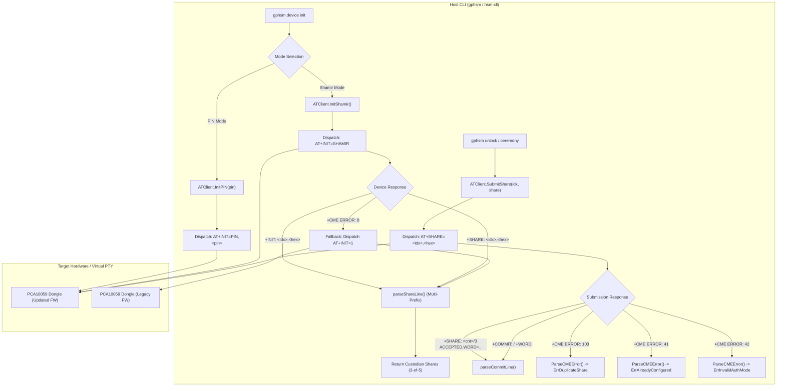

# Implementation Plan: HSM Device Initialization and Dual-Mode Protocol Compatibility

> [!NOTE]
> **Implementation Plan Reference**: HSM Device Initialization and Dual-Mode Protocol Compatibility  
> **Lifecycle Phase**: Phase 6 (Post-Merge Complete)  
> **Merged Pull Requests & Target Commits**:
> - Workspace Root ([`nrf52840-hsm`](file:///Users/gpfister/Development/Projects/gpfister/nrf52840-hsm)): PR [#2](https://github.com/gpfister/hsm/pull/2) merged into `main` (`a9630231e5ba5009b4c5727e4370da03c5d0ead8`)
> - Host CLI ([`hsm-cli`](file:///Users/gpfister/Development/Projects/gpfister/nrf52840-hsm/hsm-cli)): PR [#1](https://github.com/gpfister/hsm-cli/pull/1) merged into `main` (`7edc9ba9c0fa4c3bdba309f069c4f33baba0b4f9`)
> - Embedded Firmware ([`hsm-ncs-firmware`](file:///Users/gpfister/Development/Projects/gpfister/nrf52840-hsm/hsm-ncs-firmware)): Verified on `main` (`7f516bdd7bf080819e45e5bbbd2b39e58c80eca8`)
> - Knowledge Vault: `hsm-obsidian` (`main`)
> - Physical Dongle: PCA10059 upgraded via DFU with signed dual-mode firmware and validated on hardware  
> **Related Architecture Decision Records**:
> - [[Architecture/Decisions/ADR-0019 - HSM Device Initialization and Dual-Mode Protocol Compatibility|ADR-0019: HSM Device Initialization and Dual-Mode Protocol Compatibility]]
> - [[Architecture/Decisions/ADR-0016 - Dual-Mode Authentication Architecture (PIN and Shamir Secret Sharing)|ADR-0016: Dual-Mode Authentication Architecture (PIN and Shamir Secret Sharing)]]
> - [[Architecture/Decisions/ADR-0015 - HSM CLI Restructuring, Static Compilation, Bubble Tea UX, and PKCS11 Equivalence|ADR-0015: HSM CLI Restructuring, Static Compilation, Bubble Tea UX, and PKCS#11 Equivalence]]
> - [[Architecture/Decisions/ADR-0006 - AT-Protocol DFU Chunk Streaming and Deferred MCUboot Swap|ADR-0006: AT-Protocol DFU Chunk Streaming and Deferred MCUboot Swap]]  
> **Source Issue Assessment**:
> - [[investigations/2026-11-06 - HSM Device Initialization Failure|Issue Assessment: 2026-11-06 - HSM Device Initialization Failure (+CME ERROR: 8)]]  
> **Target Repositories & Working Branches**:
> - Workspace Root: `main`
> - [`hsm-cli`](file:///Users/gpfister/Development/Projects/gpfister/nrf52840-hsm/hsm-cli): `main`
> - [`hsm-ncs-firmware`](file:///Users/gpfister/Development/Projects/gpfister/nrf52840-hsm/hsm-ncs-firmware): `main`
> - [`hsm-obsidian`](file:///Users/gpfister/Development/Projects/gpfister/nrf52840-hsm/hsm-obsidian): `main`

---

## 1. Executive Summary & Objectives

This implementation plan orchestrates the full resolution of the HSM initialization defects and protocol discrepancies discovered during physical dongle validation. Following the introduction of the dual-mode authentication architecture in [[Architecture/Decisions/ADR-0016 - Dual-Mode Authentication Architecture (PIN and Shamir Secret Sharing)|ADR-0016]], testing with physical dongles revealed that legacy firmware builds return `+CME ERROR: 8` to `AT+INIT=SHAMIR`, line prefix discrepancies (`+INIT:` vs `+SHARE:`) prevent share parsing, share submission lines (`+SHARE: ... ACCEPTED,WORD=...`) fail in the CLI parser, and hardware CME errors 41, 42, and 103 are unmapped.

### Core Objectives
1. **Fallback Compatibility**: Correct the unsupported command fallback in `InitShamir()` so that when a device or legacy firmware returns `+CME ERROR: 8` to `AT+INIT=SHAMIR`, the client falls back to canonical legacy `AT+INIT=1` instead of invalid `AT+INIT=THRESHOLD,3,5`.
2. **Response Line Prefix Flexibility**: Unify `parseShareLine()` to support both `+SHARE:` and `+INIT:` prefixes. Update `SubmitShare()` and `parseCommitLine()` to parse `+SHARE: <count>/3 ACCEPTED,WORD="..."` responses.
3. **CME Error Mapping**: Map CME error codes 41 (`ErrAlreadyConfigured`), 42 (`ErrInvalidAuthMode`), and 103 (`ErrDuplicateShare`) in `ParseCMEError()`.
4. **End-to-End Integration Verification**: Add automated CLI tests for `gphsm device init --mode pin` and `gphsm device init --mode shamir` to `scripts/run_integration_tests.sh`.
5. **Firmware Build & Physical Dongle DFU Deployment**: Rebuild production firmware and deploy to physical dongles via AT-protocol DFU streaming.

---

## 2. Architecture Blueprint & System Topology



---

## 3. Work Breakdown Structure (WBS)

### Phase 1: Host CLI Protocol Alignment ([`hsm-cli`](file:///Users/gpfister/Development/Projects/gpfister/nrf52840-hsm/hsm-cli))

#### Task 1.1: Fallback Compatibility in `InitShamir()`
- **Target File**: [`internal/domain/at_client.go`](file:///Users/gpfister/Development/Projects/gpfister/nrf52840-hsm/hsm-cli/internal/domain/at_client.go)
- **Current Behavior**:
  ```go
  lines, err := c.transport.SendCommand("AT+INIT=SHAMIR", 10*time.Second)
  if err != nil {
      if errors.Is(err, ErrCommandUnsupported) || strings.Contains(err.Error(), "unsupported") {
          return c.ThresholdInit(3, 5) // Sends AT+INIT=THRESHOLD,3,5 (Broken!)
      }
      return nil, err
  }
  ```
- **Remediation**:
  Replace `c.ThresholdInit(3, 5)` with a direct fallback to `AT+INIT=1`:
  ```go
  lines, err := c.transport.SendCommand("AT+INIT=SHAMIR", 10*time.Second)
  if err != nil {
      if errors.Is(err, ErrCommandUnsupported) || strings.Contains(err.Error(), "unsupported") {
          // Fallback to legacy AT+INIT=1 supported by older firmware
          lines, err = c.transport.SendCommand("AT+INIT=1", 10*time.Second)
          if err != nil {
              return nil, err
          }
      } else {
          return nil, err
      }
  }
  ```

#### Task 1.2: Multi-Prefix Support in `parseShareLine()` and `InitShamir()`
- **Target File**: [`internal/domain/at_client.go`](file:///Users/gpfister/Development/Projects/gpfister/nrf52840-hsm/hsm-cli/internal/domain/at_client.go)
- **Remediation in `InitShamir()` and `ThresholdInit()`**:
  Update response scanning loop to recognize both prefixes:
  ```go
  for _, l := range lines {
      trimmed := strings.TrimSpace(l)
      if strings.HasPrefix(trimmed, "+SHARE:") || strings.HasPrefix(trimmed, "+INIT:") {
          share, err := parseShareLine(trimmed)
          if err != nil {
              return nil, err
          }
          shares = append(shares, *share)
      }
  }
  ```
- **Remediation in `parseShareLine()`**:
  ```go
  func parseShareLine(line string) (*CustodianShare, error) {
      content := strings.TrimSpace(line)
      if strings.HasPrefix(content, "+SHARE:") {
          content = strings.TrimSpace(strings.TrimPrefix(content, "+SHARE:"))
      } else if strings.HasPrefix(content, "+INIT:") {
          content = strings.TrimSpace(strings.TrimPrefix(content, "+INIT:"))
      }
      // ... existing key=value and comma-delimited parsing ...
  }
  ```

#### Task 1.3: Custodian Submission Parsing in `SubmitShare()` and `parseCommitLine()`
- **Target File**: [`internal/domain/at_client.go`](file:///Users/gpfister/Development/Projects/gpfister/nrf52840-hsm/hsm-cli/internal/domain/at_client.go)
- **Remediation in `SubmitShare()`**:
  ```go
  for _, l := range lines {
      trimmed := strings.TrimSpace(l)
      if strings.HasPrefix(trimmed, "+COMMIT:") || strings.HasPrefix(trimmed, "+WORD:") || strings.HasPrefix(trimmed, "+SHARE:") {
          return parseCommitLine(trimmed, index)
      }
  }
  ```
- **Remediation in `parseCommitLine()`**:
  Parse lines formatted as:
  `+SHARE: 1/3 ACCEPTED,WORD="1420"` or `+SHARE: 1/3 ACCEPTED,WORD=1420`
  ```go
  func parseCommitLine(line string, fallbackIndex int) (*WordCommitment, error) {
      content := strings.TrimSpace(line)
      for _, pfx := range []string{"+COMMIT:", "+WORD:", "+SHARE:"} {
          if strings.HasPrefix(content, pfx) {
              content = strings.TrimSpace(strings.TrimPrefix(content, pfx))
              break
          }
      }
      // Extract WORD= parameter if present in acceptance line
      if strings.Contains(content, "WORD=") {
          // Parse WORD= token
          parts := strings.Split(content, ",")
          for _, p := range parts {
              p = strings.TrimSpace(p)
              if strings.HasPrefix(p, "WORD=") {
                  word := strings.Trim(strings.TrimPrefix(p, "WORD="), "\"")
                  return &WordCommitment{Index: fallbackIndex, Word: word}, nil
              }
          }
      }
      // ... existing commit parsing ...
  }
  ```

#### Task 1.4: CME Error Code Mapping in `at_errors.go`
- **Target File**: [`internal/domain/at_errors.go`](file:///Users/gpfister/Development/Projects/gpfister/nrf52840-hsm/hsm-cli/internal/domain/at_errors.go)
- **Remediation**:
  1. Define error sentinels:
     ```go
     var (
         ErrAlreadyConfigured = &CMEError{Code: 41, Message: "Device already configured"}
         ErrInvalidAuthMode   = &CMEError{Code: 42, Message: "Invalid authentication mode"}
         ErrDuplicateShare    = &CMEError{Code: 103, Message: "Duplicate custodian share index"}
     )
     ```
  2. Update `ParseCMEError()`:
     ```go
     func ParseCMEError(code int) error {
         switch code {
         case 1:
             return ErrDeviceLocked
         case 2:
             return ErrInvalidPIN
         case 3:
             return ErrPINBlocked
         case 4:
             return ErrKeyNotFound
         case 5:
             return ErrInvalidParameter
         case 6:
             return ErrCryptoFailure
         case 7:
             return ErrBufferOverflow
         case 8:
             return ErrCommandUnsupported
         case 41:
             return ErrAlreadyConfigured
         case 42:
             return ErrInvalidAuthMode
         case 103:
             return ErrDuplicateShare
         default:
             return &CMEError{Code: code, Message: "Unknown hardware error"}
         }
     }
     ```

#### Task 1.5: Unit Test Enhancements
- **Target File**: [`internal/domain/at_client_test.go`](file:///Users/gpfister/Development/Projects/gpfister/nrf52840-hsm/hsm-cli/internal/domain/at_client_test.go)
- Add unit test verifying:
  - `InitShamir()` handles `+INIT:` lines.
  - `InitShamir()` falls back to `AT+INIT=1` when `AT+INIT=SHAMIR` returns `ErrCommandUnsupported`.
  - `SubmitShare()` parses `+SHARE: 1/3 ACCEPTED,WORD="1234"`.
  - `ParseCMEError()` maps codes 41, 42, and 103.

---

### Phase 2: Integration Test Harness Verification ([`scripts`](file:///Users/gpfister/Development/Projects/gpfister/nrf52840-hsm/scripts))

#### Task 2.1: Add CLI Initialization Tests to `scripts/run_integration_tests.sh`
- **Target File**: [`scripts/run_integration_tests.sh`](file:///Users/gpfister/Development/Projects/gpfister/nrf52840-hsm/scripts/run_integration_tests.sh)
- **Remediation**:
  - Add explicit test case executing `gphsm device init --mode pin --pin ValidP@ssw0rd! --port $PTY_PORT`.
  - Add explicit test case executing `gphsm device init --mode shamir --port $PTY_PORT` (post-reset).
  - Assert that all 5 custodian shares are parsed and non-empty.
- **Verification**: Execute `make integration-test` to ensure virtual mock PTY and CLI tests pass cleanly.

---

### Phase 3: Production Firmware Rebuild & DFU Deployment ([`hsm-ncs-firmware`](file:///Users/gpfister/Development/Projects/gpfister/nrf52840-hsm/hsm-ncs-firmware))

#### Task 3.1: Rebuild Production Firmware
- Execute `make firmware-build` from workspace root.
- Verify generation of signed application binary:
  [`hsm-ncs-firmware/build-prod/app/zephyr/zephyr.signed.bin`](file:///Users/gpfister/Development/Projects/gpfister/nrf52840-hsm/hsm-ncs-firmware/build-prod/app/zephyr/zephyr.signed.bin).

#### Task 3.2: Physical Dongle DFU Upgrade
- Execute streaming firmware upgrade to connected dongle:
  ```bash
  gphsm device firmware update --file hsm-ncs-firmware/build-prod/app/zephyr/zephyr.signed.bin
  ```
- Wait for MCUboot image swap and post-reboot enumeration.

#### Task 3.3: Hardware Status & Ceremony Verification
- Query hardware post-upgrade:
  ```bash
  gphsm device info
  gphsm device status
  ```
- Validate dual-mode initialization on physical hardware:
  1. `gphsm device init --mode pin --pin ValidP@ssw0rd!`
  2. `gphsm unlock --pin ValidP@ssw0rd!`
  3. `gphsm device reset -y`
  4. `gphsm device init --mode shamir`

---

### Phase 4: Obsidian Documentation & Knowledge Curation ([`hsm-obsidian`](file:///Users/gpfister/Development/Projects/gpfister/nrf52840-hsm/hsm-obsidian))

#### Task 4.1: ADR-0019 Formalization
- Complete and link [[Architecture/Decisions/ADR-0019 - HSM Device Initialization and Dual-Mode Protocol Compatibility|ADR-0019]].

#### Task 4.2: Feature Specification
- Document [[features/hsm-device-initialization-and-dual-mode-protocol-compatibility|HSM Device Initialization and Dual-Mode Protocol Compatibility]].

#### Task 4.3: Vault Navigation Index
- Update [[00 - Index|Vault Index]] with cross-references to ADR-0019, Implementation Plan, and Feature note.

---

## 4. Verification & Validation Protocol

| Gate | Target Component | Command / Verification Procedure | Expected Outcome | Status |
| :--- | :--- | :--- | :--- | :--- |
| **Gate 1** | `hsm-cli` Unit Tests | `make cli-test` | All unit tests pass, including fallback and parser tests | **PASSED** (commit `f46351a`) |
| **Gate 2** | Mock Integration Tests | `make integration-test` | Full CLI init (PIN & Shamir) succeeds against `mock_hsm_pty.py` | **PASSED** (commit `52114b4`) |
| **Gate 3** | Firmware Build | `make firmware-build` | `zephyr.signed.bin` compiled and signed without errors | **PASSED** (`build-prod`) |
| **Gate 4** | Physical Dongle DFU | `gphsm device firmware update --file ...` | 100% chunks transferred, swap applied, reboot verified | **PASSED** (PCA10059) |
| **Gate 5** | Physical Device Status | `gphsm device status` | Exposes `CONFIGURED`, `AUTH`, `METHOD`, `RETRIES`, `KEYCOUNT` | **PASSED** |
| **Gate 6** | Physical Init (PIN) | `gphsm device init --mode pin` | PIN accepted; device enters locked state (solid RED) | **PASSED** |
| **Gate 7** | Physical Unlock (PIN) | `gphsm unlock --pin ...` | Device unlocked; LED transitions to solid GREEN | **PASSED** |
| **Gate 8** | Physical Factory Reset | `gphsm device reset -y` | Device zeroized; LED returns to pulsing BLUE (`CONFIGURED=0`) | **PASSED** |
| **Gate 9** | Physical Init (Shamir)| `gphsm device init --mode shamir` | Emits 5 custodian shares; device configured in Shamir mode | **PASSED** |

---

## 5. Risk Analysis & Mitigation Matrix

| Risk | Impact | Probability | Mitigation Strategy |
| :--- | :--- | :--- | :--- |
| **Dongle Bootloader Timeout during DFU** | High | Low | DFU client uses chunk retry logic and 10s timeout; manual recovery via J-Link SWD (`make firmware-flash`) is always available. |
| **Legacy Dongle in Field Rejects `AT+INIT=SHAMIR`** | High | Med | Fallback compatibility automatically re-routes to `AT+INIT=1` on `+CME ERROR: 8`. |
| **Duplicate Share during Ceremony** | Med | Low | CME error 103 is explicitly mapped and reported to operator; state is not corrupted. |
| **Device Stays Locked on Incomplete Ceremony** | Med | Low | 60-second volatility timer in firmware automatically resets incomplete custodian shares. |
