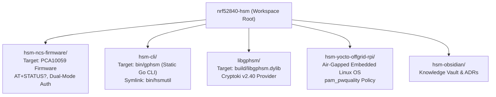
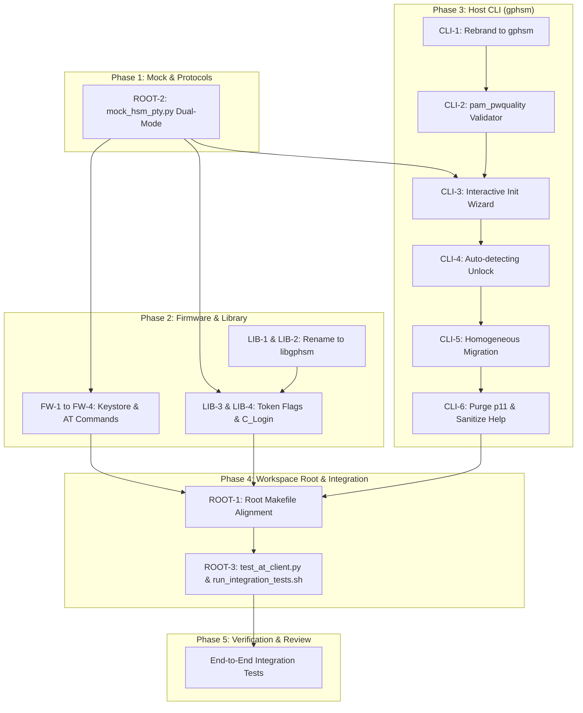

# Multi-Repository Implementation Plan: HSM Dual-Mode Authentication, CLI Renaming (gphsm), and PKCS#11 Refactoring (libgphsm)

> [!NOTE]
> **Implementation Plan Reference**: HSM Dual-Mode Authentication, CLI Renaming (`gphsm`), and PKCS#11 Refactoring (`libgphsm`)  
> **Target Lifecycle Phase**: Phase 6 (Post-Merge Complete — All Subsystems Merged on `main`)  
> **Related Architecture Decision Records**:
> - [[Architecture/Decisions/ADR-0016 - Dual-Mode Authentication Architecture (PIN and Shamir Secret Sharing)|ADR-0016: Dual-Mode Authentication Architecture (PIN and Shamir Secret Sharing)]]
> - [[Architecture/Decisions/ADR-0017 - Host CLI Rebranding to gphsm and PKCS11 Refactoring to libgphsm|ADR-0017: Host CLI Rebranding to gphsm and PKCS#11 Refactoring to libgphsm]]  
> **Merged Commits**:
> - Firmware: [`7f516bd`](file:///Users/gpfister/Development/Projects/gpfister/nrf52840-hsm/hsm-ncs-firmware) (`feature/dual-mode-auth` &rarr; `main`)
> - PKCS#11: [`d25adea`](file:///Users/gpfister/Development/Projects/gpfister/nrf52840-hsm/libgphsm) (`task/rename-libgphsm-dual-mode` &rarr; `main`)
> - CLI: [`14ea65f`](file:///Users/gpfister/Development/Projects/gpfister/nrf52840-hsm/hsm-cli) (`feature/gphsm-dual-mode` &rarr; `main`)
> - Root Workspace: [`2848d50`](file:///Users/gpfister/Development/Projects/gpfister/nrf52840-hsm) (`task/dual-mode-workspace-alignment` &rarr; `main`)
> - Knowledge Vault: [`hsm-obsidian`](file:///Users/gpfister/Development/Projects/gpfister/nrf52840-hsm/hsm-obsidian) on `main`  
> **Target Repositories & Working Branches**:
> - Workspace Root: `task/dual-mode-workspace-alignment`
> - [`hsm-ncs-firmware`](file:///Users/gpfister/Development/Projects/gpfister/nrf52840-hsm/hsm-ncs-firmware): `feature/dual-mode-auth`
> - [`hsm-cli`](file:///Users/gpfister/Development/Projects/gpfister/nrf52840-hsm/hsm-cli): `feature/gphsm-dual-mode`
> - [`libgphsm`](file:///Users/gpfister/Development/Projects/gpfister/nrf52840-hsm/hsm-libpkcs11) (renamed from `hsm-libpkcs11`): `task/rename-libgphsm-dual-mode`
> - [`hsm-obsidian`](file:///Users/gpfister/Development/Projects/gpfister/nrf52840-hsm/hsm-obsidian): `main`  
> **Execution Status**: Approved and formalized in vault; development ready.

---

## 1. Executive Summary & Goals

This implementation plan orchestrates a workspace-wide architectural enhancement spanning firmware, host CLI, PKCS#11 middleware, mock test harnesses, and root automation:

1. **Dual-Mode Cryptographic Authentication**:
   - Firmware introduces an explicit `auth_method_t` state machine in NVS (`NONE`, `PIN`, `SHAMIR`), expands PIN storage to 64 bytes, updates `AT+STATUS?` to expose `CONFIGURED` and `METHOD`, implements `AT+INIT=PIN,<pin>` and `AT+INIT=SHAMIR`, and strictly enforces mutual exclusivity between `AT+AUTH` and `AT+SHARE`.
2. **Host CLI Rebranding to `gphsm` & Security Policy Parity**:
   - Re-brands binary, package, and Cobra definitions from `hsmutil` to `gphsm` (with backward-compatible symlinks).
   - Implements pure-Go Yocto-compliant `pam_pwquality` validation for PIN initialization and updates.
   - Introduces an interactive Bubble Tea initialization wizard and auto-detecting `gphsm unlock`.
   - Enforces homogeneous migration verification (`PIN == PIN`, `SHAMIR == SHAMIR`).
   - Purges redundant `p11` subcommands and cleans low-level AT protocol strings from help text.
3. **PKCS#11 Shared Library Refactoring (`libgphsm`)**:
   - Renames repository directory `hsm-libpkcs11/` to `libgphsm/`.
   - Renames CMake project to `libgphsm` producing `libgphsm.dylib`/`.so`/`.dll`.
   - Advertises `CKF_PROTECTED_AUTHENTICATION_PATH` in Shamir mode in token flags.
   - Refactors `C_Login` to check hardware status: gracefully bypasses PIN validation if already authenticated (`AUTH=1`), and returns clear error codes if locked.
4. **Workspace & Test Harness Alignment**:
   - Updates root `Makefile` variables (`SUBREPOS`), build targets (`gphsm-build`, `libgphsm-build`), and testing recipes.
   - Extends `mock_hsm_pty.py` with dual-mode simulation, updated status formats, and error conditions.
   - Updates `test_at_client.py` and `run_integration_tests.sh` to validate the refactored ecosystem.

---

## 2. Architecture & Flow Diagrams

### 2.1 Dual-Mode Authentication State Machine

```mermaid
stateDiagram-v2
    [*] --> FactoryDefault: Flashed or Factory Reset (AT+RESET)
    
    state FactoryDefault {
        CONFIGURED_0: CONFIGURED = 0
        METHOD_NONE: METHOD = NONE
        AUTH_0: AUTH = 0 (Locked)
        LED_BLUE: LED = Breathing Blue
    }

    FactoryDefault --> PINConfigured: AT+INIT=PIN,&lt;pin&gt; (6-64 chars)
    FactoryDefault --> ShamirConfigured: AT+INIT=SHAMIR (3-of-5 Split)

    state PINConfigured {
        PIN_Locked: AUTH = 0 (Solid Red LED)
        PIN_Unlocked: AUTH = 1 (Solid Green LED)
        
        PIN_Locked --> PIN_Unlocked: AT+AUTH=&lt;pin&gt; [Correct PIN]
        PIN_Locked --> PIN_Locked: AT+AUTH=&lt;pin&gt; [Wrong PIN &rarr; Retries Decrement]
        PIN_Unlocked --> PIN_Locked: AT+LOCK / Timeout
        PIN_Locked --> PIN_Locked: AT+SHARE=&lt;*&gt; &rarr; CME ERROR 5 (Forbidden)
    }

    state ShamirConfigured {
        Shamir_Locked: AUTH = 0 (Solid Red LED)
        Shamir_Unlocked: AUTH = 1 (Solid Green LED)
        
        Shamir_Locked --> Shamir_Locked: AT+SHARE=&lt;idx&gt;,&lt;share&gt; [Shares &lt; 3]
        Shamir_Locked --> Shamir_Unlocked: AT+SHARE=&lt;idx&gt;,&lt;share&gt; [3rd Valid Share]
        Shamir_Unlocked --> Shamir_Locked: AT+LOCK / Timeout
        Shamir_Locked --> Shamir_Locked: AT+AUTH=&lt;*&gt; &rarr; CME ERROR 5 (Forbidden)
    }

    PINConfigured --> FactoryDefault: AT+RESET (Zeroize All)
    ShamirConfigured --> FactoryDefault: AT+RESET (Zeroize All)
```

### 2.2 PKCS#11 `C_Login` and Token Info Resolution

```mermaid
sequenceDiagram
    autonumber
    actor App as PKCS#11 Application (pkcs11-tool / OpenSSL)
    participant Lib as libgphsm (Cryptoki Provider)
    participant HSM as HSM USB Key (Firmware)

    App->>Lib: C_GetTokenInfo(slotID, &tokenInfo)
    Lib->>HSM: AT+STATUS?
    HSM-->>Lib: +STATUS: AUTH=0,CONFIGURED=1,METHOD=SHAMIR,RETRIES=3,KEYCOUNT=2
    Note over Lib: METHOD is SHAMIR &rarr;<br/>Set CKF_PROTECTED_AUTHENTICATION_PATH
    Lib-->>App: tokenInfo (CKF_PROTECTED_AUTHENTICATION_PATH set)

    alt Application calls C_Login when device already authenticated
        App->>Lib: C_Login(CKU_USER, NULL, 0)
        Lib->>HSM: AT+STATUS?
        HSM-->>Lib: +STATUS: AUTH=1,CONFIGURED=1,METHOD=SHAMIR,...
        Note over Lib: Device already unlocked via custodian shares
        Lib-->>App: CKR_OK
    else Application calls C_Login when device is locked in Shamir mode
        App->>Lib: C_Login(CKU_USER, pin, pinLen)
        Lib->>HSM: AT+STATUS?
        HSM-->>Lib: +STATUS: AUTH=0,CONFIGURED=1,METHOD=SHAMIR,...
        Note over Lib: In-band PIN rejected in Shamir mode
        Lib-->>App: CKR_PIN_LOCKED / CKR_DEVICE_ERROR<br/>(Log: Unlock device out-of-band via gphsm unlock)
    else Application calls C_Login in PIN mode
        App->>Lib: C_Login(CKU_USER, "Secr3t!P@ss", 11)
        Lib->>HSM: AT+AUTH=Secr3t!P@ss
        HSM-->>Lib: OK
        Lib-->>App: CKR_OK
    end
```

### 2.3 Refactored Workspace & Binary Layout



---

## 3. Multi-Repository Work Breakdown Structure (WBS)

### 3.1 Repository: `hsm-ncs-firmware` (`feature/dual-mode-auth`)

- [ ] **Task FW-1: Keystore Schema & Method Enumeration**:
  - Add `auth_method_t` enum (`AUTH_METHOD_NONE = 0`, `AUTH_METHOD_PIN = 1`, `AUTH_METHOD_SHAMIR = 2`) to `firmware/include/keystore.h` and `firmware/src/keystore.c`.
  - Expand PIN storage buffer to 64 bytes (`char pin[65]` or `uint8_t pin[64]`).
  - Store and restore `auth_method_t` in Zephyr NVS flash record.
- [ ] **Task FW-2: Status Response Expansion (`AT+STATUS?`)**:
  - Update `firmware/src/at_cmd.c` to parse and format `+STATUS:` output:
    `+STATUS: AUTH=<0|1>,CONFIGURED=<0|1>,METHOD=<NONE|PIN|SHAMIR>,RETRIES=<N>,KEYCOUNT=<K>`.
- [ ] **Task FW-3: Dual-Mode Initialization Dispatch (`AT+INIT`)**:
  - Implement parser for `AT+INIT=PIN,<pin>` (validating 6 to 64 characters).
  - Implement parser for `AT+INIT=SHAMIR` (generating 32-byte secret and emitting 5 threshold shares).
  - Return `+CME ERROR: 4` if device is already configured (`CONFIGURED == 1`).
- [ ] **Task FW-4: Command Mutual Exclusivity Enforcement**:
  - If `METHOD == PIN`: reject `AT+SHARE` with `+CME ERROR: 5`.
  - If `METHOD == SHAMIR`: reject `AT+AUTH` with `+CME ERROR: 5`.
  - If `METHOD == NONE`: reject both with `+CME ERROR: 6`.
- [ ] **Task FW-5: Unit & Build Verification**:
  - Validate Zephyr sysbuild compilation with `west build -b nrf52840dongle/nrf52840`.

---

### 3.2 Repository: `hsm-cli` (`feature/gphsm-dual-mode`)

- [ ] **Task CLI-1: Rebranding to `gphsm`**:
  - Update Go module name, package imports, and Cobra root command (`Use: "gphsm"`).
  - Update Makefile to compile binary to `bin/gphsm`.
  - Generate relative symlink `bin/hsmutil -> gphsm` and `bin/hsmutils -> gphsm` during build.
- [ ] **Task CLI-2: Yocto-Compliant `pam_pwquality` Validator**:
  - Create `internal/security/pwquality.go` enforcing:
    - Minimum length $\ge 10$.
    - Character diversity (at least 3 of: uppercase, lowercase, digits, symbols).
    - Maximum character repeat $\le 3$.
    - Dictionary/sequence pattern rejection (`123456`, `qwerty`, `password`).
  - Unit test password policy edge cases.
- [ ] **Task CLI-3: Interactive Initialization Wizard (`gphsm device init`)**:
  - If run interactively, prompt user to select mode:
    `1. PIN Mode (Password-Protected)` vs `2. Shamir Secret Sharing (3-of-5 Threshold)`.
  - If PIN selected: prompt with masked input, run `pwquality` check, confirm PIN, dispatch `AT+INIT=PIN,<pin>`.
  - If Shamir selected: dispatch `AT+INIT=SHAMIR`, display 5 shares with custodian instructions, prompt for confirmation.
  - Support headless flags: `--mode=pin --pin=<pin>` and `--mode=shamir`.
- [ ] **Task CLI-4: Auto-Detecting Unlock (`gphsm unlock`)**:
  - Query `AT+STATUS?` to determine `METHOD`.
  - In PIN mode: prompt for masked PIN or read `--pin` / stdin.
  - In Shamir mode: prompt for 3 threshold shares or accept `--share` flags.
- [ ] **Task CLI-5: Homogeneous Migration Verification**:
  - In `gphsm device migrate` and `gphsm key migrate`:
  - Query `AT+STATUS?` on source and target devices.
  - Enforce `source.METHOD == target.METHOD`; abort immediately if mismatched with actionable error message.
- [ ] **Task CLI-6: Command Purge & Help Sanitization**:
  - Delete `p11` command group (`internal/cmd/p11.go`).
  - Audit all command descriptions to replace raw AT-command references (`AT+AUTH`, `AT+KEYGEN`, `AT+RESET`) with semantic descriptions.
- [ ] **Task CLI-7: Verification**:
  - Run full Go unit tests (`go test ./...`) with static verification (`CGO_ENABLED=0`).

---

### 3.3 Repository: `libgphsm` (`task/rename-libgphsm-dual-mode`)

- [ ] **Task LIB-1: Directory & Repository Renaming**:
  - Rename repository directory `hsm-libpkcs11` to `libgphsm`.
- [ ] **Task LIB-2: CMake Project Rebranding**:
  - Update `CMakeLists.txt` project name to `libgphsm`.
  - Output binary target: `libgphsm.dylib` (Darwin), `libgphsm.so` (Linux), `libgphsm.dll` (Windows).
- [ ] **Task LIB-3: `C_GetTokenInfo` Flag Advertising**:
  - Query `AT+STATUS?` during token initialization.
  - If `METHOD == SHAMIR`: set `flags |= CKF_PROTECTED_AUTHENTICATION_PATH`.
  - Always set `CKF_USER_PIN_INITIALIZED` when `CONFIGURED == 1`.
- [ ] **Task LIB-4: `C_Login` State Handling**:
  - Check `AUTH` status via `AT+STATUS?`.
  - If `AUTH == 1`: bypass PIN check and return `CKR_OK`.
  - If `AUTH == 0` and `METHOD == PIN`: dispatch `AT+AUTH=<pin>`.
  - If `AUTH == 0` and `METHOD == SHAMIR`: return `CKR_PIN_LOCKED` / `CKR_DEVICE_ERROR` with instruction to authenticate out-of-band via `gphsm unlock`.
- [ ] **Task LIB-5: Build & Test Verification**:
  - Build shared library via CMake and run unit/interface tests (`ctest`).

---

### 3.4 Repository: Workspace Root (`task/dual-mode-workspace-alignment`)

- [ ] **Task ROOT-1: Root Makefile Updates**:
  - Update `SUBREPOS` list: replace `hsm-libpkcs11` with `libgphsm`.
  - Rename `cli-build` to `gphsm-build` (keep `cli-build` alias).
  - Rename `libpkcs11-build` to `libgphsm-build` (keep `libpkcs11-build` alias).
  - Rename `libpkcs11-test` to `libgphsm-test`.
- [ ] **Task ROOT-2: Mock HSM PTY Engine Update (`scripts/mock_hsm_pty.py`)**:
  - Update mock state machine to support `auth_method` (`NONE`, `PIN`, `SHAMIR`).
  - Update `AT+STATUS?` to return `+STATUS: AUTH=<0|1>,CONFIGURED=<0|1>,METHOD=<...>,RETRIES=<N>,KEYCOUNT=<K>`.
  - Support `AT+INIT=PIN,<pin>` and `AT+INIT=SHAMIR`.
  - Enforce mutual exclusivity on `AT+AUTH` and `AT+SHARE` returning `+CME ERROR: 5`.
- [ ] **Task ROOT-3: Test Harness Updates**:
  - Update `scripts/test_at_client.py` for new `AT+STATUS?` and `AT+INIT` formats.
  - Update `scripts/run_integration_tests.sh` to execute `hsm-cli/bin/gphsm` and `libgphsm/build/libgphsm.dylib`.

---

### 3.5 Repository: `hsm-obsidian` (`task/dual-mode-documentation` / `main`)

- [x] **Task OBS-1: Formalize Architecture Decision Records**:
  - [[Architecture/Decisions/ADR-0016 - Dual-Mode Authentication Architecture (PIN and Shamir Secret Sharing)|ADR-0016: Dual-Mode Authentication Architecture (PIN and Shamir Secret Sharing)]]
  - [[Architecture/Decisions/ADR-0017 - Host CLI Rebranding to gphsm and PKCS11 Refactoring to libgphsm|ADR-0017: Host CLI Rebranding to gphsm and PKCS#11 Refactoring to libgphsm]]
- [x] **Task OBS-2: Multi-Repository Implementation Plan**:
  - Author [[Plan/HSM Dual-Mode Authentication, CLI Renaming (gphsm), and PKCS11 Refactoring Implementation Plan|HSM Dual-Mode Authentication, CLI Renaming (gphsm), and PKCS11 Refactoring Implementation Plan]].
- [ ] **Task OBS-3: Feature Specification & Index Updates**:
  - Author feature specification note [[features/dual-mode-auth-gphsm-and-libgphsm-refactoring|Dual-Mode Auth, gphsm Rebranding & libgphsm Refactoring]].
  - Update [[00 - Index|Vault Index]] with wikilinks to new ADRs, plan, and feature notes.
  - Update [[git-status|Workspace Git Status]] to record task branches.

---

## 4. Implementation Phasing & Dependency Graph



---

## 5. Verification & Acceptance Plan

| Scope | Verification Command / Harness | Acceptance Criteria |
| :--- | :--- | :--- |
| **Mock PTY** | `python3 scripts/mock_hsm_pty.py --verbose` | Supports `AT+STATUS?` exposing `CONFIGURED` and `METHOD`; enforces `AT+INIT=PIN` and `AT+INIT=SHAMIR`; strictly fails on wrong auth method. |
| **CLI Unit & Static Build** | `cd hsm-cli && go test -v ./... && make build` | 100% tests pass; binary built as `bin/gphsm` with static `CGO_ENABLED=0`; `bin/hsmutil` symlink created and functional. |
| **Password Quality** | `cd hsm-cli && go test -v ./internal/security/...` | `pwquality` rejects weak PINs (<10 chars, sequential digits, single char class) and accepts compliant passphrases. |
| **PKCS#11 Build & Tests** | `cd libgphsm && mkdir -p build && cd build && cmake .. && make && ctest --output-on-failure` | Builds `libgphsm.dylib`/`.so`/`.dll`; exports standard Cryptoki v2.40 symbols; unit tests 100% pass. |
| **PKCS#11 Standard Tooling** | `pkcs11-tool --module libgphsm/build/libgphsm.dylib -L` | Advertises `CKF_PROTECTED_AUTHENTICATION_PATH` in Shamir mode; reports initialized token. |
| **End-to-End Integration** | `make integration-test` (`scripts/run_integration_tests.sh`) | Full dual-mode lifecycle: PIN init, lock, unlock, sign; reset; Shamir init, shares, unlock, sign; migration validation passes. |

---

## 6. Risk Assessment & Mitigations

| Risk | Impact | Likelihood | Mitigation Strategy |
| :--- | :--- | :--- | :--- |
| **Breaking Existing CLI Muscle Memory** | Low | High | Maintain relative symlinks `bin/hsmutil -> gphsm` and `bin/hsmutils -> gphsm`, and retain root Makefile backward-compatible aliases (`cli-build`, `libpkcs11-build`). |
| **Directory Rename Disruption (`libgphsm`)** | Medium | Medium | Perform repository directory rename cleanly, update `SUBREPOS` in root Makefile, and verify git tracking before launching parallel tasks. |
| **NVS Schema Corruption on Physical Dongles** | High | Low | If flash stores an uninitialized or legacy record, firmware defaults safely to `AUTH_METHOD_NONE` (`CONFIGURED=0`) and prompts for initialization or factory reset. |
| **PKCS#11 Lockout in Shamir Mode** | Medium | Low | Clearly log and instruct user via `libgphsm` debug logs to unlock the device out-of-band via `gphsm unlock` when `CKF_PROTECTED_AUTHENTICATION_PATH` is active. |
