# Implementation Plan: HSM Yocto OS Hardening, Clean Console, U-Boot Network Deactivation, and gphsm CLI Alignment

**Plan ID**: `PLAN-2026-YOCTO-HARDENING-CLEAN-CONSOLE`  
**Specification Reference**: [[Specification/HSM Yocto OS Hardening, Clean Console, U-Boot Network Deactivation, and gphsm CLI Alignment|Technical Specification]]  
**Status**: APPROVED  
**Author**: `coding-plan`  
**Date**: 2026-11-11  

---

## 1. Executive Summary & Architectural Scope

This implementation plan defines the step-by-step engineering work across the [`hsm-yocto-offgrid-rpi`](file:///Users/gpfister/Development/Projects/gpfister/nrf52840-hsm/hsm-yocto-offgrid-rpi) sub-repository and root orchestration workspace:
1. **Password Change Deduplication**: Eliminate the custom bash password loop in `first-login-wizard.sh`, delegating first-login password enforcement entirely to native Linux PAM (`pam_pwquality`) via shadow password expiration (`sp_lstchg=0`) configured in `hsmutil-user.bb`.
2. **Raspberry Pi Boot Logo Suppression**: Disable kernel framebuffer boot logos via `# CONFIG_LOGO is not set` in `hardened.cfg` and pass `logo.nologo` in kernel boot arguments.
3. **U-Boot Network Subsystem Deactivation**: Introduce `recipes-bsp/u-boot/files/no-net.cfg` stripping `CONFIG_NET`, `CONFIG_CMD_DHCP`, `CONFIG_CMD_PING`, and related network drivers from U-Boot builds.
4. **Appliance Identity Standard**: Standardize the system hostname from `airgap-hsm` to `piKMS` in `hsm-image-base.bb`.
5. **Clean Console Hardening**: Suppress watchdog, kernel printk, and systemd service startup messages on HDMI `tty1` via dedicated systemd drop-ins (`10-clean-console.conf`), sysctl settings (`20-quiet-console.conf`), journald configs (`ForwardToConsole=no`, `ForwardToKMsg=no`), and `quiet loglevel=0`.
6. **Executable Alignment (`hsmutil` -> `gphsm`)**: Migrate the CLI package recipe to `recipes-support/gphsm/gphsm.bb`, installing `/usr/local/bin/gphsm` with a backward-compatibility symlink `/usr/local/bin/hsmutil`, while preserving the `hsmutil` unprivileged user account.
7. **Conditional U-Boot UART Modes**: Verify and enforce silent production boot (`HSM_DEV_MODE=0`) vs interactive diagnostic serial output on `serial0,115200` (`HSM_DEV_MODE=1`).

---

## 2. Affected Repositories & Branching Strategy

| Repository | Role | Target Branch | Base Branch |
| :--- | :--- | :--- | :--- |
| [`hsm-yocto-offgrid-rpi`](file:///Users/gpfister/Development/Projects/gpfister/nrf52840-hsm/hsm-yocto-offgrid-rpi) | Air-Gapped Embedded Linux OS | `feature/yocto-hardening-clean-console` | `main` |
| [Root Workspace](file:///Users/gpfister/Development/Projects/gpfister/nrf52840-hsm) | Workspace Orchestration & Documentation | `feature/yocto-hardening-clean-console` | `main` |

---

## 3. Work Breakdown Structure (WBS) & Implementation Phases

```mermaid
flowchart TD
    subgraph P1["Phase 1: User Space & Wizard Refactoring"]
        P1A["hsmutil-user.bb: Set shadow sp_lstchg=0 for first-login expiry"]
        P1B["first-login-wizard.sh: Strip custom bash password loop"]
    end

    subgraph P2["Phase 2: Bootloader & Kernel Air-Gap Lockdown"]
        P2A["hardened.cfg: Add # CONFIG_LOGO is not set"]
        P2B["rpi-cmdline.bbappend: Add logo.nologo and vt.global_cursor_default=1"]
        P2C["u-boot/files/no-net.cfg: Disable CONFIG_NET and network commands"]
        P2D["u-boot_%.bbappend: Include file://no-net.cfg in SRC_URI"]
        P2E["Verify DEV vs PROD conditional silent boot"]
    end

    subgraph P3["Phase 3: Clean Console & System Identity"]
        P3A["hsm-image-base.bb: Set hostname:pn-base-files = 'piKMS'"]
        P3B["clean-console.bb: Create recipe for systemd & sysctl drop-ins"]
        P3C["10-clean-console.conf: LogLevel=notice, ShowStatus=no"]
        P3D["20-quiet-console.conf: kernel.printk = 1 1 1 1"]
        P3E["journald configs: Verify ForwardToConsole=no, ForwardToKMsg=no"]
    end

    subgraph P4["Phase 4: CLI Alignment (gphsm) & Image Recipe"]
        P4A["gphsm.bb: Create recipe installing /usr/local/bin/gphsm & hsmutil symlink"]
        P4B["hsmutil.bb: Deprecate redundant recipe"]
        P4C["hsm-image-base.bb: Replace hsmutil with gphsm and add clean-console"]
    end

    subgraph P5["Phase 5: Verification & Acceptance"]
        P5A["Syntax validation (YAML, BitBake, Bash, Ini, Cfg)"]
        P5B["Shadow password format test"]
        P5C["first-login-wizard.sh dry-run test"]
        P5D["Makefile target & Kas dry-run inspection"]
    end

    P1 --> P2 --> P3 --> P4 --> P5
```

---

## 4. Phase-by-Phase Technical Specifications

### Phase 1: User Space & Wizard Refactoring
- **`hsmutil-user.bb`**: In `pkg_postinst:${PN}()`, configure `sed -i 's/^hsmutil:\([^:]*\):[^:]*:/hsmutil:\1:0:/' "$D/etc/shadow"` to force PAM password change on initial login.
- **`first-login-wizard.sh`**: Remove `validate_password()` and the bash prompt loop. Wizard starts cleanly at Step 1 (Keyboard Layout) and Step 2 (Locale/UTC).

### Phase 2: Bootloader & Kernel Air-Gap Lockdown
- **`hardened.cfg`**: Append `# CONFIG_LOGO is not set` (and variants) to prevent Linux framebuffer logos.
- **`rpi-cmdline.bbappend`**: Append `logo.nologo vt.global_cursor_default=1` across `CMDLINE_PROD` and `CMDLINE_DEV`.
- **`u-boot/files/no-net.cfg`**: Disable `CONFIG_NET`, `CONFIG_CMD_DHCP`, `CONFIG_CMD_PING`, `CONFIG_CMD_TFTPBOOT`, `CONFIG_CMD_NFS`, `CONFIG_NETDEVICES`.
- **`u-boot_%.bbappend`**: Include `file://no-net.cfg` in `SRC_URI:append:rpi`.

### Phase 3: Clean Console & System Identity
- **`hsm-image-base.bb`**: Declare `hostname:pn-base-files = "piKMS"`.
- **`clean-console.bb`**: Deploy `/etc/systemd/system.conf.d/10-clean-console.conf` (`LogLevel=notice`, `ShowStatus=no`, `LogTarget=journal`) and `/etc/sysctl.d/20-quiet-console.conf` (`kernel.printk = 1 1 1 1`).
- **`systemd-journald-airgap`**: Verify `ForwardToConsole=no` and `ForwardToKMsg=no`.

### Phase 4: CLI Alignment (`gphsm`) & Image Packaging
- **`recipes-support/gphsm/gphsm.bb`**: Install `/usr/local/bin/gphsm` (mode `0755`), create symlink `/usr/local/bin/hsmutil -> gphsm`, declare `RPROVIDES:${PN} += "hsmutil"`.
- **`hsm-image-base.bb`**: Include `gphsm` and `clean-console` in `IMAGE_INSTALL:append`.

---

## 5. Verification & Acceptance Criteria

| Test ID | Objective | Expected Result |
| :--- | :--- | :--- |
| **VT-1** | First Login Flow | Initial login triggers native PAM `pam_pwquality`. Wizard launches after PAM without password prompts. |
| **VT-2** | Framebuffer Logos | Zero berry logos on HDMI boot. `logo.nologo` in `/proc/cmdline`. |
| **VT-3** | U-Boot Network Stripping | U-Boot compiles with `no-net.cfg`. `do_dhcp`, `do_ping` absent from U-Boot symbols. |
| **VT-4** | System Hostname | `hostname` returns `piKMS`. |
| **VT-5** | Clean Console & Printk | `cat /proc/sys/kernel/printk` returns `1 1 1 1`. Zero watchdog or service chatter on `tty1`. |
| **VT-6** | `gphsm` CLI & Symlink | Both `/usr/local/bin/gphsm` and `/usr/local/bin/hsmutil` execute `gphsm` CLI. |
