# Implementation Plan: Kernel Network Stripping, Clean Subrepo Architecture, Environment Conditioning, and gphsm Workflow

**Plan ID**: `PLAN-2026-YOCTO-HARDENING-CLEAN-LAYOUT`  
**Specification Reference**: [[Specification/Kernel Network Stripping, Clean Subrepo Architecture, Environment Conditioning, and gphsm Workflow|Technical Specification]]  
**Status**: APPROVED  
**Author**: `coding-plan`  
**Date**: 2026-11-12  

---

## 1. Executive Summary & Architectural Scope

This implementation plan defines the work breakdown structure to implement five essential hardening, architectural encapsulation, and branding refinements across the `hsm-yocto-offgrid-rpi` sub-repository and root orchestration workspace:

1. **Complete Kernel Network Stripping**:
   - Disable all IPv4 and IPv6 network protocol stacks (`# CONFIG_INET is not set`, `# CONFIG_IPV6 is not set`) in [`hardened.cfg`](file:///Users/gpfister/Development/Projects/gpfister/nrf52840-hsm/hsm-yocto-offgrid-rpi/meta-hsm-os/recipes-kernel/linux/files/hardened.cfg).
   - Disable Netfilter firewall subsystems (`# CONFIG_NETFILTER is not set`, `# CONFIG_NF_TABLES is not set`, etc.).
   - Explicitly retain base socket infrastructure and UNIX domain sockets (`CONFIG_NET=y`, `CONFIG_UNIX=y`) to maintain local IPC for `systemd` and `udev`.
   - Remove obsolete `nftables` and `nftables-rules` from [`hsm-image-base.bb`](file:///Users/gpfister/Development/Projects/gpfister/nrf52840-hsm/hsm-yocto-offgrid-rpi/meta-hsm-os/recipes-core/images/hsm-image-base.bb) and prune the recipe directory `meta-hsm-os/recipes-connectivity/nftables`.
2. **Conditional Shell History Retention (Prod vs Dev)**:
   - In production mode (`HSM_DEV_MODE=0`), deploy `/etc/profile.d/99-hsm-history.sh` setting `HISTFILE=/dev/null`, `HISTSIZE=0`, `HISTFILESIZE=0`, and `set +o history`.
   - In development mode (`HSM_DEV_MODE=1`), omit the suppression profile to retain standard bash history logging.
3. **Environment-Conditioned System Hostname**:
   - Production appliances ([`hsm-image-prod.bb`](file:///Users/gpfister/Development/Projects/gpfister/nrf52840-hsm/hsm-yocto-offgrid-rpi/meta-hsm-os/recipes-core/images/hsm-image-prod.bb) / base) configure `hostname:pn-base-files = "piKMS"`.
   - Development appliances ([`hsm-image-dev.bb`](file:///Users/gpfister/Development/Projects/gpfister/nrf52840-hsm/hsm-yocto-offgrid-rpi/meta-hsm-os/recipes-core/images/hsm-image-dev.bb)) configure `hostname:pn-base-files = "piKMS-dev"`.
4. **Tidy Sub-Repository Layout**:
   - Reconfigure [`kas-project.yml`](file:///Users/gpfister/Development/Projects/gpfister/nrf52840-hsm/hsm-yocto-offgrid-rpi/kas-project.yml) to clone all external layer repositories into `build/repos/<repo-name>`.
   - Update [`scripts/run-kas.sh`](file:///Users/gpfister/Development/Projects/gpfister/nrf52840-hsm/hsm-yocto-offgrid-rpi/scripts/run-kas.sh) to mount `build/downloads` and `build/sstate-cache`.
   - Update [`Makefile`](file:///Users/gpfister/Development/Projects/gpfister/nrf52840-hsm/hsm-yocto-offgrid-rpi/Makefile) targets `clean` and `distclean` to purge `$(BUILD_DIR)` and prune any legacy root clones.
   - Simplify [`.gitignore`](file:///Users/gpfister/Development/Projects/gpfister/nrf52840-hsm/hsm-yocto-offgrid-rpi/.gitignore) to ignore `build/`.
5. **Modernized `gphsm` Build and Packaging Workflow**:
   - Refactor [`recipes-support/gphsm/gphsm.bb`](file:///Users/gpfister/Development/Projects/gpfister/nrf52840-hsm/hsm-yocto-offgrid-rpi/meta-hsm-os/recipes-support/gphsm/gphsm.bb) to package local binary in DEV mode and fetch from Git remote in PROD mode.
   - Install `/usr/local/bin/gphsm`.
   - Completely eliminate the legacy `/usr/local/bin/hsmutil` symlink and remove `RPROVIDES:${PN} += "hsmutil"`.
   - Preserve dedicated unprivileged system user `hsmutil` (`/home/hsmutil`) in [`recipes-core/users/hsmutil-user.bb`](file:///Users/gpfister/Development/Projects/gpfister/nrf52840-hsm/hsm-yocto-offgrid-rpi/meta-hsm-os/recipes-core/users/hsmutil-user.bb).
   - Update [`AGENTS.md`](file:///Users/gpfister/Development/Projects/gpfister/nrf52840-hsm/AGENTS.md) documentation.

---

## 2. Affected Repositories & Branching Strategy

| Repository | Role | Target Branch | Base Branch |
| :--- | :--- | :--- | :--- |
| [`hsm-yocto-offgrid-rpi`](file:///Users/gpfister/Development/Projects/gpfister/nrf52840-hsm/hsm-yocto-offgrid-rpi) | Air-Gapped Embedded Linux OS | `feature/yocto-network-strip-clean-layout` | `main` |
| [Root Workspace](file:///Users/gpfister/Development/Projects/gpfister/nrf52840-hsm) | Workspace Orchestrator & Docs | `feature/yocto-network-strip-clean-layout` | `main` |

---

## 3. Work Breakdown Structure (WBS) & Detailed Implementation Steps

```mermaid
flowchart TD
    subgraph P1["Phase 1: Kernel Network Stripping & Image Cleanliness"]
        P1A["hardened.cfg: Strip CONFIG_INET, CONFIG_IPV6, and Netfilter"]
        P1B["hardened.cfg: Enforce CONFIG_NET=y and CONFIG_UNIX=y"]
        P1C["hsm-image-base.bb: Remove nftables & nftables-rules"]
        P1D["Prune meta-hsm-os/recipes-connectivity/nftables"]
    end

    subgraph P2["Phase 2: Shell History & Hostname Conditioning"]
        P2A["init-wizard.bb: Conditionally deploy /etc/profile.d/99-hsm-history.sh"]
        P2B["hsm-image-base.bb: Set hostname:pn-base-files = 'piKMS'"]
        P2C["hsm-image-dev.bb: Set hostname:pn-base-files = 'piKMS-dev'"]
    end

    subgraph P3["Phase 3: Tidy Sub-Repository Layout"]
        P3A["kas-project.yml: Set repo paths to build/repos/<name>"]
        P3B["scripts/run-kas.sh: Update volume mounts to build/downloads & build/sstate-cache"]
        P3C["Makefile: Update clean & distclean for encapsulated build/ directory"]
        P3D[".gitignore: Simplify ignore patterns to build/"]
    end

    subgraph P4["Phase 4: gphsm Packaging & Symlink Elimination"]
        P4A["gphsm.bb: Implement Dev vs Prod build workflow"]
        P4B["gphsm.bb: Remove /usr/local/bin/hsmutil symlink & RPROVIDES"]
        P4C["AGENTS.md: Update CLI path documentation"]
    end

    subgraph P5["Phase 5: Verification & Acceptance"]
        P5A["Syntax validation (YAML, BitBake, Kconfig, Bash)"]
        P5B["Profile script inspection (Prod vs Dev)"]
        P5C["Kas manifest validation"]
        P5D["Makefile distclean dry-run validation"]
    end

    P1 --> P2 --> P3 --> P4 --> P5
```

---

## 4. Verification & Acceptance Testing Plan

| Test ID | Target Component | Command / Verification Method | Expected Result |
| :--- | :--- | :--- | :--- |
| **VT-1** | Kernel Fragment | Inspect `hardened.cfg` | `# CONFIG_INET is not set`, `# CONFIG_IPV6 is not set`, `# CONFIG_NETFILTER is not set`, `CONFIG_NET=y`, `CONFIG_UNIX=y`. |
| **VT-2** | Base Image Packages | Inspect `hsm-image-base.bb` | Neither `nftables` nor `nftables-rules` present in `IMAGE_INSTALL`. |
| **VT-3** | Shell History Profile | Inspect `init-wizard.bb` | `99-hsm-history.sh` is generated only when `HSM_DEV_MODE == "0"` with `HISTFILE=/dev/null` and `HISTSIZE=0`. |
| **VT-4** | Hostname Specification | Inspect `hsm-image-base.bb` and `hsm-image-dev.bb` | Base/prod specifies `piKMS`; dev specifies `piKMS-dev`. |
| **VT-5** | Kas Repo Pathing | Python YAML assertion | All external repos path to `build/repos/`. |
| **VT-6** | Kas Script Mounts | Inspect `scripts/run-kas.sh` | Mounts `-v "${REPO_DIR}/build/downloads:/downloads:rw"` and `-v "${REPO_DIR}/build/sstate-cache:/sstate-cache:rw"`. |
| **VT-7** | gphsm Recipe Packaging | Inspect `gphsm.bb` | Zero occurrences of `hsmutil` symlink; `FILES:${PN}` strictly includes `/usr/local/bin/gphsm`. |
| **VT-8** | Subrepo Distclean | `make -C hsm-yocto-offgrid-rpi -n distclean` | Dry-run verifies `rm -rf $(BUILD_DIR)` and container volume purge. |
| **VT-9** | Git Status Cleanliness | `git status` across repos | No untracked files or unexpected modifications. |
