# Implementation Plan: Persistent Authentication & User Account State Across Reboots

**Plan ID**: `PLAN-2026-YOCTO-PERSIST-AUTH`  
**Specification Reference**: [[Specification/Persistent Authentication and User Account State Across Reboots|Technical Specification: Persistent Authentication & User Account State Across Reboots]]  
**Status**: APPROVED  
**Author**: `coding-plan`  
**Date**: 2026-11-12  

---

## 1. Executive Summary & Architectural Scope

This implementation plan establishes a **Targeted Authentication State Persistence** architecture for the air-gapped `hsm-yocto-offgrid-rpi` appliance. The underlying root filesystem remains 100% read-only with an ephemeral RAM-only tmpfs overlay over `/etc` (`/run/overlay/etc-upper`), preserving A/B partition integrity during RAUC updates. User credentials and account state (`/etc/shadow`, `/etc/passwd`, `/etc/group`, `/etc/gshadow`) are securely persisted to the dedicated ext4 data partition at `/data/etc` (mode `0700`, owner `root:root`).

Key enhancements:
1. **Filesystem Mount Standardization**: Update `/etc/fstab` to reference `/data` (`LABEL=data`) and `/home` (`LABEL=homefs`) by volume label rather than static mmcblk indices.
2. **Early Boot Seeding & Restoration**: On early boot, `hsm-setup-volatile.sh` verifies `/data` is mounted, creates `/data/etc` (`0700`), seeds credentials on first boot, and restores them into the active `/etc` overlay on subsequent boots with strict ownership (`root:shadow` for shadow/gshadow, `root:root` for passwd/group) and permissions (`0400`/`0644`). Corrupt files fall back safely to the rootfs template.
3. **Real-Time Synchronization**: A systemd path unit (`hsm-persist-auth.path`) and oneshot service (`hsm-persist-auth.service`) monitor `/etc/{shadow,passwd,group,gshadow}` for changes (e.g. `passwd`, `chage`, `useradd`), running `/usr/local/bin/hsm-sync-auth.sh` to atomically write temporary files, create `.bak` backups, rename target files, and flush dirty blocks via `sync`.
4. **Shutdown / Reboot Flush**: `ExecStop` in `hsm-persist-auth.service` guarantees all pending in-memory credential updates are flushed to `/data` before unmounting.
5. **Persistent Home Directory Retention**: In `hsm-setup-volatile.sh`, bypass ephemeral tmpfs mounting over `/home/hsmutil` when persistent `/home` (`LABEL=homefs`) is mounted.
6. **Recipe & Documentation Alignment**: Update `recipes-core/volatile-storage/volatile-storage.bb`, root `AGENTS.md`, root `README.md`, and `hsm-yocto-offgrid-rpi/README.md`.

---

## 2. Affected Repositories & Branching Strategy

| Repository | Role | Target Branch | Base Branch |
| :--- | :--- | :--- | :--- |
| [hsm-yocto-offgrid-rpi](file:///Users/gpfister/Development/Projects/gpfister/nrf52840-hsm/hsm-yocto-offgrid-rpi) | Air-Gapped Embedded Linux OS | `feature/yocto-persist-auth-state` | `main` |
| [Root Workspace](file:///Users/gpfister/Development/Projects/gpfister/nrf52840-hsm) | Multi-Repo Orchestrator & Docs | `feature/yocto-persist-auth-state` | `main` |

---

## 3. Work Breakdown Structure (WBS) & Detailed Implementation Steps

```mermaid
flowchart TD
    subgraph P1["Phase 1: Filesystem Mount Standardization"]
        P1A["recipes-core/base-files/files/fstab: Use LABEL=data and LABEL=homefs"]
    end

    subgraph P2["Phase 2: Boot & Early Storage Initialization"]
        P2A["hsm-setup-volatile.sh: Ensure /data mount check (LABEL=data)"]
        P2B["hsm-setup-volatile.sh: Ensure /data/etc directory (0700 root:root)"]
        P2C["hsm-setup-volatile.sh: First-boot seeding (copy rootfs template to /data/etc)"]
        P2D["hsm-setup-volatile.sh: Subsequent-boot restoration (/data/etc -> /etc overlay)"]
        P2E["hsm-setup-volatile.sh: Persistent home check (bypass tmpfs on /home/hsmutil)"]
    end

    subgraph P3["Phase 3: Real-Time Synchronization Mechanism"]
        P3A["hsm-sync-auth.sh: Atomic write, permissions, .bak backup & sync flush"]
        P3B["hsm-persist-auth.service: Oneshot service with ExecStart & ExecStop"]
        P3C["hsm-persist-auth.path: Monitor /etc/{shadow,passwd,group,gshadow}"]
    end

    subgraph P4["Phase 4: Recipe Integration & Packaging"]
        P4A["volatile-storage.bb: Install hsm-sync-auth.sh, path and service units"]
        P4B["volatile-storage.bb: Enable systemd path and service units"]
    end

    subgraph P5["Phase 5: Documentation Alignment"]
        P5A["AGENTS.md: Document targeted auth persistence architecture"]
        P5B["README.md: Document reboot credential persistence"]
        P5C["hsm-yocto-offgrid-rpi/README.md: Update Section 2.1"]
    end

    subgraph P6["Phase 6: Verification & Testing"]
        P6A["Syntax validation (Bash, INI, BitBake)"]
        P6B["Simulated seeding, sync, and restoration test"]
        P6C["Permission & ownership validation"]
        P6D["Corruption fallback test"]
    end

    P1 --> P2 --> P3 --> P4 --> P5 --> P6
```



---

### Phase 1: Filesystem Mount Standardization

#### Step 1.1: Update `/etc/fstab` to use Filesystem Labels
- **File**: `meta-hsm-os/recipes-core/base-files/files/fstab`
- **Modifications**:
  Replace static `/dev/mmcblk0p5` and `/dev/mmcblk0p6` entries with label-based mount declarations:
  ```text
  LABEL=data    /data    ext4    defaults                   0    2
  LABEL=homefs  /home    ext4    defaults,x-systemd.growfs  0    2
  ```

---

### Phase 2: Boot & Early Storage Initialization

#### Step 2.1: Update `hsm-setup-volatile.sh`
- **File**: `meta-hsm-os/recipes-core/volatile-storage/files/hsm-setup-volatile.sh`
- **Modifications**:
  1. **Ensure `/data` mount**:
     ```bash
     mkdir -p /data
     if ! mountpoint -q /data; then
         mount LABEL=data /data 2>/dev/null || true
     fi
     ```
  2. **Mount Ephemeral `/etc` Overlay**:
     Maintain existing `mount -t overlay overlay -o lowerdir=/etc,upperdir=/run/overlay/etc-upper,workdir=/run/overlay/etc-work /etc`.
  3. **Targeted Auth Seeding & Restoration**:
     - Ensure `/data/etc` exists with mode `0700` (`chown root:root /data/etc && chmod 0700 /data/etc`).
     - **First-Boot Seeding**: If `/data/etc/shadow` does not exist or has size 0 (`[ ! -s /data/etc/shadow ]`):
       - Copy rootfs template files `/etc/{shadow,passwd,group,gshadow}` into `/data/etc/`.
       - Enforce permissions:
         - `chmod 0400 /data/etc/shadow /data/etc/gshadow 2>/dev/null || true`
         - `chown root:shadow /data/etc/shadow /data/etc/gshadow 2>/dev/null || true`
         - `chmod 0644 /data/etc/passwd /data/etc/group`
         - `chown root:root /data/etc/passwd /data/etc/group`
     - **Subsequent Boot Restoration**: If `/data/etc/shadow` exists and is non-empty (`[ -s /data/etc/shadow ]`):
       - Validate integrity (`[ -s /data/etc/passwd ] && [ -s /data/etc/group ]`).
       - If valid, copy `/data/etc/{shadow,passwd,group,gshadow}` into active `/etc` overlay (`/run/overlay/etc-upper`).
       - Enforce restored permissions in `/etc`:
         - `chmod 0400 /etc/shadow /etc/gshadow 2>/dev/null || true`
         - `chown root:shadow /etc/shadow /etc/gshadow 2>/dev/null || true`
         - `chmod 0644 /etc/passwd /etc/group`
         - `chown root:root /etc/passwd /etc/group`
       - If corrupt (empty files), log a kernel warning and allow `/etc` overlay to fall back to rootfs template.
  4. **Persistent Home Directory Check**:
     Check if `/home` is already mounted (from `LABEL=homefs`):
     ```bash
     mkdir -p /home/hsmutil
     if mountpoint -q /home; then
         chown -R 1000:100 /home/hsmutil
     elif ! mountpoint -q /home/hsmutil; then
         mount -t tmpfs -o mode=0750,uid=1000,gid=100 tmpfs /home/hsmutil
         if [ -d /etc/skel ]; then
             cp -rT /etc/skel /home/hsmutil 2>/dev/null || true
         fi
         chown -R 1000:100 /home/hsmutil
     fi
     ```

---

### Phase 3: Real-Time Synchronization Mechanism

#### Step 3.1: Create `/usr/local/bin/hsm-sync-auth.sh`
- **File**: `meta-hsm-os/recipes-core/volatile-storage/files/hsm-sync-auth.sh` *(New File)*
- **Contents**:
  ```bash
  #!/bin/bash
  set -eu

  TARGET_DIR="/data/etc"

  if ! mountpoint -q /data; then
      exit 0
  fi

  mkdir -p "${TARGET_DIR}"
  chmod 0700 "${TARGET_DIR}"
  chown root:root "${TARGET_DIR}"

  PID=$$
  AUTH_FILES=("shadow" "passwd" "group" "gshadow")

  for file in "${AUTH_FILES[@]}"; do
      src="/etc/${file}"
      dst="${TARGET_DIR}/${file}"
      tmp="${TARGET_DIR}/.${file}.tmp.${PID}"
      bak="${TARGET_DIR}/${file}.bak"

      if [ -f "${src}" ] && [ -s "${src}" ]; then
          cp -p "${src}" "${tmp}"

          if [ "${file}" = "shadow" ] || [ "${file}" = "gshadow" ]; then
              chmod 0400 "${tmp}"
              chown root:shadow "${tmp}" 2>/dev/null || chown root:root "${tmp}"
          else
              chmod 0644 "${tmp}"
              chown root:root "${tmp}"
          fi

          if [ -f "${dst}" ]; then
              cp -p "${dst}" "${bak}" 2>/dev/null || true
          fi

          mv -f "${tmp}" "${dst}"
      fi
  done

  sync
  ```

#### Step 3.2: Create Systemd Path Unit `hsm-persist-auth.path`
- **File**: `meta-hsm-os/recipes-core/volatile-storage/files/hsm-persist-auth.path` *(New File)*
- **Contents**:
  ```ini
  [Unit]
  Description=Monitor Authentication and Account Database Changes
  DefaultDependencies=no
  After=data.mount

  [Path]
  PathModified=/etc/shadow
  PathModified=/etc/passwd
  PathModified=/etc/group
  PathModified=/etc/gshadow
  Unit=hsm-persist-auth.service

  [Install]
  WantedBy=multi-user.target
  ```

#### Step 3.3: Create Systemd Service Unit `hsm-persist-auth.service`
- **File**: `meta-hsm-os/recipes-core/volatile-storage/files/hsm-persist-auth.service` *(New File)*
- **Contents**:
  ```ini
  [Unit]
  Description=Synchronize Authentication Database to Persistent Storage
  DefaultDependencies=no
  After=data.mount
  Conflicts=shutdown.target

  [Service]
  Type=oneshot
  ExecStart=/usr/local/bin/hsm-sync-auth.sh
  ExecStop=/usr/local/bin/hsm-sync-auth.sh
  RemainAfterExit=yes

  [Install]
  WantedBy=multi-user.target
  ```

---

### Phase 4: Recipe Integration & Packaging

#### Step 4.1: Update `recipes-core/volatile-storage/volatile-storage.bb`
- **File**: `meta-hsm-os/recipes-core/volatile-storage/volatile-storage.bb`
- **Modifications**:
  1. Add new files to `SRC_URI`: `hsm-sync-auth.sh`, `hsm-persist-auth.service`, `hsm-persist-auth.path`.
  2. Register units in `SYSTEMD_SERVICE:${PN}`: `hsm-volatile-storage.service`, `hsm-persist-auth.path`, `hsm-persist-auth.service`.
  3. Install scripts to `${D}/usr/local/bin` and units to `${D}${systemd_system_unitdir}`.
  4. Package paths in `FILES:${PN}`.

---

### Phase 5: Documentation Alignment

#### Step 5.1: Root `AGENTS.md`
- Document targeted authentication persistence (`/data/etc` with `hsm-persist-auth.path` and atomic sync) under Section 2.5.

#### Step 5.2: Root `README.md`
- Update OS architecture overview to mention persistent authentication state on `/data/etc` while preserving read-only rootfs and RAUC update isolation.

#### Step 5.3: Sub-Repository `README.md`
- Update Section 2.1 to document `/data/etc` seeding on first boot, real-time synchronization on password changes, and seamless credential restoration on reboot.

---

## 4. Verification & Acceptance Testing Plan

| Test ID | Objective | Command / Procedure | Expected Result |
| :--- | :--- | :--- | :--- |
| **VT-1** | Fstab Syntax Check | Inspect `meta-hsm-os/recipes-core/base-files/files/fstab` | Contains `LABEL=data` and `LABEL=homefs`. Zero occurrences of static device paths for data/home. |
| **VT-2** | Script Syntax Check | `bash -n meta-hsm-os/recipes-core/volatile-storage/files/hsm-setup-volatile.sh` and `bash -n meta-hsm-os/recipes-core/volatile-storage/files/hsm-sync-auth.sh` | Clean exit code 0; no syntax errors. |
| **VT-3** | Systemd Unit Validation | Inspect `hsm-persist-auth.path` and `hsm-persist-auth.service` | Valid systemd INI structure; correct path triggers and ExecStart/ExecStop definitions. |
| **VT-4** | Recipe Integrity | Inspect `volatile-storage.bb` | All new files referenced in `SRC_URI`, `SYSTEMD_SERVICE`, and `FILES`. |
| **VT-5** | Atomic Sync Logic Verification | Run simulated unit test in scratch script: mock `/etc` and `/data/etc`, trigger sync | Temporary file created, backup rotated to `.bak`, atomic rename succeeds, permissions verified (`0400` / `0644`). |
| **VT-6** | First-Boot Seeding Verification | Run mock first-boot simulation in scratch script | Non-existent `/data/etc/shadow` seeded from `/etc`, correct mode and ownership applied. |
| **VT-7** | Subsequent-Boot Restoration Verification | Run mock subsequent-boot simulation in scratch script | Existing `/data/etc/shadow` copied into `/etc` overlay, preserving valid password hash and `sp_lstchg`. |
| **VT-8** | Corruption Fallback Verification | Truncate `/data/etc/shadow` to 0 bytes and run restore function | Corruption detected, warning issued, fallback to rootfs template executed without hang. |
| **VT-9** | Documentation Consistency | Inspect `AGENTS.md`, root `README.md`, and `hsm-yocto-offgrid-rpi/README.md` | Consistent description of targeted auth persistence across all docs. |
