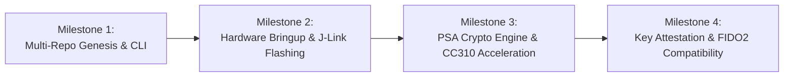

# Project Roadmap & Milestones

## Milestone Schedule

### Milestone 1: Genesis Architecture & Multi-Repo (Complete)
- [x] Multi-repo coordination via root `Makefile` and `AGENTS.md`.
- [x] Dual-stage bootloader architecture (B0 + MCUboot) with root ECDSA P-256 keys.
- [x] Dual CDC-ACM USB endpoints and RGB LED status engine.
- [x] Cross-platform Go CLI `hsmutil` (Cobra + BubbleTea) for macOS, Linux, and Windows.
- [x] `firmware info` and `firmware update --file <file>` chunk streaming.

### Milestone 2: Hardware Bringup & Flashing (In Progress)
- [ ] Connect J-Link `802007333` and verify SWD flashing of `merged.hex`.
- [ ] Validate dual CDC-ACM device enumeration on macOS and Linux.
- [ ] Verify LED pulsating blue, solid red, and solid green transitions.
- [ ] Run automated end-to-end integration tests using `hsmutil test`.

### Milestone 3: Cryptographic Primitives & Storage
- [ ] Hardware-accelerated RSA-2048 / ECDSA P-256 key generation via CryptoCell CC310.
- [ ] Asymmetric signing (`YMS_CMD_SIGN_DATA_PKCS1`, `YMS_CMD_SIGN_DATA_ECDSA`).
- [ ] Secure NVS key storage with AES-CCM envelope encryption.
