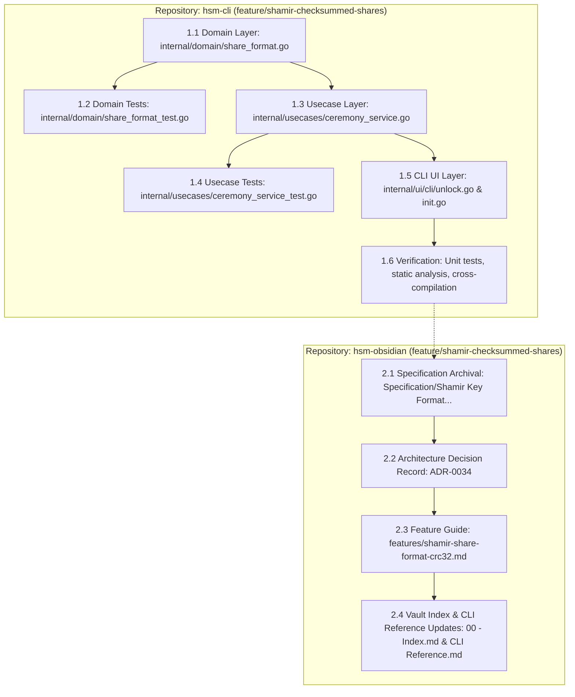

# Implementation Plan: Shamir Key Format with Embedded Index and CRC32 Checksum

> **Document Status**: APPROVED (Phase 3 Plan Approved)  
> **Associated Specification**: [[Specification/Shamir Key Format with Embedded Index and CRC32 Checksum|Technical Specification: Shamir Key Format with Embedded Index and CRC32 Checksum]]  
> **Associated Architecture Decision Record**: [[Architecture/Decisions/ADR-0034 - Shamir Key Format with Embedded Index and CRC32 Checksum|ADR-0034: Shamir Key Format with Embedded Index and CRC32 Checksum]]  
> **Target Repositories**:
> - [`hsm-cli`](file:///Users/gpfister/Development/Projects/gpfister/nrf52840-hsm/hsm-cli)
> - [`hsm-obsidian`](file:///Users/gpfister/Development/Projects/gpfister/nrf52840-hsm/hsm-obsidian)  
> **Target Git Branch**: `feature/shamir-checksummed-shares`  
> **Author**: `coding-plan` (Architecture Planner)

---

## 1. Overview & Architecture Strategy

### 1.1 Objective
Enhance Shamir Secret Sharing custodian usability and hardware resilience by introducing a 75-character, self-contained, checksum-protected custodian share format at the host CLI layer:
$$\mathbf{\langle index \rangle \textbf{--} \langle 64\_hex\_share \rangle \textbf{--} \langle 8\_hex\_crc32 \rangle}$$

This eliminates custodian index transcription errors, prevents hardware non-volatile retry counter exhaustion from typos, streamlines the `gphsm unlock` UX to a single masked prompt, and maintains 100% wire-protocol invariance with the underlying nRF52840 firmware (`AT+SHARE=<idx>,<shareHex>`).

### 1.2 Local Deployment Assessment

| Repository | Deployment Instruction Inspection | Local Deployment Step | Rationale |
| :--- | :--- | :--- | :--- |
| [`hsm-cli`](file:///Users/gpfister/Development/Projects/gpfister/nrf52840-hsm/hsm-cli) | No Dockerfile, docker-compose, k8s, or deploy scripts. Pure Go application. | **Not Required** | Standard Go compilation and automated unit/integration test execution (`go test ./...`, `make build`, `make build-all`). |
| [`hsm-obsidian`](file:///Users/gpfister/Development/Projects/gpfister/nrf52840-hsm/hsm-obsidian) | Documentation-only markdown vault. No containers or deployment scripts. | **Not Required** | Obsidian markdown vault changes verified via file integrity, wikilink validation, and markdown parsing. |

> [!NOTE]
> Since neither repository requires container or cluster deployment, no local deployment phase (`coding-deploy`) is needed for this feature. The lifecycle advances directly from `coding-develop` to `coding-review` upon successful test execution.

---

## 2. Multi-Repository Work Breakdown Structure (WBS)



---

## 3. Detailed Work Packages

### 3.1 Repository: `hsm-cli`

**Branch**: `feature/shamir-checksummed-shares` (branched from `main`)

#### Task 1.1: Implement Domain Functions & Error Sentinels
- **Target File**: [`internal/domain/share_format.go`](file:///Users/gpfister/Development/Projects/gpfister/nrf52840-hsm/hsm-cli/internal/domain/share_format.go) (New)
- **Scope & Responsibilities**:
  1. Define domain errors:
     - `ErrInvalidShareFormat`: Malformed input, missing or incorrect number of hyphens, or invalid segment lengths.
     - `ErrInvalidShareIndex`: Custodian index not in range $[1, 5]$.
     - `ErrInvalidShareHex`: Share payload is not exactly 64 hexadecimal characters (32 bytes) or contains invalid non-hex characters.
     - `ErrInvalidShareChecksum`: CRC-32 checksum mismatch (transcription typo detected).
     - `ErrRawShareDetected`: Custodian pasted an obsolete 64-hexadecimal raw share without index and checksum.
  2. Implement `CalculateShareCRC32(index int, shareBytes []byte) uint32`:
     - Allocates a contiguous 33-byte slice: `[byte(index) || shareBytes[0..31]]`.
     - Returns standard IEEE 802.3 CRC-32 checksum (`hash/crc32.ChecksumIEEE`).
  3. Implement `FormatCustodianShare(index int, shareHex string) (string, error)`:
     - Validates index $\in [1, 5]$.
     - Trims whitespace and optional `0x`/`0X` prefixes.
     - Ensures decoded share is exactly 32 bytes (64 hex characters).
     - Formats canonical output string: `fmt.Sprintf("%d-%s-%08X", index, strings.ToUpper(cleanHex), crc)`.
  4. Implement `ParseCustodianShare(input string) (int, string, error)`:
     - Trims whitespace.
     - Checks if input is an unformatted 64-character raw hex string (or `0x`-prefixed 66-character string) without hyphens; returns `ErrRawShareDetected`.
     - Splits strictly on `-` delimiter; requires exactly 3 segments.
     - Parses and validates `index` $\in [1, 5]$.
     - Decodes and validates 64-character hexadecimal share.
     - Parses 8-character hex CRC-32 suffix.
     - Calculates expected CRC-32 over `[byte(index) || shareBytes]`.
     - Validates expected vs actual CRC-32; returns `ErrInvalidShareChecksum` on mismatch.
     - Returns validated `(index, strings.ToUpper(shareHex), nil)`.

#### Task 1.2: Implement Comprehensive Domain Unit Tests & Benchmarks
- **Target File**: [`internal/domain/share_format_test.go`](file:///Users/gpfister/Development/Projects/gpfister/nrf52840-hsm/hsm-cli/internal/domain/share_format_test.go) (New)
- **Scope & Test Cases**:
  1. **Canonical Test Vectors**: Test known vector from specification:
     - Index: `1`, Share: `000102030405060708090A0B0C0D0E0F101112131415161718191A1B1C1D1E1F`
     - Expected CRC32: `40B513CD`
     - Formatted: `1-000102030405060708090A0B0C0D0E0F101112131415161718191A1B1C1D1E1F-40B513CD`
  2. **Round-Trip Tests**: Generate 100 random 32-byte shares across indices $1 \dots 5$; assert `Parse(Format(i, s)) == (i, s)`.
  3. **Single-Character Mutation (Typo Detection)**:
     - Mutate 1 character in index (e.g. `2-` instead of `1-`) $\rightarrow$ CRC mismatch.
     - Mutate 1 character in the 64-hex share $\rightarrow$ CRC mismatch.
     - Mutate 1 character in the CRC suffix $\rightarrow$ CRC mismatch.
  4. **Syntax & Boundary Rejections**:
     - Index out of bounds (`0`, `6`, `99`, `-1`).
     - Short share (`62` chars) and long share (`66` chars).
     - Non-hex characters in share (e.g. `G`, `Z`, `?`).
     - Short CRC (`7` chars) and long CRC (`9` chars).
     - Double hyphens (`1--share--crc`).
     - Whitespace handling (leading/trailing whitespace accepted and trimmed).
     - Case insensitivity (lowercase hex share and CRC converted to uppercase).
  5. **Legacy Raw Share Interception**: Verify that 64-hex string returns `ErrRawShareDetected`.
  6. **Performance Benchmark**: `BenchmarkParseCustodianShare` asserting parsing and validation takes $< 1\,\mu\text{s}$ per operation.

#### Task 1.3: Update Usecase Ceremony Service
- **Target File**: [`internal/usecases/ceremony_service.go`](file:///Users/gpfister/Development/Projects/gpfister/nrf52840-hsm/hsm-cli/internal/usecases/ceremony_service.go) (Modify)
- **Scope & Changes**:
  1. In `RunTurnByTurnInit`:
     - Format each emitted share via `domain.FormatCustodianShare(share.Index, share.Share)`.
     - Update the display template to prominently present:
       ```text
       Custodian Index: %d
       Formatted Share: %s
       ```
     - Emphasize to custodians that the formatted share with index and CRC suffix must be stored in its entirety.
  2. In `RunTurnByTurnAuth`:
     - **Remove** the separate custodian index prompt (`Enter your Custodian Index (1-5)...`).
     - Prompt custodian once using masked password entry:
       `Enter Custodian Secret Share (masked): `
     - Parse input offline using `domain.ParseCustodianShare(shareInput)`.
     - If parsing fails (`ErrInvalidShareChecksum`, `ErrRawShareDetected`, `ErrInvalidShareFormat`), display an informative error and prompt for re-entry without calling `client.SubmitShare`.
     - Once valid, pass extracted `idx` and `shareHex` to `client.SubmitShare(idx, shareHex)`.

#### Task 1.4: Update Ceremony Service Tests
- **Target File**: [`internal/usecases/ceremony_service_test.go`](file:///Users/gpfister/Development/Projects/gpfister/nrf52840-hsm/hsm-cli/internal/usecases/ceremony_service_test.go) (Modify)
- **Scope & Changes**:
  1. Update `TestRunTurnByTurnInit`: Assert formatted share strings appear in output buffer.
  2. Update `TestRunTurnByTurnAuth_Success`: Supply formatted shares in mock inputs (`1-HEX...-CRC...`) without the previous standalone index prompts.
  3. Add `TestRunTurnByTurnAuth_TypoDoesNotCallHardware`: Provide a corrupted formatted share; assert `SubmitShare` is never invoked and error message indicates local checksum failure.
  4. Add `TestRunTurnByTurnAuth_RawShareRejection`: Provide a raw 64-hex string; assert helpful diagnostic explaining required formatted syntax.

#### Task 1.5: UI Layer Polish & Help Text
- **Target Files**:
  - [`internal/ui/cli/unlock.go`](file:///Users/gpfister/Development/Projects/gpfister/nrf52840-hsm/hsm-cli/internal/ui/cli/unlock.go) (Modify)
  - [`internal/ui/cli/init.go`](file:///Users/gpfister/Development/Projects/gpfister/nrf52840-hsm/hsm-cli/internal/ui/cli/init.go) (Modify)
- **Scope & Changes**:
  1. Update command description and examples in `gphsm unlock` to reflect the single formatted share input.
  2. Update `gphsm device init --mode shamir` help text and instructions.

#### Task 1.6: Verification Commands for `hsm-cli`
```bash
# Run unit tests and race detection across all packages
cd hsm-cli && go test -v -race ./...

# Run benchmarks for share formatting and parsing
cd hsm-cli && go test -v -bench=. ./internal/domain

# Build local host binary
cd hsm-cli && make build

# Cross-compile all 5 release architectures (macOS, Linux arm64/amd64, Windows arm64/amd64)
cd hsm-cli && make build-all
```

---

### 3.2 Repository: `hsm-obsidian`

**Branch**: `feature/shamir-checksummed-shares` (branched from `main`)

#### Task 2.1: Archive Technical Specification
- **Target File**: `Specification/Shamir Key Format with Embedded Index and CRC32 Checksum.md` (Created)
- **Content**: Full text of the approved specification with metadata, Mermaid sequence diagram, and worked numerical examples.

#### Task 2.2: Formalize Architecture Decision Record (ADR-0034)
- **Target File**: `Architecture/Decisions/ADR-0034 - Shamir Key Format with Embedded Index and CRC32 Checksum.md` (Created)
- **Content**:
  - **Status**: Accepted
  - **Context**: Custodian index disassociation, raw hex transcription errors leading to microcontroller retry counter exhaustion, and multi-prompt UX friction.
  - **Decision**: Adopt the canonical 75-character format `<index>-<64_hex_share>-<8_hex_crc32>` with IEEE 802.3 CRC-32 over `[uint8(index) || 32_byte_share]`. Enforce fail-fast offline validation in `gphsm`. Keep physical firmware wire protocol invariant.
  - **Consequences**: Zero firmware alterations, complete elimination of typo-induced hardware lockouts, single-prompt threshold authentication ceremony.

#### Task 2.3: Feature Documentation
- **Target File**: `features/shamir-share-format-crc32.md` (Created)
- **Content**: User guide, custodian ceremony protocol, visual layout diagrams, and acceptance criteria.

#### Task 2.4: Vault Index and CLI Reference Updates
- **Target Files**:
  - `00 - Index.md` (Modify: add links to ADR-0034 and new specification)
  - `Development/CLI Reference.md` (Modify: update `gphsm device init` and `gphsm unlock` examples)

#### Task 2.5: Verification for `hsm-obsidian`
- Verify markdown syntax and wikilink integrity (`[[...]]`) across created and modified vault notes.

---

## 4. Execution Dependency & Sequencing

```text
Sequence of Execution:
1. Create branch `feature/shamir-checksummed-shares` in `hsm-cli` and `hsm-obsidian`.
2. [hsm-cli] Implement Task 1.1 (`share_format.go`) & Task 1.2 (`share_format_test.go`).
3. [hsm-cli] Verify domain tests pass (`go test -v ./internal/domain`).
4. [hsm-cli] Implement Task 1.3 (`ceremony_service.go`) & Task 1.4 (`ceremony_service_test.go`).
5. [hsm-cli] Implement Task 1.5 (`unlock.go`, `init.go`).
6. [hsm-cli] Run complete test suite and cross-compilation (`make test && make build-all`).
7. [hsm-obsidian] Author Tasks 2.1 (Specification), 2.2 (ADR-0034), 2.3 (Feature note), 2.4 (Index & Reference).
8. Code Review and Approval (`coding-review`).
9. Branch Merging (`coding-merge`).
```

---

## 5. Risk Assessment & Mitigations

| Risk | Impact | Probability | Mitigation |
| :--- | :--- | :--- | :--- |
| **Custodian attempts to paste legacy raw 64-hex share** | Unlock fails | Medium | Local parser explicitly identifies 64-character raw hex strings and emits `ErrRawShareDetected` explaining the required format with helpful instructions. |
| **Typo during custodian share entry** | Potential counter decrement | High | Local parser computes CRC-32 before initiating serial AT transmission. If checksum fails, serial I/O is skipped, preserving hardware retry counters. |
| **Index spoofing / share swapping** | Inconsistent threshold recovery | Low | Custodian index is prepended to the binary payload before CRC calculation. Altering the leading index invalidates the CRC check. |
| **Cross-platform compilation failure** | Build breakage on Windows/Linux | Low | Uses standard library `hash/crc32` with zero CGO dependencies. Tested across all 5 architectures via `make build-all`. |

---

## 6. Summary of Affected Files

| Repository | Path | Action | Description |
| :--- | :--- | :--- | :--- |
| `hsm-cli` | `internal/domain/share_format.go` | **Create** | Implements `CalculateShareCRC32`, `FormatCustodianShare`, `ParseCustodianShare`, and sentinel errors. |
| `hsm-cli` | `internal/domain/share_format_test.go` | **Create** | Unit tests, round-trip tests, error rejections, and performance benchmarks. |
| `hsm-cli` | `internal/usecases/ceremony_service.go` | **Modify** | Formatted share display in init; single-prompt masked input with fail-fast validation in auth. |
| `hsm-cli` | `internal/usecases/ceremony_service_test.go` | **Modify** | Test cases updated for formatted shares and offline typo protection. |
| `hsm-cli` | `internal/ui/cli/unlock.go` | **Modify** | Updated help strings and usage notes. |
| `hsm-cli` | `internal/ui/cli/init.go` | **Modify** | Updated usage guidance for Shamir initialization. |
| `hsm-obsidian` | `Specification/Shamir Key Format with Embedded Index and CRC32 Checksum.md` | **Create** | Technical specification archival. |
| `hsm-obsidian` | `Architecture/Decisions/ADR-0034 - Shamir Key Format with Embedded Index and CRC32 Checksum.md` | **Create** | Formal ADR for the format and local validation. |
| `hsm-obsidian` | `Plan/Shamir Key Format with Embedded Index and CRC32 Checksum Implementation Plan.md` | **Create** | Multi-repository implementation plan. |
| `hsm-obsidian` | `features/shamir-share-format-crc32.md` | **Create** | Feature guide and operational documentation. |
| `hsm-obsidian` | `00 - Index.md` | **Modify** | Indexing ADR-0034, plan, specification, and new feature notes. |
| `hsm-obsidian` | `Development/CLI Reference.md` | **Modify** | CLI reference update with sample command invocations. |
