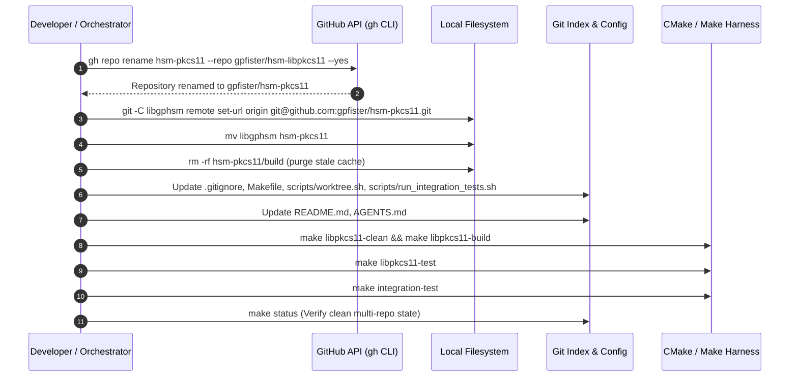

# Multi-Repository Implementation Plan: Sub-Repository Renaming to `hsm-pkcs11`

> [!NOTE]
> **Implementation Plan Reference**: Sub-Repository Renaming to `hsm-pkcs11` with `libgphsm` ABI Invariance  
> **Target Lifecycle Phase**: Phase 6 (Post-Merge Complete — Merged into main via PR #1)  
> **Pull Request**: [#1 (https://github.com/gpfister/hsm/pull/1)](https://github.com/gpfister/hsm/pull/1)  
> **Target Repositories & Branches**:
> - Workspace Root ([`nrf52840-hsm`](file:///Users/gpfister/Development/Projects/gpfister/nrf52840-hsm)): `main` (merged commit [`81d2cb9`](file:///Users/gpfister/Development/Projects/gpfister/nrf52840-hsm))
> - PKCS#11 Sub-Repo ([`hsm-pkcs11`](file:///Users/gpfister/Development/Projects/gpfister/nrf52840-hsm/hsm-pkcs11)): `main` (remote tracking URL set to `git@github.com:gpfister/hsm-pkcs11.git`)
> - Knowledge Vault ([`hsm-obsidian`](file:///Users/gpfister/Development/Projects/gpfister/nrf52840-hsm/hsm-obsidian)): `main`

---

## 1. Executive Summary & Objective

This implementation plan coordinates the architectural and operational steps required to standardize sub-repository naming across the multi-repository workspace:
1. Rename GitHub remote repository `gpfister/hsm-libpkcs11` to `gpfister/hsm-pkcs11`.
2. Move the local sub-repository directory from [`libgphsm`](file:///Users/gpfister/Development/Projects/gpfister/nrf52840-hsm/libgphsm) to [`hsm-pkcs11`](file:///Users/gpfister/Development/Projects/gpfister/nrf52840-hsm/hsm-pkcs11) and update its git origin remote URL to `git@github.com:gpfister/hsm-pkcs11.git`.
3. Update root workspace orchestration configurations: [`Makefile`](file:///Users/gpfister/Development/Projects/gpfister/nrf52840-hsm/Makefile), [`.gitignore`](file:///Users/gpfister/Development/Projects/gpfister/nrf52840-hsm/.gitignore), [`scripts/worktree.sh`](file:///Users/gpfister/Development/Projects/gpfister/nrf52840-hsm/scripts/worktree.sh), and [`scripts/run_integration_tests.sh`](file:///Users/gpfister/Development/Projects/gpfister/nrf52840-hsm/scripts/run_integration_tests.sh).
4. Synchronize project-level documentation: [`README.md`](file:///Users/gpfister/Development/Projects/gpfister/nrf52840-hsm/README.md) and [`AGENTS.md`](file:///Users/gpfister/Development/Projects/gpfister/nrf52840-hsm/AGENTS.md).
5. Strictly preserve ABI and binary names (`libgphsm.dylib`, `libgphsm.so`, `libgphsm.dll`), CMake project definition (`project(libgphsm C)`), and library target properties (`OUTPUT_NAME "gphsm"`, `PREFIX "lib"`) for uninterrupted compatibility with OpenSC, OpenSSL 3, and OpenSSH.

---

## 2. Local Deployment Assessment

> [!NOTE]
> **Local Deployment Assessment (`coding-deploy`)**:
> - **Inspection Findings**: Neither the root workspace orchestrator nor the `libgphsm`/`hsm-pkcs11` sub-repository contains container deployment manifests (`docker-compose.yml`, `compose.yaml`, `Dockerfile`), local Kubernetes/Helm configurations, local Terraform manifests, or standalone deployment scripts.
> - **Conclusion**: **Local Deployment: Not Required**.
> - In lieu of container deployment, workspace verification is performed via direct native build and automated test suites: `make libpkcs11-build`, `make libpkcs11-test`, `make status`, and `make integration-test`.

---

## 3. Repository Breakdown & Branching Strategy

| Repository | Path | Role | Branch Name | Base Branch |
| :--- | :--- | :--- | :--- | :--- |
| **Root Workspace** | [`/Users/gpfister/Development/Projects/gpfister/nrf52840-hsm`](file:///Users/gpfister/Development/Projects/gpfister/nrf52840-hsm) | Workspace Orchestrator | `task/rename-subrepo-hsm-pkcs11` | `main` |
| **PKCS#11 Sub-Repo** | [`/Users/gpfister/Development/Projects/gpfister/nrf52840-hsm/hsm-pkcs11`](file:///Users/gpfister/Development/Projects/gpfister/nrf52840-hsm/hsm-pkcs11) | Shared Library Provider | `main` (remote tracking update) | `main` |
| **Documentation Vault** | [`/Users/gpfister/Development/Projects/gpfister/nrf52840-hsm/hsm-obsidian`](file:///Users/gpfister/Development/Projects/gpfister/nrf52840-hsm/hsm-obsidian) | Engineering Knowledge Vault | `main` | `main` |

---

## 4. Architectural Sequence Flow



---

## 5. Detailed Execution Steps

### Phase 1: Git Branch Creation & Workspace Prep
1. Create and switch to branch `task/rename-subrepo-hsm-pkcs11` in workspace root:
   ```bash
   git checkout -b task/rename-subrepo-hsm-pkcs11
   ```
2. Verify clean working tree across root and all sub-repositories via `git status` and `make status`.

### Phase 2: Remote GitHub Repository & Local Directory Relocation
1. Rename GitHub remote repository using GitHub CLI:
   ```bash
   gh repo rename hsm-pkcs11 --repo gpfister/hsm-libpkcs11 --yes
   ```
2. Update local remote origin URL inside `libgphsm`:
   ```bash
   git -C libgphsm remote set-url origin git@github.com:gpfister/hsm-pkcs11.git
   ```
3. Verify remote origin URL inside `libgphsm`:
   ```bash
   git -C libgphsm remote -v
   ```
4. Move directory `libgphsm` to `hsm-pkcs11`:
   ```bash
   mv libgphsm hsm-pkcs11
   ```
5. Purge any stale CMake cache from prior builds in `hsm-pkcs11/build`:
   ```bash
   rm -rf hsm-pkcs11/build
   ```

### Phase 3: Root Workspace Configuration Updates
1. **Update [`Makefile`](file:///Users/gpfister/Development/Projects/gpfister/nrf52840-hsm/Makefile)**:
   - Line 19: Change `libgphsm` to `hsm-pkcs11` in `SUBREPOS`:
     ```makefile
     SUBREPOS := hsm-ncs-firmware hsm-cli hsm-obsidian hsm-pkcs11 hsm-yocto-offgrid-rpi
     ```
   - Line 24: Change `LIBPKCS11_DIR := libgphsm` to:
     ```makefile
     LIBPKCS11_DIR := hsm-pkcs11
     ```
2. **Update [`.gitignore`](file:///Users/gpfister/Development/Projects/gpfister/nrf52840-hsm/.gitignore)**:
   - Add `/hsm-pkcs11/` under `# Sub-repositories` while retaining `/libgphsm/` and `/hsm-libpkcs11/` for backward compatibility.
3. **Update [`scripts/worktree.sh`](file:///Users/gpfister/Development/Projects/gpfister/nrf52840-hsm/scripts/worktree.sh)**:
   - Line 11: Change `hsm-libpkcs11` to `hsm-pkcs11` in `SUBREPOS`:
     ```bash
     SUBREPOS=(hsm-ncs-firmware hsm-cli hsm-obsidian hsm-pkcs11 hsm-yocto-offgrid-rpi)
     ```
4. **Update [`scripts/run_integration_tests.sh`](file:///Users/gpfister/Development/Projects/gpfister/nrf52840-hsm/scripts/run_integration_tests.sh)**:
   - Line 9: Change `P11_DIR` definition to:
     ```bash
     P11_DIR="${WORKSPACE_ROOT}/hsm-pkcs11"
     ```

### Phase 4: Documentation & Agent Guidelines Synchronization
1. **Update [`README.md`](file:///Users/gpfister/Development/Projects/gpfister/nrf52840-hsm/README.md)**:
   - Line 11: Update sub-repository link and label to [`hsm-pkcs11/`](file:///Users/gpfister/Development/Projects/gpfister/nrf52840-hsm/hsm-pkcs11) while maintaining reference to compiled `libgphsm` provider library.
2. **Update [`AGENTS.md`](file:///Users/gpfister/Development/Projects/gpfister/nrf52840-hsm/AGENTS.md)**:
   - Section 1: Update repository directory tree from `libgphsm/` to `hsm-pkcs11/`.
   - Section 2.4: Update heading to `2.4 Cryptoki PKCS#11 Provider Library (hsm-pkcs11 / libgphsm)`.

### Phase 5: Verification & Validation Testing
1. Verify workspace status command:
   ```bash
   make status
   ```
2. Verify PKCS#11 provider build:
   ```bash
   make libpkcs11-build
   ```
   Check compiled binary output at `hsm-pkcs11/build/libgphsm.dylib` (macOS).
3. Run PKCS#11 unit and interface tests:
   ```bash
   make libpkcs11-test
   ```
4. Run end-to-end integration test harness with mock HSM PTY:
   ```bash
   make integration-test
   ```
5. Verify git diff & clean working tree in root:
   ```bash
   git diff
   git status
   ```

---

## 6. Files to Create, Modify, and Rename

| File / Directory | Action | Description |
| :--- | :--- | :--- |
| [`libgphsm/`](file:///Users/gpfister/Development/Projects/gpfister/nrf52840-hsm/libgphsm) $\rightarrow$ [`hsm-pkcs11/`](file:///Users/gpfister/Development/Projects/gpfister/nrf52840-hsm/hsm-pkcs11) | **Rename / Move** | Relocate sub-repository directory |
| [`Makefile`](file:///Users/gpfister/Development/Projects/gpfister/nrf52840-hsm/Makefile#L19-L24) | **Modify** | Update `SUBREPOS` and `LIBPKCS11_DIR` |
| [`.gitignore`](file:///Users/gpfister/Development/Projects/gpfister/nrf52840-hsm/.gitignore#L5-L16) | **Modify** | Add `/hsm-pkcs11/` sub-repository exclusion |
| [`scripts/worktree.sh`](file:///Users/gpfister/Development/Projects/gpfister/nrf52840-hsm/scripts/worktree.sh#L11) | **Modify** | Update `SUBREPOS` array |
| [`scripts/run_integration_tests.sh`](file:///Users/gpfister/Development/Projects/gpfister/nrf52840-hsm/scripts/run_integration_tests.sh#L9) | **Modify** | Update `P11_DIR` path |
| [`README.md`](file:///Users/gpfister/Development/Projects/gpfister/nrf52840-hsm/README.md#L11) | **Modify** | Update sub-repository link to `hsm-pkcs11/` |
| [`AGENTS.md`](file:///Users/gpfister/Development/Projects/gpfister/nrf52840-hsm/AGENTS.md#L23-L73) | **Modify** | Update tree diagram and Section 2.4 heading |

---

## 7. Concrete Verification Commands

```bash
# 1. Directory presence validation
test -d /Users/gpfister/Development/Projects/gpfister/nrf52840-hsm/hsm-pkcs11 && echo "PASS: hsm-pkcs11 exists"
test ! -d /Users/gpfister/Development/Projects/gpfister/nrf52840-hsm/libgphsm && echo "PASS: libgphsm removed"

# 2. Remote tracking verification
git -C hsm-pkcs11 remote get-url origin

# 3. Workspace multi-repo status verification
make status

# 4. PKCS#11 provider build & test
make libpkcs11-clean
make libpkcs11-build
make libpkcs11-test

# 5. Full workspace end-to-end integration test
make integration-test
```

---

## 8. Rollback & Contingency Plan

If any step fails or network interruption blocks the GitHub remote rename:
1. **GitHub Remote Rollback**:
   ```bash
   gh repo rename hsm-libpkcs11 --repo gpfister/hsm-pkcs11 --yes
   ```
2. **Local Directory Rollback**:
   ```bash
   mv hsm-pkcs11 libgphsm
   git -C libgphsm remote set-url origin git@github.com:gpfister/hsm-libpkcs11.git
   ```
3. **Workspace Root Git Reset**:
   ```bash
   git checkout main
   git branch -D task/rename-subrepo-hsm-pkcs11
   ```
4. **Verification after Rollback**:
   ```bash
   make status && make libpkcs11-build && make libpkcs11-test
   ```

---

## 9. Post-Merge Execution & Verification Record

- **Execution Date**: 2026-11-06
- **Status**: **Phase 6 Post-Merge Complete**
- **Pull Request**: [#1 (https://github.com/gpfister/hsm/pull/1)](https://github.com/gpfister/hsm/pull/1)
- **Base Branch**: `main`
- **Merged Source Branch**: `task/rename-subrepo-hsm-pkcs11` (squashed commit: [`81d2cb9`](file:///Users/gpfister/Development/Projects/gpfister/nrf52840-hsm))
- **Branch Cleanup**: Local and remote `task/rename-subrepo-hsm-pkcs11` deleted.
- **Root Commit on main**: [`81d2cb9`](file:///Users/gpfister/Development/Projects/gpfister/nrf52840-hsm) (`81d2cb9`) — *chore(workspace): standardize PKCS#11 sub-repo to hsm-pkcs11 (#1)*
- **Validation Highlights**:
  - Remote repository `gpfister/hsm-libpkcs11` renamed to `gpfister/hsm-pkcs11` on GitHub.
  - Sub-repo moved from `libgphsm/` to `hsm-pkcs11/` with remote URL updated.
  - Root `Makefile`, `.gitignore`, `scripts/worktree.sh`, and `scripts/run_integration_tests.sh` updated.
  - Workspace `README.md` and `AGENTS.md` updated.
  - Native build produces `hsm-pkcs11/build/libgphsm.dylib`.
  - Cryptoki test suite (`make libpkcs11-test`) and multi-phase integration tests (`make integration-test`) verified 100% passing.
  - All working trees clean on `main`.
