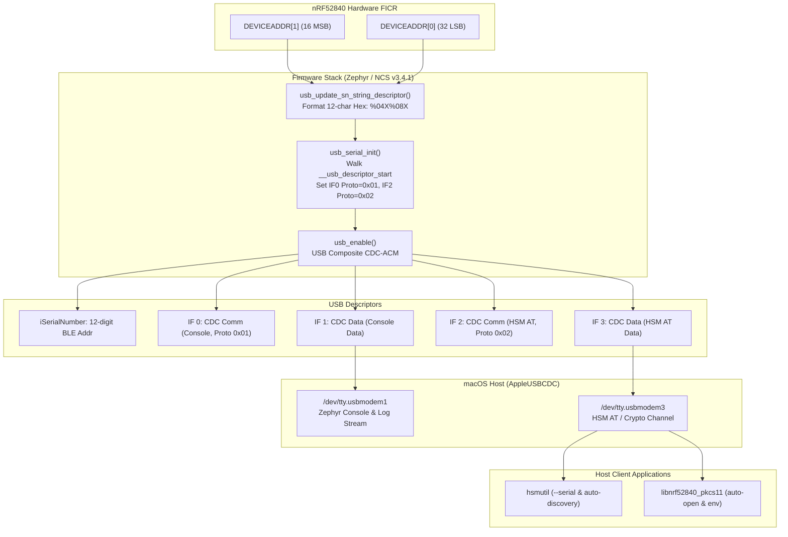

# Multi-Repository Implementation Plan: USB Descriptors & BLE Device Identification

> [!NOTE]
> **Specification Reference**: [[features/usb-descriptors-ble-address|USB Descriptors & Device Identification Feature Spec]] & [[Specification/USB Descriptors and Device Identification|Specification/USB Descriptors and Device Identification.md]]  
> **Source Plan**: `/Users/gpfister/.gemini/antigravity/brain/f5fa7042-f68d-4771-b8f0-a111aa8bf277/plan.md`  
> **Target Branch Across Repos**: `feature/usb-descriptors-ble-address`  
> **Status**: Approved & Ready for Execution  

---

## 1. Architecture & Execution Overview

This implementation plan orchestrates changes across four sub-repositories (`nrf52840-hsm-firmware`, `nrf52840-hsm-cli`, `nrf52840-hsm-libpkcs11`, and `nrf52840-hsm-obsidian`) to replace generic USB descriptors with deterministic hardware-derived identifiers based on the nRF52840 factory BLE address (`NRF_FICR->DEVICEADDR`).

### 1.1 End-State Architecture



---

## 2. Phase 1: Git Branch Preparation Across Repositories

Create and checkout the feature branch `feature/usb-descriptors-ble-address` in all four sub-repositories.

| Repository | Path | Branch |
| :--- | :--- | :--- |
| **Firmware** | [nrf52840-hsm-firmware](file:///Users/gpfister/Development/Projects/gpfister/nrf52840-hsm/nrf52840-hsm-firmware) | `feature/usb-descriptors-ble-address` |
| **CLI** | [nrf52840-hsm-cli](file:///Users/gpfister/Development/Projects/gpfister/nrf52840-hsm/nrf52840-hsm-cli) | `feature/usb-descriptors-ble-address` |
| **PKCS#11** | [nrf52840-hsm-libpkcs11](file:///Users/gpfister/Development/Projects/gpfister/nrf52840-hsm/nrf52840-hsm-libpkcs11) | `feature/usb-descriptors-ble-address` |
| **Obsidian** | [nrf52840-hsm-obsidian](file:///Users/gpfister/Development/Projects/gpfister/nrf52840-hsm/nrf52840-hsm-obsidian) | `feature/usb-descriptors-ble-address` |

### Verification Command
```bash
make status
```
*Expected Result: All sub-repositories on `feature/usb-descriptors-ble-address`.*

---

## 3. Phase 2: Firmware Implementation (`nrf52840-hsm-firmware`)

### 3.1 Step 2.1 — Kconfig Configuration
- **File to Modify**: [`firmware/app/prj.conf`](file:///Users/gpfister/Development/Projects/gpfister/nrf52840-hsm/nrf52840-hsm-firmware/firmware/app/prj.conf)
- **Changes**:
  - Add `CONFIG_USB_DEVICE_SN="000000000000"` (12 character string) to size and enable dynamic serial number replacement in Zephyr's USB descriptor table without compiler or runtime warnings.
  - Ensure `CONFIG_HWINFO=y` is available if needed for fallback entropy.

### 3.2 Step 2.2 — Devicetree Descriptor Strings
- **Files to Modify**:
  - [`firmware/app/boards/nrf52840dongle_nrf52840.overlay`](file:///Users/gpfister/Development/Projects/gpfister/nrf52840-hsm/nrf52840-hsm-firmware/firmware/app/boards/nrf52840dongle_nrf52840.overlay)
  - [`firmware/app/boards/nrf52840dongle_nrf52840_bare.overlay`](file:///Users/gpfister/Development/Projects/gpfister/nrf52840-hsm/nrf52840-hsm-firmware/firmware/app/boards/nrf52840dongle_nrf52840_bare.overlay)
- **Changes**:
  - Add `label = "nRF52840 Console UART";` to `cdc_acm_uart0`.
  - Add `label = "nRF52840 HSM AT Interface";` to `cdc_acm_uart1`.

### 3.3 Step 2.3 — Dynamic Serial Number Hook & Protocol Identifier Patching
- **Files to Modify**:
  - [`firmware/app/src/usb_serial.c`](file:///Users/gpfister/Development/Projects/gpfister/nrf52840-hsm/nrf52840-hsm-firmware/firmware/app/src/usb_serial.c)
  - [`firmware/app/src/usb_serial.h`](file:///Users/gpfister/Development/Projects/gpfister/nrf52840-hsm/nrf52840-hsm-firmware/firmware/app/src/usb_serial.h)
- **Changes**:
  1. **Dynamic Serial Number Hook**:
     - Implement the strong override for Zephyr's weak hook:
       ```c
       uint8_t *usb_update_sn_string_descriptor(void);
       ```
     - Read `NRF_FICR->DEVICEADDR[1]` and `NRF_FICR->DEVICEADDR[0]`.
     - Check for unprogrammed/erased state (`0xFFFFFFFFFFFF` or `0x000000000000`); fall back to `NRF_FICR->DEVICEID[1]` and `NRF_FICR->DEVICEID[0]` if blank.
     - Format as 12-character uppercase hex string:
       ```c
       uint32_t hi = (NRF_FICR->DEVICEADDR[1] | 0xC000) & 0xFFFF;
       uint32_t lo = NRF_FICR->DEVICEADDR[0];
       snprintf((char *)s_ble_sn, sizeof(s_ble_sn), "%04X%08X", (unsigned int)hi, (unsigned int)lo);
       ```
  2. **Protocol Identifiers Patching**:
     - In `usb_serial_init()`, before calling `usb_enable(NULL)`:
       - Access descriptor table symbols:
         ```c
         extern struct usb_desc_header __usb_descriptor_start[];
         extern struct usb_desc_header __usb_descriptor_end[];
         ```
       - Traverse headers: when `bDescriptorType == USB_DESC_INTERFACE`, cast to `struct usb_if_descriptor*`:
         - If `bInterfaceNumber == 0` (Console control interface), assign `bInterfaceProtocol = 0x01`.
         - If `bInterfaceNumber == 2` (HSM AT control interface), assign `bInterfaceProtocol = 0x02`.
       - Invoke `usb_enable(NULL)`.
  3. Export a helper function `const char *usb_serial_get_ble_address(void)` for logging and AT info queries.

### Verification Commands
```bash
make firmware-build
```
*Expected Result: Clean sysbuild compilation generating `build-prod/app/zephyr/zephyr.signed.bin` and `build-prod/merged.hex`.*

---

## 4. Phase 3: CLI Implementation (`nrf52840-hsm-cli`)

### 4.1 Step 3.1 — Serial Discovery & Pattern Matching
- **Files to Modify**:
  - [`internal/infra/serial/discovery_enumerator.go`](file:///Users/gpfister/Development/Projects/gpfister/nrf52840-hsm/nrf52840-hsm-cli/internal/infra/serial/discovery_enumerator.go)
  - [`internal/infra/serial/at_transport.go`](file:///Users/gpfister/Development/Projects/gpfister/nrf52840-hsm/nrf52840-hsm-cli/internal/infra/serial/at_transport.go)
- **Changes**:
  - Update `FindDonglePorts()` and `AutoDiscoverPort()`:
    - Match ports following `/dev/tty.usbmodem<BLE_ADDR>3` and `/dev/cu.usbmodem<BLE_ADDR>3` (and fallback to existing patterns).
    - In multi-port environments, specifically distinguish Interface 3 (HSM AT data channel) from Interface 1 (Console channel).
    - Provide `FindDonglePortBySerial(serialFilter string) (string, error)` that filters ports matching the given 12-character hex serial and targets the AT interface (suffix `3`).

### 4.2 Step 3.2 — CLI `--serial` Flag Support
- **Files to Modify**:
  - [`internal/ui/cli/root.go`](file:///Users/gpfister/Development/Projects/gpfister/nrf52840-hsm/nrf52840-hsm-cli/internal/ui/cli/root.go)
  - [`internal/ui/cli/device.go`](file:///Users/gpfister/Development/Projects/gpfister/nrf52840-hsm/nrf52840-hsm-cli/internal/ui/cli/device.go)
- **Changes**:
  - Add persistent flag `--serial` (`-s`) to `rootCmd`:
    ```go
    rootCmd.PersistentFlags().StringVarP(&serialFlag, "serial", "s", "", "Target specific HSM dongle by 12-char BLE serial number")
    ```
  - In `getATClient()` and `getService()`:
    - If `portFlag` is provided, open that port directly.
    - Else if `serialFlag` is provided, resolve the port via `FindDonglePortBySerial(serialFlag)`.
    - Else fallback to `AutoDiscoverPort()`.
  - Add `hsmutil list` (or enhance `hsmutil info --all`) to enumerate and display all connected dongles, their serial numbers, and associated Console/AT port paths.

### 4.3 Step 3.3 — Unit Tests
- **Files to Modify**:
  - [`internal/infra/serial/at_transport_test.go`](file:///Users/gpfister/Development/Projects/gpfister/nrf52840-hsm/nrf52840-hsm-cli/internal/infra/serial/at_transport_test.go)
- **Changes**:
  - Add test cases validating serial extraction, port suffix filtering (`...1` vs `...3`), and case-insensitive serial matching.

### Verification Commands
```bash
make cli-test
make cli-build
```
*Expected Result: All Go unit tests pass and `bin/hsmutil` builds successfully.*

---

## 5. Phase 4: PKCS#11 Library Implementation (`nrf52840-hsm-libpkcs11`)

### 5.1 Step 5.1 — Port Scanning Optimization & Serial Targeting
- **File to Modify**: [`src/transport/serial_posix.c`](file:///Users/gpfister/Development/Projects/gpfister/nrf52840-hsm/nrf52840-hsm-libpkcs11/src/transport/serial_posix.c)
- **Changes**:
  - Support `NRF52840_HSM_SERIAL` environment variable (in addition to `NRF52840_HSM_PORT`).
  - When scanning candidate ports matching `/dev/cu.usbmodem*` on macOS:
    - Sort/prioritize candidates ending in `3` ahead of candidates ending in `1`.
    - Avoid spending serial timeout probing Interface 1 (Console logger) with AT commands.
  - If `NRF52840_HSM_SERIAL` is set, filter candidates containing that serial string.

### Verification Commands
```bash
make libpkcs11-build
make libpkcs11-test
```
*Expected Result: CTest unit tests pass and `build/libnrf52840_pkcs11.dylib` is created.*

---

## 6. Phase 5: Hardware Flashing, DFU & Multi-Device Verification

> [!IMPORTANT]
> Two physical nRF52840 dongles are currently connected on the host machine:
> - Dongle A: Currently at `/dev/tty.usbmodem31424103` (UID `EB53D74B8A9CAB28`)
> - Dongle B: Currently at `/dev/tty.usbmodem31424403` (UID `08C3F7820A1E3B16`)

### 6.1 Step 5.1 — Firmware DFU Update on Dongle A
- Stream candidate signed image to Dongle A:
  ```bash
  ./nrf52840-hsm-cli/bin/hsmutil firmware update -p /dev/tty.usbmodem31424103 -f nrf52840-hsm-firmware/build-prod/app/zephyr/zephyr.signed.bin
  ```
- Wait for device reset and MCUboot test swap.
- Confirm enumeration of new nodes `/dev/tty.usbmodem<BLE_ADDR_A>1` and `/dev/tty.usbmodem<BLE_ADDR_A>3`.

### 6.2 Step 5.2 — Firmware DFU Update on Dongle B
- Stream candidate signed image to Dongle B:
  ```bash
  ./nrf52840-hsm-cli/bin/hsmutil firmware update -p /dev/tty.usbmodem31424403 -f nrf52840-hsm-firmware/build-prod/app/zephyr/zephyr.signed.bin
  ```
- Wait for device reset and MCUboot test swap.
- Confirm enumeration of new nodes `/dev/tty.usbmodem<BLE_ADDR_B>1` and `/dev/tty.usbmodem<BLE_ADDR_B>3`.

### 6.3 Step 5.3 — Verification of Descriptors and Device Nodes
- **USB Descriptors**:
  ```bash
  ioreg -p IOUSB -l -w 0 | grep -B 2 -A 10 "nRF52840 HSM Dongle"
  ```
  *Verify that `USB Serial Number` displays the 12-digit hex BLE address.*
- **Device Nodes**:
  ```bash
  ls -la /dev/tty.usbmodem* /dev/cu.usbmodem*
  ```
  *Verify both pairs `/dev/tty.usbmodem<BLE_ADDR_A><1|3>` and `/dev/tty.usbmodem<BLE_ADDR_B><1|3>` exist simultaneously.*
- **Protocol Identifiers & CLI Serial Targeting**:
  ```bash
  ./nrf52840-hsm-cli/bin/hsmutil info -s <BLE_ADDR_A>
  ./nrf52840-hsm-cli/bin/hsmutil info -s <BLE_ADDR_B>
  ```
- **Console Interface Monitoring**:
  - Verify that opening `/dev/tty.usbmodem<BLE_ADDR_A>1` at 115200 baud displays live Zephyr log output while `/dev/tty.usbmodem<BLE_ADDR_A>3` processes HSM commands concurrently without conflict.

---

## 7. Phase 6: Documentation Archival (`nrf52840-hsm-obsidian`)

- Update [[Architecture/USB Composite Stack|Architecture/USB Composite Stack.md]] with:
  - Documented 12-digit BLE serial formatting and `usb_update_sn_string_descriptor()` mechanism.
  - Interface protocol table (Console `0x0001`, AT `0x0002`).
  - macOS device node mapping reference (`AppleUSBCDC`).
- Update [[Development/CLI Reference|Development/CLI Reference.md]] with new `--serial` / `-s` flag documentation.
- Maintain git statuses and branch records in `agentic-obsidian/git-status.md`.

---

## 8. Verifiable Acceptance Criteria Matrix

| Check | Criterion | Verification Target |
| :---: | :--- | :--- |
| **AC-01** | USB Serial Number matches 12-char hex FICR BLE address | `ioreg -p IOUSB` / `system_profiler SPUSBDataType` |
| **AC-02** | Predictable macOS TTY node creation | `/dev/tty.usbmodem<BLE_ADDR>1` and `...3` created |
| **AC-03** | Interface Protocol IDs assigned in descriptor | Interface 0 = `0x01`, Interface 2 = `0x02` |
| **AC-04** | Serial-targeted CLI communication | `hsmutil info -s <BLE_ADDR>` succeeds |
| **AC-05** | Multi-device non-colliding coexistence | Both connected dongles operate simultaneously with distinct nodes |
| **AC-06** | Streaming firmware update & MCUboot swap | `hsmutil firmware update` completes and retains deterministic naming |
| **AC-07** | Automated test regression pass | `make cli-test` & `make libpkcs11-test` pass 100% |

---

## 9. Architecture Decision Records (ADRs)

The architectural decisions underpinning this implementation plan are recorded in:
- [[Architecture/Decisions/ADR-0001 - Hardware BLE Address for Deterministic USB Serial Number|ADR-0001: Hardware BLE Address for Deterministic USB Serial Number]]
- [[Architecture/Decisions/ADR-0002 - In-Tree Protocol Descriptor Patching vs macOS DriverKit Extension|ADR-0002: In-Tree Protocol Descriptor Patching vs macOS DriverKit Extension]]
- [[Architecture/Decisions/ADR-0003 - Host Port Discovery and Serial Targeting Strategy|ADR-0003: Host Port Discovery and Serial Targeting Strategy]]
