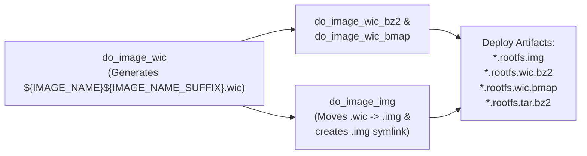

# Implementation Plan: Uncompressed Disk Image `.img` Output in `rpi-z2w-yocto-hsm`

> [!IMPORTANT]
> **Source Specification**: [[Specification/Uncompressed Disk Image img Output in rpi-z2w-yocto-hsm|Uncompressed Disk Image .img Output in rpi-z2w-yocto-hsm Specification]]  
> **Feature Note**: [[features/uncompressed-img-disk-image-output|Uncompressed Disk Image .img Output Feature]]  
> **Architecture Decision Record**: [[Architecture/Decisions/ADR-0005 - Custom BitBake img Image Type via WIC Rename|ADR-0005: Custom BitBake img Image Type via WIC Rename]]  
> **Operational Guide**: [[Development/Yocto Build and RAUC Update Guide|Yocto Build and RAUC Update Guide]]  
> **Status**: Completed & Verified (Phase 5 Pre-Merge Review — Commit [`f4adf0b`](file:///Users/gpfister/Development/Projects/gpfister/nrf52840-hsm/rpi-z2w-yocto-hsm)).

---

## 1. Architectural Overview & Pipeline Flow



By declaring `IMAGE_TYPEDEP:img = "wic"`, BitBake automatically schedules `do_image_wic` as a prerequisite task and adds `wic` to the internal build dependencies without requiring `wic` to be explicitly retained in `IMAGE_FSTYPES`. In OE-Core Scarthgap, `IMAGE_CMD:wic` produces `${IMGDEPLOYDIR}/${IMAGE_NAME}${IMAGE_NAME_SUFFIX}.wic` (`IMAGE_NAME_SUFFIX = ".rootfs"`). Once `do_image_wic` and its conversion dependents (`bz2`, `bmap`) complete, `do_image_img` renames the uncompressed `${IMGDEPLOYDIR}/${IMAGE_NAME}${IMAGE_NAME_SUFFIX}.wic` file to `${IMGDEPLOYDIR}/${IMAGE_NAME}${IMAGE_NAME_SUFFIX}.img`, cleans up the intermediate `${IMGDEPLOYDIR}/${IMAGE_LINK_NAME}.wic` symlink, and allows BitBake's post-image symlink mechanism to create `${IMGDEPLOYDIR}/${IMAGE_LINK_NAME}.img`.

---

## 2. Repository Work Breakdown

### Repository: `rpi-z2w-yocto-hsm`
- **Repository Path**: [`/Users/gpfister/Development/Projects/gpfister/nrf52840-hsm/rpi-z2w-yocto-hsm`](file:///Users/gpfister/Development/Projects/gpfister/nrf52840-hsm/rpi-z2w-yocto-hsm)
- **Target Git Branch**: `feature/img-disk-image-output`
- **Local Deployment (`coding-deploy`)**: **Not Required** (No local Docker Compose services, Minikube/K8s manifests, local Terraform configurations, or `deploy-local` targets exist; repository is an embedded Yocto OS image build system).

#### Files Modified

1. **[kas-project.yml](file:///Users/gpfister/Development/Projects/gpfister/nrf52840-hsm/rpi-z2w-yocto-hsm/kas-project.yml#L56-L60)**
   - Replaced `wic` with `img` in `IMAGE_FSTYPES` and configured `IMAGE_TYPEDEP:img` and `IMAGE_CMD:img`:
     ```yaml
     IMAGE_FSTYPES = "tar.bz2 img wic.bz2 wic.bmap"
     IMAGE_TYPEDEP:img = "wic"
     IMAGE_CMD:img = "mv ${IMGDEPLOYDIR}/${IMAGE_NAME}${IMAGE_NAME_SUFFIX}.wic ${IMGDEPLOYDIR}/${IMAGE_NAME}${IMAGE_NAME_SUFFIX}.img && rm -f ${IMGDEPLOYDIR}/${IMAGE_LINK_NAME}.wic"
     ```

2. **[hsm-image-base.bb](file:///Users/gpfister/Development/Projects/gpfister/nrf52840-hsm/rpi-z2w-yocto-hsm/meta-hsm-os/recipes-core/images/hsm-image-base.bb#L34-L39)**
   - Defined the custom `img` image type dependency and command at the end of the recipe:
     ```bitbake
     # Produce uncompressed .img artifact by renaming the generated .wic output
     IMAGE_TYPEDEP:img = "wic"
     IMAGE_CMD:img () {
         mv "${IMGDEPLOYDIR}/${IMAGE_NAME}${IMAGE_NAME_SUFFIX}.wic" "${IMGDEPLOYDIR}/${IMAGE_NAME}${IMAGE_NAME_SUFFIX}.img"
         rm -f "${IMGDEPLOYDIR}/${IMAGE_LINK_NAME}.wic"
     }
     ```

3. **[.gitignore](file:///Users/gpfister/Development/Projects/gpfister/nrf52840-hsm/rpi-z2w-yocto-hsm/.gitignore#L1-L12)**
   - Add `*.img` alongside existing image ignore rules:
     ```gitignore
     *.img
     *.wic
     *.wic.bz2
     *.wic.bmap
     *.tar.bz2
     *.raucb
     ```

4. **[flash-sd.sh](file:///Users/gpfister/Development/Projects/gpfister/nrf52840-hsm/rpi-z2w-yocto-hsm/scripts/flash-sd.sh#L1-L15)**
   - Update header comment and usage output to reference `.img` instead of `.wic` for raw uncompressed images:
     ```bash
     # flash-sd.sh: Flash generated disk image (.img or .wic.bz2) to an SD card block device
     ```
     ```bash
     if [[ $# -lt 2 ]]; then
         echo "Usage: $0 <image.img | image.wic.bz2> <target_block_device>"
         echo "Example (raw .img):       $0 build/deploy/images/raspberrypi0-2w-64/hsm-image-prod-raspberrypi0-2w-64.rootfs.img /dev/rdisk4"
         echo "Example (compressed):     $0 build/deploy/images/raspberrypi0-2w-64/hsm-image-prod-raspberrypi0-2w-64.rootfs.wic.bz2 /dev/rdisk4"
         exit 1
     fi
     ```

5. **[README.md](file:///Users/gpfister/Development/Projects/gpfister/nrf52840-hsm/rpi-z2w-yocto-hsm/README.md#L134-L146)**
   - Update Section 5 ("Flashing to SD Card") to reference `.img` and `.wic.bz2`:
     ```markdown
     ## 5. Flashing to SD Card

     Use the provided flashing script to flash the generated `.img` or `.wic.bz2` image:

     ```bash
     # Warning: Destructive operation! Verify block device carefully.
     # Flash uncompressed .img image directly:
     ./scripts/flash-sd.sh build/deploy/images/raspberrypi0-2w-64/hsm-image-prod-raspberrypi0-2w-64.rootfs.img /dev/rdisk4

     # Or stream compressed .wic.bz2 image on the fly:
     ./scripts/flash-sd.sh build/deploy/images/raspberrypi0-2w-64/hsm-image-prod-raspberrypi0-2w-64.rootfs.wic.bz2 /dev/rdisk4
     ```
     ```

---

## 3. Execution & Verification Steps

1. **Branch Creation**:
   ```bash
   cd /Users/gpfister/Development/Projects/gpfister/nrf52840-hsm/rpi-z2w-yocto-hsm
   git checkout -b feature/img-disk-image-output
   ```

2. **Apply Code & Configuration Changes**:
   - Edit [kas-project.yml](file:///Users/gpfister/Development/Projects/gpfister/nrf52840-hsm/rpi-z2w-yocto-hsm/kas-project.yml), [hsm-image-base.bb](file:///Users/gpfister/Development/Projects/gpfister/nrf52840-hsm/rpi-z2w-yocto-hsm/meta-hsm-os/recipes-core/images/hsm-image-base.bb), [.gitignore](file:///Users/gpfister/Development/Projects/gpfister/nrf52840-hsm/rpi-z2w-yocto-hsm/.gitignore), [flash-sd.sh](file:///Users/gpfister/Development/Projects/gpfister/nrf52840-hsm/rpi-z2w-yocto-hsm/scripts/flash-sd.sh), and [README.md](file:///Users/gpfister/Development/Projects/gpfister/nrf52840-hsm/rpi-z2w-yocto-hsm/README.md).

3. **Clean Stale `.wic` Artifacts**:
   ```bash
   rm -f /Users/gpfister/Development/Projects/gpfister/nrf52840-hsm/rpi-z2w-yocto-hsm/build/deploy/images/raspberrypi0-2w-64/*.wic
   ```

4. **Run Kas Build Verification**:
   ```bash
   cd /Users/gpfister/Development/Projects/gpfister/nrf52840-hsm/rpi-z2w-yocto-hsm
   ./scripts/run-kas.sh build kas-dev.yml
   ```

5. **Verify Deployed Image Outputs & Helper Script**:
   ```bash
   ls -la /Users/gpfister/Development/Projects/gpfister/nrf52840-hsm/rpi-z2w-yocto-hsm/build/deploy/images/raspberrypi0-2w-64/hsm-image-dev-raspberrypi0-2w-64.rootfs.*
   bash -n /Users/gpfister/Development/Projects/gpfister/nrf52840-hsm/rpi-z2w-yocto-hsm/scripts/flash-sd.sh
   ```
   - Confirm `*.rootfs.img` (timestamped file and symlink), `*.rootfs.wic.bz2`, `*.rootfs.wic.bmap`, and `*.rootfs.tar.bz2` exist.
   - Confirm no `*.rootfs.wic` uncompressed file or broken symlink remains in `build/deploy/images/raspberrypi0-2w-64/`.
