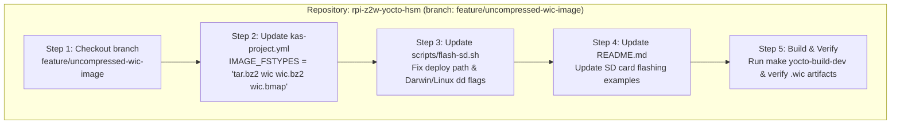

# Implementation Plan: Uncompressed WIC Image Generation & SD Flash Tooling Alignment

> [!IMPORTANT]
> **Source Specification**: [[Specification/Uncompressed WIC Image Generation and SD Flash Tooling Alignment|Uncompressed WIC Image Generation & SD Flash Tooling Alignment Specification]]  
> **Feature Note**: [[features/uncompressed-wic-image-and-sd-flash-tooling|Uncompressed WIC Image Generation & SD Flash Tooling Alignment Feature]]  
> **Operational Guide**: [[Development/Yocto Build and RAUC Update Guide|Yocto Build and RAUC Update Guide]]  
> **Status**: Merged to `main` (Phase 6 Post-Merge Complete — Fast-forward commit `b99899f`, branch `feature/uncompressed-wic-image` pruned).

---

## 1. Architecture & Execution Flow



---

## 2. Repository Work Breakdown

### Repository: `rpi-z2w-yocto-hsm`
- **Repository Path**: [`/Users/gpfister/Development/Projects/gpfister/nrf52840-hsm/rpi-z2w-yocto-hsm`](file:///Users/gpfister/Development/Projects/gpfister/nrf52840-hsm/rpi-z2w-yocto-hsm)
- **Base Branch**: `main`
- **Target Feature Branch**: `feature/uncompressed-wic-image`
- **Local Deployment**: `Not Required` (Target is an air-gapped Raspberry Pi OS image built via containerized Kas/BitBake; artifact generation in `build/deploy/images/raspberrypi0-2w-64/` is verified directly during the build verification step via `make yocto-build-dev`).

---

### Step 1: Create Isolated Feature Branch
Create and switch to `feature/uncompressed-wic-image` from a clean `main` branch in `rpi-z2w-yocto-hsm`.

```bash
git -C /Users/gpfister/Development/Projects/gpfister/nrf52840-hsm/rpi-z2w-yocto-hsm checkout -b feature/uncompressed-wic-image
```

---

### Step 2: Add Uncompressed `wic` to `IMAGE_FSTYPES` in `kas-project.yml`
- **File to Modify**: [kas-project.yml](file:///Users/gpfister/Development/Projects/gpfister/nrf52840-hsm/rpi-z2w-yocto-hsm/kas-project.yml#L56-L59)
- **Changes**:
  Update `IMAGE_FSTYPES` under `local_conf_header.base_settings` on line 57 so OpenEmbedded/BitBake retains the uncompressed `.wic` disk image alongside `.wic.bz2`, `.wic.bmap`, and `.tar.bz2`:
  ```yaml
      # Image Packaging and Bootloader
      IMAGE_FSTYPES = "tar.bz2 wic wic.bz2 wic.bmap"
      WKS_FILE = "sdimage-dual-raspberrypi.wks.in"
      DEPLOY_DIR = "${TOPDIR}/deploy"
  ```

---

### Step 3: Update `scripts/flash-sd.sh` for Deploy Path & macOS/Linux `dd` Compatibility
- **File to Modify**: [scripts/flash-sd.sh](file:///Users/gpfister/Development/Projects/gpfister/nrf52840-hsm/rpi-z2w-yocto-hsm/scripts/flash-sd.sh#L7-L52)
- **Changes**:
  1. Update usage output (lines 7–11) to show the accurate `build/deploy/images/raspberrypi0-2w-64/` path for both `.wic` and `.wic.bz2` images:
     ```bash
     if [[ $# -lt 2 ]]; then
         echo "Usage: $0 <image.wic | image.wic.bz2> <target_block_device>"
         echo "Example (raw .wic):       $0 build/deploy/images/raspberrypi0-2w-64/hsm-image-prod-raspberrypi0-2w-64.rootfs.wic /dev/rdisk4"
         echo "Example (compressed):     $0 build/deploy/images/raspberrypi0-2w-64/hsm-image-prod-raspberrypi0-2w-64.rootfs.wic.bz2 /dev/rdisk4"
         exit 1
     fi
     ```
  2. Add host OS detection (`uname -s`) before the `dd` invocation (lines 37–52) so macOS (`Darwin`) uses `bs=4m status=progress` while Linux uses `bs=4M status=progress conv=fsync`:
     ```bash
     # Configure platform-specific dd flags (macOS BSD dd vs Linux GNU dd)
     HOST_OS="$(uname -s)"
     if [[ "${HOST_OS}" == "Darwin" ]]; then
         DD_FLAGS=(bs=4m status=progress)
     else
         DD_FLAGS=(bs=4M status=progress conv=fsync)
     fi

     # Detect bzip2 compressed WIC
     if [[ "${IMAGE_PATH}" == *.bz2 ]]; then
         echo "==> Decompressing and streaming to ${TARGET_DEV}..."
         if command -v bzip2 >/dev/null 2>&1; then
             bzip2 -dc "${IMAGE_PATH}" | sudo dd of="${TARGET_DEV}" "${DD_FLAGS[@]}"
         elif command -v pbzip2 >/dev/null 2>&1; then
             pbzip2 -dc "${IMAGE_PATH}" | sudo dd of="${TARGET_DEV}" "${DD_FLAGS[@]}"
         else
             echo "Error: bzip2 or pbzip2 required." >&2
             exit 1
         fi
     else
         echo "==> Writing raw image to ${TARGET_DEV}..."
         sudo dd if="${IMAGE_PATH}" of="${TARGET_DEV}" "${DD_FLAGS[@]}"
     fi
     ```

---

### Step 4: Align SD Flashing Instructions in `README.md`
- **File to Modify**: [README.md](file:///Users/gpfister/Development/Projects/gpfister/nrf52840-hsm/rpi-z2w-yocto-hsm/README.md#L134-L142)
- **Changes**:
  Update Section 5 (`## 5. Flashing to SD Card`) to reference `build/deploy/images/raspberrypi0-2w-64/` and show both uncompressed `.wic` and compressed `.wic.bz2` examples:
  ```markdown
  ## 5. Flashing to SD Card

  Use the provided flashing script to flash the generated `.wic` or `.wic.bz2` image:

  ```bash
  # Warning: Destructive operation! Verify block device carefully.
  # Flash uncompressed .wic image directly:
  ./scripts/flash-sd.sh build/deploy/images/raspberrypi0-2w-64/hsm-image-prod-raspberrypi0-2w-64.rootfs.wic /dev/rdisk4

  # Or stream compressed .wic.bz2 image on the fly:
  ./scripts/flash-sd.sh build/deploy/images/raspberrypi0-2w-64/hsm-image-prod-raspberrypi0-2w-64.rootfs.wic.bz2 /dev/rdisk4
  ```
  ```

---

### Step 5: Build & Verification Commands
1. **Validate `flash-sd.sh` syntax and usage output**:
   ```bash
   bash -n /Users/gpfister/Development/Projects/gpfister/nrf52840-hsm/rpi-z2w-yocto-hsm/scripts/flash-sd.sh
   /Users/gpfister/Development/Projects/gpfister/nrf52840-hsm/rpi-z2w-yocto-hsm/scripts/flash-sd.sh || true
   ```
2. **Remove any manually extracted non-symlink `.wic` file and execute `make yocto-build-dev`**:
   ```bash
   rm -f /Users/gpfister/Development/Projects/gpfister/nrf52840-hsm/rpi-z2w-yocto-hsm/build/deploy/images/raspberrypi0-2w-64/hsm-image-dev-raspberrypi0-2w-64.rootfs.wic
   make -C /Users/gpfister/Development/Projects/gpfister/nrf52840-hsm yocto-build-dev
   ```
3. **Verify all generated image artifacts in `build/deploy/images/raspberrypi0-2w-64/`**:
   ```bash
   ls -lh /Users/gpfister/Development/Projects/gpfister/nrf52840-hsm/rpi-z2w-yocto-hsm/build/deploy/images/raspberrypi0-2w-64/hsm-image-dev-raspberrypi0-2w-64.rootfs*
   test -L /Users/gpfister/Development/Projects/gpfister/nrf52840-hsm/rpi-z2w-yocto-hsm/build/deploy/images/raspberrypi0-2w-64/hsm-image-dev-raspberrypi0-2w-64.rootfs.wic
   test -f /Users/gpfister/Development/Projects/gpfister/nrf52840-hsm/rpi-z2w-yocto-hsm/build/deploy/images/raspberrypi0-2w-64/hsm-image-dev-raspberrypi0-2w-64.rootfs.wic
   test -f /Users/gpfister/Development/Projects/gpfister/nrf52840-hsm/rpi-z2w-yocto-hsm/build/deploy/images/raspberrypi0-2w-64/hsm-image-dev-raspberrypi0-2w-64.rootfs.wic.bz2
   test -f /Users/gpfister/Development/Projects/gpfister/nrf52840-hsm/rpi-z2w-yocto-hsm/build/deploy/images/raspberrypi0-2w-64/hsm-image-dev-raspberrypi0-2w-64.rootfs.wic.bmap
   test -f /Users/gpfister/Development/Projects/gpfister/nrf52840-hsm/rpi-z2w-yocto-hsm/build/deploy/images/raspberrypi0-2w-64/hsm-image-dev-raspberrypi0-2w-64.rootfs.tar.bz2
   ```

---

## 3. Summary Checklist & Verification Report

| # | Repository | File | Action | Verification | Status |
| :--- | :--- | :--- | :--- | :--- | :--- |
| 1 | `rpi-z2w-yocto-hsm` | [kas-project.yml](file:///Users/gpfister/Development/Projects/gpfister/nrf52840-hsm/rpi-z2w-yocto-hsm/kas-project.yml#L57) | Modify `IMAGE_FSTYPES` to include `wic` | `make yocto-build-dev` emits `.rootfs.wic` symlink & image (`1.6G`) | ✅ Verified (`b99899f`) |
| 2 | `rpi-z2w-yocto-hsm` | [scripts/flash-sd.sh](file:///Users/gpfister/Development/Projects/gpfister/nrf52840-hsm/rpi-z2w-yocto-hsm/scripts/flash-sd.sh) | Fix deploy path example & add Darwin/Linux `dd` flags | `bash -n scripts/flash-sd.sh` & usage test | ✅ Verified (`b99899f`) |
| 3 | `rpi-z2w-yocto-hsm` | [README.md](file:///Users/gpfister/Development/Projects/gpfister/nrf52840-hsm/rpi-z2w-yocto-hsm/README.md#L134-L142) | Update SD card flashing paths & add `.wic` command | Visual & markdown link inspection | ✅ Verified (`b99899f`) |

### Verified Build Artifacts (`rpi-z2w-yocto-hsm/build/deploy/images/raspberrypi0-2w-64/`)
- `hsm-image-dev-raspberrypi0-2w-64.rootfs.wic` $\rightarrow$ `hsm-image-dev-raspberrypi0-2w-64.rootfs-20261105101217.wic` (**1.6 GB**)
- `hsm-image-dev-raspberrypi0-2w-64.rootfs.wic.bz2` $\rightarrow$ `hsm-image-dev-raspberrypi0-2w-64.rootfs-20261105101217.wic.bz2` (**168 MB**)
- `hsm-image-dev-raspberrypi0-2w-64.rootfs.wic.bmap` $\rightarrow$ `hsm-image-dev-raspberrypi0-2w-64.rootfs-20261105101217.wic.bmap` (**8.0 KB**)
- `hsm-image-dev-raspberrypi0-2w-64.rootfs.tar.bz2` $\rightarrow$ `hsm-image-dev-raspberrypi0-2w-64.rootfs-20261105101217.tar.bz2` (**73 MB**)
